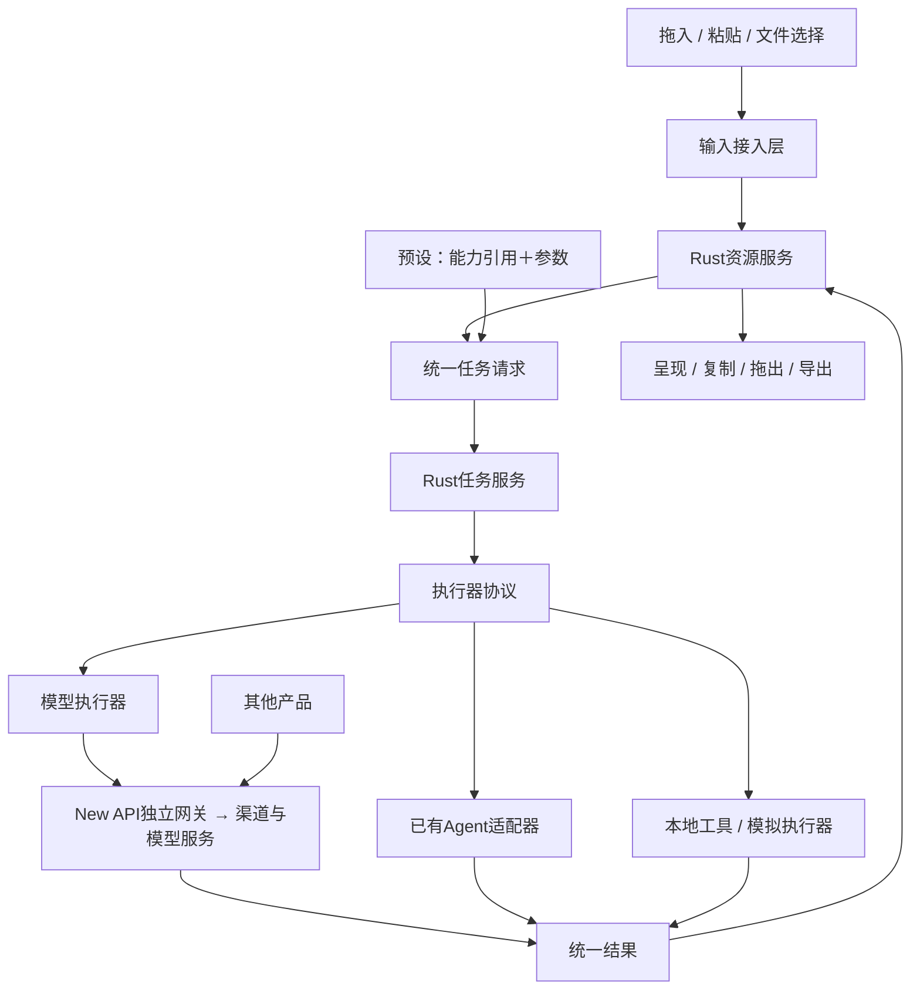

# QuickGen 架构与统一契约

更新：2026-11-14。当前两项交付审查返修及验收已完成，最新状态见资源与任务计划；原收口历史保留。本文是当前架构口径。已实现状态以[桌面基线](desktop-baseline.md)为准；可靠底座验收以[资源与任务计划](resource-task-plan.md)为准。R0类型与纯校验已实现，见[契约v1](contracts/README.md)；运行时资源/模拟任务服务已验证并接管生产画板；外部能力API未接入。

## 产品定位

QuickGen是桌面上的临时收纳盒，服务高频、临时、快速取得结果的操作。放入、处理、取出应直接；画板只是把内容摊开查看。无需先命名、分类、建项目或手动保存中间文件。“临时使用”不等于关闭即删除，也不等于可以丢失正在执行的任务。

放入盒子仅收纳；有意拖到能力才执行。意图与授权已明确时不重复确认；涉及发消息、覆盖文件或发布等外部副作用的能力，必须声明权限和必要确认节点。当前尚未接入这类Agent能力。

## 当前已实现

- 唯一产品入口main.rs → board.rs → board.html/board.js；Tauri/Rust宿主提供窗口、托盘、拖放、全局快捷键、穿透和原生命中。画板/能力面板共用WebView，添加/预设为附属窗口。
- 前端负责图片画板、选择与结果呈现；Rust资源库与串行任务服务持久化图片、场景、attempt和结果。旧IndexedDB只读留存；storage.rs继续保存布局、能力、主题和封面副本。
- 单屏交互已收口。桌面延迟通过原生侧计算悬浮命中集合、仅变化通知修复，用户确认流畅且变淡正常。
- R0—R4可靠底座已完成：Rust资源库、模拟任务、恢复与场景一致性、实际画板接入及真实生产迁移均已验证。原生四组交互经用户确认通过；最终冻结源码对应默认交付与诊断容量候选，身份分别记录。100张512×512图片、50任务、30分钟及20次开关通过；内存峰值及样本边界见执行计划。AI Gateway、真实模型/Agent接入未实现，多屏仍后置。

## 目标结构

QuickGen资源、场景和任务模块继续位于现有Rust宿主；AI Gateway采用用户已部署的New API，供多个产品使用；不因此拆分现有窗口或替换桌面框架。

## 核心对象与职责

| 对象 | 定义及归属 |
| --- | --- |
| Resource | 输入、输出和中间内容的稳定ID、类型、内容引用、元信息和来源关系；资源服务拥有文件生命周期 |
| Capability | 接受什么输入、输出什么、参数约束、执行器引用、权限与执行特性；不能只定义为图片提示词 |
| Preset | 某个能力及一组预配置参数、名称和封面；用户卡片是预设实例，不持有密钥或厂商协议 |
| Task | 一次执行的输入、能力/参数快照、状态、尝试记录和输出集合；任务服务拥有生命周期 |
| BoardScene | 资源的摆放、相机和选择；引用资源ID，不持有文件正文或权威任务状态 |

## 统一输入与输出

统一结构，保留明确类型；不把一切强转字符串，也不把任意JSON当作无约束协议。第一版采用版本化、可校验的类型定义；v1字段与校验见[契约说明](contracts/README.md)。

- 资源种类以可扩展的类型区分：image、text、file、link等是候选类型。第一片落地image；声明种类不代表已支持该种类的导入、预览或执行。
- 输入使用资源引用列表，每项标注role/用途；例如source与reference不能仅由数组顺序暗示。
- 任务请求含schemaVersion、客户端提交ID、能力/预设引用、带用途输入、经校验参数。受理时冻结能力/参数版本与输入快照。
- 结果含带用途的输出资源列表、摘要及标准化错误。一个任务允许多个输出；图片附尺寸/格式，其他类型保留自己的元信息。
- 执行器返回待归档的输出描述，资源服务导入并校验后才成为稳定资源；临时URL不能冒充持久结果。
- 状态事件携带taskId和单调版本。任务状态与输出协议分开；没有真实进度不编造百分比。
- 未知协议版本/不支持类型/缺失角色在执行前拒绝，不能悄悄转换或丢失字段。

## 任务与执行器

任务服务负责提交去重、排队、并发、状态、重试、中断恢复与用户确认；执行器负责具体处理协议，不另建产品级队列。

首期并发1，支持已有多图逐张任务：图片预设按each模式展开为每图一个任务，共享批次ID；未来需要多输入协作的能力明确声明together，不能把选中多图一律解释成多任务或一条Agent请求。首期不承诺实现together。

建议状态：queued、running、waiting_user、finalizing、succeeded、failed、interrupted、cancelled。仅输出归档成功进入完成。waiting_user为需确认能力预留，不表示已有完整审批UI。

- 重试是一条可追踪的新尝试，不能重复已成功项。生成重试与结果保存重试分开，保存失败不能再次付费生成。
- 重启后未知远端受理状态标记中断/待核对，不自动重发。是否查询、取消、恢复、幂等、提供进度，由执行器声明；不支持时不能伪装成功。
- 收起面板、重建WebView不影响宿主任务。迟到事件不能覆盖较新状态。
- 资源移除不直接删除仍被任务或场景引用的文件；删除与保留策略已在R0确定，实际回收尚未实现，不能把临时收纳等同于自动清空。

## New API网关与QuickGen适配边界（2026-11-14）

用户已选择开源New API作为独立统一网关，并报告已在本机Docker部署。此为用户提供的部署事实；本轮未检查容器、版本、地址、令牌、渠道或模型连通性。QuickGen尚未接入真实模型。本决策替代“自行开发独立Gateway”的旧方案，保留多产品共用网关的目标。

主链路：QuickGen预设→Rust任务服务→模型执行适配→New API→模型服务商→输出接收→Rust资源归档→画板。未来其他产品直接接网关，不依赖QuickGen数据库或资源ID。

| 层级 | 职责 |
| --- | --- |
| QuickGen | 收纳、画板、用户预设、业务队列、输入快照、重试记录、资源与结果持久化 |
| QuickGen模型适配 | 将资源引用解析成实际图片与指令，调用选定协议，转换状态/错误/结果并关联本地任务 |
| New API | 复用其已有渠道与模型接入能力；实际可用接口、认证、路由、重试及日志行为按部署版本和配置核对 |
| 模型服务商 | 实际生成或处理内容；功能、限制和执行方式以所选模型为准 |

### 按协议适配，按模型配置

不为每个模型复制一套执行器。同一图片编辑协议共用请求/响应适配；模型名称、输入数量、尺寸、格式及可用参数作为能力配置。多个预设可以使用同一个模型，仅指令和默认参数不同。模型列表可见不等于支持图生图，必须核对实际能力。

若出现不同协议（例如直接返回图片与提交后查询任务），先核对New API是否已统一；确实不能统一时补可复用的协议适配，避免将厂商差异散布在画板/队列中。新增兼容模型的目标是只改配置，不承诺任意模型零代码支持。首期接一个明确的图片编辑协议和模型；兼容性可用假服务验证，不为演示扩展性默认付费调用第二个模型。

QuickGen本地资源ID不能直接供网关读取；适配器按实际接口传输图片内容。返回URL或base64等形式统一转换为受校验资源；网关响应成功不等于本地已保存。具体路径和请求格式在G0核对，不将R0内部契约当成New API原生接口。

### 凭据、状态与恢复

QuickGen仅管理New API访问地址、访问令牌及模型配置；上游密钥留在网关配置。令牌不进入预设、日志或文档。对本机实例也保留访问控制，核对产品令牌权限，不假设所有接口具有相同隔离行为。

保留本地task/attempt与可取得的网关请求ID、服务商任务ID关联。QuickGen本地提交去重不能保证远端恰好一次；只有实际接口支持才使用远端幂等、查询或取消能力。不臆造通用图片查询接口，也不把网关日志查询当作已支持的产品恢复API。

明确QuickGen与New API各自重试设置，防止叠加重试或自动换渠道导致重复执行。超时/断线且受理结果未知时不自动重新生成：可查询则查询原任务，否则标记中断/待核对。不支持取消时不得显示已取消远端执行。

收到输出后尽快持久化可恢复内容，归档失败仅重试保存；可重复下载与保留期以真实接口为准。URL过期或响应丢失且无法查询时，明确无法恢复，不偷偷重新生成。未知进度、用量和费用不编造。

### 当前范围

不自建网关服务、管理后台或服务商适配平台，不在本轮修改New API源码或Docker配置。Harness、本地小工具、网页解析继续后置；本地收纳查看不需要网关在线。下一阶段按[真实能力计划](generation-plan.md)实施QuickGen接入。

## Harness添加预设与再次执行（已确认方向，尚未实现）

用户在自己的Harness中跑通流程，说“添加到QuickGen”，Harness通过注册入口提交能力描述和预设。第一阶段采用引用原Harness执行的方式；不导出通用可执行能力包，不在QuickGen重建Agent运行时。

注册与执行是两条路径：注册只创建能力记录和预设，不启动处理；用户有意投放后，Rust任务服务通过执行器调用原Harness，归档统一结果。自定义添加、预设库和Harness导入最终使用同一能力目录与预设存储。

### 如何找到原Harness

- Connection独立管理连接ID、适配器类型、地址或受支持的启动配置、凭据引用和连接状态。配置由宿主管理；预设不复制地址和密钥。
- 可调用能力由连接ID、能力ID与能力版本共同定位，避免不同Harness的同名能力冲突。预设引用该能力并保存默认参数、名称和封面。
- 执行时按连接ID解析适配器，提交能力版本、输入资源与参数，关联本地任务ID和外部运行ID，再接收状态与输出。具体字段、资源传输边界和事件机制见R0契约；不是已可调用的API。
- API/后台服务、CLI或插件桥接是候选接入方式，取决于实际Harness支持。仅有聊天窗口不代表可外部调用；不依赖模拟点击寻找旧会话。
- 流程须保存必要指令、工具依赖、工作环境与上下文引用，能够再次调用；聊天编号本身不能代替能力定义。不能脱离会话运行的依赖必须声明，不默认为可复现。

### 添加、更新与不可用状态

名称、输入输出、默认参数等尽量由Harness提供，避免要求用户手填接口配置。首次连接完成身份校验与必要授权；已建立信任且权限未变化的重复添加不反复确认。导入描述不直接执行任意脚本，凭据不放入预设或日志。

按连接与能力身份识别重复注册；相同版本幂等，版本内容冲突须拒绝。新版本不静默改变现有预设，默认固定原版本，由用户明确更新；新注册不得覆盖用户自定义参数。R0已记录幂等注册与显式更新策略，目录写入待实现。

添加时检查连接与目标能力可调用性；无法验证的条目不能标为可用。运行前再次检查：离线显示不可用及重连入口，不能假装运行。仅对已授权且适配器支持的本机启动方式按需启动。原版本不存在时明确反馈，不自动替换版本。

执行途中断开与提交前离线区分：已可能受理的请求保留外部运行关联，按实际查询能力核对；未知状态进入中断，不自动重复执行。取消、进度和恢复能力由适配器如实声明。

具体Harness、传输方式、发现/配对方式和接口尚未选定。R0已用注册→再次执行的内存案例验证协议；真实连接、导入入口和端到端验收放在后续真实能力阶段，不因文档确认视为实现。

## 开发顺序与非目标

R0—R4可靠底座及RV1—RV3返修已完成。下一阶段按[真实能力与收纳闭环计划](generation-plan.md)：G0核对New API实例与首个模型→G1 QuickGen连接和协议适配→G2接真实任务→G3便捷输入输出→G4完整验收。

不先建设插件市场、通用DAG、账号云同步、商业计费后台或高可用集群；独立Gateway不等于先建大型云平台。网页图片解析、小工具和真实Harness后置，不把旧单图暂存点击或主面板结果页重新带回产品。
