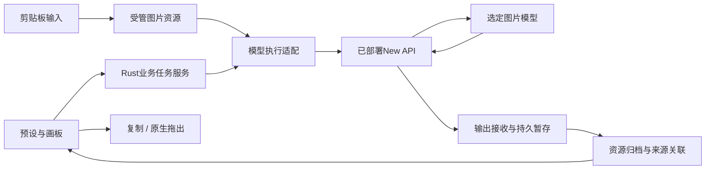

# QuickGen × New API：真实能力与便捷输入输出开发执行计划

更新：2026-11-15。本文为G阶段唯一执行计划、状态台账与接续入口。**G0–G4按已接受的限制完成交付，G4.2最终包身份审计通过；普通候选0787，schema14。用户确认最后3次真实流程、便签输入、桌面实时刷新及Ctrl拖出“都通过了”；只读审计验证3次执行、2原图完整、3结果唯一放置与来源链。累计7次/0.099064 PTC，累计授权上限¥3.50，人民币实付未核实。原始性能基线缺失以用户同意的补做对照处理；大图约298ms查询等待按用户明确接受的限制交付，原严格性能失败不改写。生产未迁移，旧包保留。最终包为desktop/dist/QuickGen-Windows-candidate-0787a26e5311.zip；当前无剩余本阶段工作，无新增模型调用。** 历史记录保留于文末。

## 1. 完整目标与当前位置

路线：单屏交互基础（完成）→ Rust可靠底座及返修（完成）→ 便签集成（隔离候选已交付）→ **New API真实执行＋便捷输入输出（本阶段）** → 后续Harness、网页输入和其他小工具。

交付体验：从选定工作软件放入图片→拖给已配置预设→New API调用真实图片模型→结果可靠归档并出现在原图旁→可继续处理→复制或拖回工作软件。多图仍逐张执行，首期业务并发1。

网关使用用户报告已在本机Docker部署的New API，不自建Gateway，不将其渠道管理后台复制到QuickGen。QuickGen新增的是连接配置、预设模型绑定、按协议复用的执行适配、真实结果接收和原生输入输出。

依据：[整体架构](architecture.md)、[统一契约](contracts/README.md)、[可靠底座台账](resource-task-plan.md)、[交互规格](interaction-spec.md)。不重新开启R阶段或倒改历史验收。

## 2. 启动时事实与待核实项（历史基线，最终状态见文末）

- 已验收底座返修包：`desktop/dist/QuickGen-Windows-candidate-9b2a33b08a6a.zip`。对应源码身份和验收证据位于`desktop/evidence/reliable-base/review/`，执行前重新核对当前现场，不假定之后无改动。
- 更新的便签集成候选为`desktop/dist/QuickGen-Windows-candidate-50989457bdb2.zip`，见[便签交付检查点](notes-integration-plan.md)。当前源码包含便签和schema7，日常9B2A程序及生产数据尚未切换。G阶段从核对后的最新源码继续，不能用旧R候选源码覆盖便签；分别记录当前源码、隔离候选与日常运行版本。
- Rust已有资源、任务、attempt、事件、归档恢复及场景服务；生产画板已切换到Rust。当前执行仍是mock，不代表真实网络请求已经可靠。
- 核心入口：`desktop/src-tauri/src/tasks.rs`、`resources.rs`、`resource_commands.rs`、`scenes.rs`、`storage.rs`、`contracts.rs`；前端`desktop/ui/board.js`、`durable-client.js`。
- 当前依赖包含SQLite和图片解码；尚未据此确定HTTP、凭据或原生剪贴板/拖出实现。选库时核对实际版本和平台支持，不先杜撰接口。
- New API实例已只读确认在 http://127.0.0.1:3000，实际版本及容器镜像v1.0.0-rc.51；同版本官方源码已核对。目标模型准确ID、渠道能力、认证及重试/计价仍未实测。
- 用户期望“gpt的image2.5生图模型”，准确ID与编辑场景仍须核对；拖回目标为桌面文件夹；总费用2元，次数不限。用户已提供访问凭据，本文及日志不记录内容；凭据安全接入尚未闭环。

## 3. 范围与保持条件

本阶段只落地一种经过确认的图片编辑协议与一个真实模型。新增兼容模型尽量只改配置；不同调用协议需要独立可复用适配，不为每个模型复制执行代码。预设是指令/参数配置，不等同于模型，多个预设可用同一模型。

保持现有刘海、画板、主题、图标、常驻、托盘、穿透及拖放防误触规则，以及已集成的便签编辑、保存、总览、焦点组和统一提示区。拖入仅收纳，主动投到能力才提交；点击卡片不消费图片。保留本地任务去重、失败提示、重试保存、宿主驱动结果恢复和删除后不复活。

不包含：Harness、网页拖图/浏览器解析、便签新增功能/清理工具、视频产品化、多屏扩展、云同步、自动跨模型回退、新网关服务或New API源码改造。不要为模型配置重做现有产品UI。缺少真实连接条件时可推进模拟协议、结果处理和输入输出测试，但不能标记真实闭环完成。

## 4. 架构与责任



| 模块 | 本阶段职责 | 不承担 |
| --- | --- | --- |
| 连接配置 | New API地址、凭据引用、连接检测、模型能力配置 | 保存上游密钥、管理New API所有渠道 |
| 协议适配（建议新增Rust模块） | 资源转请求、HTTP交互、响应与错误转换、支持时查询/取消 | 另建业务队列、直接修改画板 |
| 任务服务 | 固定预设/模型/参数快照、调用阶段、重试决策、事件 | 在数据库事务中等待网络 |
| 输出接收/资源服务 | 有界下载/解码、持久暂存、归档及重复保存 | 因保存失败重新生成 |
| 桌面桥接与UI | 配置入口、真实状态、粘贴/复制/拖出 | 向前端暴露密钥、绕过宿主直接调模型 |

实现位置可按实际代码调整，以上不是冻结白名单。特别注意现有资源worker串行执行：不得把长时间网络等待直接塞进该线程，阻塞图片读取、便签保存、场景保存、退出刷新和任务查询。采用有界执行工作与短事务，结果回到宿主权威服务提交状态。

## 5. G0：接入调查与决定

优先只读核对本机部署事实，仅输出脱敏版本、端口、渠道/模型能力；避免打印容器完整环境变量、认证配置或含令牌的命令。模型列表可见不等于支持图片编辑。

形成一份脱敏接入记录，至少包含：

- 地址、New API版本/镜像身份、目标模型标识、选定场景和目标软件。
- 实际图片编辑端点、输入传输、参数、支持图片数量、尺寸/大小及输出格式。
- 同步返回还是异步任务；能否查询、取消、幂等、重复获取输出，实际接口和权限是什么。
- 超时、网关重试/渠道回退、输出保留时间及费用边界；缺失能力明确标“不支持/未核验”。
- 需要用户决定的项目集中询问。费用上限与调用次数未确认前不发付费请求；用户授权后只在约定范围内调用，不逐次重复确认。

按部署版本对应官方资料及实际响应确定协议，不按网上最新文档假定本机支持。基础网络/认证检查不自动触发图片生成；不得以探索为名调用所有模型。Docker升级、改渠道或重启不在只读调查范围，确有必要时单独明确。

## 6. 唯一开发台账

状态使用not_started/doing/verifying/done/blocked。只有此表记录切片状态，证据追加到文末。父阶段是否完成由各项及整阶段验收共同决定。

| ID | 可交付行为 | 依赖 | 入口 | 验收 | 状态 |
| --- | --- | --- | --- | --- | --- |
| G0.1 | 核对最新源码/schema/候选，确认实例与目标场景，形成实际协议/能力/费用记录 | R及N交付现场 | 接入记录 | 当前源码与日常程序分清；关键未知明确，不泄密，不把部署当调用通过 | done |
| G1.1 | 配置连接与令牌引用，按既有契约建立模型能力及预设绑定 | G0.1 | storage/配置UI | 错误连接可反馈；旧预设不丢；连接与能力版本固定；凭据不在普通配置或前端事件 | done |
| G1.2 | 实现选定协议适配与可控假服务 | G0.1、G1.1 | 新协议模块/测试 | 请求字段/图片正确，参数拒绝，成功与错误响应规范化 | done |
| G2.1 | 真实执行接入任务服务，提交/查询/中断状态持久化 | G1.2 | tasks/commands | 网络等待不阻塞资源服务及便签保存；未知受理不重发；旧attempt回调隔离；重启状态真实 | done |
| G2.2 | 真实输出有界接收、持久暂存与资源归档 | G2.1 | resources/输出接收 | URL或内容正确保存；损坏拒绝；保存重试不增加执行次数；容量与清理不损坏可恢复输出 | done |
| G2.3 | 在授权额度内完成一次真实模型到画板验证 | G2.2、有效连接与费用授权 | 实际New API/桌面 | 输入与结果可追溯、原图保留、结果可再处理；记录真实证据 | done |
| G3.1 | 剪贴板图片直接收纳 | R底座可复用，可与网络工作独立 | 原生桥接/board | 实际工作软件复制后可粘贴；不截获表单文本粘贴 | done |
| G3.2 | 先验证目标软件原生拖出技术与手势，再完成结果复制和拖出 | 资源读取可用、目标软件已选定 | 原生桥接/board | 透明画板不挡外部目标；目标软件实际接收内容，内外拖放不冲突，文件生命周期可靠 | done |
| G3.3 | 真实任务状态与配置UI整体校验 | G2.3、G3.1、G3.2 | board/配置界面 | 主题/图标一致；错误、取消能力和保存恢复可理解可操作 | done |
| G4.1 | 完整工作流程、故障恢复与相关性能回归 | G3.3 | 隔离候选/目标软件 | 下方验收矩阵通过，真实服务与假服务证据分开 | done |
| G4.2 | 构建、打包、接入/恢复说明和最终审计 | G4.1 | 构建脚本/文档 | 源码、默认exe、包身份一致，无密钥/用户素材，未测限制清楚 | done |

G3输入输出可在等待真实服务条件时推进；未确认协议前仅做不依赖它的工作，不猜测端点。表中状态依据最终证据更新；早期检查点中的状态保留为当时历史。

G0选定目标软件后，优先推进G3.2中的最小原生拖出验证，不等真实调用全部完成才发现平台限制：确认外部软件能成为实际drop target，确定内外拖动手势及全屏透明窗口的命中策略；验证成功落下、Esc取消后，内部移动、拖到预设及穿透均可恢复，再完成其余复制/拖出实现。

## 7. 连接、配置和兼容性

地址和模型配置可持久化，令牌使用系统安全存储或经评估的宿主安全机制；普通配置仅存引用。前端仅能设置/清除凭据与查看连接状态，不读取明文。日志、异常、证据和打包文件须脱敏。

兼容旧卡片与历史mock任务：缺少真实模型绑定的卡片不得悄悄选择默认模型收费；明确未配置状态并引导配置。老任务固定旧执行器，mock完成结果仍标模拟。真实任务冻结模型标识、协议版本、有效参数与配置revision，不因后续修改卡片而改变。

映射既有统一契约：网关连接使用Connection及其宿主profile；模型能力使用Capability；预设绑定不可变CapabilityRef；任务沿用TaskRequest及现有资源引用。能力参数或执行特性变化创建新revision，不静默升级旧卡片和已入队任务，也不另造平行的模型任务契约。G1.1明确字段映射及兼容迁移，宿主负责有效参数校验；无需为此实现Harness注册服务。

任务同时固定非敏感连接身份及可解析的profile版本/原目标地址。地址变更创建新版本；旧任务提交和恢复查询不得改投新地址或账号。凭据仅存引用，不写明文快照；同连接同账号的令牌轮换需显式关联，不能把换账号视为普通轮换。连接撤销/删除、凭据缺失或身份无法确认时停止新的认证操作并报告，保留历史关联；恢复后仍使用原任务身份。已发出的调用按真实远端状态处理，不因本地删除连接宣称取消成功。

配置UI需紧凑，沿用主题、圆角和统一图标；必要字段说明及错误保留，不增加无关常驻提示。模型能力限制依据G0记录，不仅凭名称猜测；不支持参数必须拒绝或让用户明确更改，不静默删除。

本机回环HTTP按实际部署允许；未来非本机连接应明确TLS要求。网关访问令牌仅发送到配置的网关，不随结果下载或跨域重定向转发。

## 8. 真实调用与恢复约定

本地task/attempt、客户端提交ID、可取得的网关/服务商ID分别关联。业务并发1，排队与资源引用沿用底座。幂等只在服务端实际支持并验证时使用，本地去重不等于服务端恰好一次。

至少区分：尚未提交、提交可能已发生、等待结果、结果接收、归档、完成/失败/中断。可以映射到现有状态并增补持久字段，不要求推翻全部R0类型。发出请求前记录意图；远端已受理而本地未记下ID的崩溃窗口必须测试，不能假设不存在。

异步执行、查询、下载及归档回调必须携带task_id、attempt和本次执行标识，由宿主在短事务中校验仍属于预期执行及合法状态，再原子提交状态与事件。不能只按task_id读取当前attempt后保存旧结果。旧attempt的迟到响应不得覆盖新attempt、造成重复放置或清除新错误；其暂存按已记录的隔离/清理策略处理，不静默挂到新任务。明确退出时停止接单、有限等待和持久化边界；不为等待远端结果无限阻塞退出，也不因重启重发未知请求。

- 确认尚未发送的失败可按规则重试。
- 可能已受理的超时/断线：支持查询则查询原任务；否则中断/待核对，不能自动生成第二次。
- 用户明确重新生成是新attempt，并说明可能重复执行的含义；不伪装为无成本恢复。
- 排队任务可以取消；远端运行任务仅在实际取消被确认后显示取消成功。停止本地等待不等于远端停止或停止计费。
- 归档失败继续复用RV1的错误事件和重试保存。不得只有后端错误而UI一直显示处理中。
- 真实任务事件和结果恢复继续以宿主为准；隐藏任务不取消执行，删除结果不被重放复活。

检查New API实际重试与路由设置，定义产品侧策略，避免两侧同时自动重试。没有查询/取消/费用数据时如实展示，不造进度或成本。服务不支持可靠找回的结果要明确限制，不声称全部网络故障可无损恢复。

## 9. 输出接收与安全归档

按所选协议接收URL、base64或其他已验证形式。每项输出归档前校验实际格式、压缩大小、解码像素/内存预算；不能绕过现有隔离解码保护。模型超出资源服务当前上限时应提前限制参数或明确拒绝，不静默改变资源保护。

流式/有界读取，设连接和读取超时、总字节及重定向次数上限。结果URL仅按已确认来源策略获取，拒绝file等非预期scheme及意外本地/内网访问；确需本机网关代理地址时只允许配置中明确的目标。不把网关令牌发送给任意图片域名。

结果到达后尽快写受管暂存并登记调用关联，资源归档成功再标完成。崩溃在响应收到但未持久化之间时，按实际服务查询/重新下载能力恢复；不存在该能力就记录不可恢复，不能自动重新生成。输出URL过期与本地写盘失败应区分。

G2.2须明确持久暂存使用数据库还是受管文件、总容量预算、剩余空间不足行为及回收规则，不仅限制单张大小。持久关联前后的崩溃残留通过恢复扫描识别；归档成功后才清理相应暂存，待下载恢复/待重试保存的有效输出不得被当孤儿删除。预算不足要可见且不反复生成；清理与在途下载、归档、原生拖出读取互斥或具备引用保护。测试磁盘满、重复恢复和批量任务后的空间回收。

一个任务支持协议返回的多个输出，数量按能力约束。审查现有场景放置ID是否假设单输出；若接口允许多输出，补独立输出身份及去重测试，或首版明确限制每次一张并在请求前校验，不默默丢掉额外结果。

## 10. 便捷输入输出

粘贴：QuickGen获得适当焦点时接收剪贴板图片，经资源服务校验收纳，不自动执行。表单输入框保留普通文本粘贴；空剪贴板、不支持内容、超限、读取失败给出简短反馈。优先支持实际目标软件的图片格式，不宣称所有剪贴板类型已支持。

适当焦点具体限定为图片画板的可接收状态；便签编辑窗口、便签总览和连接配置等模式不得被全局图片粘贴监听抢走操作。便签正文及中文输入法保持原行为。真实任务与连接反馈复用现有统一提示控制器，保留便签保存错误优先级，关闭一条消息只清除其自身，不覆盖其他窗口未解决的错误。

复制：向系统剪贴板写真实图片内容，目标软件能粘贴；复制路径/文字不能算图片复制通过。失败不显示成功，不修改原资源。

拖出：使用Windows原生文件拖放，把受管资源的可用副本或受保护文件交给目标软件；不能只实现浏览器内部HTML拖动。外部应用延迟读取期间文件仍存在，清理策略明确，不允许外部移动操作删除受管原文件。处理取消拖出、源图删除和连续拖出。

内部拖到预设/移动画板与外部拖出需明确区分。先验证目标软件的行为，再确定自然的手势；必要交互变更按现有风格统一实现，集中验收，不增加手动保存中间文件步骤。

## 11. 验证矩阵与工具约定

| 类别 | 必测内容 | 通过标准 |
| --- | --- | --- |
| 协议 | 正确图片编辑、未知字段/能力参数、不同兼容模型配置 | 请求可解释，不静默丢参数，不按模型复制实现 |
| 认证与连接 | 错误令牌、不可达、权限不足、网关断开 | 可理解错误，无凭据泄露，本地收纳仍可用 |
| 去重与恢复 | 重复提交、响应丢失、受理后断线、ID保存前崩溃、进程重启 | 无自动重复调用；支持查询时复用原调用，不支持时中断 |
| 连接与执行身份 | 排队/运行中改地址、换账号/轮换令牌、删除连接、旧attempt晚返回 | 不改投其他网关、不误用凭据、不覆盖新attempt；缺失身份可恢复地反馈 |
| 输出 | URL/base64、损坏/超大、重定向、过期、下载中断、落盘失败 | 有界校验，重试归档不重跑模型，结果来源正确 |
| 暂存生命周期 | 总预算不足、磁盘满、写入与登记间崩溃、恢复与清理竞争 | 有效输出不误删，孤儿可回收，失败不触发重新生成 |
| 多图与状态 | 一项失败、其他成功、取消、隐藏/删除、迟到事件 | 成功项不重跑、输出不重复、删除不复活 |
| 输入输出 | 实际软件复制→粘贴；QuickGen复制/拖出→实际软件 | 内容可用、无手工中间保存、文件生命周期正确 |
| 桌面性能 | 长请求中移动/穿透/保存/退出、批次处理 | UI与宿主命中路径不被网络阻塞，保持已有体验 |
| 便签共存 | 长请求中中文输入/保存、总览切换、文本粘贴、保存错误与任务提示竞争、退出刷新 | 保存及焦点不被网络/图片输入阻塞；提示不互相覆盖；schema7数据与导出保留 |
| 真实验收 | 一条真实预设、两张输入逐张执行、结果再次处理和取回 | 同候选实际完成，记录调用数量与可取得费用，不冒充所有模型通过 |

网络异常用可控假服务，磁盘故障用隔离目录；不要对生产数据库或真实付费调用注入破坏。真实验收批次应先估计调用数与费用，受G0确认的额度约束，不够时调整测试素材/方案并记录，不擅自超额。

性能验收先在G0记录同设备、同数据的当前候选对照，固定长请求等待、结果接收/解码、穿透操作、便签编辑与保存场景。至少采样宿主事件响应延迟、资源查询/便签保存确认耗时（分位值与最大值）、内存峰值和结束后的趋势；在实现前依据基线记录具体可接受退化阈值，G4按相同条件比较，不能最后凭“感觉流畅”补写通过。只重测受影响路径，不默认重跑全部历史长测；量化测量与实际桌面体验分别留证。

已有项目根目录命令，可按影响选用：

```powershell
.\desktop\scripts\desktop.cmd test -- --offline
node --check desktop/ui/board.js
node desktop/scripts/test-review-recovery.cjs
node desktop/scripts/test-durable-client.cjs
node desktop/scripts/test-storage-authority.cjs
node desktop/scripts/test-board-motion.cjs
node desktop/scripts/test-board-panel.cjs
node desktop/scripts/test-note-editor.cjs
node desktop/scripts/test-notes-overview.cjs
node desktop/scripts/test-panel-hints.cjs
.\desktop\scripts\desktop.cmd build
```

新增协议/资源测试接入实际项目测试入口；新脚本创建后再记录命令，不能把尚不存在的脚本当已验证。首次新增依赖可能需要联网，失败先区分环境与代码。打包继续使用`desktop/scripts/package-candidate.ps1`，必须传入实际已核对的ExpectedSHA256与SourceManifest，不复用旧候选摘要。默认与诊断构建身份分别记录。

自动化能覆盖的验证由开发者完成；原生剪贴板/拖出用真实目标软件验证，DOM或HTTP单测不能替代。工具受限时先完成独立可测工作，最后集中请求最少量人工体验确认，未测项标verifying。

## 12. 数据保护、回退和交付

保留现有数据目录、生产备份及旧交付包，不覆盖底座记录。新增连接/模型绑定字段要兼容缺省；数据库变更使用版本迁移并在隔离副本验证。新程序写入后的旧版可读性必须说明，不承诺任意无损降级。删除凭据不删除历史资源，历史记录不保存明文令牌。

迁移从实际现场schema版本递增，保留schema7便签表及元数据；分别验证日常旧库经已有迁移链升级、便签候选库继续升级。阶段实现与故障验证默认使用隔离候选，不能因G阶段开发授权自行覆盖日常exe或迁移生产库；生产切换单列具体备份、升级和回退验证步骤，再按用户授权执行。

最终交付包含：QuickGen候选包、源码/依赖/默认exe与zip身份、脱敏New API兼容配置、用户配置说明、真实调用及目标软件证据、恢复/回退限制。网关版本和渠道变化可能使兼容证据失效，记录实际测试组合。打包排除用户图片、凭据、数据库及Docker私有配置。

## 13. 执行规则与结束门槛

获授权后逐片执行：读当前现场→确认行为→实现→验证→复核→更新唯一台账和检查点→继续依赖就绪项。无需为普通可逆实现逐次请求许可；真实调用严格遵守已确认范围。不要把新接口文档写好等同实现完成。

每片记录源码路径、实际命令/退出码、假服务与真实证据区别、候选身份、失败原因、下一动作和在途句柄。失败保持反例；同一路径无新增信息改诊断，不删测试放宽验收。回合结束保存检查点，不把中断标完成。

整阶段完成必须同时满足：

1. 选定New API模型的真实图片处理在QuickGen运行，预设/输入/参数固定且结果可追溯。
2. 原有可靠底座继续生效；归档重试不重新生成，未知受理不自动重发，服务端缺失能力明确披露。
3. 粘贴、复制图片和原生拖出在选定目标软件实际可用。
4. 真实结果在原图旁，可再次处理；原图、已完成结果及用户删除意图保持。
5. 相关自动/原生/性能回归通过，凭据与生产数据保护通过。
6. 同候选证据、构建身份、说明和唯一台账一致；真实服务、目标软件或必要原生证据缺失时不能结项。

## 14. 检查点历史与启动提示词（最新接续见文末）

2026-11-14：完整计划已编写并经三个子agent只读审查、主agent合并修订。G阶段所有切片not_started；本轮只核对文档与现有代码入口，没有访问Docker、读取令牌、修改程序或调用模型。第一动作G0.1：核对含便签的最新源码与候选/实际schema、只读核对部署及集中确认场景/目标模型/软件/费用；记录性能对照，尽早进行G3.2原生拖出验证。

审查修订记录（问题指向修订前计划，不表示已经发生产品缺陷）：

- 架构审查：补Connection/profile→Capability→Preset→TaskRequest映射、不可变能力版本与在途连接身份；避免并行契约及任务被静默改投。
- 可靠性审查：补旧attempt异步回调校验、有限退出等待、暂存总预算/回收与崩溃竞争；保留未知受理不重发的既有要求。
- 交付审查：纠正R日常版本与N开发候选的基线差异，补便签共存/迁移/提示回归；原生拖出可行性提前，性能验收增加可复核指标及预先确定阈值。
- 本次只修订计划，不将上述尚待实现/验证的条目标done；实际New API协议和目标软件仍待G0确认。

未来可使用以下指令启动，记录在这里不自动授权执行：

> 使用agent-dev-loop，按docs/quickgen/generation-plan.md完成“QuickGen接入New API与便捷输入输出”整个阶段。先核对现有架构、底座返修候选、当前代码和最新检查点，从第一个未完成切片继续。复用已有资源/任务/恢复，不自建Gateway、不接Harness。部署与协议按实际版本核对，按协议复用适配、按模型配置差异。需要我决定的模型、场景、目标软件和真实调用费用集中说明；未明确费用边界前可推进假服务和本地输入输出，不发付费调用。每片实现验证并记录后继续下一依赖就绪项，不逐步询问是否继续。故障测试仅隔离数据，真实调用不超授权范围。按整阶段门槛交付，真实服务或原生证据未取得不得声称完成，结束回合前保存检查点。


### G0.1 启动检查点（2026-11-14）

- 本轮为新目标首次推进：复用agent-dev-loop；读取架构、契约、完整G计划和最新N交付。实际源码已含便签/schema7，delivery-source.json全部哈希匹配；未回退到旧R源码。desktop/evidence/generation/g0/baseline.json记录当前默认exe、N包、R包及Cargo.lock身份。
- 只读docker ps失败：dockerDesktopLinuxEngine命名管道不存在。仅证明当前Docker端点不可用，不能据此断言用户未部署New API；未启动/重启Docker，未读容器环境或令牌，未调用模型。版本、地址、协议和能力仍未核验。
- 已集中询问场景、模型、目标软件、调用次数及总费用上限，问题待答；令牌不经聊天。费用未授权前保持零付费调用。该条件不阻断本地输入输出开发。
- 代码核对：现有resource_commands的Import沿用隔离解码与ResourceService.import_bytes；网络不能塞进同一串行资源worker。现有依赖无直接HTTP/剪贴板库，Windows crate固定0.62.2，新增接口需核对官方版本，不能猜测。
- 下一动作：继续G0只读部署发现并记录性能基线/预先阈值；独立推进G3.1图片粘贴的焦点约束、宿主资源导入与回归。目标软件确认后优先最小原生拖出验证。G0尚未done，其他切片未验收；没有在途构建或测试，未修改产品源码/生产数据。


### G3.1 首片实现检查点（2026-11-14）

- 上轮G0基线核对为实质进展。本轮无在途句柄；继续独立图片输入，不等待费用决定。新增desktop/ui/clipboard-intake.js并接入board：只在聚焦、打开且非穿透的图片画板接收paste；表单/可编辑元素、便签总览、退出/保存屏障和管理窗口打开时不接管。通过现有importFiles→resource_import复用资源解码和持久化，只收纳不提交任务。错误走统一提示，优先级低于便签保存错误。
- 已核对MDN paste事件文档 https://developer.mozilla.org/en-US/docs/Web/API/Element/paste_event 。使用系统粘贴事件提供的图片文件，不读任意剪贴板文本；目标软件尚未选定，WebView实际提供格式及是否需要宿主DIB补充仍待原生验证，不把这片宣称为完整Windows剪贴板支持。
- node scripts/test-clipboard-intake.cjs（从desktop目录）通过：模式/表单保护、图片导入、空/不支持/超限、失败不泄露原异常；board.js语法、panel-hints与notes-overview回归均退出0。测试是事件逻辑测试，不替代真实软件粘贴。
- 产品源码现在已不同于5098，旧exe与交付包未覆盖；尚未构建新候选。下一步补清除自身错误及导入成功/失败可观察回执，再准备隔离WebView原生粘贴验证和性能对照；目标软件/模型/费用问题仍待回复。G3.1 doing，G0.1 doing，整阶段未完成，零付费调用。


### G3.1 导入回执与用户范围确认（2026-11-14）

- 上轮首片实现为实质进展。本轮复核发现importFilesWork吞掉单图失败且没有返回导入数量，粘贴处理会把已解决的Promise误当完整成功。现返回added回执；只有全部图片确实加入才清除clipboard-input自身错误，部分失败明确提示，不清除其他来源。现有文件导入/拖入调用仍兼容返回值，host-only结果恢复回归通过。
- test-clipboard-intake.cjs增加失败回执不得清错、完整成功清错验证；board语法、test-review-recovery.cjs、test-panel-hints.cjs均通过。desktop/evidence/generation/g3/clipboard-source.json及clipboard-checks.json记录当前身份和证据层级；仍未实际软件粘贴，不标G3.1完成。
- 用户明确模型意向“gpt的image2.5生图模型”、目标“拖回到桌面文件夹”、次数不限且累计费用上限2元。模型名不是已核验ID，是否支持图片编辑及计费仍需实际实例确认。不得把不限次数解释为不限总额；未有可约束费用依据前不发付费调用。真实计费调用至今0次。
- Docker两个已有context的只读ps均失败（default/docker_engine和desktop-linux/dockerDesktopLinuxEngine管道不存在），未启动/重启服务。已集中补问New API地址、启动状态及后台完整模型ID，不索取令牌。外部拖出验收目标已明确为资源管理器桌面文件夹；图片复制仍需要真实接收图片内容的原生软件证据，不用路径/文件拖出代替。
- 接续：准备独立G候选构建与隔离WebView粘贴验证，同时推进目标为桌面文件夹的原生OLE拖出最小可行性；补同设备性能基线与阈值。现无在途构建/测试，旧5098及9B2A包未修改，生产未访问。整阶段active，G0.1/G3.1 doing。


### G候选独立构建与拖出边界核对（2026-11-14）

- 上轮导入回执及用户授权范围记录为实质进展。本轮核对无遗留cargo/rustc/QuickGen进程，新增scripts/generation-candidate.ps1固定独立target/generation，保持已验收target/notes与旧包不变。默认首次构建已启动，session_id=13989；日志desktop/evidence/generation/g3/build-clipboard.log，终态写build-clipboard-result.json。build-clipboard-source.json冻结当前产品来源；构建未结束，不声称新候选可用。
- 查阅微软DoDragDrop及Shell Clipboard Formats官方文档（https://learn.microsoft.com/en-us/windows/win32/api/ole2/nf-ole2-dodragdrop 与 https://learn.microsoft.com/en-us/windows/win32/shell/clipboard）：桌面文件夹目标需要真实OLE数据对象/拖动源；CF_HDROP为全路径双零终止列表，拖动效果限定COPY。普通DOM拖动不证明Explorer接收，透明主窗可能遮挡真实目标，必须在最小原生验证中检查。
- 资源服务read已有受管路径/哈希保护，导出不能让外部MOVE接触blob原件；后续为拖出创建独立副本并保留延迟读取生命周期。不得将DoDragDrop阻塞循环放到串行资源worker，原生UI线程与窗口命中恢复须在成功、取消和错误路径均处理。
- 下一动作先恢复13989或核对终态文件/实际进程，勿重复构建。成功核对exe与源码，再在新隔离目录验证粘贴；并实施面向Explorer的最小OLE拖出。New API地址/实际模型ID问题仍待用户，真实计费0次，总额授权2元未扩大。G0/G3仍在进行，未达整阶段门槛。


### G3.2 文件拖出编码切片与构建接续（2026-11-14）

- 上轮独立构建启动/接口调查为实质进展。本轮恢复同一13989两次均确认live，build-clipboard.log已到image/tao/webview2-com依赖；未重复构建、未更改该候选所用产品模块。
- 新增file_drop_payload.rs（暂未在lib/main注册，故不影响在途候选）：按已查阅Windows DROPFILES格式编码Unicode全路径列表、fWide及双零终止；拒绝空列表、相对路径、内嵌NUL、超长路径及超过32项。该文件仅是OLE所需payload，不是可用拖出功能，不接受其测试替代Explorer实际接收。
- 首次直接rustc因当前shell缺MSVC link.exe环境失败，未产生测试exe；新增test-file-drop-payload.cmd加载现有vcvars64后编译/运行退出0，两项测试通过。file-drop-payload-audit.json记录源码及脚本哈希、环境失败和证据边界。
- 下一步先恢复13989完成默认粘贴候选并核对指纹；然后将payload接入IDataObject/IDropSource最小原生验证及受保护副本，不把单纯编码片认作G3.2完成。拖出只允许COPY，副本需覆盖延迟读取，透明窗口让出外部drop target且所有退出路径恢复。G0费用总额2元及实际模型ID核验边界不变，收费调用0。目标active，当前仍有可推进项，不blocked。


### G默认粘贴候选构建成功、隔离启动检查点（2026-11-14）

- 上轮payload实现及已验证构建等待为进展。本轮13989结束0，默认构建3m13s；build-clipboard-result.json和build-clipboard-identity.json确认源码逐项匹配，exe SHA256=25155954D5782D52BEB295EDFA265290A86BAF8D3E6B37661AAB5D4599521E25。未接线的file_drop_payload模块不在此构建中，不宣称拖出已可用。
- 首次启动全新native-clipboard-571dfcca17b94d0ebf0a06cd8b1260ca后，CUA应用/窗口列表无QuickGen且Get-Process原PID不存在。保留native-clipboard-session.json与目录，原因未确定，不当作用户关闭或通过。
- 为区分受限环境影响，提升权限重启同一已标记隔离目录并捕获stdout/stderr；native-clipboard-retry.json记录PID59816、路径及时间，Get-Process确认存活，stderr当前为空。旧生产/候选未触碰。下一轮先核对59816当前身份，CUA查窗口并做真实粘贴验证；不要重复启动。没有在途构建，仍无原生通过证据、收费调用0。
- 下一依赖就绪项仍为G3.1原生粘贴及G3.2 OLE接线/受保护副本；New API地址/模型ID待答，费用上限2元不变。状态active，整阶段未完成。


### G3 原生窗口观察与人工粘贴待验收（2026-11-14）

- 上轮构建成功/隔离启动为实质进展。本轮CUA核对generation路径窗口21302614，Tab后实际AX显示board.html、添加图片、能力卡与便签入口，确认默认2515页面已运行。截图FrameArrived超时；对已观察添加图片按钮click返回coordinate input geometry unavailable；第二次Tab仍焦点在WebView窗格，不盲点/循环重试。
- 已一次请求用户在该隔离候选用受控native-sample.png打开画板，再从实际来源软件复制测试图Ctrl+V，并验证便签中文粘贴；要求注明图片来源软件。待回复，不将AX控件存在或逻辑测试当系统粘贴通过。未触发真实调用，候选保留供验收。
- 继续独立G3.2准备：查实际缓存windows-0.62.2的IDataObject_Impl、IDropSource_Impl及Shell数据对象构造接口，后续实现必须按本机crate签名与微软规范接线；文件payload尚未接入宿主。下一步实现最小OLE拖出及受管副本边界，等待粘贴反馈时不阻塞该项。无在途构建，目标active；New API地址/模型ID仍待答，累计费用上限2元，收费调用0。


### G3.2 OLE实现与编译在途（2026-11-14）

- 上轮原生窗口观察和工具边界确认有新证据。本轮粘贴反馈仍待答，未干扰2515隔离窗口；独立推进拖出。新增native_file_drag.rs，通过实际windows0.62.2接口SHCreateItemFromParsingName→BHID_DataObject构造Shell数据对象，IDropSource处理Esc/左键释放，DoDragDrop仅允许COPY并检查返回effect；OleInitialize成功后作用域配对OleUninitialize。
- 采用Shell原生数据对象代替自行实现全部IDataObject；此前file_drop_payload仅为编码探针，目前不接线。不接收前端任意路径；当前函数尚无IPC暴露，最终调用必须传宿主验证的导出副本。返回后不删除文件，副本预算/延迟读取与清理尚需实现；透明主窗口让出目标/所有分支恢复亦未实现，不能宣称原生拖出通过。
- Cargo.toml增加Win32 Com/Ole/SystemServices/Shell功能及已缓存windows-core=0.62.2；lib注册Windows模块。默认全测试编译session2130在途，desktop/evidence/generation/g3/ole-tests.log，当前仍编译Windows/Tauri。注意本次测试包含宿主测试，2515人工窗口仍运行；若出现热键占用须区分环境，不打断用户正在进行的验收，也不当产品缺陷。
- 下一轮先恢复2130/读日志并处理实际编译错误，勿重复启动。然后资源worker仅生成受保护副本，OLE在原生线程执行，完成后恢复窗口；继续原生验证。现无收费调用，New API信息待答，G阶段active未完成。


### OLE编译产物占用与副本实现草稿（2026-11-14）

- 恢复2130至退出1。OLE模块未报类型错误，最终错误为无法删除target/generation/release/quickgen-desktop.exe（os error5），该文件正由2515人工验收进程运行。保留ole-tests.log；不能把编译进展当全测试通过，也不关闭用户待验收窗口。改为cargo test --offline --lib，仅验证库，不替换运行exe；句柄见后续记录。
- 新增未注册的drag_exports.rs草稿：ResourceService按资源ID读取已核验原图，独立drag-exports副本、摘要命名复用、512MiB总预算、写完同步再发布、保留延迟读取文件。未接IPC或OLE，尚未测试。复核发现现有副本检查与fs::read之间仍需使用无重解析/拒写文件句柄消除竞态；发布也需避免覆盖竞争文件，并补磁盘满、原图不变、预算与重启测试。草稿不得当安全边界已完成。
- 下一步先收取库测试，再完成上述安全复核与副本测试，随后接原生窗口恢复/入口；完整宿主回归等验收窗口释放或使用另一独立target。G0信息和G3粘贴反馈仍待答，收费调用0，目标active。

- 库测试本轮已退出0，无在途句柄；结果见ole-lib-tests.log。完整宿主测试仍保留产物占用失败，下一步先修副本草稿安全边界。


### G3.2 受保护副本实现及测试通过（2026-11-14）

- 上轮OLE库测试通过为实质进展。本轮修复drag_exports草稿检查/读取竞态：复用open_blob的无重解析与Windows拒写/拒删除文件句柄，在同一handle验证长度及内容；DragCopy持有文件/目录guard覆盖调用周期。以hard_link原子发布且目标存在即失败，避免rename覆盖竞争文件；临时写入失败不对外提供路径，残留计入预算。
- prepare_drag_copy要求可变ResourceService以串行生成，资源按ID读取，不使用用户传入路径。独立副本摘要复用，512MiB预算，既有副本及未完成残留不自动删除；取消/返回后文件继续保留供延迟读取。有限预算到达后明确报错，不重生成模型结果；后续需提供显式安全清理策略及原生延迟读取验证。
- 注册drag_exports模块；cargo test --offline --lib drag_exports session75435退出0，两项测试通过：副本字节一致/活跃期间不能覆盖删除/重复复用/重启复用/篡改拒绝且原图不变；512MiB预算拒绝且保留残留与原图。全部为隔离临时目录，未操作生产。证据drag-copy-tests.log及drag-copy-source.json。
- 未将存储测试当原生拖出成功；尚缺IPC、窗口让出及恢复、画板明确手势、Explorer成功/取消/延迟读取验证、图片复制。下一步接持有DragCopy的宿主命令和OLE，避免阻塞资源worker。无在途测试/构建，2515人工粘贴现场保留，用户反馈与New API信息仍待答；真实调用0，目标active。


### G3.2 宿主命令与实验手势接线（2026-11-14）

- 上轮受保护副本测试为实质进展。本轮新增resource_drag_out，仅main窗口且资源ID验证通过才受理；全局互斥拒绝重复拖出。资源worker通过专用typed channel返回DragCopy，短任务结束后由原生主线程隐藏主画板、执行COPY-only OLE并在取消/成功/错误后show，DragCopy保持到原生操作返回；资源worker不等待外部drop。
- 宿主命令已注册。cargo test --offline --no-run --bin quickgen-desktop（session5724）退出0，drag-command-compile.log记录；只构建测试exe不覆盖正在人工验收的2515，未运行宿主测试，不冒称运行通过。
- 画板实验手势为Alt+左键拖图，普通内移/投预设路径保留；图片title提供提示。outboundDragging抑制本窗口失焦收起，finally恢复原生命中同步；错误走统一提示。JS语法与host-only结果恢复回归通过。
- 尚未构建/运行这份拖出UI，特别需验证原生hide/show与命中线程、按键释放/取消、显示器窗口恢复、迟到读取及收起行为，不能以接线编译代替原生证据。当前2515仍是仅粘贴候选，不能要求用户在旧exe测试拖出。
- 下一动作：冻结并构建另一个独立拖出候选（避免覆盖运行中的generation/2515），先用受控测试图向隔离文件夹实际OLE落下并核对哈希，再确认桌面文件夹。若窗口恢复失败须提供可操作恢复入口；复制图片及清理入口仍未实现。无在途编译，New API信息/粘贴反馈待答，费用边界不变、真实调用0，目标active。


### G3.2 窗口重显竞态修复与独立候选构建（2026-11-14）

- 上轮宿主接线/编译为实质进展。本轮代码复核发现board_view原有逻辑会在收到迟到同步时show隐藏窗口，可能在OLE循环中挡住外部target。新增宿主drag_active读取，拖出期间board_view不自动show/抢焦点，原生快捷键不发送穿透toggle；主线程结束仍负责show，JS finally同步命中。托盘既有show入口仍可用于恢复窗口。
- test-drag-out.cjs直接提取当前board.js的dragOut函数运行，覆盖等待期间重复请求拒绝、取消/异常均清busy并恢复同步、错误提示、便签/穿透/退出状态拒绝，退出0；不将函数测试当OLE实际拖动证据。
- 已冻结drag-candidate-source.json。另起target/generation-drag构建，不覆盖正在运行的2515；session71252在途，build-drag.log持续编译依赖，终态写build-drag-result.json。本轮未启动第二个QuickGen实例。
- 下一轮恢复71252并核对exe/来源。实际原生验证前需协调当前2515窗口退出以释放全局热键；用户粘贴反馈尚未返回，不强行关闭。先完成可独立运行的副本/命令与状态回归，后续Explorer落下与取消、图片复制、清理、New API及整阶段性能验收仍未完成。收费调用0，目标active。


### G3.2 图片复制像素编码与同一构建等待（2026-11-14）

- 上轮竞态修复/构建启动为实质进展。本轮两次恢复71252确认live，build-drag.log推进到image/tao/webview2-com；未重复构建或改变冻结候选已注册源码。
- 在独立未注册模块clipboard_pixels.rs实现CF_DIBV5像素内容：124字节头、32bpp、top-down行序、BGRA通道与alpha位掩码、sRGB、尺寸/32M像素预算及精确长度校验。查阅微软BITMAPV5HEADER官方文档 https://learn.microsoft.com/en-us/windows/win32/api/wingdi/ns-wingdi-bitmapv5header 。不复制路径冒充图片，也不在主进程重新无界解码。
- test-clipboard-pixels.cmd（MSVC环境）session51595退出0，两项测试检查非对称颜色/alpha/行序和零尺寸、超限、缓冲长度错误；clipboard-pixels-audit.json明确尚未写系统剪贴板、尚未接线。下一步需扩展既有隔离解码子进程有界返回像素，并正确实现Windows剪贴板内存所有权/失败处理；不能只靠编码测试宣布复制完成。
- 仍需先恢复71252并核对拖出候选身份；原生粘贴反馈与New API地址/模型ID未到，不重复询问。旧2515人工现场不动。当前可继续复制宿主接线及原生拖出验证准备，目标active，不是外部阻塞；真实付费0次，总额边界2元。


### G拖出候选5D7B构建完成；复制解码子进程接线（2026-11-14）

- 上轮位图编码及同一构建等待为实质进展。71252本轮退出0，默认构建3m10s；drag-candidate-source.json逐文件匹配，drag-candidate-identity.json记录exe SHA256=5D7BFF95B20FEB58686DC0D87ACC254A19F22E67E852F66667E666D91FAD5C9A。尚未启动，不与仍待粘贴反馈的2515争用热键。
- 构建身份核对后才继续改源码：resources.rs提取共用有界decode_pixels_local，保留格式/尺寸/像素/解码预算，原验证入口仍消费完整解码；新增decode_dib_local及clipboard_pixels注册。decode_worker新增--quickgen-clipboard-decode子进程入口，在既有Job预算内读有界输入并输出QGDIBV1头、长度、DIB像素；失败退出2，不返回成功像素。
- 新增格式不符、损坏输入拒绝及DIB尺寸/行序回归。库测试session4973，日志clipboard-decode-lib-tests.log；后续核对终态，不能用编译代替完整子进程通信测试。
- 仍缺父进程并发有界读取/超时回收、Windows剪贴板所有权与UI复制接线；子进程入口本身不等于图片复制完成。下一步补完整通信并实测；拖出5D7B保留，待当前人工窗口释放后验收。无New API调用，2元费用边界不变，目标active。
库测试4973本轮已退出0：45项通过，无在途测试。父子二进制传输与系统剪贴板仍未验收，接续先补通信边界。


### G3 图片复制二进制通信边界通过（2026-11-14）

- 上轮5D7B身份核对/45项库回归为实质进展。本轮decode_worker新增clipboard_dib父进程入口，校验输入上限、45秒超时、并发stdin/stdout线程、有界输出读取（124+32M×4及帧头），异常或超时终止并回收子进程；不采用先等待进程退出再读大stdout的死锁方式。
- parse_dib_frame检查魔数、精确长度、124字节头、top-down合法尺寸、像素预算、32bpp/BI_BITFIELDS、图像长度和RGBA掩码；短帧、尾随数据及伪造尺寸拒绝。仍须成功子进程往返证明，不用纯解析测试替代。
- cargo test --offline --lib clipboard_transport_tests session77164退出0，2项通过；clipboard-transport-tests.log记录结构篡改/截断/尾随拒绝，以及真实子进程阻塞输入在100ms测试超时后回收（总时间小于3秒）。没有改运行中的2515或已保留5D7B。
- 下一动作补成功图片实际子进程往返，再接Win32剪贴板分配/所有权及复制UI；需要核对剪贴板占用失败时不虚报成功。OLE拖出5D7B原生验证与当前粘贴反馈仍待执行/回复，New API地址/模型ID未到，真实收费0，总预算2元。无在途构建/测试，目标active。


### 图片复制真实解码往返通过与系统写入模块（2026-11-14）

- 上轮通信边界测试为实质进展。本轮新增quickgen-clipboard-probe及test-clipboard-roundtrip.cmd，使用当前exe真实启动生产decode_worker子进程。42701退出0，clipboard-roundtrip.log确认2×2非对称RGBA图像DIB逐字节一致，错误扩展名与损坏内容拒绝；未读取/写入系统剪贴板，未触及用户图片。
- 查阅微软OpenClipboard/SetClipboardData官方文档并核对缓存windows0.62.2签名，新增native_clipboard.rs：有效HWND所有者、GMEM_MOVEABLE分配先于EmptyClipboard、作用域关闭、SetClipboardData成功才转移内存所有权，失败释放自有内存并报告；剪贴板占用不清空既有内容。若Empty成功而Set失败不能承诺保留旧内容，仍明确失败。
- 添加DataExchange/Memory功能并注册模块，当前全库回归在途，native-clipboard-lib-tests.log；尚无宿主命令/UI调用与系统剪贴板实测。下一步收取测试后用资源ID经worker读取、后台解码、原生线程写入接通复制；原生软件接收和故障反馈仍必要，不以编译为完成。
- 拖出5D7B保留未启动，当前2515仍待粘贴反馈；New API地址/模型ID待答，收费调用0。目标active。
在途全库测试句柄38251；下轮先恢复该句柄/核对日志，不重复编译。


### G3 图片复制宿主/UI贯通与编译验证（2026-11-14）

- 上轮实际解码往返与系统写入模块为实质进展。本轮恢复38251退出0，47库测试通过（含内部子进程输出，不重复计数）。新增resource_copy_image仅main窗口+资源ID访问：worker typed channel读取原图，spawn_blocking运行有界解码，主线程使用真实HWND写CF_DIBV5；同一时刻仅一个复制请求，所有错误释放busy。
- board注册Ctrl+C copy事件，限定有焦点/打开/非穿透图片画板、单张有资源ID的选中图片；便签/管理/退出/屏障/拖出、表单/可编辑目标和选中文本均不接管。复制不触发任务。前端必须得到copied:true，失败仅写clipboard-output来源提示，finally释放锁。
- cargo test --offline --no-run --bin quickgen-desktop session4287退出0，copy-command-compile.log记录宿主编译，未运行测试exe；test-copy-image.cjs直接运行当前copyImage检查重复请求、缺失成功回执及异常清理，退出0。粘贴、统一提示回归及board语法通过。系统剪贴板尚未实际写入，不能以这些测试冒充目标软件接收。
- 当前源码较5D7B增加复制链路，5D7B与2515仍保留；下一步冻结组合候选前先保留5D7B exe，再复用generation-drag构建。当前没有在途作业。需要同候选原生粘贴/复制/Explorer拖出与取消恢复证据，用户待反馈问题不重复发送。New API地址/模型ID未到，真实调用0，总额上限2元，目标active。


### G3 组合候选构建及相邻回归（2026-11-14）

- 上轮复制宿主/UI贯通为实质进展。本轮先核验5D7B哈希并保存candidate-5D7B.exe，再冻结io-candidate-source.json。复用未运行的generation-drag构建目录启动组合默认候选session89816；build-io.log及build-io-result.json为日志/终态位置。再次poll确认live，未重复构建，未改运行中的generation/2515。
- test-durable-client、test-storage-authority、test-note-editor、test-notes-overview、test-board-panel全部退出0，覆盖迟到事件/冲突、只读迁移保护、编辑失败草稿/重试/组合输入/flush、总览退出与布局边界。不是原生剪贴板/Explorer验收。
- io-preflight-observation.json只读核对当前人工隔离库完整性ok，资源/任务/便签均0；这说明尚无已保存的测试导入，不推断用户操作结果，也不自动标通过。没有干扰用户窗口。
- 下一轮恢复89816/核对产物后，组合候选应覆盖同一原生工作流程；待现有粘贴反馈或用户结束该窗口再切换，避免两个实例抢热键。可独立继续拖出副本清理策略与故障回归、复制原生验证准备。G0性能对照/阈值尚未取得，真实服务信息缺失，G1/G2及整阶段验收未完成；不得用G3进展缩小原目标。调用次数0，预算上限2元，目标active。


### G3组合候选2FEF身份通过并切换隔离现场（2026-11-14）

- 89816退出0，build-io日志默认构建1m09s。io-candidate-source逐文件匹配；io-candidate-identity.json记录exe SHA256=2FEF471B73D3489F5C2DD20719B34A2CDBE9132A39D006E1047D314A46D0A2C2。直接调用该实际默认exe的--quickgen-clipboard-decode验证受控PNG逐字节RGBA一致，损坏输入退出2且无成功输出；不只是probe通过，仍未写系统剪贴板。
- 为避免无限保留旧候选而阻碍同候选验证，本轮已告知用户切换，CUA核对2515窗口后Alt+F4正常退出，Get-Process确认59816消失。使用相同已标记隔离目录启动2FEF，native-io-session.json记录新进程；保留全部数据，没有清空测试库。后续旧2515粘贴问题应以当前2FEF补验证，身份不得混记。
- CUA发现Docker Desktop已打开，重新只读docker ps从“管道不存在”变为“权限不足”，说明现场条件已变化，不继续沿用旧不可用结论；进一步只读提升权限调查镜像/端口，未读环境或令牌。下一步核对结果并继续G0实际版本/协议，不发付费调用。
- 下一轮先核对native-io-session当前窗口及Docker调查结果，执行或请求同候选原生粘贴/复制/Alt拖出与取消恢复。拖出清理策略、性能基线和完整网络阶段仍未完成。无在途构建，目标active，费用上限2元，真实调用0。
只读提升权限docker ps成功：容器d81c7990f86d，镜像calciumion/new-api:v1.0.0-rc.51，127.0.0.1:3000→3000/tcp，名称adrazzo-gateway-gateway-1。该结果只证明运行镜像标签/端口，实际应用版本、模型、认证与计价仍待核验。


### G0实际版本确认与组合候选原生请求（2026-11-14）

- 上轮组合候选/容器发现为实质进展。本轮GET http://127.0.0.1:3000/api/status成功，实际应用version=v1.0.0-rc.51，与容器镜像标签一致；new-api-status.json仅保存非敏感版本字段。GET /api/pricing成功但data为空数组（0项），new-api-public-pricing.json保留结果；不是模型不可用证明，也不能据此确定image2.5模型ID/价格。
- 已用web工具读取对应tag官方router/relay-router.go（https://raw.githubusercontent.com/QuantumNous/new-api/v1.0.0-rc.51/router/relay-router.go）：图片generations/edits由host protocol/plugin分发，不能假定通用旧同步路由即完整协议。两个猜测的源文件路径获取失败，后续需按实际目录发现，不继续猜接口。直接GitHub API树请求连接被拒绝，upstream-source-index.json为空结果不是有效版本索引；失败另记source-index-failure.json。
- CUA确认generation-drag路径窗口23134752已运行。已发送2FEF同候选集中验收，明确替代旧2515问题：实际图片软件复制→画板粘贴、画板Ctrl+C→图片软件、Alt拖到桌面测试文件夹与Esc恢复、便签中文文本粘贴。保留用户已有操作授权，真实体验反馈待答，未标通过。
- 下一步继续G0只读获取实际协议/能力及连接安全配置；需用户完整模型ID/渠道配置后才能确认费用，不能将2元总预算视为可盲测。并继续G3副本清理、故障与性能基线准备。无在途作业，目标active，真实调用0。


### G0同版本官方源码归档核验（2026-11-14）

- 上轮实际状态接口/原生请求为实质进展。本轮web API树不可访问，提升权限直接GitHub API得到明确限流；改官方codeload同tag归档成功，不增加登录或获取令牌。new-api-v1.0.0-rc.51.zip与upstream-source-manifest.json保存归档及选定源文件SHA256，未运行或部署上游源码。
- 实际文件为relay/channel/openai/relay_image.go、image_edit_test.go、relaykit/dto/openai_image.go、router/task-plugin-protocol-router.go，已精确提取到g0/upstream，不再沿用猜测连字符文件名。
- 已核对host protocol处理器将openai_image.generate/edit送入插件调度并可回落到OpenAIImage relay；DTO有model/prompt/n/size/quality/response_format/stream/image等字段，响应声明data数组中的url/b64_json。仅证明该版本代码的协议形态，未证明用户指定模型支持所有字段或图片编辑。
- 当前所读host protocol处理器未列图片retrieve/cancel；不能凭此断言全部部署插件均无查询能力，G0继续记未核验。公开pricing仍空，模型ID、渠道、实际限制/重试及费用未确认。后续假服务可围绕已证实的OpenAI image形态设计，但真实适配选择与能力配置仍须按目标模型验证，不能擅自用其他模型代替。
- 无在途作业。当前2FEF原生验收等待用户，仍可推进安全连接配置/协议假服务和本地恢复测试；未达到blocked门槛，目标active。真实调用0，2元总额边界不变。


### G1.1 连接profile版本与地址校验首片（2026-11-14）

- 上轮同版本源码核验为实质进展。本轮推进与目标模型无关的连接安全基础；G0完整协议/计价未done，不据此开启真实调用。新增gateway_profiles.rs，作为现有Connection.profile_id的宿主配置，包含固定连接/账号逻辑身份和目标origin，不另造任务契约，不包含令牌。
- profile版本采用insert-only：同ID相同配置可重复登记，不同地址或账号必须新profile_id；旧版本保留。地址使用已锁定/本机缓存url2.5.8解析，非loopback必须HTTPS，拒绝用户名密码、query、fragment及端点路径。首次只接受origin，/v1等协议路径由未来适配器负责，不静默拼错。
- profile.bind核对既有Connection的adapter/id/profile对应，仍是纯校验，不代表账号已认证、连接Ready或凭据轮换已安全。持久目录、凭据安全存储、UI和任务快照接线尚未实现；account_id仅逻辑标识，不能冒充远端身份验证。
- 定向测试session85380，profile-tests.log；下一轮按实际终态继续。测试覆盖地址保护、改账号/地址不可覆盖旧版本、普通profile拒绝明文token字段。不修改生产数据库或运行2FEF，真实调用0，目标active。接续持久配置与系统凭据入口，并继续G0真实协议和G3原生验收。
85380本轮已退出0，3项profile测试通过；无在途作业。G1.1仍doing，不把纯校验当配置闭环完成。


### G1.1 schema8持久profile及v6/v7复制件迁移（2026-11-14）

- 上轮纯profile校验为实质进展。本轮新增store_v8.sql接入既有事务迁移链；gateway_profiles仅保存无令牌profile JSON，SQL触发器拒绝UPDATE/DELETE历史版本。ResourceService提供事务save/get，相同版本同值幂等，不同值冲突，新profile ID才允许新地址/账号。尚未提供前端IPC、凭据入口或配置UI。
- 89801全库测试退出0，51项通过，profile-persistence-tests.log记录；新增测试核对重复保存、修改地址拒绝、直接SQL更新/删除拒绝及宿主重开后旧profile仍一致。原v6升级测试改用当前SCHEMA_VERSION=8作为最终版本断言，未删回滚/旧数据保护断言。
- profile-migration-audit.json：从既有n0合成v6及n4已验收测试v7库复制到全新g0/migration目录，执行实际v7/v8 SQL，所有原表逐行一致、integrity ok、源文件SHA未变。这是SQL复制件验证，不冒充新exe真实启动迁移；生产目录未访问。schema8不能交旧schema7候选无损读取，旧候选仍在各自隔离目录。
- 当前2FEF仍为schema7输入输出候选；工作区源码已进入schema8，身份必须区分。下一步补连接目录/撤销状态与凭据安全存储，前端安全设置接口；同时补真实宿主v6/v7启动迁移和升级前备份边界。G0模型/费用实际核验、G3原生体验仍未通过，无在途作业，目标active，真实调用0。

### G3 2FEF原生返修：主面板粘贴与Shell路径（2026-11-14）

- 用户反馈2FEF：Ctrl+C到图片软件可用、便签中文粘贴正常；主面板Ctrl+V无效；Alt拖出报告0x80070057。后续补充明确是在主面板粘贴而非展开画板，保留这组真实失败，不将G3标通过。
- test-panel-paste.cjs直接提取生产paste注册，open=false反例失败（panel-paste-before.log）；修复仅移除open门槛，保留焦点、穿透、便签、屏障、退出、管理器和storageReady保护。原导入成功路径自动展开画板，不调用执行器。修复后该测试、clipboard-intake/drag-out/copy-image及board语法通过。
- Shell隔离实测shell-path-repro-run.log：普通路径SHCreateItemFromParsingName和IDataObject绑定成功，ResourceService canonical扩展路径返回0x80070057，与用户一致。首个命令参数错误记录shell-path-repro.log，后续修正测试参数，未当产品失败。
- native_file_drag新增Shell边界路径转换：仅转换扩展盘符/UNC前缀，再canonicalize核对同一文件，保留原副本租约。错误加Shell创建/绑定阶段信息。shell-path-fixed.log两项通过，中文/空格文件完成真实Shell对象绑定且文件未改；这不是Explorer落盘/取消验收。
- 另恢复上轮G1凭据测试：vault-tests.log确认1项DPAPI当前用户加密隔离测试通过，51项过滤；只用虚构令牌，未接配置UI。vault绑定当前根目录，迁移到别处需重新输入凭据，尚未闭环。用户已提供New API访问凭据，本台账不记录内容；真实调用仍0、累计上限2元，模型/价格未核验。
- 已冻结io-fix-source.json，target/generation构建session26194，build-io-fix.log/result.json。2FEF仍运行于原schema7隔离目录；新源码schema8，切换前必须正常退出并备份/复制该测试目录，旧数据保留，生产与历史交付包不动。下一步恢复构建身份、隔离复制件启动，再仅复测主面板粘贴与拖出/取消。整阶段G0–G4未完成，目标保持active。

### 20F0返修候选启动与真实宿主升级核验（2026-11-14）

- session26194退出0；默认exe SHA256=20F03D7EEDEB8683CE7B0FD5BDF9DF75B7CD441F68D06B8A2E8F2B613D8B9C58，io-fix-identity.json记录路径/源码manifest，逐项源码哈希一致。未覆盖2FEF及历史交付包，尚未形成新的最终交付包。
- CUA确认2FEF主面板确有6张图及0x80070057提示，Alt+F4正常退出；58356已消失。原隔离目录完整保留，353文件逐项SHA核验复制到native-io-fix-adb1abbb62324090b2624ab264b5893f；io-fix-data-copy.json为复制清单。新候选仅指向该副本，native-io-fix-session.json记录PID/时间，CUA窗口44370978及便签5441872确认真实运行。
- io-fix-startup-audit.json：实际宿主启动schema7→8，integrity ok；旧表逐行一致（6个资源、6个blob、1个scene、1个note，tasks/attempts为0），原目录全部文件SHA仍匹配。不是只运行迁移SQL；仍不代表生产迁移已执行。
- io-fix-lib-tests.log/result.json：54项全库通过；io-fix-frontend-tests.json：10组有关前端回归全部退出0。保留反例日志，无删除/放宽断言。
- 已集中请求用户仅复测主面板Ctrl+V收纳自动展开、Alt拖出到桌面文件夹可打开、Esc取消后窗口恢复且原图保留。复制到图片软件与便签粘贴的2FEF通过事实保留；新增修复原生结果未到，G3仍doing。
- 当前无在途构建或测试。接续先处理20F0原生反馈；同时继续G1安全凭据配置与实际模型/价格只读核验。New API服务可用且用户已给凭据，不能继续声称“服务或令牌尚未提供”；没有将凭据写入配置/日志，尚未发认证/付费请求。整阶段未收口，目标active。

### 20F0原生反馈与effect 0诊断分支（2026-11-14）

- 上轮IO修复与宿主升级核验为实质进展。本轮原计划续G1，读连接契约后收到原生失败，尚未改连接代码，优先继续G3故障闭环。
- 用户确认主面板Ctrl+V与Esc取消通过；拖出变为DRAGDROP_S_DROP(0x00040100)、effect 0。先松Alt再落下仍失败，因此“仅Alt链接语义冲突”假设不成立，不能用改提示声称修复。20F0-native-feedback.json只读核对14资源、0任务、0attempt、integrity ok，粘贴未触发执行；原生复制/便签通过事实沿用2FEF。
- 扩展现有Shell测试直接GetData(CF_HDROP)，DragQueryFileW核对唯一中文/空格文件路径及内容一致，释放STGMEDIUM；shell-hdrop-content.log退出0。此证据排除测试中只绑定对象而没数据的情况，仍不代表外部Explorer已接收。
- 查阅微软IDropTarget::DragEnter/QueryContinueDrag与DROPEFFECT文档，目标可返回NONE；决定记录每次真实拖出的QueryContinueDrag次数/首末按键、GiveFeedback次数/非零反馈、IDropSourceNotify目标进入次数及耗时/HRESULT。仅隔离runtime写drag-diagnostic.json，未记文件名、窗口名或剪贴板内容，不改成功判断，不把effect0吞成成功。
- 构建诊断候选session77083，日志build-drag-trace.log/result.json；目标generation-drag，2FEF已核验备份candidate-2FEF.exe。drag-trace-source.json冻结；20F0仍在generation运行，未覆盖。下一步收取构建、切换相同schema8隔离目录并获取一次真实失败记录，区分过早松键与目标拒收；原生失败未解决，G3.2仍doing。G1/G2/G4未完成，付费0，预算2元不变。

### BDB8隔离拖放诊断现场已启动（2026-11-14）

- 77083退出0；默认exe SHA256=BDB8FC29FC5D1BD4954C0D6792C18DEA701B18423077FB465FC856EFF74646D3，drag-trace-identity.json及源码manifest逐项匹配。只增加拖放状态记录，没有声称修复effect0。
- CUA确认20F0提示与用户一致，正常Alt+F4退出并核对14920消失。BDB8复用同一schema8测试目录，native-drag-trace-session.json保存进程/根路径；CUA主窗口66654254、便签97257386确认出现。20F0 exe仍保留，2FEF另已备份；未触及生产数据/交付包。
- 已请求用户只触发一次Alt拖图到桌面文件夹，随后读取该root/drag-diagnostic.json，先归档到g3证据目录再后续尝试，避免覆盖唯一诊断。此请求是取证而非宣称候选修复，不重复粘贴/复制/便签历史验收。
- 无在途构建/测试。下次先核对诊断文件及用户反馈，利用首末按键、目标进入和非零反馈区分原因；若反馈未到，继续G1连接宿主/安全入口，不以等待为停工理由。G0/G1/G2/G3.2/G4仍未全部完成，目标active。

### G1.1连接目录、凭据撤销与配置入口（2026-11-14）

- 上轮拖放诊断候选为实质进展。本轮确认BDB8进程25460仍运行，尚无drag-diagnostic.json；未重复请求用户，继续依赖就绪G1实现。BDB8现场及schema8隔离目录不动。
- 新增gateway_connections.rs及schema9。复用既有Connection/Profile契约；连接配置为不可变版本，新建状态始终Unverified，保存不是认证通过。DPAPI凭据先落盘，SQLite只存credential_ref；绑定连接/profile/账号/引用，禁止同连接ID覆盖。SQL触发器保留历史并禁止撤销后重新激活。数据库提交失败可能留下未被引用的加密文件，不能产生可执行连接；清理策略仍待完善。
- 撤销先提交revoked，再删除对应加密凭据，删除失败返回可重试错误而不是维持有效连接；重复撤销幂等。Secret不实现Debug/Serialize，IPC令牌字符串立即转入擦除缓冲，前端只可设置/撤销及列状态，没有读取明文IPC。宿主读取凭据会检查revoked。实际用户凭据未使用，未做认证或付费调用。
- resource_commands在既有有界worker增加列表/配置/撤销，限main/manager来源；board注册。现有预设库增加“New API连接”入口，复用manager及主题/圆角，输入地址、账号名和掩码令牌；保存不提交任务，立即清空密码输入，失败解锁。账号名称仅逻辑标识，不能冒充服务端账号认证。
- connection-catalogue-tests.log单项通过：重启保留秘密、重复ID拒绝、输出不含明文、撤销/重试及历史不可重激活。connection-command-compile.log宿主命令编译通过。connection-full-lib.log全库55通过。test-gateway-settings.cjs验证实际表单一次提交/账号绑定、失败清空解锁及不发任务；能力保存3项回归通过，manager/gateway JS语法通过。
- 恢复导出源码核对为显式数据库/blob/备份清单，不导出credentials目录；搬迁后的凭据需重新设置，目前UI尚无恢复凭据流程，不能声称G1完成。原生布局/输入、连接检测、模型能力及预设绑定仍未实现或未验收。
- 已备份核验20F0 exe为g3/candidate-20F0.exe，再冻结g0/connection-candidate-source.json。构建session34721，target/generation，日志build-connection.log/result.json；下一步收取构建身份，未切换BDB8。新schema9仅测试库用过，生产与现有schema8人工目录未升级。目标active，真实费用0/2元。
34721本轮退出0；connection-candidate-identity.json已核对实际默认exe与冻结源码逐项一致。新连接候选尚未启动，不覆盖BDB8人工诊断现场。当前无在途作业；接续先读取拖放诊断，再准备schema9配置UI隔离验证及认证/模型能力检查。整个G阶段尚未收口。

### G1只读模型检测与BDB8真实拖出取证（2026-11-14）

- 上轮连接持久化/候选构建为实质进展。本轮起始BDB8未产生诊断，继续安全检测链路，没有重复停工。对应tag源码router/relay-router.go已从原归档精确提取，确认/v1/models为TokenAuth下GET路由。
- 新增gateway_discovery.rs，使用已锁定windows0.62.2的WinHTTP实现只读GET /v1/models。非loopback仍要求HTTPS，禁止重定向/Cookie/自动Windows身份认证，直连不使用系统代理；5秒各阶段超时、读取循环15秒预算、响应1MiB上限、4096条模型/ID长度限制。不是完整生成适配器；慢流/超时尚缺实际故障回归，不把已有边界当全部网络门槛通过。
- 请求只在spawn_blocking线程运行，不占资源worker/UI；凭据先由worker按固定连接读取，网络返回后再次核对未撤销，避免撤销期间迟到成功被展示。单个在途probe限制，所有结束释放。错误不包含远端body或令牌。未将检测结果持久化为Ready，不把模型可见等同图片能力/计价已验证。
- gateway_probe命令已注册；连接UI增加检测按钮，展示“认证通过，图片能力尚未验证”及实际模型列表，失败可重试。仅单元/编译验证，未运行新界面、未使用用户真实凭据。connection候选5029仍旧身份未启动，BDB8人工现场不动。
- discovery-tests.log本地受控TCP服务通过：实际GET路径、合成Bearer头、成功去重、401错误body不泄漏、302不跟随、无效JSON拒绝；discovery-command-compile.log宿主命令编译退出0。discovery-bounds-tests.log补真实超1MiB响应拒绝，终态见日志。表单与语法回归通过。
- 用户触发BDB8后已先归档drag-trace-observed.json：799ms、203次QueryContinue、207反馈/147次非零、5个目标，firstKeys33(left+Alt)、lastKeys32(Alt)，DRAGDROP_S_DROP/effect0。用户确认没有文件，因此不是仅成功回执误判；已排除本次“开始就松键/没有目标”猜测。请求同候选Alt开始后换Ctrl明确COPY并记录实际按键，用于区分最终修饰键语义，不把猜测标为根因。
- 接续先收取20136/核对日志（若已终态不重跑），然后获取新的拖放诊断并单独保存，不覆盖已归档原反例。G1还缺实际认证、模型编辑能力/费用及绑定，G3拖出未通过，G2/G4未完成；真实付费0，2元总上限不变，目标active。
20136本轮退出0，discovery-bounds-tests.log两项均通过；35992编译句柄亦已回收，无在途作业。新检测代码尚未构建成替换BDB8的默认候选，勿混用5029的源码身份。

### G0真实认证区分及Ctrl直接拖出修复（2026-11-14）

- 上轮模型检测实现与拖放取证为实质进展。本轮使用用户已提供令牌，通过隐藏输入仅在进程内存发GET http://127.0.0.1:3000/v1/models，返回401；actual-model-discovery.json只记状态/端点/模型列表，无令牌或错误body，付费0。不是把HTTP401当服务未启动。
- 用户确认来自本机New API。核对同tag model/user_access_token.go、middleware/auth.go和router/api-router.go：nap_为dashboard账户访问令牌，模型TokenAuth校验独立的模型调用令牌。使用同令牌只读GET /api/token/返回200/success true/total0，api-token-metadata.json证明账户认证成功但目前没有模型调用令牌；未创建令牌或扩大权限，未读取其他密钥。下一步查账户可用模型/渠道和计价，再准备有效调用令牌，不能继续把nap_交给模型API。
- 用户确认Alt开始后改按Ctrl可将图片放入文件夹/桌面，并指出组合复杂。drag-trace-control-copy.json证实5756ms/190反馈全非零、1目标、首键33、末键8(Ctrl)、effect1(COPY)。结合先前Alt末键/effect0和无文件，正式手势改为Ctrl直接拖出，无需Alt切换。
- board.js仅Ctrl且无Alt/Shift的画板图片左键启动外拖；普通内移/卡片投放及stack路径保留。图片title与画板工具栏可见文字提示“Ctrl拖出复制”。test-export-gesture实际函数入口回归通过，drag-out/board-panel及语法通过；测试初次因CommonJS exports命名和CRLF切片错误失败，修正夹具后通过，未放宽手势断言。
- 5029 exe核验后保留g0/candidate-5029.exe，冻结control-copy-source.json；session93788构建中，build-control-copy.log/result.json。包含此前只读检测代码，源码schema9，当前BDB8仍schema8，切换必须先保存测试目录备份/副本。下一步恢复93788/核对身份，再让直接Ctrl拖出接受一次原生验收；不要求重做已通过粘贴/复制/便签。G0/G1/G2/G3.2/G4未全完成，目标active，费用0/2元。

### 6C66实际启动核验与上游未配置确认（2026-11-14）

- 上轮已完成Ctrl直接拖出构建与启动，随后CUA被用户物理Esc中止，本轮未继续操作窗口。93788退出0；control-copy-identity.json核验exe SHA256=6C665D6036299837F551614478EF957950771BCEA3469CE01DE63A6C01E2DEA5，冻结源码逐项一致。BDB8正常退出，旧进程25460消失后复制原测试目录，control-copy-data-copy.json记录完整文件哈希，旧目录保留。
- native-control-copy-session.json：6C66进程29048实际运行于native-control-copy-747eacf813f94dcab7d82fd7a7d89583。只读宿主核验schema8→9、integrity ok；14blob/resource及1note和其他旧表逐行一致、tasks/attempts0，旧目录所有文件SHA仍匹配。第一次逐表相等断言发现scenes不同，未掩盖：scene revision131→143，视角/选择/条目布局等更新，control-copy-startup-audit.json如实记录，不宣称整库逐行未变。
- 6C66-direct-control-copy.json来自新进程启动后的真实操作：firstKeys9(Ctrl+左键)、lastKeys8、2484ms、effect1，证明直接Ctrl已得到原生目标COPY确认。未冒充最终外观/全部G3.2验收；清理策略、相邻交互及整阶段门槛仍需收齐。
- 通过隐藏输入使用用户提供的账户凭据，仅GET /api/user/models和/api/pricing，均200/success true且可用模型/价格为空；account-model-pricing.json不含密钥。用户明确“本机new api还什么都没配置”，因此真实调用缺少上游服务/渠道/调用令牌，不是应用适配错误。已询问是否已有上游API服务及地址，要求密钥留在本机安全入口。未修改New API配置或创建权限，付费0。

### 已证实图片编辑协议的纯封装首片（2026-11-14）

- 新增image_protocol.rs，只编码/解析已核对版本的OpenAI图片编辑形态，不选择真实模型，不发网络请求，不接执行器。ImageEditPolicy必须显式给模型/允许尺寸/质量，未知参数拒绝，不擅自设置默认质量/尺寸；首期固定单输入/单输出n1，multipart使用受控字段名/文件名和原始二进制，检测boundary碰撞和输入预算。
- 响应只接受恰好一个url或b64_json，不接受歧义、多结果、缺失或畸形内容；28MiB响应/20MiB解码预算，provider错误不回显body。URL仅形成不可信描述符，尚未下载；G2仍必须实施域名/IP/重定向及下载预算控制，不能将https检查当SSRF防护完成。图片完整解码/归档仍复用后续资源链路。
- 定向测试26964，image-protocol-tests.log；覆盖二进制/中文多行prompt、模型显式绑定、未知选项及n拒绝、boundary冲突、响应二义/非法base64/URL及错误脱敏。此片不是完整假服务/真实适配，不能标G1.2完成。下一步完成协议假服务往返、能力配置不可变绑定与网络提交边界；实际模型支持与费用继续等上游信息。
26964本轮退出0，2项协议测试通过，无在途作业。G1.2仅已证实协议的独立部分doing，实际模型/账户配置仍未就绪，不改变前置验收要求。下轮继续假服务往返与既有契约绑定；6C66仍运行，不用新schema/源码身份冒充旧候选验收。

### 面板边缘透明灰带返修（2026-11-14）

- 用户说明上游由其自行配置，完成后再通知；后续不代改New API配置、不发付费请求。原计划接协议假服务时收到面板截图，优先处理当前可见缺陷，本轮未新增协议传输代码。
- 用户截图保存g3/panel-edge-before.png：主面板左侧/底部出现被直线裁切的半透明带，便签入口附近形成台阶形区域。源码#panel使用0 12px 38px外阴影，syncNative将panel/notes-entry等矩形扩6px后SetWindowRgn；主窗口原生shadow(false)。据此定位为CSS外阴影被宿主矩形保留区域裁切，非用户背景或新增控件透明度。
- 修改board.css，仅移除主面板外阴影，边框/圆角和交互热区不变；不缩小边缘缩放热区、不改便签纸张样式。test-board-panel及test-board-motion全部通过，含8方向缩放、边界、动画反转及1秒投放保护。尚缺新候选真实外观，不以CSS或编译代替验收。
- BDB8核验后保留candidate-BDB8.exe，冻结panel-edge-source.json，generation-drag构建session78943，日志build-panel-edge.log/result.json。6C66仍运行；下步恢复构建终态、核对来源后正常切换同schema9测试现场，仅验证透明灰带是否消失及边缘缩放保持。无真实调用，费用0/2元，整阶段active未收口。
78943本轮退出0；panel-edge-identity.json记录89FA完整SHA256=89FAC80A05CFF717FAD31F068440DBB2B9311074A209031C97EE1F2C1739DA51，源码manifest逐项匹配。6C66经CUA正常退出且29048消失，89FA已在同schema9隔离目录启动；native-panel-edge-session.json保存身份，CUA窗口21630610/便签76877106确认。已请求只确认边缘灰带消失及边缘缩放，仍待原生外观反馈。当前无在途构建，旧候选与生产未改，G阶段未完成。接续先处理该反馈，再回到协议假服务；上游由用户自行配置，等待其通知。

### 89FA边缘外观验收通过（2026-11-14）

用户反馈“消失了，缩放也没问题”。据此关闭本次面板透明灰带返修；保留panel-edge-before.png、89FA源码/exe身份及原测试记录，不重做旧交互验收。G阶段仍未整体完成。继续G1.2本地假服务，真实上游由用户自行配置，等待其通知，不代改配置、不发付费请求。

### G1.2图片协议真实本机假服务往返与执行器边界（2026-11-14）

- 上轮灰带修复为实质进展；本轮用户确认89FA灰带消失/缩放正常，已记录通过，运行候选不替换。真实上游由用户自行配置，不再主动操作New API配置，未发付费请求。
- gateway_discovery提取共用exchange，复用现有WinHTTP隔离规则，增加固定POST /v1/images/edits及multipart正文。GET模型检测原边界保留；编辑响应上限28MiB，接收阶段90秒超时/读取循环180秒预算（不是精确全程180秒硬截止），同步调用必须在资源/UI线程之外。没有提交重试循环；禁止重定向/Cookie/自动Windows认证不变。
- submit_edit返回DeliveryFailure：调用SendRequest前的本地校验错误为未发出；进入发送后任何不确定错误及成功HTTP但响应无法解析均标acceptance_unknown。此时不能自动重发。调用方仍必须先持久化dispatch状态；当前未接任务IPC、没有真正实现G2调度或撤销，不能将传输接口当完整执行器。
- edit-transport-tests.log：4项通过，包括实际本机TCP假服务读取完整Content-Length正文并逐字节匹配生产build_edit输出、中文prompt/二进制保留、成功解析返回，读完POST后断开且客户端报告受理未知；原GET认证/重定向/尺寸回归保留。测试无真实模型、无用户凭据；单次服务端收包不等于证明任意上游无内部重试，实际渠道重试策略仍待核验。
- 接续审查发现execute_next_mock只筛Queued，未来网络队列会被模拟执行器消费。先在隔离库构造网络连接任务，executor-boundary-before.log明确失败，不能用后续通过覆盖原反例。修复按request及capability_snapshot均为internal-mock才模拟执行；GatewayProfile禁止占用该内部连接ID。新测试同时要求网络execution_count保持0且后续本地mock仍可执行，防止以阻塞全部队列绕过问题。
- 52673全库回归，edit-transport-full-lib.log为终态证据。网络能力不可变绑定、真实任务受理/结果持久暂存、归档命名与通用最终化路由、重启后的未知结果/显式重试策略、远程URL接收均仍待完成，G1/G2未关闭。下轮核对该终态后先接既有Capability/Connection目录与任务快照，不另建队列。运行89FA与当前新源码身份区分，生产未动，费用0/2元，目标active。
52673本轮退出0：63项全库测试通过，无在途测试/构建。89FA继续供用户使用，其灰带修复已原生验收；本轮新增网络传输和执行器筛选尚未构建为默认候选，不混记验收身份。

### G1不可变模型绑定与G2持久受理首片（2026-11-14）

- 上轮假服务/模拟执行隔离为实质进展。本轮核对既有CapabilityRef、Preset、TaskRequest及任务表后复用它们，没有另建业务队列。
- 新增开发中schema10：gateway_checks保存认证模型列表，image_bindings按connection/capability/revision不可变保存协议策略，image_task_bindings冻结每个业务任务的策略快照。禁止更新/删除历史绑定。schema10尚未交付/运行在人工目录，因此本轮同一未发布迁移中追加任务绑定表；89FA仍schema9，生产与人工数据未升级。
- gateway_probe成功时仅由宿主记录经过认证的模型列表，失败清除验证记录；记录前复查凭据与revoked，撤销后迟到成功拒绝。Connection.Ready只说明已有成功认证记录，不等于图片模型能力/费用已验收。上游权限的外部变化仍由后续请求/显式检测发现，未声称实时认证。
- register_image_binding要求连接Ready且模型存在于认证列表，固定profile；协议ID+模型策略哈希产生CapabilityRef.revision，变参数/模型创建新revision，相同值幂等。采用现有source/result图片角色与参数契约；取消/查询/幂等特性均false，不能谎报提供者能力。当前未接预设编辑UI或注册IPC，真实模型配置仍待用户完成。
- admit_image_task使用宿主保存的Preset与TaskRequest，不接受静默参数覆盖；验证资源、能力/连接匹配及模型枚举，事务写入既有tasks/attempts/resource_refs与绑定快照。重复submission保持原任务；参数冲突拒绝；受理execution_count=0；内部mock不会消费网络任务。该方法尚未对UI开放，尚无实际网络调度，不能当G2完成。
- image-bindings-lib.log全库64通过；进一步image-admission-tests.log验证重启幂等/原策略保留、原图不可回收、参数冲突、模拟执行器不消费、绑定插入故障导致整个受理事务回滚、未知模型拒绝和撤销后不能恢复Ready。全部隔离目录、虚构token，无付费调用。
- 宿主命令调整了probe结果提交，编译session21062，image-bindings-host-compile.log；下轮先核对终态，勿覆盖89FA。后续必须继续预设绑定UI、网络dispatch前持久状态、结果暂存/归档、取消与未知受理恢复及实际端到端门槛。上游由用户自行配置，暂不再调查/改动其服务，费用0/2元，目标active。
21062本轮退出0，宿主命令编译通过，无在途作业。G2.1仅持久受理部分doing，调度/恢复门槛未通过；实际运行仍89FA，不混用当前schema10源码与旧候选身份。

### G2执行前落盘与迟到结果隔离（2026-11-14）

- 上一回合只复核89FA已记录的验收，未新增开发进展；本轮回到G2。89FA运行包不替换，schema10仍只在隔离测试库使用。上游由用户自行配置，未查询/修改其配置，真实调用0、费用0/2元。
- prepare_image_dispatch复用既有tasks/attempts及冻结的image_task_bindings：校验当前连接、凭据、原图和策略，先构造请求，再事务提交Running/event_version/execution_count，提交失败不返回网络负载。业务层拒绝第二个Running网络任务。ImageDispatch不实现Debug/Serialize，不把凭据/正文放入事件。此接口没有授权实际付费；尚未接宿主后台调度，不能当真实执行完成。
- stage_image_output按task/attempt/event_version及请求快照拒绝迟到完成；同一事务保存已验证的图片字节与Finalizing。提交失败仍Running，调用方可保留同一结果重试保存，不重调执行器。fail_image_dispatch区分发送前失败与发送后结果未知，后者Interrupted且必须显式重试；恢复沿用既有逻辑，不自动重发。
- 归档读取持久mime，不再假设所有结果都是PNG；保留模拟任务的“模拟结果”，图片网络任务标“生成结果”。复用现有归档失败事件、retry_archive和资源来源关联，不新增结果队列。
- image-dispatch-tests.log与image-dispatch-full-lib.log均退出0，后者64项全库通过。扩展隔离测试覆盖发送事务故障回滚/count0、重复dispatch拒绝、同一业务并发限制、Running重启→Interrupted、显式新attempt后的旧结果拒绝、暂存失败回滚后保存同一JPEG、归档故障跨重启保留并重试成功、重复归档同结果、原图仍可读取、两个attempt各execution_count1、发送前失败/未知受理分流。没有真实HTTP编辑或用户凭据参与本轮测试，不冒充WebView端到端证据。
- image-dispatch-evidence.json记录本轮三个源码文件哈希与测试日志。未构建新默认exe/交付包；89FA身份和所有历史包保留。
- 接续：将有界后台网络工作与资源worker短事务接通，落实调用方保留未保存结果和单一实际网络工作约束；复用隔离解码器接收inline图片，补远程URL下载控制。随后完成预设绑定UI、明确费用/未知结果重试提示与假服务端到端。当前ValidatedImage是宿主可信输入，生产链路必须先经过隔离解码；不能将本轮测试中直接validate_image冒充生产解码隔离。G2仍doing，整阶段未收口；无在途测试或构建。

### G2单一后台工作与假服务往返（2026-11-14）

- 上轮执行前落盘/迟到隔离为实质进展。本轮新增image_execution.rs，复用ImageDispatch、WinHTTP提交及已有任务服务，没有另建任务数据库。一个ImageExecution最多持有一个网络工作/待保存结果；start拒绝并行，poll只在JoinHandle已结束时收取，不在资源线程等待HTTP；线程失败转换为未知结果，spawn失败记未发送，均不自动重发。
- Inline响应先识别PNG/JPEG/WebP，再调用现有validate_image，实际通过decode_worker同exe子进程施加512MiB/30秒CPU/45秒等待限制。更正上轮检查点措辞：validate_image本身已经调用隔离解码，并非本地不受限解码；本轮实际TCP响应也走同一路径。解码失败不冒充成功，不回显服务body。
- 保存事务失败时保留同一ValidatedImage于单一工作对象，停止自动存储轮询；retry_save只提交同一结果，不调网络。此时阻止新的执行。成功暂存后由既有Finalizing归档/恢复完成。当前缓冲仍仅内存：退出前必须处理待保存工作，崩溃前未暂存的响应仍只能恢复为结果未知；此限制未解决，不能声明完整结果恢复门槛通过。
- image-worker-tests.log：2项通过。实际本机TCP假服务读取完整multipart请求，等待测试释放响应期间，宿主能创建便签、读原图且poll立即返回；注入pending输出保存故障，清除后显式保存同一结果；重开资源服务再归档，重复归档同一结果，execution_count1。假服务监听保留到全部保存/重启断言结束，检查没有第二连接，强化后证据image-worker-completion-tests.log，2项通过。所有token/图片/数据库均为隔离虚构夹具。
- image-worker-full-lib.log：66项全库通过；之后只改测试的服务关闭握手并运行定向测试，无产品源码更改。无真实调用、费用0/2元。
- 当前位置：G2宿主后台执行组件已实现并测试，但尚未由resource_commands实际创建/调度，未开放任何新网络任务IPC，未替换89FA、未构建交付包。Remote URL明确拒绝且提示不可自动重新生成，实际有界下载仍必须实现，不能当远程结果支持完成。下一片优先接宿主工作与退出/保存失败展示，再完成模型绑定/费用授权入口和下载规则；真实模型仍等用户配置通知。现有finalize_mock归档时会同步等待解码子进程，后续接入也须核对其对资源线程响应的影响。
- 无在途测试或构建；89FA原生灰带/缩放验收保留，G阶段仍active、未收口。

### G2资源宿主接线、保存入口与退出屏障（2026-11-15）

- 上轮单一后台组件/假服务往返为实质进展。本轮resource_commands实际资源worker持有ImageExecution并轮询完成事件，网络/解码仍在后台；暂存成功唤醒原有归档调度。保存失败暂停自动轮询，避免每25ms重复写盘，工作仍占用单一槽位。暂存状态经task_feed.image_work返回，不伪造已持久化的task/event_version。
- 新增宿主内部start_authorized_image入口，尚无UI调用者且未注册为Tauri命令。费用/预设受理仍待接通；没有让任意WebView直接指定任务启动网络，未放开自动消费网络队列。真实模型配置仍由用户负责，未读取或修改其正在配置的服务。
- task_feed携带待保存任务身份；TaskMirror处理该临时宿主状态，即使没有新增持久事件也能更新。画板复用现有统一提示区/圆角按钮显示“图片结果尚未保存”和“重试保存”。image_retry_save仅main允许，检查task_id/attempt/event_version后保存同一内存结果，不触发执行器；成功清除提示。WebView重载可重新读取宿主状态，进程崩溃前尚未持久化的结果仍是限制，未声称其无损恢复。
- board_quit_saved改为异步宿主屏障：有执行/待保存工作时保留程序及quit_requested，返回明确错误；空闲则封住新的网络启动后退出。前端沿用既有退出失败解锁与提示流程，便签flush/场景保存顺序不变。没有新增强制终止或生产数据操作。
- image-host-compile.log：宿主完整命令编译退出0。image-host-client-tests.log通过：新增临时状态接收、带版本保存重试、成功清除、无待保存时拒绝；board-panel及JS语法回归通过。image-host-worker-tests.log两项通过，补覆盖保存失败停止轮询、错误版本重试拒绝。此证据不冒充新控件原生外观/托盘真实验收，未构建新的默认候选。
- 当前整体G1/G2/G3仍doing；89FA及历史包保持，付费0/2元。下一步接宿主保存的预设模型绑定与明确执行授权/预算边界，使实际投图能走该入口，然后在隔离假服务上验证整条WebView链路；远程结果下载、未保存响应退出/崩溃限制及同步归档解码阻塞仍需处理。无在途作业，整阶段未收口。

### G1预设模型绑定配置入口（2026-11-15）

- 上轮宿主接线与退出屏障为实质进展。本轮连接设置页新增“预设模型绑定”，沿用manager主题/圆角，select补入统一控件样式。只显示认证Ready连接，选择现有面板预设，填写准确model ID及可选尺寸/质量/返回方式。保存明确不调用模型，并标注真实执行尚未启用；未填尺寸/质量不擅自增加默认值。
- gateway_bind_preset仅main/manager允许；宿主调用不可变register_image_binding，要求model出现在认证列表，验证Preset及参数允许值，只把capability引用和size/quality写入卡片。storage使用现有配置锁读改写，只更新选中卡片imageBinding/imageParameters，不覆盖并发添加的其他卡片或现有名称、指令、封面、主题、布局。历史任务快照不随绑定改变。
- 新绑定不会误落入模拟执行：admit_mock对imageBinding存在的卡片明确拒绝，未启用真实入口前不会以模拟结果冒充模型响应。旧submission幂等回执仍先返回既有任务，不改变历史任务。当前尚未把新绑定转换为实际网络受理；后续须接现有TaskRequest/Preset及费用/未知重试提示，不能把配置保存视为实际能力验收。
- preset-binding-storage-tests.log：宿主编译及10项storage测试通过，新增隔离磁盘往返验证选中绑定保存、其他卡片/正文/封面/布局/主题保持，以及不存在的卡片拒绝且配置不变。preset-binding-ui-tests.log验证Ready过滤、准确model/options、保存回执且没有task调用；原gateway-settings测试和新JS语法通过。preset-binding-executor-tests.log通过，确认绑定卡片不会新增mock任务，未绑定模拟队列仍可工作。
- 本轮未构建默认exe，未启动或修改89FA隔离运行数据，生产和历史交付包不动；新界面尚缺原生外观验收。没有访问用户New API配置或发真实调用，费用0/2元。
- 接续重点：预设已保存绑定的读取/回显与解除绑定、原子受理转换及受费用约束的执行许可；之后跑宿主/WebView/假服务完整链路。远程URL结果、持久化前崩溃恢复限制、归档解码对资源线程影响及整阶段回归/交付仍未完成。当前无在途编译/测试，G1/G2/G3继续doing，整阶段未收口。

### G1绑定回显、撤销连接可读与解除（2026-11-15）

- 上轮绑定保存与模拟执行隔离为实质进展。本轮补gateway_image_binding只读命令，按冻结capability引用读取原模型策略，不读取凭据、不检测服务或调用模型。已撤销连接保留在表单中供历史配置回显，但不能用于保存新绑定；用户可选择Ready连接或解除。
- image-binding-settings重新打开/切换预设时回显model/size/quality/response_format；用sequence和组件存活标记忽略迟到请求，防止切换后旧查询覆盖新表单。读取失败时禁止按空白表单静默覆盖，仍允许解除关联。未绑定预设明确显示模拟执行，已绑定配置仍注明真实执行尚未启用。
- gateway_unbind_preset仅main/manager可用。storage在同一配置锁中校验expected capability引用后只移除imageBinding/imageParameters，引用冲突拒绝并要求刷新。历史不可变能力、任务快照、结果不删；当前卡片名称/指令/封面及其他设置不改。
- preset-unbinding-storage-tests.log：宿主编译与10项storage测试通过，增加错误revision不改配置、正确解除后整个配置等于绑定前的隔离断言。preset-binding-readback-tests.log验证准确参数保存/解除、revoked历史回显、阻止保存及快速切换迟到隔离；preset-binding-gateway-regression.log通过，JS语法通过。未把Node DOM夹具当原生外观证据。
- 当前无在途作业，未构建新的默认exe，89FA和历史包、生产数据未动，真实调用0/2元。整体G1/G2/G3未完成。下一动作将卡片绑定转换为既有Preset/TaskRequest并验证重复提交的冻结快照语义，再接明确费用约束与调度；仍需完成远程下载、响应持久化前故障限制、资源线程归档响应、完整假服务/WebView与真实模型门槛。

### G2面板提交转模型快照与跨配置幂等（2026-11-15）

- 上轮绑定回显/解除为实质进展。本轮新增admit_configured_image，将现有面板提交字段转换为宿主保存的Preset/TaskRequest：只从卡片读取冻结的capability、prompt、size/quality，不让前端提交任意模型参数或地址。复用既有事务写tasks/attempts/resource_refs/image_task_bindings，未新增业务队列。
- 幂等记录保存原始面板submission，而不是每次重新读取可变配置得到的Request。先匹配submission再读取配置，因此预设改名/改指令/删除/解绑、连接撤销或重开库后，原始重放仍得到同一任务和原快照；修改同一submission的输入会冲突，新submission读取当前配置。旧mock入口重放同一已受理网络submission也返回既有任务，不新建或执行mock。网络simulate_failure请求明确拒绝。
- 拆出image_protocol::validate_parameters供受理和真实multipart编码共用；受理不再第二次读图并拼装整个multipart，也不使用固定占位boundary，因此合法prompt包含该字符串不再被误拒绝。实际发送仍保留boundary格式及内容碰撞检查。
- configured-image-admission-tests.log通过，覆盖配置修改、移除、撤销、跨重启重放、输入冲突、新提交新指令、事务插入故障完整回滚、原图保留/引用保护及execution_count0。configured-image-full-lib.log：67项全库通过，含协议TCP假服务、后台工作及归档恢复。全部隔离虚构输入，无用户服务或付费调用。
- 此转换方法尚未接task_submit的真实分支，当前UI仍明确“真实执行尚未启用”，不会偷偷提交排队但永远不执行的任务；下一片必须接明确授权/费用约束后将受理与后台启动连成实际行为，再做WebView完整链路。后台响应持久化前崩溃、远程URL下载、同步归档响应及最终交付门槛仍未解决。
- 当前无在途作业，未替换89FA或任何交付包、未操作生产数据，真实调用0/2元。G1/G2/G3继续doing，整阶段未收口。

### G2发送前持久额度预留（2026-11-15）

- 上轮卡片受理/冻结快照为实质进展。本轮增加schema11，单库共享image_budget、按不可变capability保存的费用上限批准记录，以及按task/attempt唯一的image_budget_reservations。使用整数人民币微元，1元=1,000,000微元；没有默认额度或默认模型报价。当前仅隔离测试写入1/4微元虚构额度，未给用户服务设置执行许可。
- prepare_image_dispatch在同一SQLite事务中完成额度预留、Running状态和execution_count。缺总额、缺有效上限、过期或余额不足均不返回可发送负载；提交失败整体回滚，预留额/count均不变。所有模型/连接共享同一个库内总额，不因另建预设获得新额度；重启保留预留记录，预算无重置/提高接口。
- 每次显式新attempt需要新的额度，归档/结果保存重试不再预留。金额表示保守预留而非实际账单；当前连明确未发送失败也不自动释放，是保守限制而非已收费声明。审批必须来自经核对的最大费用，覆盖所有允许输入/参数及网关重试；这里的账本不能保证一个虚假/过期外部价格不会超收。最新批准过期时拒绝，不回退采用旧报价。
- approve_image_cost/establish_image_budget只为宿主内部方法，未开放WebView批准接口；真实模型、实际报价与2元约束尚未核验，所以实际调用继续为0。运行89FA仍schema9，之前源码schema10和当前schema11都未升级人工/生产现场。
- 初次image-budget-full-lib.log因rusqlite无u64 FromSql编译失败，保留原日志；改为i64读取并检查转换。image-budget-full-lib-fixed.log67项通过；复核新增“最新批准过期不回退”及迁移回滚测试后，image-budget-reviewed-lib.log68项通过。覆盖缺批准拒绝、失败事务预留回滚、跨重启/显式retry保留用量、保存重试不加额、额度耗尽不执行、不可删除预留/重置额度；schema10→11隔离升级保留场景，故障时回滚到10并保留旧表。
- 当前无在途作业，未构建/替换默认exe或交付包。整体G1/G2/G3仍doing。下一步把经授权额度与模型绑定受理/队列调度连成假服务完整链路，明确未发送失败的可核验额度回收和用户可见状态；随后补URL下载、结果收到但未持久化时的恢复限制及完整原生/真实验收。未经真实报价核验，不直接把用户2元写成可执行许可。整阶段未收口。

### G2实际提交路由、宿主队列与未知结果确认（2026-11-15）

- 上轮持久额度约束为实质进展。本轮task_submit改走admit_board_submission：旧submission先重放，不受配置变化影响；新模型预设先检查有效费用批准/余额，再冻结受理；未绑定预设沿用mock。没有费用批准时直接拒绝，不放入永远等待的假队列。
- 资源宿主复用现有调度循环，ImageExecution.start_next按既有tasks顺序选择Queued网络任务，每次启动仍在事务内重查并预留额度。排队期间额度耗尽/凭据撤销等发送前失败，写入明确Failed/image_not_sent且count0；继续下一项而非让坏任务永久堵队列。网络工作持有槽位期间不执行新的mock；结果待保存时继续保持单工作约束。退出屏障停止新网络启动，Queued意图仍持久保存。
- 对结果未知的网络任务，普通Retry在后端拒绝；新增Regenerate动作代表明确再次生成。前端先提示可能重复执行/计费，用户点击“确认重新生成”后携带提示时的task/attempt/event_version提交，迟到确认不会重试另一个attempt。保存重试路径保持不变。
- image-queue-integrated-lib.log：68项全库通过；本机假服务测试现从真实board submission字段/保存卡片路由受理、start_next执行，覆盖无批准不受理、重复提交、同额度下第二排队任务明确未发送、首任务保存故障/重试/重启归档，服务端观察无第二请求。image-regenerate-confirm-tests.log验证确认冻结版本与冲突提示；durable-client、绑定表单及JS语法通过。尚不是WebView真实操作证据。
- 宿主编译session65238仍运行，image-queue-host-compile.log；已复查exec会话和cargo/rustc进程存活，未因观察等待重复启动。下一步恢复同一会话并核对终态。默认89FA未替换，新增UI/退出/完整投图仍待隔离候选验收。

### 用户通知gpt-image-2已可用（2026-11-15）

- 用户明确准确模型ID为gpt-image-2，并表示New API已测试可用，撤销“等待用户开始配置”的旧阻塞描述；仍需区分文生图与图片编辑实际能力。没有将用户提供的名称擅自换为其他模型。
- 本轮仅GET本机/api/status与/api/pricing：v1.0.0-rc.51，出现gpt-image-2，default组，supported_endpoint_types=[image-generation,openai]，billing_mode=tiered_expr，表达式按prompt/cache/image/output用量计价，非固定单张价格。gpt-image-2-public-check.json保留脱敏证据；不能据此证明/v1/images/edits支持或任意任务费用上限。
- 当前89FA隔离resource-store只读核对schema9、gateway_connections0，没有调用令牌可供QuickGen使用。已请求用户在本机“预设库→New API连接”密码框保存模型调用令牌，不把nap账户PAT当模型令牌；并集中询问刚才通过的是文生图、图片编辑还是两者。没有要求用户把密钥发到聊天。
- 费用授权仍累计2元、次数不限但受总额约束；现有动态计价不足以直接批准固定单张上限。下一步在令牌保存后只读认证/模型核对，查实编辑能力与用量/网关重试/可约束费用，再安排真实验收批次。真实调用保持0，生产与历史交付包未动，整阶段未收口。
65238随后退出0，宿主命令编译通过（2m57s），无在途构建/测试；未生成或替换默认候选。下轮从模型令牌/编辑场景反馈及隔离候选完整链路验证继续。

### 模型调用令牌只读认证通过（2026-11-15）

- 用户提供模型调用令牌后，本轮通过Read-Host -AsSecureString隐藏输入，仅进程内存用于GET /v1/models；不把令牌写入脚本/命令参数/配置/证据，未回显正文。probe-new-api-secure.ps1新增ReportPath参数以保留旧401反例，不覆盖历史。
- gpt-image-2-authenticated-discovery.json：HTTP200，模型列表含gpt-image-1/gpt-image-1-mini/gpt-image-2，paidCalls0。模型调用身份现已认证，不再记“缺令牌”；此GET不能证明图片编辑端点成功或调用费用上限。
- CUA应用清单和Get-Process均未发现QuickGen运行，89FA现场已关闭；原session62632不是当前运行证据。未自动重启旧包或覆盖数据。隔离库仍schema9且连接0，令牌尚未保存到应用DPAPI库，不能声称已完成应用接入。
- 接续：先冻结当前源码并构建独立新候选、保留89FA与6C66；将旧隔离数据完整备份/校验复制后升级验证，通过应用密码入口或同等受保护的宿主入口持久保存令牌。用户关于已测试文生图/图片编辑的第二问题仍待回复，动态计价/最大费用/网关重试仍需核验。实际模型调用0，预算2元未改变，整阶段未收口。

### 2878隔离候选构建与schema9→11宿主升级（2026-11-15）

- 上轮模型令牌认证为实质进展。本轮先确认无QuickGen/cargo/rustc运行，核验6C66默认exe后保留g3/candidate-6C66.exe；89FA仍保留generation-drag路径。connected-candidate-source.json冻结169个源码/脚本/依赖配置文件。
- 构建session29261退出0，build-connected-candidate.log/result.json；默认exe SHA256=28784A33F9FD97A037A385FB64BA38F98C1BF93555FA36DA082521189DE0DC38，connected-candidate-identity.json记录路径与manifest，构建后169项逐一一致。不是最终交付包，未覆盖历史zip。
- 旧89FA隔离目录完整复制至g0/native-connected-e211d75a0bde4190b83eafad5c5599e5，371文件在复制前后对源/副本逐项SHA校验一致，connected-data-copy.json记录。复制时旧进程已关闭；不操作生产数据。
- 首次普通沙箱启动进程39684终止且schema仍9，未冒充启动成功。随后通过自动批准审查允许的桌面启动，Start-Process -WindowStyle Hidden使用同一副本；native-connected-session.json为有效会话记录。CUA确认主窗口5315804/便签21761682。connected-startup-audit.json证明实际宿主schema9→11，integrity ok，全部旧表除schema_migrations外逐行哈希相同，原目录仍全部文件SHA一致。图片/便签/场景/任务不丢；预算表0、连接0，不能触发模型发送。
- CUA已定位notch按钮，但AX点击返回coordinate input geometry unavailable，截图FrameArrived超时，Tab后焦点仍在宿主pane；不重复相同失败路径。已请求用户只展开面板进入“预设库→New API连接”并停留，不要求重做历史交互或再次提供令牌。令牌已认证但仍未保存DPAPI，此事实保持。
- 本轮核对官方当前图片编辑文档 https://developers.openai.com/api/reference/resources/images/methods/edit ：gpt-image-2属于编辑支持模型，low/medium/high可用；GPT图片默认base64，URL输出不受支持，input_fidelity对gpt-image-2应省略。故实际配置宜保留response_format=None而非擅自要求url；文档支持不等于本机渠道已实测。302文档抓取超时，不据失败页面作验证。未切换用户指定模型、未发付费调用。
- 当前无在途构建/测试，2878实际运行在副本；下一步从用户打开的设置窗口继续保存连接/认证/模型绑定，核实本机编辑与动态费用/重试边界，再准备真实验收。费用0/2元，G阶段仍未收口，原生新控件/完整假服务WebView及最终包验收仍未完成。

### 应用内认证完成、绑定参数差异与CUA中止记录（2026-11-15）

- 上轮用户打开2878连接页，CUA已填写账号名称与密码框；AX setValue可用，但按钮点击geometry unavailable、窗口截图FrameArrived超时、Tab焦点仍文档。经最小人工接力，用户明确“认证通过”。native-connection-authenticated.json核对1个连接、1个成功模型列表记录、1个DPAPI文件（仅文件身份/加密头，无密钥）、任务0/额度0。令牌已经由应用宿主受保护地保存，不再记“尚未保存”。
- 随后CUA被用户物理Esc中止，当轮立即停止全部工作并说明；本轮只读检查与代码开发，没有继续GUI操作。原生截图/密码框清空证据未取得，不用认证记录冒充截图验收。
- 用户回复“绑定已保存”。native-gpt-image-2-binding.json确认clay绑定gpt-image-2、response_format=None，但sizes/qualities及卡片imageParameters均为空。最初按预期1024x1024/low断言失败，随后记录实际数据，没有篡改证据称通过。已请求只补填这两项并保存，若用户已填则需按保存缺陷调查。未自动改用户正在编辑的配置。
- 应用仍schema11/2878，tasks0、budgetRows0；真实调用0/2元。官方编辑支持与本地模型可见不等于已完成渠道编辑/计价验收，用户最初测试场景问题仍待明确。

### G2确认未发送失败的额度回收（2026-11-15）

- 本轮新增schema12的不可变image_budget_releases，原因限定confirmed_not_sent，按task/attempt唯一且外键指向原预留。原schema11已经用于2878，故新增版本，不倒改旧迁移。
- 只有后台传输在SendRequest前明确失败（含工作线程创建失败）的acceptance_unknown=false才能在fail_image_dispatch事务内提交失败及释放凭据。这里释放的是额度预留，不是删除/修改原预留记录，也不是声称供应商退款。未知受理、发送后HTTP错误/响应解析错误以及归档失败均不释放。
- 可用额度和状态按原预留扣除有明确释放凭据的条目计算，跨重启保留；重复/迟到失败不能重复释放。调用次数记录仍保留1，不伪装从未尝试。新attempt可使用已确认未发送的额度，未知结果继续占额。
- image-budget-release-lib.log68项通过；复核补充释放写入故障使Running/预留完整回滚，以及schema11→12成功保留额度/故障原子回滚后，image-budget-release-reviewed-lib.log为最终证据。全部隔离目录/假额度，不修改正在运行的2878库或真实New API。
- 接续先核对最终测试终态；继续处理用户绑定参数反馈、实际费用/渠道重试核验与完整WebView链路。源码schema12尚未构建成默认候选，2878源码manifest仅代表此前schema11版本，不能混记当前工作区。整阶段未收口。
75864退出0：image-budget-release-reviewed-lib.log共69项通过，无在途作业。用户澄清刚才未填尺寸/质量，现已填并保存；native-gpt-image-2-low-binding.json按卡片当前引用核对gpt-image-2/1024x1024/low/response_format=None，参数一致，历史绑定2版本保留，tasks0/budgetRows0。不是配置保存缺陷，不重开无效返修。


### G0渠道与既有测试计费只读核验（2026-11-15）

- 用户补填已核实：当前绑定gpt-image-2/1024x1024/low，沿用native-gpt-image-2-low-binding.json；不再请求重复保存。应用2878/schema11与工作区schema12分开记录。
- 只读打开New API挂载库（SQLite mode=ro），仅选取非敏感渠道/计价字段，未读取渠道key或tokens.key、未改变配置。new-api-image-route-audit.json证明唯一匹配渠道启用，origin=https://api.302.ai，default组，未配置模型映射/参数覆盖/请求头覆盖。
- new-api-billing-unit-audit.json补充既有用户测试的request_path=/v1/images/generations、billing_unit=token、p=9/img=0/c=196；因此现有成功证据是文生图，不是图片编辑。不再依赖用户补答来判断该条历史测试。日志quota2963仅表示该条既有记录，不能当任意编辑请求的最大费用。
- 固定版本源码默认QuotaPerUnit=500000、RetryTimes=0；库中相应覆盖项不存在，但尚未排除启动环境覆盖，不能据默认值声称实际运行重试已完全核验。公开302生成文档已检索到，未取得足够的编辑输入/费用上限证据，不拿第三方价格摘要批准真实额度。
- 真实调用仍0，预算授权2元不变；没有修改网关、调用模型、操作生产或替换候选。无在途构建/测试。G阶段未收口。下一步核对运行重试设置及302编辑计价边界；费用核验不能闭合时继续G2结果持久化/假服务端到端等独立就绪项，不能将动态价格的历史样本伪装成保守上限。


### G2.2收到结果后数据库保存失败的重启恢复（2026-11-15）

- 上轮只读渠道调查产生新证据，本轮转向独立就绪的结果恢复切片。先扩展实际本机TCP假服务测试，注入pending_task_outputs写入失败，丢弃工作对象并重新打开服务；image-received-restart-before.log退出101，实际Interrupted而预期Finalizing，确认内存结果丢失反例。
- 使用现有staging目录，按完整宿主Task快照SHA生成固定文件名，内容仅校验和及有界结果字节，不保存令牌/请求正文，不引入第二业务队列。网络线程收到inline字节后在隔离解码前create_new写临时文件、sync_all并rename发布；失败仍保留内存响应，显式保存重试必须先完成暂存。已有暂存必须内容一致，不覆盖；SQLite提交成功才尝试清理固定对应文件，清理失败保留为可审计残留。
- recover_mock_tasks在通用Running→Interrupted前，按当前Running网络任务快照查找暂存并重新有界校验、提交原attempt到Finalizing。旧attempt/事件版本的文件名不匹配，不会应用于新任务。文件损坏或超限时保留文件并记录未知受理，不自动重新生成。没有响应文件的原有恢复语义保持。
- export_recovery把当前Running任务已发布的暂存结果纳入staging及manifest哈希。集成测试实际打开导出目录恢复为Finalizing；随后原目录重启归档成功、重复归档同一结果、原图保持、execution_count1、预留额不变、假服务无第二请求。不存在借重试保存再次计费。
- image-received-recovery-lib.log退出0，71项全库通过；复核将暂存前移到解码前后，image-received-before-decode-tests.log退出0，4项针对性测试通过。含损坏校验和/超限文件拒绝；最终源码哈希见image-received-recovery-evidence.json。测试全为隔离图片、假服务和虚构额度，不是WebView/真实断电证据。
- 限制：响应尚未完整收到或文件未成功发布前断电，仍不能保证恢复；写盘本身失败时仅能保留内存并阻止正常退出。若启动恢复时数据库持续无法提交，当前服务初始化仍报错，此恢复可用性须继续处理。未完成远程URL下载、残留容量策略、归档同步解码响应性及完整WebView验收，G2.2仅doing，不能标完成。
- 运行进程44696路径为generation/release/quickgen-desktop.exe，未替换2878或历史包；当前源码schema12未构建默认候选。无在途作业，真实付费0/2元，生产不动。下片处理持久暂存恢复失败时的可操作重试，随后补响应性/假服务完整链路及真实费用门槛；整阶段未收口。


### G2.2持续保存故障的后台恢复与可操作重试（2026-11-15）

- 上轮持久暂存为实质进展。本轮先保持隔离pending输出故障触发器跨重启，image-recovery-persistent-fault-before.log退出101：recover_mock_tasks直接返回isolated save failure，宿主初始化会整体失败；确认实际缺口，不把正常重启通过等同于持续故障可用。
- 启动恢复不再同步解码/提交已收到的结果。对当前Running网络任务有对应固定快照暂存的，保留原事件版本；ImageExecution.start_next优先通过现有单一工作槽启动纯本地恢复线程，读校验文件并隔离解码，不准备HTTP负载、不增加attempt或执行次数、不新增预留。其他未知任务仍沿用Interrupted语义。
- 复用image_work状态和image_retry_save入口；持续提交失败仍保留同一结果、停止自动写盘轮询，原图读取与便签操作可用。故障解除后显式重试保存到Finalizing，随后归档；失败/损坏产物保留，不按成功结果清理。复核补ImageRetrySave唤醒归档调度，避免显式保存成功后停在Finalizing直到另一操作触发。
- 新增TCP假服务反例与修复验证覆盖持续故障跨重启、便签创建/原图读取、保存错误状态、停止轮询、故障解除同结果保存、最终归档去重/count1/预留不增，监听器继续证明没有第二网络请求。普通重启与恢复副本测试改为走同一后台恢复入口，不以直接方法提交冒充宿主调度。
- 首次全库image-recovery-persistent-fault-lib.log为71通过/1失败：已有resources目录锁测试在首次打开夹具时遇到os error32，未将其当产品通过。检查发现夹具只以PID+系统时间命名且create_dir_all容许复用，存在并行时钟碰撞风险；加入进程内原子序号并改create_dir拒绝复用，不修改锁断言。image-recovery-persistent-fault-reviewed-lib.log最终72通过，退出0。未声称已取得此前碰撞路径的直接证据。
- 源码证据image-recovery-persistent-fault-evidence.json；宿主编译image-recovery-host-compile.log会话80283在途，接续只观察该作业，不重复启动。当前2878默认运行exe未替换，schema12源码仍未交付，真实调用0/2元，生产不动。
- G2.2仍doing：完整WebView保存重试/恢复证据、远程URL、暂存容量清理、归档同步解码及最终真实费用与端到端验收未完成。数据库整体损坏或无法打开仍属于服务不可用；本片解决可读写其他表而结果提交持续失败的隔离，不宣称任意磁盘故障都能正常运行。

80283已退出0：image-recovery-host-compile.log宿主编译通过，无在途作业。下一步验证真实WebView里的保存重试唤醒与恢复状态，再继续G2.2其余接收/容量/响应性门槛；未构建替换默认候选或最终包。


### G2隔离WebView真实链路验证准备（2026-11-15）

- 上轮72项库测试与宿主编译为实质进展。本轮复用已有board诊断模式、迁移种子和三次启动脚本，增加generation-recovery专用模式；不另造画板或业务队列。
- generation_fixture仅desktop-diagnostics编译，host generation_test同时要求main、隔离目录、专用模式。setup仅无既有任务时绑定clay到动态127.0.0.1假HTTP服务，合成PNG/令牌与2微元虚构测试额度，绝不读取真实连接或调用外网。故障仅为该隔离SQLite的pending输出INSERT触发器。请求日志只记录edit/invalid，不记录认证或正文。
- generation-recovery.js从真实board simulate受理入口提交；验证收到结果保存失败及实际提示按钮，隐藏→WebView重载→进程直接退出/重启，保持故障再检查可用性；清故障后点击现有hint-action重试保存，等待调度归档及画板放置，删除结果后再次重载/重启核对不复活与执行/预留次数。
- 此处只是实现测试入口，尚未运行通过，不能标WebView已验收。JS语法检查通过。旧diagnostics exe先按哈希保留至g2/prior-diagnostic-*.exe，源码/脚本manifest为g2/webview-recovery-source.json；诊断构建会话58603在途，日志g2/webview-recovery-build.log，默认2878进程44696未替换。真实付费调用0，生产与历史交付包不动。
- 复核另发现任务卡片与回执仍硬编码“模拟生成中/逐张模拟”；真实模型执行时此文案不准确，后续必须修正并验证，不能作为本轮完整UI已完成。当前首先取得此构建及WebView测试终态，任何失败保留反例后修复。


### G2真实WebView链路取得部分证据，退出握手未通过（2026-11-15）

- 58603诊断构建退出0。首轮隔离启动未进入测试即退出101：现有2878占用Alt＋·全局热键。保留g2/generation-recovery-22de3a4036a444beb3ee96a978dc4e8a-phase1.stderr.log。未关闭用户现场；仅generation-recovery模式且隔离目录时跳过注册，普通构建行为不变。
- 旧test-review-recovery.cjs夹具缺少hints导致ReferenceError，不能算通过；补其最小提示对象后host-only-recovery-regression.log通过。durable-client与image-retry-confirm通过。原多命令末尾退出0不代表中间测试通过，此处明确纠正。
- 构建2会话23509退出0，源码manifest复核一致，首次/第二次identity和source分别保留。WebView测试会话26505退出1：第一阶段通过实际保存错误/按钮/隐藏/重载，第二阶段60秒超时。只读SQLite已证明任务succeeded、触发器清除，场景只剩原图且任务done，未据此把退出门槛判通过。
- 构建3会话45456退出0，加入专用阶段进度记录，再运行会话85321。g2/generation-recovery-ff639f19f8c54a2e9e61b42d4e128294/capacity-progress.json明确stage=reload-success/step=verified-terminal；board-smoke-result.json为ok:true/flushExit:true、executions1/requests1/reserved_micros1。证明真实WebView经过实际hint-action点击、重启仍故障可重试、自动归档/放置/图片decode、显式删除后重载不复活以及原图保留。
- 但85321最终仍退出1（脚本超时终止测试进程），正常退出握手未完成，第三次进程启动尚未执行。因此整体WebView测试失败，不能拿board-smoke-result.ok=true覆盖进程终态。两次等价超时已累计，下一步必须诊断flush-and-quit中的pendingBoardWork/taskSyncBusy/persistDurable/notes_flush/image_shutdown具体停点，不再盲目增加超时或重复同一测试。测试创建了一张空便签并在重载打开，需核对便签flush与退出屏障协作，不能先删掉该交互来掩盖缺陷。
- 当前无在途构建/测试，仅默认2878进程44696仍运行；诊断候选身份在g2/webview-recovery-identity.json，源码manifest为g2/webview-recovery-source.json。未覆盖2878及既有交付包，生产不动，付费调用0/2元。G2.2/G4未完成；待修真实任务模拟文案、退出缺口及其他原定门槛仍保留。


### G2退出停点定位：便签首次载入与保存竞态（2026-11-15）

- 上轮真实链路部分证据为实质进展。构建4会话62821退出0，增加quit各阶段诊断；WebView会话77305最终超时退出1，但此次取得新增区分证据：g2/generation-recovery-e3f660f8f0d54d20b66c9951ae7f2190/capacity-progress.json为quit-error，错误“便签尚未载入，请先重试载入”。不是归档未完成或图片执行屏障，而是新建便签重载打开后的首次读取尚未结束，退出flush已经到达。
- test-note-initial-flush.cjs用可控note_get延迟触发同一顺序；note-initial-flush-before.log退出1，flush提前返回未载入错误。note.js新增首次load完成屏障，flush等待它后再检查note；真实load失败仍保持note缺失并拒绝确认，不能将未载入的空文本写回。没有跳过便签、延长退出超时或强制退出。
- note-initial-flush-after.log退出0，验证未载入期间既不确认成功也不误报永久失败，解除读取后正文保留且patch0；note-load-regression.log与note-editor-regression.log退出0，载入失败/重试、保存失败、IME组合、删除与置顶独立行为保持。
- 构建5会话88478在途，g2/webview-recovery-build-5.log；来源manifest已更新含新反例脚本，第四版manifest/identity已另存，运行2878仍未替换。下一步只恢复该构建并跑三阶段WebView，必须确认真实进程退出0和第三次启动后删除不复活，不能仅凭Node通过收口。真实调用0/2元，无生产数据操作。


### G2真实WebView保存恢复及退出链路通过（2026-11-15）

- 构建5会话88478退出0；测试41735仍退出1，进度从“尚未载入”变为notes_flush等待10秒后“保存未确认”。明确推翻仅前端等待首次读取即可完全解决的判断，保留e2e-5反例。
- 构建6会话87843退出0，测试17916三阶段退出0；新增generation-progress.jsonl表明退出请求可发生在note-hide/flush监听器注册过程中，初始化先后具有竞争。记录仅在generation-recovery隔离URL generationTrace=1启用，普通note运行不发送诊断请求。第6版通过结果保留generation-recovery-sixth-result.json，不能据一次偶然顺序就删除后续门槛。
- 补宿主FlushState.ready屏障：note_ready在监听器/首次load之后确认就绪；WebView PageLoadEvent::Started清除旧标记；notes_flush在原10秒总期限内先等当前便签就绪，再发送flush并等待确认。正常载入失败仍由前端显式错误拒绝保存；未扩大超时、未跳过便签或绕过退出屏障。前端initialLoad屏障继续防止并发flush读取未初始化正文。
- 构建7会话36069退出0；测试5294暴露夹具DOM竞态（items已更新但renderImages尚未完成时查询img为null），保留e2e-7。修正为同时等待同步完成和实际img节点出现后再decode，没有放宽“图片实际显示”条件。构建8会话69863退出0，最终源码manifest逐项验证一致。
- 最终测试62710退出0，webview-recovery-e2e-8.log；generation-recovery-latest.json为三次实际进程启动，每次exitCode0/oktrue，第3次restarttrue。隔离root=generation-recovery-14983c44d7404ad3a1423bf562b8eb0a。覆盖真实board提交→localhost POST→收到结果后SQLite故障→实际提示和重试按钮→隐藏/重载/直接退出→重启仍故障→便签服务可用→点击实际按钮保存→调度自动归档/画板放置及img.decode→显式删除→WebView重载→正常退出握手→第三次启动删除不复活。requests1/executions1/reserved_micros1，原图仍在，任务succeeded/attempt1/无failure。
- 最终诊断exe SHA256=8711656F42F9E73866DFEC16D5FC88673CCD59A37BAE91C841BED96117263C36，路径target/diagnostics/release/quickgen-desktop.exe；identity与source在g2/webview-recovery-identity.json、webview-recovery-source.json。这是诊断候选，不是默认交付包；2878默认候选及历史包保留。
- 最终note-initial-flush-final.log、note-load-final.log、note-editor-final.log均退出0，正文不被空白覆盖、载入失败拒绝、失败重试、IME组合保护和独立置顶/删除行为保持。此处是真实WebView/本机假服务证据，不是付费模型、鼠标体验或新外观的人工验收。
- 当前无在途测试/构建，真实付费0/2元，生产未动。G2.2仍doing，尚余远程结果下载、容量/残留策略、归档同步解码响应性；G0实际编辑费用上限、G2.3真实模型及G3/G4最终原生回归/默认构建交付仍未收口。下一依赖就绪动作先修真实任务误标模拟的文案，再继续G2.2剩余接收/性能门槛；不重做本轮已通过的恢复交互，除非相关代码变更使证据失效。


### G3真实任务状态文案与临时保存失败刷新（2026-11-15）

- 上轮真实WebView恢复/退出通过为实质进展。本轮以宿主冻结的connection_id区分模拟与网络任务：真实任务显示“生成中/生成失败”，只有internal-mock显示“模拟生成中/模拟失败”；混合或真实回执显示“逐张处理”。未受理失败显示“提交失败”。不根据当前已改动预设反推历史任务类型。
- 当前image_work保存失败只在task_id/attempt/event_version均匹配时将卡片显示为“结果保存失败”并使用既有failed样式；旧attempt或旧版本不会污染新任务。回执失败计数不再把它当运行中。此状态未改变持久任务事件，因此新增临时工作状态变化触发renderJobs，仍复用面板既有“重试保存”入口，不新增控件。
- job-status-tests.log覆盖真实/模拟、受理失败、归档失败、临时保存失败及旧版本隔离；job-status-recovery-regression.log通过。构建9会话98018退出0，源码身份核对一致。WebView会话63743退出0，webview-recovery-e2e-9.log及generation-recovery-latest.json三阶段exitCode0；追加真实DOM断言卡片失败状态与回执不误标模拟，其余恢复/删除/正常退出行为保持。
- 本轮最终诊断SHA256=6C29788B000C0F4F633DCDCAD43B13DACB677ABDFD36459FC92E8C162EE6AF82；前版8711的manifest/identity/result已保留eighth文件。默认2878未替换，未构建最终包。
- 费用调查补retry-option-source.json：固定版本非测试源码中RetryTimes默认0，修改入口是model/option.go的RetryTimes选项；检索未见同名环境读取。此为静态源码证据，不伪装成运行内存设置查询。仍未完成真实编辑计费上限核验，付费0/2元。
- 无在途作业。G2.2/G3/G4未收口；下一项明确暂存总容量与崩溃残留回收、空间不足的发送前拒绝及保存重试保护，再处理同步归档解码响应性和协议输出/真实服务验收。不得将单张20MiB限制当总容量门槛通过。


### G2.2图片暂存总额检查与已提交副本回收（2026-11-15）

- 上轮真实状态文案/WebView复验为实质进展。本轮先在隔离staging建立256MiB逻辑占用文件，image-capacity-before.log退出101，原worker仍可启动，确认缺少发送前容量门槛。该已知夹具文件由测试直接删除，无递归清理或生产目录操作。
- 图片暂存预算256MiB：核算image-received-*文件（含partial/未知残留）及数据库pending_task_outputs字节，单目录扫描有1024文件防护，拒绝重解析/非普通文件。新网络dispatch在Running/count/费用预留事务前检查可容纳2×MAX_BYTES+32的最大响应和SQLite交接重叠；缺空间不发送、不增加计数/预留。实际结果写入及stage事务前再次检查，单一工作槽仍控制并发。
- 持久写入失败时只清理本次create_new创建的未发布partial，已发布结果不覆盖、不删除；失败继续保留内存/已发布文件并等待显式保存重试。容量错误以现有任务失败/保存重试路径反馈，不通过自动重新生成解决。
- 新dispatch前可回收已提交重复副本：从既有Running任务事件重建精确暂存文件身份，校验内容后，只有同task/attempt的pending字节完全一致，或task_output引用资源可读取且内容完全一致才删除该副本。不按年龄/文件前缀直接删除；未知/损坏/未关联partial继续保留并计入预算。回收仅在单一网络槽空闲的发送前执行，不与在途写入、拖出读取竞争；拖出仍是独立受保护副本。
- image-capacity-after.log5项通过；复核增加保存重试时容量仍满、未提交有效文件不能回收、清除占用后恢复不重发、成功后清除暂存、模拟提交后unlink残留的安全回收、未知partial保留与重复回收幂等，image-capacity-reviewed-lib.log最终72项通过/退出0。检查原图和归档结果仍可读、执行count1、费用预留不增，假服务无第二连接。image-capacity-evidence.json记录最终源码身份。
- 限制仍在：这里是受管图片暂存逻辑预算，不等于操作系统实际剩余磁盘空间；部分写失败/磁盘满真实错误路径仍待专门注入。未关联崩溃残留的用户可操作查看/确认清理入口尚缺，当前保守保留；既有mock或外部程序占用不被本规则擅自删除。不得将本片标为全部容量/清理门槛完成。
- 无在途作业。工作区已超过6C29诊断源码身份，本轮未重新构建默认exe/包；6C29及2878和历史包保留。付费0/2元，生产不动。下一项补空间不足可重复故障与安全可操作残留管理，再继续归档响应性/真实服务和完整交付门槛；G2.2仍doing。


### G2.2实际可用空间检查与部分写入故障（2026-11-15）

- 上轮逻辑容量/安全副本回收为实质进展。本轮核对固定windows0.62.2本地生成绑定，启用Win32_Storage_FileSystem，使用GetDiskFreeSpaceExW获取当前调用者可用字节，不把卷总空闲量当可写额度。新dispatch和实际保存容量检查同时要求请求增量及64MiB余量；查询失败也拒绝发送/保存，不猜测空间充足。此预检不是磁盘空间预留锁，其他程序后续占用仍按写失败处理。
- 测试线程局部可用空间覆盖仅cfg(test)存在，确认0可用时任务仍Queued、无费用预留，不创建网络工作。真实Windows查询及精确余量/整数溢出边界均测试；没有向默认/生产数据写故障配置。
- 新增cfg(test)写入故障点：在实际create_new partial写完32字节校验和后返回Windows ERROR_DISK_FULL(112)，模拟真实部分写入而非预先跳过文件路径。确认未发布结果、失败partial已清理、同一解码响应仍在worker；移除隔离故障后显式重试，原数据库故障仍可见，最终保存/归档count1、requests1、原图/结果可读。桌面构建不包含该故障钩子。
- image-disk-space-tests.log首轮6通过/1失败，失败在network-save夹具第一次打开writer锁；此前该helper以PID+时钟命名，多组并行测试存在碰撞风险。加入同进程原子序号，不修改单写者断言。最终image-disk-space-reviewed-lib.log74通过/退出0，源码及故障说明见image-disk-space-evidence.json。明确这是隔离错误注入，不冒充实际把卷写满的测试。
- 当前无在途作业，未构建替换6C29诊断/2878默认候选或最终包；Windows feature变动尚未做新的桌面交付构建。生产不动，付费0/2元。G2.2仍doing：未关联残留的可操作管理/备份回收、同步归档解码响应性、协议输出及真实费用/模型验证仍待推进。下一项先补保留结果情况下的残留查看与安全回收入口，不能只提示用户“处理残留”而不给可操作路径。


### G2.2暂存维护入口实现与隔离验证准备（2026-11-15）

- 上轮实际可用空间/部分写失败测试为实质进展。本轮新增image_storage模块及连接设置中的“暂存空间”页，显示staging+pending占用、预算、受保护文件和遗留数量；沿用manager主题/圆角/按钮样式，没有展示凭据或任意文件路径输入。
- 受保护身份来自当前Running网络Task完整快照的文件名摘要，同时保护同一身份的partial。未知遗留默认不删。“清理已保存副本”复用逐字节比对的安全回收；“备份并移出遗留文件”先检查可用空间、在recovery-exports唯一子目录逐文件流式复制/刷盘/SHA验证，再写入并复核manifest，最后再次比对源内容才移除源。失败保留原文件；不能确认用途的字节仍留在恢复副本，不被当垃圾销毁。未触及其他staging文件、原图、结果、凭据。
- 维护IPC仅main/manager；运行中的接收/解码工作禁止整理，save_failed暂停状态允许整理且当前结果受保护，避免满容量与重试保存相互等待。打开副本复用board_recovery_open并允许manager，但仍限制为本数据根recovery-exports直接子目录及manifest存在。
- UI只读进入页，维护需点击明确动作，返回页后忽略迟到读取，失败后可重试；说明移出暂存不等于释放磁盘空间。image-storage-ui-tests.log及gateway回归通过。image-storage-reviewed-lib.log75项通过，增加清单写失败时所有原文件保留、内容/manifest验证、重复归档空操作，以及未提交有效结果不被归档。此处尚无原生外观验收。
- generation-recovery诊断新增1个合成partial，并在实际save_failed时经IPC备份遗留/清理重复，断言protected_files仍1；随后沿用重试保存/重载/重启/删除/退出验证，尚待执行终态。
- 6C29诊断exe已备份candidate-6C29-diagnostic.exe，旧manifest/identity/result另存ninth文件。新诊断构建会话69529在途，g2/webview-storage-build.log；源manifest已加入新模块/UI/测试，默认2878不动，付费0/2元。接续只恢复该构建，不重复启动。


### G2.2暂存维护宿主链路验证完成（2026-11-15）

- 69529构建退出0，webview-storage-build.log；构建后源码manifest逐项一致。诊断exe SHA256=BC519DA1F5EAD650BED5923EF7E881FFC1C1F94FF7E2F6F375BF8401CE64BD2F，identity仍在g2/webview-recovery-identity.json；默认2878及旧6C29备份未替换。
- 45374实际WebView测试退出0，webview-storage-e2e.log/generation-recovery-latest.json三次进程均退出0。新增验证在save_failed暂停期间image_storage status识别protected1/residue1；archive备份移出1个合成残留且protected仍1；clean未删除有效待保存文件。后续实际重试按钮、归档放置、图片解码、删除、重载/重启与便签正常退出全链路继续通过，requests1/executions1/预留1微元（虚构测试额度）。
- 独立只读审计恢复副本清单，逐文件长度与SHA256一致，见image-storage-export-audit.json。不是凭JSON成功回执认定文件复制成功。该备份仅遗留文件，不是完整配置/场景备份。
- 新设置页通过Node DOM行为测试，宿主维护经过真实WebView IPC；尚未取得manager内新控件的原生外观验收，不把主画板诊断当新设置页外观通过。整体G2.2/G3/G4仍未收口。
- 无在途作业。付费调用0/2元，生产未动。下一依赖就绪动作处理Finalizing归档的重复同步解码对资源worker响应影响，并核对选定图片协议输出要求；之后汇总新的默认候选与必要原生/真实模型验收，而非重复已通过恢复交互。

### G2.2网络归档解码移出资源线程及真实重试验证（2026-11-15）

- 核对发现网络任务此前仍通过tick_mock/finalize_mock在资源worker等待图片解码子进程，虽有超时但可能阻塞便签和资源读取。现在mock调度只处理internal-mock；网络Finalizing由单一ImageExecution工作槽后台解码，完成后回到宿主做版本核对和归档提交。SQLite/文件归档写入仍在资源worker，尚不能将大图实际写入延迟门槛标通过。
- 网络retry_archive只清除当前archive错误并递增event_version，保留同一attempt/pending结果，重新安排本地归档工作；不重新进入网络dispatch、不增加执行或费用预留。归档成功/失败回调要求完整任务快照一致；迟到回调不能清除更新后的错误。失败仍持久记录并等待显式重试，重启由持久Finalizing/pending恢复。
- archive-worker-first-tests.log保留初次失败：旧测试在归档槽仍工作时期待下一任务立即失败，改为等待真实归档终态后继续预算断言，没有放宽预算或重复执行约束。archive-worker-reviewed-lib.log最终75项通过/退出0。测试用仅cfg(test)存在的隔离解码暂停点，证明等待时便签创建和原图读取仍可完成；验证失败/重试同attempt、旧回调拒绝、原图结果可读、requests/count仍1。
- webview-archive-worker-build.log构建完成；首轮真实WebView webview-archive-worker-e2e.log退出1，错误Missing archive error UI。证据显示后端已再次记录归档失败，但前端仍停留在重试中的旧快照；夹具随后增加等待前端archive失败与实际错误DOM完成再点击，保留原断言。失败日志保留。
- webview-archive-worker-build-2.log构建会话17766退出0；源码manifest逐项一致。最终诊断exe SHA256=59C04D58678646FEE8A41651DD2A3DAD2C56B259274EA71171FE4D567C42D396，身份及源码清单见g2/webview-recovery-identity.json、webview-recovery-source.json。BC51诊断exe/source/identity/result另存candidate-BC51-diagnostic.exe及webview-storage-*，默认2878和历史交付包未替换。
- 三阶段真实WebView会话4619退出0，webview-archive-worker-e2e-2.log及generation-recovery-latest.json三次进程exitCode0/oktrue，第三次restarttrue。新增实际归档故障→卡片错误→点击重试仍失败→解除故障→再次点击保存→结果放置并img.decode；继续覆盖隐藏、重载、重启、原图保留、删除不复活、便签正常退出。最终requests1/executions1/虚构预留1微元，未调用真实服务。
- 当前无在途构建/测试，真实付费0/2元，生产未动。G2.2仍doing；下一步核对选定协议的返回方式与实际可用能力，处理当前UI可选URL而接收端尚拒绝下载的不一致；随后推进费用上限、真实模型、大图归档延迟、新维护页原生外观及最终默认候选交付。不能把本片通过等同于整阶段收口。

### G2.2已确认来源图片下载实现与协议调查（2026-11-15）

- 上轮归档后台解码/实际重试三阶段通过是实质进展。本轮继续核对协议：302.AI官方编辑文档 https://doc.302.ai/288853817e0 展示gpt-image-2、multipart /v1/images/edits及file.302.ai图片结果示例。固定New API源码OpenaiImageHandler将上游响应字节传回客户端，不保证将URL自动变成Base64。因此不能仅凭OpenAI直连文档假定当前渠道一定返回内嵌图片。
- gateway_discovery新增独立无凭据下载传输：仅接受已核验的精确HTTPS来源file.302.ai:443；不接受任意来源、后缀伪装、非默认端口、userinfo或fragment。禁止重定向、Cookie和隐式Windows认证，单独新建无代理会话，无Authorization/Referer。每步5秒超时、读取总预算60秒、20MiB上限及空内容拒绝，错误不回显响应体或签名地址。
- submit_edit对受信URL下载后统一返回Inline，随后沿用现有发送工作线程的持久暂存→解码→宿主归档，不另造业务队列、不重复生成。来源拒绝/下载失败保留outcome_unknown，现阶段不会自动再发生成请求。尚未持久化URL描述符，下载失败/下载中退出后仍不能独立重试下载，这项恢复缺口明确保留待做，不能称完整接收闭环。
- image-download-tests.log首轮6项针对性测试退出0；补二进制PNG下载后解码与伪造image/png内容拒绝，image-download-reviewed-lib.log会话89863最终78项库测试通过/退出0。覆盖精确来源策略、请求无凭据/Referer/Cookie、重定向和403拒绝不泄露响应体、空/超20MiB拒绝、原有归档重试/容量恢复回归。传输测试为本机假HTTP服务，私有传输函数由测试直接调用；生产入口仍强制HTTPS来源校验。不把此测试冒充真实302 TLS/图片下载验收。
- image-download-evidence.json记录来源、源码SHA和限制。本轮未改绑定UI/历史能力版本，未声称URL选择已完整验收：302文档示例将response_format放在query，而当前通用OpenAI适配放在multipart；New API转发及实际默认返回还需进一步核对。用户已存配置默认返回方式保持不动。计价仍为实际token用量，单次费用上限未闭环，付费0/2元。
- 无在途构建/测试；默认2878、诊断59C0和既有交付包保留，工作区已超过59C0源码身份，尚未重新构建本轮默认/诊断候选。下一步先补URL描述符的持久保存及只下载重试，防止生成已完成却因下载失败只能重新付费；再核对query参数/实际渠道、费用、原生与最终交付门槛。G2.2及整阶段仍doing。

### G2.2下载地址持久恢复与只下载重试（2026-11-15）

- 上轮来源下载/78项库测试为实质进展。本轮将submit_edit恢复为返回协议描述符，由ImageExecution接收URL后先保存恢复记录，再执行无凭据下载。image_receipt新模块使用当前Windows用户DPAPI及完整Task快照SHA作为独立用途绑定；带签名URL不写入任务JSON、前端事件或日志。记录使用同任务暂存前缀.url.dpapi，create_new临时写入→sync_all→rename发布，重复保存同地址幂等，不覆盖不同地址或损坏记录。
- URL保存或下载失败时，工作槽保留地址/结果并暴露现有save_failed；显式“重试保存”只重试保存描述符和下载，保留task/attempt/event_version。下载成功的字节仍先持久暂存再解码；磁盘保存失败保留已下载内存结果，既有保存重试不重新下载/生成。原始生图网络不再由该重试路径调用。
- 重启发现URL记录保留Running快照，恢复为等待显式保存重试；已有完整图片文件时优先本地恢复。记录按原任务身份保护，纳入暂存容量、受保护维护清单和恢复导出（仅加密字节）；成功stage提交后删除该任务URL记录。损坏/身份不匹配记录拒绝读取并保留，不把恢复失败解释为重新调用模型许可。DPAPI仍要求相同Windows用户环境；跨机器可读性没有保证。
- image-receipt-first-lib.log78项旧回归通过；image-receipt-recovery-test.log会话23823新增用例通过：受理/预算事务后模拟返回URL、加密与错版本检查、重启保持快照、维护不移走有效记录、实际loopback GET先503、再次重启后显式重试GET成功、归档Succeeded/attempt1、原图可读、execution_count1和reserved1微元。模型端点设为不可连接地址，不存在真实生图调用。下载测试替换入口仅cfg(test)编译，并强制127.0.0.1；桌面构建不包含此钩子。
- image-receipt-reviewed-lib.log最终79项通过/退出0，image-receipt-evidence.json记录源码身份。此处为真实宿主/SQLite/DPAPI/HTTP测试，尚非实际WebView按钮和原生退出体验验收；不能替代上一版59C0之后新路径的桌面证据。未新建schema或修改用户配置。
- 无在途作业，付费0/2元、生产未动，默认2878/诊断59C0与历史交付包保留。本轮工作区未重新打包，G2.2仍doing。下一步为URL恢复路径补隔离诊断假服务和实际WebView“失败→按钮→重启→只下载→归档”证据；同时核对返回格式query与本机New API实际转发。费用上限、真实模型、原生维护页、大图归档响应和最终交付门槛仍未收口。

### G2.2图片地址恢复的真实WebView验证（2026-11-15）

- 上轮URL加密持久化/宿主只下载重试为实质进展。本轮把既有generation-recovery夹具改成返回固定的合成file.302.ai URL，诊断中下载映射到动态端口127.0.0.1假服务。覆盖首次503、重启后点击重试仍503、解除故障后GET成功，再复用归档故障重试、结果放置/解码、删除、重载、正常退出、第三次启动检查。
- 下载替换只在desktop-diagnostics编译、QUICKGEN_DIAGNOSTIC=generation-recovery、命令行存在--isolated-data且描述符严格等于固定合成URL时启用；generation_test IPC仍要求main窗口、runtime_paths::isolated及精确诊断模式。假服务器只绑定loopback，下载传输也再次限制127.0.0.1，不接收任意外部目标。正式默认构建没有诊断替换路径；先前cfg(test)单测注入仍独立。
- 59C0诊断exe备份candidate-59C0-diagnostic.exe，source/identity/result分别保存webview-archive-*。webview-url-recovery-build.log构建会话51860退出0；期间确认cargo/rustc仍存活后观察同一作业，没有重复构建。新源码manifest逐项匹配，包含image_receipt.rs。
- 最终诊断exe SHA256=153CED17A6F3DF26FFD703DC3057DBE202377CC07A31E8BD371AAE32FBC40553，身份与source见g2/webview-recovery-identity.json、webview-recovery-source.json。WebView会话72481退出0，webview-url-recovery-e2e.log及generation-recovery-latest.json三次进程均exitCode0/oktrue，第3次restarttrue。
- 实际DOM使用现有“重试保存”按钮：失败显示、隐藏和重载保持；重启没有自动下载/重新生成；再次失败仍可操作便签与保存重试；下载成功后归档错误也可再次重试，最终img.decode通过。独立查看fixture-requests.txt只有1行edit，fixture-downloads.txt恰好3行get，无invalid；统计requests1/executions1/downloads3/reserved1微元。最终staging为空，成功后的加密URL/图片接收副本已清理，显式删除结果第三次启动不复活、原图保留。
- 同时只读检查固定New API源码归档内relay/channel/openai/adaptor.go：默认GetRequestURL使用RequestURLPath；ConvertImageRequest逐项保留已解析multipart非文件字段。此静态证据不能证明302将form response_format等同query，当前用户绑定的默认返回方式继续保持。未动渠道、凭据或生产数据，付费0/2元。
- 当前无在途作业。URL本地恢复的宿主与WebView证据已取得，不等于实际302 TLS/输出有效期或真实计费通过；默认2878未替换，最终交付包未生成。下一依赖就绪项核对费用上限与必要配置路径，并处理未完成的大图归档响应、退出/暂存空间原生验收及G3拖出副本维护；最终按完整G0–G4矩阵交付，不以本片测试通过宣布阶段收口。

### G3拖出副本清理进行中；用户报告整桌面卡顿，优先诊断（2026-11-15）

- 前轮URL恢复WebView通过为实质进展。本轮核对拖出512MiB预算缺少清理入口，工作区新增drag_storage_status/clean_drag_copies及暂存页按钮草稿。清理仅显式触发，使用Windows带DELETE权限的同一文件句柄核验SHA后设置FileDispositionInfo，拒绝占用、重解析、修改和未知/partial文件，避免校验后按路径删除的竞态。drag-cleanup-tests.log会话39881三项通过；仍缺UI测试更新、控件状态复核、实际WebView和原生验收，尚未构建发布，不能标done。
- 开发期间用户报告“开着面板好卡，单纯放在那里都很卡”，补充“整个桌面、鼠标或其他软件也卡”。立即暂停本清理切片推进，优先处理性能回归，不修改用户图片/便签、不强制杀面板或其他软件。
- 当前运行QuickGen PID44696，target/generation默认2878，起始00:31:24；其WebView主PID60104及子进程已通过只读CIM确认。诊断153C测试进程均退出，没有残留编译进程；用户反馈后的采样时cargo/rustc不在运行。第一次非提权CIM拒绝访问，随后只读提权成功，不是自动审批拒绝。
- 5秒系统CPU样本：arphaCrashReport PID47824增量3.0CPU秒，old-uninstaller PID59540增量0.578，Chrome最高0.469；QuickGen及其WebView未进入前18（第18为0.047CPU秒）。可用物理内存约8.1GiB/31.9GiB。单次GPU计数样本：DWM PID1900约5.15%、Chrome24984约5.71%、ChatGPT11188约2.42%，未见QuickGen高占用。此为短时样本，不能排除透明窗口合成或间歇性卡顿，也不能据此归因其他进程。未终止任何无关进程。
- 已请用户通过托盘正常退出后观察10秒是否恢复，等待A/B反馈，先不自动重开。后台构建已结束；新性能修复尚未实施。下一动作根据退出前后体验和系统采样定位；仍保留G0–G4原目标和费用上限，付费0/2元。
- 用户A/B反馈：通过托盘退出后仍然卡。实际进程查询确认QuickGen已退出，不重新启动；idle-lag-after-exit.json保存退出后样本，arphaCrashReport仍3.0CPU秒/5秒。其ExecutablePath/Company不可读取，父进程显示svchost，不据名称或非权威网页猜测来源，不擅自结束。
- 系统补充样本：CPU32%、处理器队列0、DPC/中断计数0；磁盘占用55%、约14MiB/s、队列1；提交内存约58.6GiB/75.5GiB（77%），可用物理内存8108MiB，PagesInput734/s。未见提交额度耗尽，但短时采样无法排除系统间歇性资源或驱动问题。近两小时应用崩溃查询无可用事件输出。尚未定位整桌面卡顿根因，不能宣称已修复或完全排除QuickGen关联。开发构建/测试当前均停止，用户现场保持QuickGen关闭；后续先确认系统体验恢复，再恢复原阶段工作，未完成清理UI草稿保持待验证状态。

### G3拖出清理控件逻辑复核；保持低负载开发（2026-11-15）

- 上轮为实质进展：拖出副本宿主清理3项测试通过，用户整桌面卡顿诊断获得退出QuickGen后仍卡的A/B证据。当前核对无QuickGen/cargo/rustc进程；未自行重启面板或执行大型构建。卡顿根因仍未确定，原生性能验收保持待处理，不能因为A/B反馈就宣布产品完全无关。
- 续查未完成的暂存页草稿。先补取消确认/显式执行/两类状态互不干扰反例，drag-cleanup-ui-before.log退出1：拖出清理结束会错误启用原本无遗留文件而禁用的归档按钮。修复为分别保留lastStorage/lastDrag，并统一按busy和实际数量恢复控件；离开后不再读取或更新页面。
- drag-cleanup-ui-after.log通过，验证进入页只执行status/drag-status两次读取，显示512MiB预算；取消不调用清理，确认仅触发drag-clean，结果显示清理/保留数量；归档无文件状态不被覆盖，错误后可再次操作，导航后的迟到读取不污染新页面。node语法检查通过，drag-cleanup-settings-regression.log连接设置回归通过。仅Node测试，没有冒充真实manager外观验收。
- drag-cleanup-ui-evidence.json记录本轮源码身份。仍保留正在占用、外部修改、未知与partial文件；未知/partial的用户恢复与预算释放路径尚待补全。清理大量副本时在资源worker上的耗时也待测，不能仅凭功能测试标为全部生命周期完成。
- 当前无在途作业，未替换诊断153C/默认2878及历史包；付费0/2元，生产数据未动。下一步优先补拖出遗留文件的保守恢复入口与有界清理，再待系统体验恢复后做实际WebView/原生和构建验收；同时G0费用核验、真实模型与完整交付矩阵继续保留，不缩减整阶段范围。

### G3拖出清理分批上限与连续处理验证（2026-11-15）

- 上轮控件状态反例修复为实质进展。本轮复核拖出清理可能连续读取512MiB副本的资源worker占用，改为单次最多核验32MiB/64个候选，64KiB流式SHA而非整张Vec读取。目录条目上限4096在删除前核对；响应返回checked_bytes/deferred，界面明确可再次清理下一批，不自动连续循环。
- 增加ResourceService内存游标按排序目录轮转。保留损坏文件时也向后续批次推进，避免反复核验前64个损坏文件使后方正常副本永远无法清理。游标只影响维护顺序，重启可安全从头开始，不改变任务/场景/schema，也不作为删除依据。
- drag-batch-tests.log会话37651退出0，4项通过：零字节额度不读取/删除；每批字节及文件数上限；两批完成正常副本；损坏首项保留而下一批正常副本仍可删除；占用句柄保护、原图保留、再次拖出可重建。运行使用单编译作业和BelowNormal优先级，未启动桌面面板。
- drag-batch-ui.log通过，显示待下一批且保持原控件状态约束。复用已编译测试目标跑drag-batch-reviewed-lib.log，81项通过/退出0，测试执行1.92秒。未用字节上限宣称硬实时延迟保证；慢磁盘单次读取仍可能延迟，实际原生性能继续待验收。
- 面板保持关闭，无在途作业，未替换153C诊断/2878默认及旧交付包。已向用户询问当前系统是否恢复流畅，尚未收到新反馈；整桌面卡顿根因仍未确认。未知/partial拖出残留保守保留，其备份恢复入口尚待补全，不将本片视为G3整体完成。下一步补这一入口及相关真实WebView证据；费用/真实模型/原生验收与阶段交付门槛不变，付费0/2元。

### G3拖出遗留副本备份入口实现，诊断构建在途（2026-11-15）

- 用户反馈“已经恢复流畅”。记录为系统体验恢复；期间没有实施面板性能修复，不能把恢复归因于产品改动，也不重写此前退出后仍卡的证据。继续构建使用单作业/BelowNormal优先级，默认面板保持关闭。
- 新增drag_archive：用户明确操作后选取未占用普通文件，每批32MiB/64文件，包含未知/partial；持有DELETE权限且拒绝写/替换的源句柄，64KiB流式复制、sync、SHA/长度复核，写并复核manifest后才按原句柄移除源。源名manifest.json保存在files子目录，不覆盖恢复清单。占用、重解析、超限文件保留；失败保留源，已复制字节也保留便于检查。恢复副本仍占磁盘空间，非完整配置备份。
- 暂存页增加“备份并移出拖出文件”及确认，结果显示保留数/上限并复用“打开恢复副本”。“查看拖出目录”通过无路径参数的新宿主命令打开固定目录，限定main/manager，目录守卫拒绝重解析；不让前端指定任意打开目标。未知超限文件可由用户检查，程序不擅自删除。
- drag-archive-tests.log会话92196通过，覆盖清单失败源完整保留、占用及超限保留、备份文件独立SHA校验、manifest同名隔离、再次归档/原图保持。drag-archive-ui.log通过取消无操作、明确备份/反馈/打开正确目录、离页响应隔离。drag-archive-reviewed-lib.log会话27752退出0，82项通过。
- 扩展既有generation-recovery夹具：合成完整拖出副本及partial，实际WebView IPC清理完整副本并备份partial，继续执行URL下载/归档故障/重载重启/删除不复活验证。尚未跑终态。新设置页外观和原生手感仍待验收，不用IPC测试冒充。
- 153C诊断exe身份核对后保存g3/candidate-153C-diagnostic.exe及pre-drag-source/identity/result，历史包不动。当前唯一在途作业为诊断构建会话87359，日志g3/drag-maintenance-build.log；源码清单g2/webview-recovery-source.json已更新含drag_archive.rs。接续只观察该会话，构建成功后核对源码与exe，再跑实际WebView及备份清单独立审计。付费0/2元，生产未动，G3及整阶段尚未收口。
- 构建87359仍在运行，已观察到先后编译进程推进至后续可执行文件，当前日志仅既有未使用代码警告；最近一次只读确认rustc PID51584仍存活、CPU累计增长。未因等待时间较长重启作业。下一回合恢复87359，终态前不启动第二次构建，也不将桌面候选标为已通过。

### G3拖出维护实际WebView通过，新增控件等待原生反馈（2026-11-15）

- 上轮实现/82项库测试及真实在途构建属于实质进展与verified wait。本轮接续87359至退出0，drag-maintenance-build.log；没有重跑构建。源码manifest逐项核对一致，新诊断exe SHA256=F5C7B0B1E24197884ECFA510DA10BA07AB31D65176A0E4DF4E275662CD08685A，仍为target/diagnostics/release，不是最终默认交付包。
- 实际WebView会话9292退出0，g3/drag-maintenance-e2e.log。g2/generation-recovery-latest.json三阶段均exitCode0/oktrue，第3次restarttrue；新增drag-fixture→drag-clean删除完整副本/保留partial→drag-archive备份移出partial，继续原URL两次下载故障/成功、归档重试、结果解码/删除、正常退出/重启验证，最终生图requests1/executions1、downloads3，虚构额度不增。
- 独立文件审计g3/drag-export-audit.json：备份files/pending-fixture为29字节合成内容，SHA256与manifest一致，拖出源目录为空；请求日志精确1个edit及3个get，无invalid。恢复清单仅表示拖出文件备份，不冒充完整配置恢复副本。
- 新建原生验收目录g3/native-maintenance-ad6c37d3f0ee4daca04bdc64383743ea，未复制旧数据/配置/凭据。运行同一F5C7诊断候选、诊断模式关闭，PID50472（后续需重核身份）；放入1个以正确SHA命名的测试PNG及1个合成pending文件。g3/native-maintenance-identity.json记录源码候选/根/PID。旧2878目录及连接不动。
- 已集中请求用户验收暂存页新控件可见/滚动、取消与确认清理、备份及打开副本，并反馈重新打开后桌面是否流畅；目前尚未收到反馈。自动WebView证明宿主IPC与数据行为，不替代manager原生外观/按钮体验。当前无构建/自动测试在途，只有原生隔离候选等待验收。
- G3仍verifying条件未齐，G0费用边界/实际编辑调用、G2退出与大图归档性能、最终默认构建/包及G4整阶段矩阵仍未完成。公开302文档再次核对仍仅提供实际token计价，不能从现有证据推出单次保证上限；付费调用继续0/2元。不声明全部收口。

### G2可恢复待保存结果退出检查；G3原生确认窗裁切返修（2026-11-15）

- 上轮拖出维护真实WebView/备份审计通过为实质进展。本轮继续G2退出检查：旧ImageShutdown只要worker.busy就拒绝，已持久保存的下载URL或图片结果在等待重试时也无法正常退出。新增check_shutdown：仅允许暂停且没有线程在运行、Task完整快照仍一致、图片字节与受管文件/pending一致，或加密URL描述符可正确解密且与内存描述符一致时退出。仅内存、文件缺失/损坏、版本不符及在途工作仍拒绝。没有删除结果或发起新模型调用。
- image-shutdown-tests.log会话64897退出0，8项专项通过；覆盖在途拒绝、磁盘失败仅内存拒绝、已保存字节允许/损坏拒绝、URL记录允许/删除或损坏拒绝，原保存恢复与执行计数不变。image-shutdown-reviewed-lib.log82项通过。generation-recovery阶段1已改为flushExit正常退出，以验证实际退出屏障接受待下载记录；历史直接退出证据仍保留，宿主重启测试继续保留。新WebView验收尚待构建。
- 用户反馈F5C7“面板没有裁切”，但“清理拖出副本”“备份并移出拖出文件”的弹出提示窗有裁切。明确新增控件原生验收未通过。两处使用window.confirm，改为设置页内确认区域：沿用现有主题按钮、显示具体动作、自动scrollIntoView、焦点先到取消，确认时才提交，待确认期间锁住其他维护操作，离页后忽略旧操作。不再调用独立系统确认框。
- inline-maintenance-confirm-tests.log通过，测试禁止window.confirm、验证展开无操作/取消无操作/确认一次提交/正确归档状态/页内滚动及迟到响应隔离；inline-confirm-gateway-regression.log通过，JS语法检查通过。尚未取得修复后原生外观反馈。
- 用户按请求托盘退出F5C7并回复“已退出”，进程50472已核实消失。原exe保存g3/candidate-F5C7-diagnostic.exe，旧source/identity/result保存pre-inline-*。原生隔离目录两份测试文件仍完整，后续复用，不需用户重新填配置或导入图片。
- 当前唯一在途为低优先级单作业诊断构建22920，g3/inline-confirm-build.log，来源清单已更新；最后观察cargo9756/rustc49380存活且已推进到后续编译。接续观察同一作业，成功后核对manifest/exe并跑三阶段WebView，然后重新启动同一原生隔离目录复测两处页内确认。正式默认候选与历史包不动，付费0/2元；整阶段未收口。

### G3页内确认返修构建及回归完成，等待原生复测（2026-11-15）

- 接续同一构建22920退出0，耗时6m27s，日志g3/inline-confirm-build.log；未重复启动构建。源码清单逐项SHA匹配，诊断exe SHA256=3DFA06890E6D16546A8FE256523A6D18EC8D85D3738E65B2467B45E915D0134A，记录g2/webview-recovery-identity.json。
- 实际WebView会话7619退出0，g3/inline-confirm-e2e.log；三阶段exitCode0/oktrue，第3阶段restarttrue。阶段1使用flushExit正常退出，证明保存失败但已持久化URL的任务能够通过退出屏障，并在新进程恢复；结果保存重试、归档错误恢复、删除后不复活仍通过。独立核对resource-store内日志为1次edit/3次get，暂存文件为空，证据g3/inline-confirm-audit.json。首次审计误从隔离根寻找fixture日志，纠正到resource-store后核对成功，不涉及产品失败。
- 已启动同一原生隔离目录native-maintenance-ad6c37d3f0ee4daca04bdc64383743ea，新PID64832/3DFA，身份g3/native-maintenance-identity.json；F5C7身份另存native-maintenance-F5C7-identity.json。没有复制真实凭据或生产数据。
- 已请用户只复测页内确认可见/滚动不裁切、清理取消与确认、备份和打开恢复副本。外观结果仍待反馈，不能以自动回归替代原生验收。当前无构建/自动测试在途。下一步接收反馈并核对隔离清理/备份产物，再继续G2/G3其余门槛；真实调用费用上限、实际编辑、大图性能、默认构建及G4仍未完成。付费0/2元，历史交付包未动。

### G3页内确认原生返修验收通过；G2大图占用诊断启动（2026-11-15）

- 用户对3DFA集中复测回复“验证通过”，覆盖页内确认文字/按钮可见可滚动无裁切、先取消再确认清理、备份移出及打开恢复副本。独立检查隔离drag-exports为空，恢复副本包含29字节pending-native-fixture，长度及SHA与manifest相符；native-inline-confirm-accepted.json记录身份和产物。此次裁切返修已验收，不需重复历史手测；不等于整个G3或阶段完成。
- 下一依赖就绪项为G2大图资源worker占用诊断。旧计划要求的实现前G0量化基线没有取得，不能事后补写成已通过；当前先建立可复跑的同步归档占用探针，诊断是否存在阻塞，再设计实际队列/WebView及历史对照采样。
- 新增仅cfg(test)且默认ignore的image_archive_probe.rs：独立临时目录、合成凭据与不可用loopback地址，不启动传输；32/2048边长确定性噪声PNG各5个不同输出，测持久暂存、归档、随后查询及便签保存耗时，校验原图/输出。编码解码不计入同步归档时间。此探针不代表队列等待、桌面输入、内存峰值或性能验收。
- 探针会话46813退出0，archive-occupancy-probe.log，实际执行1.30秒；原始JSON复制至g2/archive-occupancy-probe.json，统计archive-occupancy-summary.json，相关源码身份archive-occupancy-identity.json。5个32px输出每张3172字节，5个2048px输出每张12585988字节，图片/原图校验通过，没有请求网络。
- 小图暂存中位2.28ms/最大2.55ms，归档3.45/3.83ms；约12MiB大图暂存中位25.18ms/最大38.91ms，归档40.93/54.10ms。归档后查询最大0.11ms，便签保存最大1.82ms。每组仅5个样本，最近秩p95等于最大值，不声称稳定尾延迟或硬上限；测量未含排队、解码、IPC、WebView、内存与慢磁盘。
- 这证实有同步占用，不能据此判定性能验收通过，也不能归因此前整桌面卡顿。未修改产品算法；工作区仅增加默认ignore测试和cfg(test)入口，运行3DFA及其冻结manifest保持原身份，不把新增测试源码说成已在exe内。
- 当前无在途编译或测试。下一步：实际宿主队列/WebView采样覆盖空闲、长请求等待、接收解码、大图暂存归档，采集事件/查询/便签确认的分位与最大值、进程树内存峰值和回落；先保存当前未优化参考再确定后续改动比较阈值。原G0实现前基线缺失仍须在最终审计中披露，不能用本探针替代。保持G2 doing、G3剩余门槛与完整G4；真实付费0/2元，生产未动。

### G2实际WebView性能采样实现，诊断构建进行中（2026-11-15）

- 前轮原生验收与大图占用探针为实质进展。继续采用已有generation-recovery隔离入口，新增受限small/large性能配置：POST假服务等待3秒，输出8×6小图或2048×2048确定性噪声PNG；不读取真实连接，不改变正式执行路径，未发付费请求。
- 新generation-performance.js在实际WebView内测空闲3秒→执行/归档→稳定3秒；串行测task_feed/task_snapshot/note_patch往返，独立16ms定时心跳，校验结果DOM解码及执行/下载次数均1。阶段是观察到的task状态，不能精准标识解码或文件写入边界；定时心跳不冒充物理输入延迟。
- test-generation-performance.ps1计划小/大各3次隔离运行，采样实际宿主及后代进程内存/CPU，输出原始JSON；summarize-generation-performance.py按mode/phase/metric计算最近秩p50/p95/max和采样峰值。采样可能漏掉短生命周期解码器及瞬时峰值；结束样本不等于释放证明。不预设测试通过、不以摘要补写历史基线。
- 用户按请求退出3DFA，PID64832已不在运行；3DFA exe保存candidate-3DFA-diagnostic.exe，原source/identity/result保存pre-performance-*。新增探针没有重做已验收交互。JS/PowerShell/Python语法检查通过，实际运行尚未开始。
- 唯一在途构建为47490，低优先级单作业，日志g2/webview-performance-build.log；最后确认cargo21576/rustc9924存活且CPU推进。源码manifest已冻结在webview-recovery-source.json，之后仅添加外部采样/统计脚本，未修改嵌入源码。下一步恢复同一句柄，构建成功核对manifest/新exe身份，先跑性能脚本（隔离本机服务）并复核真实结果；出现失败先定位，不重复启动构建。G阶段仍未完成，付费0/2元，生产数据与历史包未动。
- 构建47490退出0，webview-performance-build.log，8m01s。源码清单逐项匹配，新诊断SHA256=2B200E5E216ACCA56B8EB0081E93A24251F8DFE969120004835E78CCDC77F578。实际性能脚本90989退出0，webview-performance-e2e.log，小/大各3次全部正常退出且结果/执行/下载计数断言通过；完整原始数据generation-performance-latest.json，汇总generation-performance-summary.json。
- 实际IPC测量暴露新待定位问题：空闲便签保存中位small128.3ms/large127.1ms，执行中最大small1058.3ms/large1071.8ms；空闲查询p95≤2.3ms，而执行中查询最大约346ms。small也出现峰值，不能单归因大图写盘。large成功显示阶段timer最大126.8ms（含16ms计划等待），小图全阶段最大28.1ms。需定位队列等待、note数据库保存与note-changed广播，再决定修复，不宣布性能通过。
- 进程树采样峰值small约309–322MiB、large约469–525MiB；最后一次内存样本有时处于退出阶段，不能据此证明稳定回落或泄漏。某些finalizing阶段太短未被观察，暂无对应分组；不伪造缺失阶段。历史G0基线未取得仍保留限制。
- 同一2B20原恢复回归19991退出0，post-performance-recovery.log；三阶段exitCode0/oktrue、第三次restarttrue，最终requests1/executions1/downloads3。新性能诊断没有替代或删掉旧故障恢复验证。脚本身份performance-scripts-identity.json。
- 本回合结束现场：无在途构建/自动测试，无QuickGen进程；用户连接所在旧2878隔离目录和已验收3DFA原生目录均保留，未重启占用桌面。下一切片为诊断便签确认高延迟：仅在受限性能模式下记录资源请求入队→开始→结束与note_patch广播前后耗时，用内存缓冲在测试结束一次性取出，避免逐请求文件日志扰动；复用同一小/大工作量后才选择产品优化。2B20及这轮原始数据作为当前未优化参考保留，不与缺失的历史G0基线混淆。G0费用核验/G2真实调用/G3整体/G4尚未收口，真实付费0/2元。

### G2便签确认延迟分段诊断（2026-11-15）

- 上轮2B20六次性能测量与恢复回归为实质进展，本轮从确认高延迟原因继续，未将测量成功当性能通过。现场无QuickGen/旧编译进程，2B20 exe和source/identity/原始性能及摘要/恢复结果保存candidate-2B20-diagnostic.exe及baseline-2B20-*。
- 新增仅desktop-diagnostics编译的performance_trace.rs，运行还须isolated+generation-recovery+small/large性能模式。内存最多10000条，只记录标签和毫秒，不存凭据、正文或输入内容；达到上限会令测试拒绝不完整数据。记录note/feed/query/other排队与资源线程执行、worker poll/schedule、note dispatch/emit。结束通过受限generation_test取出，不逐请求写文件。正式保存、队列和事件行为未改。
- JS性能结果追加hostTimings，统计脚本增加宿主分段汇总。语法检查通过，实际采样尚未跑。只读复核固定Tauri2.12.5源码的emit链路和当前note_patch，后者确实先等待dispatch再emit，但没有据此提前归因。
- 当前唯一在途作业16575为低优先级单作业诊断构建，日志host-timing-build.log。源码manifest已冻结，后续仅修改外部统计脚本。最后确认cargo8868/rustc36332存活且推进，既有未使用代码警告无新错误。下一步观察同一作业终态，逐项核对源码/新exe，然后跑相同六次小/大WebView采样，比较分段延迟再选修复。生产未动，付费0/2元，G阶段未收口。
- 构建16575退出0，host-timing-build.log；源码manifest全部匹配，诊断SHA256=31B039835EDCEA425869C37C4E7B5FA6265BF1BB0FA11EAF68448E9A7B8F3C17。原六次采样85566在第1轮大图超过90秒而退出1；保留host-timing-e2e.log/host-timing-timeout.json。超时后观察该进程11292已自行退出，未强杀，不记通过或重复运行相同路径。第1轮小图已完成，note.emit最大0.05ms而note.service中位864ms，提示瓶颈位于持久化/排队。
- 发现并纠正比较条件：原归档单元探针根在C盘Temp，而WebView根在F盘项目；原运行器还在采样时频繁写memory.jsonl。没有将差异直接当产品算法退化。保留pre-drive-comparison-runner.ps1，运行器新增DataParent（每次只建新GUID隔离目录）并把内存日志缓冲至结束再写，正式产品代码未优化。
- 同一31B0的C盘对照44625退出0，两次小/大均通过；host-timing-c-latest/summary.json。note.service中位约1.8ms，note.emit约0.02ms，WebView note确认中位约3ms；大图worker.poll最大65.08ms。小图出现一次178.71ms数据库服务离群，不能声称硬上限或全部性能通过。
- 相同缓冲采样的F盘对照48012退出0，小/大均通过；host-timing-f-latest/summary.json。note.service中位小501.39/大535.71ms，note.emit中位均0.02ms；large worker.poll最大2062.42ms。此证据支持存储位置相关的持久化延迟，不支持把广播作为主要根因，亦未确定磁盘硬件/驱动/其他负载的具体原因。
- 只读卷信息：C/F均本地NTFS，C空闲约57.05GB/536.87GB，F约37.55GB/2000.51GB。未清理或迁移任何现有数据，不据低剩余比例单独判定根因。当前启动C盘回测会话以形成C→F→C对照，日志host-timing-c-recheck.log，仍为同一31B0，不构建、不发真实调用。
- C盘回测10033退出0，小/大均完成；host-timing-c-recheck-latest/summary.json。note.service中位小1.81/大1.83ms，p95小2.18/大2.27ms；WebView note确认各主要阶段中位约3ms。large worker.poll最大61.12ms。C→F→C同程序同缓冲采样形成位置相关差异，暂不改广播或放宽SQLite持久化语义。
- 结论范围：这组约0.5秒确认延迟主要落在F盘隔离目录的数据库服务与其造成的排队；具体硬件/驱动/系统负载原因未证明，也不据此宣布此前整桌面卡顿根因已找到。两次C对照仍有36–179ms持久化离群及约61–65ms大图poll占用，最终性能门槛、物理桌面体验和稳定内存趋势仍未全部验收。将来必须同盘对照，不能将C盘单元探针和F盘WebView直接比较。
- 本轮新增代码仅诊断计时，未改保存/事件/执行/归档算法。31B0正常性能场景四次C/两次F通过，原六次F序列含超时如实保留；2B20完整故障恢复证据保留，31B0新增计时默认关闭的恢复回归尚未再跑。当前无在途作业/QuickGen进程，未自动迁移任何用户目录。接续：用31B0复核原恢复流程；以C盘隔离数据继续完整任务性能对照与门槛审计，再回到费用/真实模型和最终交付剩余项。付费0/2元，阶段active未收口。

### G1调用额度入口实现，保留费用核验门槛（2026-11-15）

- 上轮C→F→C定位为实质进展。本轮31B0原三阶段恢复在C盘全新目录完成，host-timing-recovery.log退出0，最终requests1/executions1/downloads3，第三次restarttrue。运行器增加DataParent参数，仅改变新建隔离目录所在位置，不迁移既有数据；源脚本发生变化，不倒改31B0构建身份。
- 重新读取302官方编辑接口文档https://doc.302.ai/288853817e0：gpt-image-2仍按文字/图片输入及图片输出token计价，最终按实际用量；没有取得经本机渠道可证明的单次总上限。故未安装真实费用批准、未发真实调用，不能将模型认证成功或low尺寸配置等同费用已核验。
- 新增调用额度页面与main/manager限定image_budget IPC，复用既有establish_image_budget/image_budget_status。页面打开只读，显式保存正金额，最多6位小数以整数微元精确传递；额度存后不可重置，显示总额/已预留/可用及费用核验仍独立的解释。没有暴露前端伪造模型费用上限的入口，保存额度不提交任务。
- budget-settings-ui.log和budget-gateway-regression.log通过，覆盖只读打开、精确2.000001、零/负/科学计数/超范围拒绝、保存后不可重复提交、读取失败保持禁用、离页迟到响应隔离。JS语法通过。新增宿主测试覆盖额度非法值、幂等、重启不重置、没有费用批准时仍拒绝；尚待运行终态。
- generation-recovery initial新增真实IPC额度读/保存/拒绝重置/无任务断言，使用合成2微元随后复用夹具审批，不是用户真实2元账户。尚未构建/运行这版WebView，新增页原生外观也待验收。当前31B0未替换，工作区产品改动尚未交付。
- 当前唯一在途为宿主专项测试81857，低优先级单作业，budget-settings-host.log；最后cargo8612仍存活，尚无终态。恢复同一作业，不因观察等待重复启动。下一步确认专项通过后完成宿主命令编译/必要回归，冻结源码构建并跑新增额度IPC＋原恢复链路，再原生验收额度控件。真实付费0/2元，生产未动，G阶段未收口。
- 补充现场核对：cargo8612身份已通过只读CIM确认，为本机stable工具链cargo.exe，当前无子编译进程；线程处于等待，工具会话81857仍在运行。日志尚停留cargo test启动行，未出现成功/失败。不能因观察超时认定停止；接续先轮询81857或核对同一进程，尚未重复运行或终止它。

### G1额度宿主验证通过，候选构建接续点（2026-11-15）

- 接续同一测试81857，未重跑。短时I/O计数无变化、只读Windows等待链未报告死锁；随后原cargo8612启动rustc14808，最终退出0，总构建9m20s，budget-settings-host.log专项1项通过。等待链观测不能确定先前停顿的具体原因。同期只读卷样本F盘79%活动、队列1、约77KB/s，C盘0；此短样本不作为硬件故障诊断。
- 直接复用刚编译的测试二进制运行全库回归，budget-reviewed-lib.log退出0，83项通过、1个默认忽略的手动性能探针，7.37s。没有启动第二轮Cargo扫描或用删测换通过。
- 费用条件新补充：302官方API Key管理说明https://help.302.ai/docs/API-guan-li 支持总/日额度，但公开说明没有证明单次结算绝不超出剩余额度。已集中请求用户提供其渠道硬性上限说明/额度单位与人民币换算，不请求密钥，不改变2元授权，不将可配置额度自动当严格收费保证。等待反馈不阻塞本地功能验证；真实调用仍0。
- 31B0 exe保存candidate-31B0-diagnostic.exe，旧源码/身份/恢复结果保存pre-budget-*。额度新增页/测试已加入最新manifest，冻结后启动诊断构建87546，budget-settings-build.log，低优先级单作业。当前唯一在途即87546，尚未取得构建终态；工作区源码不要在该构建期间修改后再冒称身份一致。
- 下一动作恢复87546，成功后逐项核对源码/新exe，运行test-generation-recovery.ps1 -DataParent $env:TEMP验证新增额度IPC与原保存/下载/归档/重启链路，再用全新C盘原生隔离目录验收额度页。原真实连接/绑定仍在旧2878目录，不复制DPAPI凭据到新根，不迁移生产。整阶段未收口。

### G1额度候选构建期间的操作说明补全（2026-11-15）

- 接续同一87546，构建仍进行中，已从rustc9896推进到后续rustc15588，CPU计时增长；没有重启构建，也没有修改冻结产品源码。
- 核对当前board任务动作、Ctrl拖出入口、CredentialVault目录绑定及recovery_export实际清单后，新增generation-usage.md操作说明草稿，区分接入/认证/费用核验、精确额度保存、隐藏/取消/删除/保存重试/重新生成、退出屏障、暂存维护与完整恢复副本。明确完整导出不提供可直接迁移的调用令牌，DPAPI与目录/用户边界、服务URL有效期限制，不把源码功能当原生验收完成。
- 修正README表格“G阶段均未开始”的过时内容并链接操作草稿，保留历史R/N交付身份段落；新增G开发状态说明与唯一计划链接。操作草稿的本地文档链接检查通过。文档编辑不改变正在构建的产品源manifest。
- 费用说明反馈仍待用户回复，当前未增加真实调用。下一步继续观察87546，成功后验证额度IPC和原恢复链路，并在C盘新隔离目录请求新增额度页原生验收。未完成阶段门槛仍保留。
- 构建87546退出0，budget-settings-build.log，8m19s；没有重跑。源码manifest逐项匹配，新诊断SHA256=8256BBB9A9C80A1F6310EF671FDAF970387E7F12E626A554B663287B27CF2CE8，记录webview-recovery-identity.json。文档更新未改变冻结产品源。
- budget-settings-e2e.log退出0，C盘新隔离目录，三阶段exitCode0/oktrue，第3阶段restarttrue。新增image_budget初始只读/保存2微元/拒绝改3微元/无任务断言已走实际WebView IPC；继续原下载失败、保存重试、归档失败、隐藏/重载/重启、结果删除不复活，最终requests1/executions1/downloads3。合成额度不属于用户真实账户。
- 已启动8256正常模式的全新C盘空白原生目录C:/Users/ZYF/AppData/Local/Temp/quickgen-native-budget-d1cab985c6ec4dc9b6f329384a5a58a2，PID34032，native-budget-identity.json。无真实连接或凭据，不复制2878数据、不发模型请求。已请用户只验收调用额度页外观及填2保存、返回重入后总额2/预留0/不可修改；反馈待返回，不能把IPC通过当外观验收。
- 当前无构建/自动测试在途，只有原生空白候选等待反馈；费用硬性上限信息的上一问题也仍待答复。下一步核对用户反馈与这个隔离库中的额度/零任务，再继续已授权的剩余G门槛。当前未生成最终默认交付包，付费0/2元，生产数据与历史包未动。

### G1连接目录保存失败的凭据回收返修（2026-11-15）

- 上轮8256构建/额度IPC恢复为实质进展。本轮继续原计划的凭据失败路径，未改动待用户验收的原生窗口。核对configure_gateway存在先写加密文件、后插入连接目录的流程，插入失败会留下孤立凭据。
- 新隔离反例failed_catalogue_save_removes_only_its_new_credential：先建一个有效合成连接，再以SQLite触发器拒绝新连接目录写入。credential-rollback-before.log会话29935退出101，期望文件数1而实际2；原连接仍能读出，证明缺陷是新加密文件遗留。最初日志父目录不存在导致命令未启动，创建g1证据目录后才运行此反例，未把首次重定向错误当测试结果。
- 修复将验证/序列化提前到加密写入前，连接目录插入使用显式事务。失败后仅在SQLite已退出事务且查询证明该连接ID不存在时，删除这次新凭据；状态不确定或删除失败保留加密文件并返回不含密钥的明确错误，避免删除可能已被引用的凭据。非敏感profile版本保留供重试，不重定向旧连接。
- credential-rollback-after.log会话83252退出0；覆盖BEFORE ABORT和AFTER INSERT RAISE(FAIL)两种失败，后者必须先回滚再清理；已有凭据不变，重启后同profile可保存成功。直接复用测试二进制全库credential-reviewed-lib.log退出0，84项通过/1个手动探针忽略。源码/测试二进制哈希及前后退出码保存credential-rollback-identity.json。
- 边界：本片处理成功写入凭据后的目录提交失败。凭据文件自身部分写入/同步失败、回收受阻及进程在两步之间崩溃的残留还需保守审查，不能说所有凭据生命周期已收口。正式exe未重建，这个修复仅在工作区与单元测试产物中。
- 只读检查8256原生隔离目录：额度尚未设置、任务0、连接0，native-budget-observed.json；PID34032仍为原8256。没有用户外观反馈，不推断验收通过、不擅自结束窗口或覆盖exe。费用硬性上限说明也仍待反馈。当前无构建/测试在途；下一就绪项继续凭据自身失败/崩溃残留审查，收到额度反馈后完成原生证据并安排包含本修复的新候选。付费0/2元，生产未动，G阶段未收口。

### G1凭据部分写入失败返修（2026-11-15）

- 上轮连接目录提交失败回收为实质进展。本轮在独立临时目录中，以仅cfg(test)线程局部故障注入模拟加密内容写8字节后失败。credential-partial-before.log会话93318退出101，断言“partial credential left behind after write failure”失败，证明同一凭据引用会被半成品占用。
- save_new改为以独占、写入及DELETE权限创建新文件；写入或sync_all报错时通过持有句柄的SetFileInformationByHandle标记删除，随后关闭句柄。不重新解析路径删除，不覆盖旧文件。若标记删除失败，返回明确的加密文件保留错误；不会伪装保存成功。成功路径仍先sync后返回，未降低持久化要求。
- 第一版修复遗漏Rust OpenOptions的write(true)，导致正常create_new也失败；credential-partial-after.log会话3599退出101，两项均失败。补回该选项后credential-partial-reviewed.log会话70536退出0，两项通过。保留失败记录，没有放宽断言。验证半写文件移除、原凭据可读、同引用再次保存成功、重复创建不能替换原凭据及DPAPI错误绑定拒绝。
- 复用最新测试二进制运行credential-partial-full-lib.log退出0，85项通过/1手动探针忽略，5.47s。源及测试二进制身份、前后退出码见credential-partial-identity.json。注入仅存在于测试编译，不接受产品运行时故障参数。
- 范围限制：本片覆盖返回写入错误后的清理路径，不声称已自动回收进程在凭据与连接目录之间崩溃留下的所有文件。遇到不确定引用的加密文件保守保留，不据文件名自动删除。尚需核对计划第7节同账号令牌轮换与历史任务身份要求，不能以此宣布G1全部完成。
- 当前无在途编译/测试；运行中的8256未替换，这两处凭据修复尚未打入exe。额度页外观反馈与费用上限信息仍待答复，保持原生空白窗口和旧连接数据不动。下一依赖就绪项审查同账号轮换/撤销/旧任务关联的实际实现与证据，再合并必要修复安排候选；真实付费0/2元，生产未动，整阶段未收口。

### G1同账号令牌轮换、版本检测与历史任务关联（2026-11-15）

- 核对第7节发现当前只有新建/撤销连接，缺少同账号轮换；检测回调仅携带连接ID，加入轮换后旧检测会误更新新令牌状态。新增schema13不可修改/删除的轮换关联记录，保留原连接/profile/账号/地址；活动凭据取最新版本。轮换新凭据先DPAPI持久化、事务关联并清除认证状态，失败仅在明确未引用时回收。已运行请求持有原Secret，未运行请求重认证后取新Secret；不改变任务快照或执行次数。
- gateway_probe现在把凭据版本贯穿请求和回调，迟到的旧版本成功/失败均拒绝，不能使新版本可用或清除新版本认证。撤销先落库再清除原始及全部轮换加密文件，清除失败可重试；不恢复已撤销连接。不同账号被拒绝，账号归属依赖用户声明，不声称能从模型列表证明身份。
- credential-rotation-reviewed.log退出0，3项隔离测试通过：轮换提交失败回滚/旧凭据保留/新凭据重启可读/旧检测失效/撤销清除；排队任务快照和运行中Secret不变、未认证阻止后续执行；v12→13迁移失败回滚且预算和场景保留。复用测试二进制全库credential-rotation-full-lib.log退出0，88通过/1手动探针忽略，7.72s。旧credential-rotation-host.log保留单项初验。
- 新增主面板/manager限定gateway_rotate命令和页内“更换同账号令牌”入口，沿用manager主题/表单/按钮。原账号显式确认、密码一次提交即清空、版本冲突拒绝、保存后提示重新检测、离页迟到回调不污染当前页。credential-rotation-ui.log与credential-rotation-gateway.log退出0；这些是脚本验证，不冒充原生外观或WebView IPC通过。
- 当前唯一在途为低优先级单作业命令编译54494，credential-rotation-command-build.log（cargo test --offline --bin quickgen-desktop --no-run --features desktop-diagnostics）；仅编译测试二进制，不覆盖正在运行的8256。原生PID34032仍为8256，用户此前“已退出”对应历史3DFA，不据此关闭新窗口。额度页反馈和费用信息仍待回复。
- 下一动作：恢复54494终态，复核命令编译；给实际WebView恢复夹具补轮换IPC及重启持久关联断言，再冻结源码构建新候选。需先完成8256额度原生反馈并正常退出后才替换该exe。schema13迁移仅测试隔离库，旧2878连接目录/生产数据/历史包均未动。凭据崩溃窗口残留仍保守保留，不声称全部自动清理；G1及整阶段未收口，付费0/2元。

- 编译期间复核发现尚未覆盖的真实调度问题：ImageExecution::start_next会把未认证导致的prepare_image_dispatch拒绝转成fail_queued_image；仅验证prepare方法不足以证明排队保留。且资源worker的wake集合尚无GatewayProbeCheck。下一修复必须先加start_next隔离反例，再保留等待认证的任务、检测成功唤醒调度；当前UI“检测后继续”的承诺尚不能验收。54494仍在途，未在编译过程中修改冻结产品源；不能把前述88项通过当此路径通过。

### G1轮换后的调度等待返修与组合候选（2026-11-15）

- 上轮为实质进展。恢复同一54494并确认后续rustc推进，最终退出0，credential-rotation-command-build.log耗时8m17s，证明轮换命令、版本化检测及注册可编译。它不是新原生候选。编译后段仅补cfg(test)调度断言，产品实现未改；不把测试源码变化混入此前manifest匹配声明。
- 新反例直接调用ImageExecution::start_next，credential-rotation-scheduler-before.log会话60730退出101，报scheduler must wait for rotated credential authentication。确认缺口为调度器把认证暂不可用转成任务失败，而不只是方法拒绝。
- 修复start_next跳过Unverified连接的排队任务并继续查找其他可执行项；撤销/缺失连接仍沿用原失败路径。GatewayProbeCheck仅在当前凭据版本验证成功时唤醒调度，旧检测回调仍拒绝，不重新受理任务或增加attempt。credential-rotation-scheduler-after.log会话58885退出0，3项通过；全库credential-rotation-scheduler-full-lib.log退出0，88通过/1忽略，5.90s。证明等待期间任务快照/预留额度不变、认证后同attempt取得新Secret；完整资源worker唤醒仍待实际集成证据。
- generation-recovery增加真实DOM轮换表单→gateway_rotate IPC，合成凭据覆盖账号不匹配清空密码、同账号保存、旧引用冲突、没有生成任务，并在各重载/重启阶段核对同一credential_ref/profile_id/Unverified。JS语法与轮换表单脚本通过，尚未跑新exe，不预先标记WebView通过。轮换目标长ID支持折行，沿用原主题。
- 为避免阻塞在8256原生反馈，选择复用target/generation构建缓存；先核对旧默认exe确为28784A33F9FD97A037A385FB64BA38F98C1BF93555FA36DA082521189DE0DC38，原文件完整复制并哈希核对至g1/candidate-2878-default.exe，旧身份保存pre-rotation-*。旧真实连接目录、生产与历史zip不动。构建成功后target/generation/release路径将是新诊断候选，不再可按路径当成2878；8256仍在target/diagnostics运行，未替换。
- 当前唯一在途构建81881，credential-rotation-candidate-build.log，单作业/低优先级，命令desktop.cmd build -- --features desktop-diagnostics，CARGO_TARGET_DIR=target/generation。源码冻结g1/rotation-candidate-source.json，加入store_v13.sql与gateway-rotation.js。下一动作观察同一81881，成功逐项核对manifest/exe，用test-generation-recovery.ps1 -Exe新候选 -DataParent C盘Temp运行三阶段；不要使用默认脚本路径误跑8256。原生额度及费用问题仍待反馈，G阶段未完成，真实付费0/2元。

### G1组合候选06A9实际WebView通过，认证唤醒集成补证（2026-11-15）

- 接续81881并持续确认rustc进程及CPU推进，最终退出0，credential-rotation-candidate-build.log耗时9m57s；未重复启动。186项冻结源码全部哈希一致，schema13诊断SHA256=06A91267B59ACB8FF55623BBB4247D13B3C89908DE9433E1EE708F53CAFD6CC1，rotation-candidate-identity.json（其历史副本见pre-wake-identity/source）。目标路径target/generation现已是诊断06A9；默认2878已备份candidate-2878-default.exe，旧用户连接目录仍保留未迁移。
- 实际WebView会话86152退出0，credential-rotation-webview.log与rotation-webview-accepted.json：C:/Users/ZYF/AppData/Local/Temp/generation-recovery-4dde0d8f7bb7464db6c5fb400d730a73，三阶段exitCode0/oktrue，第3阶段restarttrue。新增轮换表单确实走DOM和宿主IPC，拒绝账号不匹配、清空提交密码、保存同账号新版本、拒绝旧引用，并在重载/重启核对同一profile与凭据引用。旧保存失败/隐藏/下载重试/归档重试/删除不复活仍通过，最终requests1/executions1/downloads3、预留1微元。全部合成凭据与loopback，不是实际模型或原生外观验收。
- 审计保留证据缺口：06A9证明单测调度等待与实际轮换IPC，但没有实际证明GatewayProbeCheck能唤醒资源worker。为闭合这条路径，假服务新增只读GET /v1/models响应，不计为生成请求；恢复脚本在fixture配置后先轮换，再提交任务，观察保持Queued/attempt1/无错误/执行0/请求0/预留0，随后只调用gateway_probe，要求自动进入既有保存恢复流程。没有另发提交、取消或重试来掩盖唤醒缺陷。JS语法通过，运行结果待新构建。
- 06A9 exe与source/identity保存candidate-06A9-diagnostic.exe和pre-wake-*。本次仅更新诊断假服务和验证脚本，产品轮换/调度逻辑未再次修改。最新manifest已冻结rotation-candidate-source.json；当前唯一构建56283，credential-wake-candidate-build.log，低优先级单作业，仍target/generation，未覆盖运行中的8256。
- 下一动作恢复56283，成功核对最新source/exe并跑同一三阶段回归，重点核对检测后自动继续与一次执行。新旧native验收待用户反馈：8256额度页尚未验收；轮换页尚无原生外观结果。费用上限信息也待回复；生产数据与历史包未动，真实付费0/2元，G阶段未收口。

### G1认证唤醒夹具顺序修正（2026-11-15）

- 接续56283终态退出0，credential-wake-candidate-build.log，5m55s；186项source哈希匹配。A34043ACE356EA5F31E8295F73B77CFD7ABAEAF3AC491B04EF53E31291F03F5B/schema13诊断候选已构建，原exe及身份/source保存candidate-A340-diagnostic.exe与wake-A340-*。
- WebView会话76886退出1，初始阶段报Timeout queued rotated task admission，界面错误invalid image task request。阶段结果独立保存credential-wake-before-result.json；原始g2/generation-recovery-99a7719b40bf43129187e0d78d23b6d2-phase1.result.json。脚本的汇总重定向日志为空，终止异常由工具输出，故不能仅以空日志判断无错误。没有第二、三阶段通过证据。
- 根因是测试顺序不符合目标场景：夹具先把连接轮换成Unverified，再提交新任务，TaskRequest::validate正确拒绝未认证连接。目标是已经受理的排队任务在轮换后等待。保持产品受理规则，不放宽校验或断言。
- 仅增加受desktop-diagnostics＋隔离目录＋generation-recovery＋main窗口四重限制的pause-scheduling/resume-scheduling夹具动作；暂停仅在image worker空闲时允许。新流程：暂停调度→按已认证连接正常受理→等待宿主任务ID→轮换→恢复调度→观察原Queued/执行0/预留0→实际gateway_probe→自动继续。恢复调度发生在认证前，等待断言后不再用控制命令唤醒；正确性仍须新运行证明。JS语法通过，产品认证/执行策略未变。
- 当前唯一在途构建86276，credential-wake-reviewed-build.log，单作业低优先级，源码清单rotation-candidate-source.json已冻结。下一动作恢复86276终态后核对身份、重跑三阶段实际WebView；通过后同C盘小/大性能对照，未通过则保存新证据定位。原8256窗口未动，额度页及费用反馈仍待答，轮换原生外观未验收。付费0/2元、生产未动、整阶段未收口。

### G1认证唤醒闭环通过；G2同盘性能复核与内存区间补证（2026-11-15）

- 接续86276退出0，credential-wake-reviewed-build.log耗时5m47s；186项source匹配，schema13诊断9CDFAEC51EA69289E220D5F962D9B62CD2A97FDFA7EAB04B622EDA7D49EEB75D。实际WebView credential-wake-reviewed-webview.log退出0，三阶段exit0/oktrue、最终restarttrue，根C:/Users/ZYF/AppData/Local/Temp/generation-recovery-8c5665468b8e42ee9a87e75c1b55f407。完整结果credential-wake-accepted.json。
- 修正后的真实链路已证明：已认证时受理→轮换后原任务保持Queued/attempt1/无错误、执行0/请求0/预留0→实际gateway_probe成功→仅认证回调唤醒并继续→下载/保存/归档重试及重载/重启→结果删除不复活。最终执行1/生成请求1/下载3/预留1微元。不是新提交或控制命令触发恢复；新增连接始终未认证时仍不能受理新任务，保留A340夹具失败。G1原生外观仍待验收。
- 9CDF同C盘新目录小/大各1轮性能会话78678退出0，rotation-performance.log、rotation-performance-latest/summary.json。便签note.service中位小1.84ms/大1.83ms，p95小2.31/大2.23ms；query.service中位均0.11ms；large worker.poll最大71.59ms。此前31B0 C回测对应note中位1.81/1.83ms、large poll61.12ms。此次样本有限，不据单个最大值判定显著退化或放宽门槛，不与F盘旧样本直接比较。
- 采样峰值小350.73MiB/大441.63MiB，但末次小2.41MiB/大376.50MiB可能已在退出期，不能证明稳定释放。为补齐结束后趋势，WebView新增idle/settled明确墙钟区间，settled由3秒改为10秒；外部采样记录每次开始/结束时间，只统计完全落在区间内的样本，报告首末/min/max/delta。没有把这10秒窗口当无泄漏证明，也未补造缺失的G0实现前基线。
- 统计边界隔离样例memory-window-summary-test.json通过，覆盖跨界/缺时间戳/退出样本排除及窗口内趋势。首次在Temp目录创建测试夹具被文件系统拒绝，计算尚未运行；改到工作区全新隔离目录后通过，未触碰既有数据。JS/Python/PowerShell语法检查通过。新实际内存窗口尚未运行。
- 9CDF exe及源码身份保留g2/candidate-9CDF-diagnostic.exe、pre-memory-window-*。当前唯一构建29663，g2/memory-window-build.log，低优先级单作业，source冻结g2/memory-window-source.json，包含采样和汇总脚本。下一动作恢复29663，成功核对身份后运行C盘小/大性能3轮并核对每个窗口样本、波动及宿主延迟；若诊断改动影响恢复入口，复核原认证唤醒恢复。原8256仍等待额度页反馈，轮换页原生外观及真实费用/模型闭环未验收；付费0/2元，生产与历史包未动，整阶段未收口。

### G2运行中内存窗口采样完成；普通候选构建接续（2026-11-15）

- 上轮为实质进展。本轮恢复29663退出0，memory-window-build.log耗时5m45s，188项源码/脚本哈希一致，诊断1CBBF07A90E530C1AE105218B44EDC52B6B132846EB997274768DFE74F49CA93/schema13，身份memory-window-identity.json。
- 实际WebView性能会话82236退出0，小/大各3轮正常完成，memory-window-e2e.log、memory-window-latest/summary.json。各轮完成后区间均约10秒，11–12个完全落入区间的进程树样本；未使用退出样本推断回落。大图三轮区间首→末为539.38→422.91、547.15→426.02、540.02→417.48MiB（下降116.47/121.13/122.54MiB）；小图同期变化+1.84/+1.52/+6.25MiB，末端353.19–356.81MiB。仅覆盖单张任务后10秒，不能证明长批次无泄漏或容量无限。
- 汇总note.service中位小/大均1.75ms，p95小2.08/大2.54ms，最大小10.12/大42.30ms；query.service中位0.10ms、最大≤0.29ms。大图worker.poll最大139.21ms，小图3.84ms。保留大图占用峰值，不只报中位；缺失实现前G0基线及预先阈值仍未补造。量化与原生物理输入/穿透/中文编辑长请求体验分别验收，后者仍缺当前候选证据。
- 同一1CBB非性能模式三阶段恢复memory-window-recovery.log退出0，全部exit0/oktrue，最终restarttrue；认证后自动继续、保存重试与删除不复活保留。结果memory-window-recovery-accepted.json。无需重做已验收历史便签交互。
- 为准备新增配置与当前行为的普通模式原生验收，先哈希核对并保留g2/candidate-1CBB-diagnostic.exe，再启动无desktop-diagnostics的普通构建39631，g1/default-reviewed-build.log，source冻结g1/default-reviewed-source.json。该步骤是G1/G2当前候选验证准备，不把G4.1/最终交付门槛提前标done，不运行最终打包。
- 当前唯一在途为39631，单作业低优先级target/generation。下一动作恢复终态并核对普通exe/source；检查隔离启动与配置，集中补新增额度/轮换页及长请求原生体验（原8256额度反馈仍待回复，不能假定通过或擅自关闭）。真实模型两输入及再次处理、费用硬性边界、最终默认包/全阶段审计仍未完成。旧真实连接目录未升级、生产与历史包未动、付费0/2元。

### G1普通候选0F77与G2批次适配补验（2026-11-15）

- 恢复39631退出0，default-reviewed-build.log耗时5m46s；冻结时188项哈希匹配，schema13普通默认候选0F77445B9FA1C6F7EA433CFE7D083710CB751E69870B68C1F50EEFBBA926129C，default-reviewed-identity.json。未启用desktop-diagnostics。默认exe的隔离解码烟测退出0，512×512测试PNG返回image/png，无stderr，default-decoder-smoke.json。未启动替换原生窗口，未打最终包。
- 按矩阵补同批真实传输适配测试：image_batch_tests.rs只接本机新端口假服务，三项共享batch；一次HTTP400按当前保守策略标Interrupted/outcome_unknown，另一项成功，第三项排队取消。验证继续处理、取消项执行0、总请求2/执行计数[0,1,1]、总预留2微元、全部attempt1、成功只有一个不同于原图的输出、错误/取消无输出、额外调度不重发、重启状态/额度/原图保留。
- image-batch-protocol.log会话56859退出0；补独立输出和无待处理第三请求断言后image-batch-reviewed.log会话64959退出0。全库image-batch-full-lib.log退出0，89通过/1手动探针忽略，6.02s。身份image-batch-identity.json。新增模块仅#[cfg(test)]注册；是在0F77冻结核验后添加的测试源码，不属于0F77的原source快照，不能声称当前全源码与该快照逐字一致。产品运行逻辑没有修改；最终封包前仍需按最终source重新冻结核对。
- 只读复查8256原生空白目录：schema12、额度未设置、任务0、连接0，native-budget-recheck.json，不能把迟迟无反馈当通过。已明确替代旧额度页问题：请求用户先托盘正常退出8256，再换0F77集中验收额度/轮换控件、直接Ctrl拖出等尚缺的原生项；历史通过的粘贴/复制/便签与维护页不重做。退出反馈待返回，不擅自关闭旧窗口。
- 当前无编译/自动测试在途，0F77尚未原生启动。下一步：核对用户退出后切换普通候选；可先只读核对旧2878已配置连接的隔离目录，迁移前制作并校验完整恢复备份，原路径升级才能保留DPAPI目录绑定，不能复制凭据到新根冒充迁移成功。生产目录不动。真实费用硬性边界反馈仍待答，真实模型编辑/两输入/再次处理/取回未验收，G4最终包及审计未完成。真实付费0/2元，整阶段active未收口。

### 切换前完整备份与未完成门槛审计（2026-11-15）

- 上轮普通构建及批次测试为实质进展。本轮只读CIM确认唯一QuickGen是PID34032/8256，使用C盘空白预算目录；旧2878连接目录没有运行宿主，未强制关闭任何程序。无编译/自动测试在途。
- 旧隔离目录g0/native-connected-e211d75a0bde4190b83eafad5c5599e5完整备份到g1/connected-backup-b4f2675ca6664f6b84c3d26753e24166，379文件/77,481,125字节。拒绝重解析路径，每文件复制前后及源再次读取的SHA一致；数据库校验后再核对全部379副本哈希仍一致。原库/副本均schema11、任务0、连接1、资源14，integrity_check=ok、foreign_key_check无错误。摘要connected-backup-verified.json，完整清单在副本backup-manifest.json。未输出或解密凭据；备份中的加密凭据仍绑定原canonical路径和Windows用户，不能直接在备份根当可携带连接使用。原目录未升级，生产未动。
- 操作说明修正为额度/轮换已在普通候选但尚待原生验收，避免把“仅工作区”旧状态继续当事实。以下是对第11节与交付门槛的缺口审计，不是阶段关闭：

| 门槛 | 已取得证据 | 仍缺或限制 |
| --- | --- | --- |
| 协议/参数 | image-batch-full-lib.log中的multipart/参数校验/有界输出测试；本机假服务实际传输 | 所选真实渠道编辑及选定参数尚无真实调用证据 |
| 认证/身份 | gateway_discovery错误脱敏、版本快照/轮换/撤销单测；1CBB实际轮换与认证唤醒 | 新普通候选轮换控件原生外观；不能由models列表证明两个令牌归属同账号 |
| 重复/未知受理/恢复 | 实际WebView三阶段及lost-response、late-response/重启宿主测试 | 无可靠远端查询时只能中断，不能保证找回未持久化的远端结果 |
| 输出/暂存 | URL/base64边界、受保护暂存/写入失败/预算/重启/清理竞争与归档重试；三阶段请求1执行1下载3 | 真实302 HTTPS结果/过期行为未实测，不能用loopback下载替代 |
| 批次/取消 | 新批次实际适配测试：错误不重发、成功继续、取消执行0、唯一输出、原图/重启保持 | 真实模型两输入逐张执行尚未完成 |
| 输入输出 | 用户已通过主面板Ctrl+V、图片复制粘贴、Esc取消和便签文字粘贴；宿主副本生命周期测试 | 简化后的直接Ctrl拖出仍缺明确原生反馈；不得把Alt后加Ctrl成功当新手势已验收 |
| 性能 | 同候选小/大各3轮，实际IPC/事件/便签耗时及运行中10秒内存窗口 | 实现前G0量化基线/预先阈值缺失；当前长请求下物理输入/穿透/中文输入体验未验收；139ms大图poll峰值保留 |
| 便签共存 | 历史N阶段原生通过；新网络等待期间note_patch自动探针通过 | 自动note_patch不替代当前长请求下系统IME、焦点和退出体验 |
| 费用/真实闭环 | 用户2元总授权；连接认证及gpt-image-2/1024x1024/low绑定已保存 | 硬性单次费用依据及可信批准安装尚未完成；两输入、结果再次处理与取回的同候选真实调用证据为零 |
| 普通构建/交付 | 0F77默认构建和独立解码通过；历史zip完整保留；操作说明草稿已补 | 0F77新增页原生验收、最终源码重冻结（之后仅增加测试源码）、默认包身份与最终审计未完成，不生成冒充正式交付的包 |

- 当前下一步：等待已提出的8256正常退出反馈，随后以已备份原路径切换普通候选并验证schema迁移、连接/绑定保留，再集中补原生控件和直接Ctrl手势；不复制DPAPI凭据到新根。费用上限说明问题仍待答，不能用本地预留数字冒充上游收费保证。待原生与真实服务条件满足后再完成G3.3/G4，不缩小原目标。此次完成了备份和证据审计，尚不是无事可做的阻塞回合；真实付费0/2元，整阶段未收口。

### 外部验收等待检查 1（2026-11-15）

- 上轮完成备份与矩阵审计，为实质进展。本轮确认PID34032/8256仍运行，无cargo/rustc或自动测试在途；没有收到退出、原生补验或费用上限的新反馈。
- 当前确需外部输入的条件：旧8256正常退出以集中切换0F77；新控件/直接Ctrl拖出/长请求物理体验的真实反馈；不超2元的可信费用依据。既有自动证据不能替代这几项。普通候选、完整备份、接续路径均已准备，无需为等待重复构建或重跑已通过测试。
- 这是完成当前就绪本地工作后的第1次外部阻塞审计，目标保持active；未到连续3回合阈值，不标complete或blocked。收到退出反馈后先切换已备份原路径并核对迁移；费用条件未明确仍不调用模型。无付费调用、未迁移或修改生产。

### 外部验收等待检查 2（2026-11-15）

- 上轮为外部条件等待，没有新增实现或验收进展。本轮再次核实旧8256/PID34032仍运行，无在途编译/测试；退出、原生验收与费用信息均未新增。
- 同一阻塞条件连续第2回合成立。已经完成的备份、普通构建、89项库回归、实际WebView恢复、六轮性能与证据审计不重做；尚无不依赖这些外部条件的必要就绪切片。保持active，下一回合若条件仍未变化且无新可推进项，按约定标blocked并停止自动空转，不标阶段完成。恢复位置与数据路径沿用前述检查点；付费仍0/2元。

### 外部验收等待检查 3：目标阻塞（2026-11-15）

- 连续第3回合确认相同外部条件：旧8256/PID34032仍运行，无在途编译或自动测试，未收到正常退出/新增原生验收/可信费用依据反馈。前两回合仅等待，没有新的实施进展；目前没有不依赖这些条件的必要就绪工作。
- 按持续目标约定将目标标blocked，停止自动空转，不标完成、不缩小整阶段范围。普通候选0F77、1CBB诊断证据、89项回归、379文件校验备份和完整缺口矩阵全部保留。
- 恢复条件：用户托盘正常退出旧8256并回复后，切换已备份的原连接隔离目录到0F77，验证迁移与连接保留，集中补原生控件/直接Ctrl拖出/长请求体验；取得不超2元的可信费用依据后安装宿主费用批准并完成真实模型两输入与再次处理。未满足这些门槛前不生成最终交付声明。生产数据未动，真实付费仍0/2元。

### 用户退出后恢复推进：0F77原路径升级及原生补验（2026-11-15）

- 用户回复旧8256“已退出”，并恢复目标active。本轮确认无QuickGen/cargo/rustc进程后开始切换；外部阻塞计数重置，不沿用之前3回合。未重做已完成阶段。
- 再次核对0F77 exe SHA；完整比对原连接隔离目录与379文件备份、备份清单SHA，全部一致。启动前记录所有既有SQLite表的行数/内容摘要及预设绑定摘要，connected-upgrade-before.json，不保存或打印明文凭据。
- 以普通0F77在原canonical隔离路径g0/native-connected-e211d75a0bde4190b83eafad5c5599e5启动，PID62688，native-default-identity.json。明确清除诊断/性能环境变量，仅传--isolated-data；未运行生产目录或费用批准。新stdout/stderr路径native-default.*.log。
- connected-upgrade-after.json：schema11→13，integrity_check=ok、foreign_key_check无错；所有既有表仅schema_migrations内容变化，任务0、资源14、连接1、预算0、轮换记录0；预设绑定摘要一致，covers/blobs/credentials原文件哈希无变化。加密文件保留不等于已证明当前宿主能解密，已将实际“检测连接”纳入集中原生补验。
- 已集中请求两组原生反馈：连接检测、额度填2保存/重入/不可修改、轮换页可见无裁切（只打开，不更换真实令牌）；直接Ctrl拖出文件可打开、Esc取消后原图及窗口恢复、桌面流畅。历史通过的粘贴/复制/便签与维护页不重做。此前透明窗口自动操作受限，仍需用户实际反馈，不能用自动IPC替代。
- 当前无编译/自动测试在途，仅PID62688普通候选等待反馈。下一步核对用户反馈和隔离库预算/任务/连接状态；发现问题在同一候选来源上返修，未通过项保持未验收。真实费用依据及实际模型闭环仍未完成，不安装未经核验费用批准或发起付费调用。生产未动、历史包保留、真实付费0/2元，整阶段未收口。

### 恢复后的外部验收等待检查 1（2026-11-15）

- 上轮完成0F77启动及schema迁移核对，为实质进展。本轮确认PID62688普通候选仍运行，无编译/自动测试在途。只读核对隔离库：schema13、连接1、额度未设置、任务0、执行0、轮换0，native-default-observed.json。进程查询命令因不存在cargo/rustc返回1不代表QuickGen退出，实际QuickGen对象已返回并存活。
- 尚无两组原生补验或费用依据的新回复；没有将窗口存活或数据库未变化解释为通过。当前需要用户反馈新增控件、直接Ctrl拖出/取消及桌面体验，真实调用仍依赖不超2元的可信费用依据。已有备份/自动验证不重复。
- 恢复后阻塞计数从头开始，这是当前第1次外部等待审计，目标保持active。下一步接收原生反馈后核对状态并处理具体问题；若无反馈且无独立就绪项，按连续3回合规则处理，不提前标blocked。生产未动、真实调用0，整阶段未完成。

### 恢复后的外部验收等待检查 2（2026-11-15）

- 上轮为外部等待，无新增验收进展。本轮核实PID62688/0F77仍在原路径运行，尚未收到两组原生补验或费用依据的新回复。候选运行不等于验收通过。
- 恢复后同一外部条件连续第2回合未变化；没有新的必要独立就绪工作，不重复构建/回归、不重新发送相同问题。目标保持active，若下一回合仍在同一实际障碍下且无法推进，按约定标blocked。当前候选保持供用户验收，数据及备份保留，付费调用0/2元，整阶段未收口。

### 0F77连接与配置页原生反馈已取得（2026-11-15）

- 本轮原计划进行恢复后第3次等待检查，期间用户返回新反馈“①通过。②保存好了。③无裁切。”，因此未调用blocked，停止按无新反馈处理，等待计数重置。
- 记录范围：0F77实际连接检测通过；用户完成调用额度保存；轮换页面无裁切。结合迁移后仍在原canonical目录，实际检测成功证实当前宿主可使用保留的凭据认证。未更换真实令牌，轮换记录仍0，不把外观检查说成真实账号令牌轮换测试。
- 独立只读核对native-default-settings-accepted.json：schema13、额度2,000,000微元（¥2）、已预留0、任务0、执行0、连接1/已认证1。首次审计误查ceiling_micros列而失败，核对store_v11.sql后改用amount_micros，未写数据库；中间PowerShell通配rg路径失败也未修改文件。原生保存已落库且没有生成请求。
- 用户未明确报告返回重入后的显示/不可修改状态，该细项不补写成原生通过；既有自动WebView/脚本证据保留。直接Ctrl拖出/取消与桌面体验的第二组问题尚待反馈。费用依据尚未新增，本地¥2设置不等于上游单次费用已核验。
- 当前普通0F77仍用于用户验收，无在途编译/自动测试。下一步接收第二组反馈并核对具体问题；待费用条件明确后再安装可信批准、执行真实模型闭环。阶段active未完成，付费仍0/2元，生产未动。

### 配置验收后的外部等待检查 1（2026-11-15）

- 上轮获得配置页原生反馈并独立核对¥2额度落库，为实质进展。本轮确认PID62688/0F77仍运行；第二组Ctrl拖出/取消/体验及费用依据没有新回复。
- 配置验收进展后的新等待计数为1。保留已通过项，不重复构建、已通过回归或相同问题；尚无不依赖剩余原生和真实服务条件的必要就绪工作。目标保持active，未到连续3回合阻塞阈值。
- 接续位置不变：收到拖出反馈后处理具体问题；费用条件明确后才安装可信批准并开展真实模型闭环。当前无在途编译/测试，普通候选继续供用户验证，未改生产，付费0/2元，整阶段未完成。

### 配置验收后的外部等待检查 2（2026-11-15）

- 上轮是外部等待，没有新增实现或验收进展。本轮确认PID62688/0F77仍在运行；Ctrl拖出/取消/桌面体验及费用依据尚无新反馈，同一阻塞条件连续第2回合成立。
- 无新的必要独立就绪工作，不重复构建、已通过测试或相同问题。目标保持active；若下轮条件仍未变化且无法推进，将按约定标blocked，停止自动空转。候选、数据、备份及验收记录保留，真实付费仍0/2元，阶段未完成。

### 配置验收后的外部等待检查 3：目标阻塞（2026-11-15）

- 连续第3回合确认同一实际障碍：PID62688/0F77仍运行，无新的Ctrl拖出/取消/桌面体验反馈或费用依据；无可独立推进的必要就绪项。前两回合没有实现进展，不能将重复状态记录视为开发完成。
- 按约定将完整目标标blocked并停止自动空转，不标complete。保留已通过的连接认证、¥2额度落库、轮换页无裁切及全部自动证据；不重复请求相同测试。
- 接续条件：收到直接Ctrl拖出/取消及体验反馈后处理具体结果；取得可信费用依据后安装宿主批准，完成真实模型两输入、再次处理与取回。普通候选与已校验备份保持原样，最终包/阶段审计仍待全部门槛满足。真实付费0/2元，生产未动。

### 直接Ctrl拖出原生通过；计费接入继续核对（2026-11-15）

- 用户明确反馈“Ctrl拖出可以了，调用额度我已经改成2了呀”。当前0F77的直接Ctrl拖出成功已取得原生证据，不再列为待反馈；本次没有额外宣称当前候选Esc或桌面性能通过，历史20F0取消验收保留。目标恢复active，旧阻塞计数不沿用。
- ¥2此前已保存且独立核对为2,000,000微元，native-default-settings-accepted.json已有证据；不再要求用户重新设置。连接认证与轮换页外观已通过。用户的总费用授权明确，尚缺的是实际计费依据与宿主批准接入，不能描述成用户未授权。
- 只读核对本机New API渠道及计价白名单，current-pricing-whitelist.json：启用渠道为https://api.302.ai，default分组包含gpt-image-2；已保存的ModelPrice/ModelRatio/CompletionRatio中未发现该模型显式项。此结果不能单独证明运行时最终费率或剩余额度。
- 核对302官方编辑接口文档https://doc.302.ai/288853817e0：gpt-image-2按实际token计费，文本/图像输入/图像输出标价为5/8/30 PTC每百万token；文档示例不构成1024x1024 low的单次费用上界。https://help.302.ai/docs/API-guan-li说明API key可设置总/日额度，但本轮尚未取得越过余额时如何结算的保证。未安装未经核验的费用批准，也未调用付费模型。
- 本轮无产品代码修改或新构建，0F77、旧交付包和隔离数据保留。下一动作是核对现有费用批准契约与渠道实际计价如何对接，明确可实施的受限真实调用方案；不重复要求本地¥2设置，不用重复等待记录替代工程进展。真实两输入、再次处理、当前长请求体验及最终包仍未验收，整阶段未收口，付费调用仍0。

### G0/G2费用接入缺口定位与已有账单取证（2026-11-15）

- 上轮接收Ctrl拖出验收及保存渠道调查证据，属于进展。本轮检查image_budget.rs、image_bindings.rs、image_protocol.rs及所有approve_image_cost调用：普通程序没有费用规则安装入口，现有调用全部属于测试/诊断夹具。这是本地实现缺口，不是用户未设置¥2或未授权，不再按单纯等待外部反馈处理。
- 现有批准按完整CapabilityRef生效，注释要求覆盖所有允许输入/参数；协议允许prompt最多32000字节，size/quality可省略，输入只按通用资源限制。即使当前预设保存1024x1024/low，也不能把此预设的一张小图估价直接当成完整绑定的通用上界。普通导入入口和批准适用范围必须一起处理，不能仅写入任意ceiling或跳过准入检查。
- 只读读取本机New API已有gpt-image-2账单，严格白名单输出，未读出令牌/请求正文：existing-image-billing-whitelist.json。记录id3为用户已有/v1/images/generations测试：输入9、输出196、图像输入0、quota2963、用时27秒；实际billing_mode=tiered_expr，group_ratio=1，表达式tier("standard", p*5 + cr*1.25 + img*8 + img_cr*2 + c*30)。这首次取得该实例实际使用的计价路径，不能冒充本代理调用或图片编辑验收。
- 官方OpenAI图片生成指南https://developers.openai.com/api/docs/guides/image-generation列出gpt-image-2的1024方图low输出估价$0.006，与该已有账单输出196 tokens相符；输出价不含编辑输入，且上游价格不能单独替代实际人民币结算。未用历史GPT Image 1的图像token公式套用gpt-image-2，也未把一次实测当最坏上界。
- 下一具体切片：为费用批准增加可强制执行的请求适用范围，并提供普通宿主的受控规则安装途径；先构造“批准仅适用小图/指定参数，却提交省略quality或超范围输入”的隔离反例，保证不发送、不计执行/不预留；再接入真实渠道规则。范围检查须在准入及发送前保持一致，重启不能失效。现有假服务无约束夹具批准需明确与真实规则区分，不降低现有未知受理/归档重试保障。
- 本轮未改产品源码、未构建、未发送网络生成请求；旧包与运行候选保持。实际模型两输入/再次处理、长请求原生体验与最终交付仍未完成。目标active，此轮有新代码调查与实际账单证据，不计作外部阻塞等待。

### G2费用适用范围实现与隔离回归（2026-11-15）

- 上轮为代码缺口定位与已有账单取证，本轮推进实现，不按外部等待处理。新增隔离反例cost_scope_rejects_omitted_quality_before_admission：原通用批准接口不能表达low估价限定，省略quality仍被受理。cost-scope-before.log会话12339退出101，断言实际失败；未发送HTTP。此反例证明不能把低质量样例估价装成旧式全绑定批准，不表示此前真实用户任务发生收费错误。
- 新增image_cost_rules.rs和schema14的image_cost_scopes。规则绑定不可变CapabilityRef，记录人民币单次上限、有效期、依据和明确的size/quality、提示词UTF-8字节数、输入宽高/字节数。批准与范围在同一事务安装，记录不可更新/删除；重复安装同一旧规则不提升其优先级。原无范围批准API仅保留test/desktop-diagnostics，普通模式拒绝旧无范围批准。
- 在宿主任务准入时检查范围，发送前在预留/执行计数同一事务内再次检查；不从省略参数推断服务默认值。已受理submission重放仍返回旧任务，不由新规则篡改历史。新规则收紧后，排队任务不能绕过发送前检查；保存重试路径未修改。
- 普通main增加--install-image-cost-rule文件入口，本阶段要求--isolated-data且已有resource-store。文件有16KiB读取上限，未知字段拒绝；不输出文件正文、令牌或依据内容。通过ResourceService独占写锁安装，不绕过正在运行的宿主；不会发送请求、增加额度或释放预留。操作说明已补。该命令已编译但尚未在新普通exe中实际运行，不能标作CLI原生验收完成。
- cost-scope-after.log会话29711退出0：全库91通过/1手动探针忽略。涵盖省略质量、UTF-8长度、超宽输入拒绝且无任务；规则安装事务故障无半条批准；运行中写锁拒绝外部安装；重启后收紧规则继续阻止已排队任务且执行0/预留0；旧规则幂等重装不回退限制；新有效规则放行仅一次执行/预留1；原图保持。schema13→14成功/失败原子性测试保留2元额度。所有故障仅临时隔离库。
- cost-scope-bin-check.log会话73990退出0：默认特性的普通库及main测试目标编译通过（--bin quickgen-desktop --no-run）。有一条image_budget.rs测试专用sha2导入在普通库未使用的警告，无编译错误；未把编译检查称为实际命令执行。源码身份cost-scope-identity.json。
- 本轮未替换或启动新原生exe，target/generation/release/quickgen-desktop.exe仍为0F77445B9FA1C6F7EA433CFE7D083710CB751E69870B68C1F50EEFBBA926129C/schema13；工作区已到schema14，两者明确不同。旧交付包和原连接目录未升级，真实费用规则未安装，代理付费0。
- 下一步：复核费用范围实现边界，准备新普通候选并在独立目录实际验证规则安装命令、普通模式拒绝无范围批准和现有WebView闭环；仍需真实渠道编辑输入计价/人民币换算依据，不能把规则结构已实现冒充收费已核验。之后按原计划完成两输入、结果再次处理、当前长请求体验及最终交付。整阶段active未收口，无在途编译/测试。

### G2普通费用规则候选构建接续（2026-11-15）

- 上轮完成范围实现及隔离回归，属于进展。本轮复核代码后清理普通模式sha2未使用导入警告（仅调整cfg，不改行为）。复用上一轮91项库回归，未重跑无关历史手测。
- 构建前完整保留target/diagnostics中的8256，副本g2/candidate-pre-scope-8256BBB9A9C8.exe，复制哈希核对8256BBB9A9C80A1F6310EF671FDAF970387E7F12E626A554B663287B27CF2CE8。普通0F77所在target/generation不覆盖。冻结cost-scope-default-source.json（旧清单加新源码）；启动默认特性普通构建，虽然输出目录名为target/diagnostics，本次没有传desktop-diagnostics。
- **当前唯一在途：exec会话79406**，命令desktop.cmd build，CARGO_TARGET_DIR=desktop/src-tauri/target/diagnostics，单作业低优先级；日志g2/cost-scope-default-build.log。13:30:17现场cargo PID50012、rustc PID6456仍存活，CPU93.0625秒；会话仍running，尚无退出码。只有已有geometry/overlay_support六条dead_code警告，不能把暂时无新日志当终止或重新构建。
- 新增tests/image_cost_rule_cli.rs为普通库+实际exe集成验收（构建开始后添加的测试文件，不是产品运行代码；旧冻结清单未包含它）。测试显式ignore，必须提供QUICKGEN_COST_RULE_TEST_EXE并带--ignored运行。覆盖隔离写锁拒绝、普通模式拒绝legacy无范围批准、实际安装及幂等重装、错误/超长文件拒绝与脱敏、缺--isolated-data拒绝、安装不花费/不创建任务、有效任务只准备一次执行且原图保持；不启动HTTP传输。**该测试尚未运行，不写成通过。**
- 下一动作先恢复79406终态，核对源码清单与新exe哈希并复制保留候选；随后以该普通exe设置QUICKGEN_COST_RULE_TEST_EXE，运行desktop.cmd test -- --offline --test image_cost_rule_cli -- --ignored --nocapture（使用同一target/diagnostics缓存，单作业低优先级，另存日志）。若失败保存具体反例再修复，禁止用单测通过替代实际命令成功。目标active；生产与原连接隔离目录未升级，0F77仍保留，真实付费0/2元，整阶段未收口。

### A913普通构建完成，实际CLI集成验证在途（2026-11-15）

- 上轮完成备份、测试准备并确认构建在途，为进展及有效等待。本轮恢复79406退出0，cost-scope-default-build.log耗时7m03s，默认特性普通构建成功；已有六条dead_code警告保留，没有费用模块新增警告。
- 冻结清单逐项哈希全部一致。新普通schema14候选SHA256=A913EF1660F50F19AC78B9C35476F05B41B473B154875132287F42B87AEF8063；复制保留g2/candidate-cost-scope-A913EF1660F5.exe并核验一致，身份cost-scope-default-identity.json（包含独立集成测试源码哈希）。当前0F77未替换，未升级原连接目录。
- **唯一在途exec会话62984**：QUICKGEN_COST_RULE_TEST_EXE指向上述冻结副本，CARGO_TARGET_DIR=target/diagnostics，desktop.cmd test -- --offline --test image_cost_rule_cli -- --ignored --nocapture，日志g2/cost-scope-cli.log，单作业低优先级。13:36:19现场cargo28424、rustc67388存活，rustc CPU113.65625秒；之后同一会话仍running。当前在编译普通宿主依赖，未取得测试终态，不标CLI通过。
- 注意cargo integration test可能重建target/diagnostics/release中的宿主exe；实际命令验收始终调用已校验A913副本，不假定构建目录当前文件身份仍为A913。下一动作只恢复62984，不重启；终态后读取完整测试结果并核对副本SHA，若失败按具体失败修复。真实费用规则未安装，所有测试只使用独立临时目录、synthetic凭据和不启动传输的假连接；代理付费0/2元，整阶段active未收口。

### A913实际CLI验收通过；保留首轮夹具失败（2026-11-15）

- 上轮完成普通候选身份核对并有效等待CLI作业，本轮恢复62984退出101。cost-scope-cli.log保留首轮失败：在导入测试PNG时普通库的同exe解码器启动了集成测试exe，该入口不支持--quickgen-decode，错误image decoder exceeded budget or exited unexpectedly；尚未进入安装命令，不是A913产品解码或规则安装失败。
- 修正仅在tests/image_cost_rule_cli.rs：调用冻结A913的实际解码入口验证2×2 PNG，再在独立临时SQLite/资源目录准备这张synthetic资源，关闭并重新打开宿主。没有新增生产解码绕过或放宽测试断言。复测cost-scope-cli-reviewed.log退出0，编译5.88s、测试0.54s，1通过/0忽略；实际调用的是A913副本。
- 实际命令覆盖：活跃写锁拒绝；普通库拒绝legacy无范围批准；规则安装成功、重复安装幂等；错误JSON脱敏、超过16KiB文件拒绝；无--isolated-data拒绝；安装后任务0/预留0；省略quality仍被拒绝；符合范围的任务只准备一次且预留1微元，原图字节保留。最后只prepare，没有调用HTTP执行器；不能把最后Running/执行1当成实际生成请求。
- 只读复核临时库和证据cost-scope-cli-accepted.json，fixture为TEMP/quickgen-cost-cli-37528-1794721184715323200。冻结A913 SHA不变。cargo集成测试另生成target/diagnostics/release/quickgen-desktop.exe SHA758FC15CAE9D745C08B7720D2A05ADD6F36405F1B9BB631A7D133EDDD38AA776；它不是本次实际安装验收所用A913，不能混写身份。A913副本和8256旧候选保留。
- 本轮完成费用规则安装路径的普通exe验证，不等于真实渠道费用核验或模型闭环通过。当前无在途编译/测试，原0F77与原连接隔离目录未替换/升级，真实规则未安装、付费0/2元。下一就绪工作是将真实302编辑输入计价与人民币换算落实到受限规则，再在备份校验后切换候选完成真实两输入/再次处理与当前长请求原生验收；不能用仅文生图9输入/196输出账单假称编辑成本已经核验。整阶段active未收口。

### G0真实编辑范围准备与输入计价核对（2026-11-15）

- 上轮完成A913实际CLI验证，为实质进展。本轮不重建或重跑已通过测试。只读复查本机账单edit-pricing-recheck.json，仍仅id3的/v1/images/generations，image输入0；没有新的编辑账单，未把用户的文生图测试误认为编辑验证。
- 官方图片生成指南https://developers.openai.com/api/docs/guides/image-generation的GPT-Image-2输入保真段明确该模型固定高保真、应省略input_fidelity；因此不能采用input_fidelity=low来降低费用的假设。该页计算器明确只估输出，排除文字/图像输入。302编辑接口https://doc.302.ai/288853817e0仍按5/8/30 PTC每百万文字输入/图片输入/图片输出tokens、实际usage结算，未给出当前受限尺寸的输入tokens上界。模型页和官方指南未提供可直接填入已核验规则的输入上界；不能套用旧gpt-image-1公式。302参考价格图片签名链接过期/不可访问，不反复重试该路径。
- 已向用户仅询问302实际1PTC人民币购买换算（允许答不清楚），明确QuickGen的¥2已保存、无需再改、无需令牌。这是补上游单位转换，不是重新索要总额授权。换算与输入费用依据仍未齐，真实规则未安装。
- 独立准备两张合成白模输入g2/real-inputs/clay-block-a.png及clay-block-b.png，均512×512，2952/2954字节，哈希见manifest.json；两图已实际查看。均不含用户原始素材，尚未导入运行目录或上传。用于原计划的两输入逐张执行，后续结果再次处理仍需覆盖1024×1024输入，不能只批准初始512图而漏掉再处理。
- 只读核对当前clay预设：prompt为33 UTF-8字节，参数low/1024x1024，CapabilityRef revision8210c896801d3e3eca66e39a863b25c9b9c02ccab6a5e0ad01878e68772284fa，记录real-edit-scope-preparation.json；没有改写用户配置。该文件明确不是费用批准文件。
- 本轮取得计费限制新证据并准备真实验收素材，不是构建等待。无在途作业；下一步取得人民币换算并解决受限编辑输入的计价依据，形成可复核规则，再按备份/迁移及真实验收流程推进。若外部条件仍缺且无必要独立工作，按连续阻塞审计处理，不重复相同研究/构建制造进展。A913/0F77与旧包保留，代理付费0/2元，整阶段active未收口。

### 费用外部条件检查1（2026-11-15）

- 上轮有计价限制证据与素材准备进展；本轮没有新增实现或验收，属于实际阻塞审计，不把状态复查称为进展或在途作业等待。现场仅0F77/PID62688，未发现cargo/rustc；原隔离库仍schema13、总额度2,000,000微元、任务0/执行0/费用批准0。
- 未收到302实际PTC人民币换算回复，也未取得受限编辑输入费用依据。已准备的规则安装、源码/候选核验及自动测试无需重做；真实调用、当前真实长请求体验和最终交付仍不能完成。当前没有必须在这些条件前继续实现的独立切片，不追加装饰性代码或重复同一资料搜索。
- 当前连续外部阻塞计数1，目标保持active，未到blocked阈值。接续仍为取得费用依据→形成受限规则→正常退出/备份校验与候选切换→真实两输入/再次处理/取回及最终验收。无需用户重新设置¥2；现有提问保持待答，不重复发送。未改生产或运行目录，付费0/2元。

### 用户要求直接测试；首个真实编辑成功（2026-11-15）

- 本轮开始原拟第二次外部检查，用户明确回复“别墨迹了，直接测就行”。停止继续等待PTC换算回复，按最新指令先做一次小图真实测试；不将其解释为取消¥2总上限，不再重复费用提问。此前阻塞计数终止，目标继续active。
- 新增一次性探针scripts/probe-real-image-once.py：仅读取已配置隔离连接，DPAPI凭据只在内存解密，实际POST本机127.0.0.1:3000/v1/images/edits；不打印或落盘明文令牌。先独占写入并fsync attempt.json，重复运行不会再次调用；无HTTP自动重试或重定向。响应原文（可能含签名URL）以DPAPI加密保存，下载限https://file.302.ai:443、不携带Authorization、不跟随重定向、20MiB上限。
- 输入为自制clay-block-a.png，使用现有clay预设33字节提示词，gpt-image-2/1024x1024/low/n=1，无input_fidelity及response_format覆盖。会话7982退出0，实际耗时32.29秒，结果1024×1024、1,360,068字节，SHA256=d2a8f79305f892f32403885120903770a522238478110d23519c3d7d7ad7ef5f。结果已实际查看，白模转成写实白色材质、光照与阴影；原输入哈希不变。
- 证据g2/real-probe-01/attempt.json、response.dpapi、result.png、result.json、billing.json。响应usage：image输入1024、text输入16、输出196、总1236。只读核对New API新增日志id4，路径/v1/images/edits，quota7076、group_ratio1、计费tokens相符；按该实例表达式对应0.014152 PTC（不是已核实的人民币结算金额）。此前id3文生图记录未计入本代理调用数。
- **代理累计真实请求现为1，不再写零付费。** 这是用户授权的协议/渠道小图探针，未走QuickGen宿主任务和画板，不能标G2.3/G4完整真实闭环完成。QuickGen原隔离库任务0/预留0仍属实，但该本次外部探针费用必须计入¥2总授权；后续预算不能忽略它或把App剩余额度当总授权全部未使用。
- 下一动作以此次真实编辑用量为依据继续受限验收，接通A913候选宿主/画板中的两输入逐张执行、结果再次处理及取回；不再等待同一换算问题或重新调查已经证实的编辑接口。切换原路径仍需正常退出、增量变化后的完整备份与schema14升级核对。当前无在途作业，0F77未替换，生产未动，整阶段未收口。

### A913真实画板验收切换准备（2026-11-15）

- 上轮完成真实编辑协议探针，为实质进展。本轮遵循用户“直接测”继续准备画板内验证，不恢复旧PTC提问阻塞。费用规则准备在g2/real-test-cost-rule.json，明确是用户授权后的保守测试预留，不冒充供应商保证的定价上界：每次预留¥0.50，low/1024x1024、prompt≤64字节、输入≤1024×1024/2MiB，适配再次处理输出；初始有效期4小时，实际安装前须检查是否过期。
- 总体验收账本real-test-authorization-ledger.json为已有外部探针单独保留¥0.50、代理后续最多3次各¥0.50，合计不超过¥2测试预留；每次核对实际账单后再继续。它不是上游账单，也没有重置App总额度。真实人民币精确结算仍未知，最新用户指令允许先按实测用量继续测试；不再把缺少精确换算当作必须等待用户的条件。该规则尚未安装、无新增调用。
- 尝试当前cua原生工具正常退出：窗口103878218/0F77可读到AX树（QuickGen、展开能力面板），但点击报coordinate input geometry is unavailable，截图报FrameArrived timed out；Win+B后窗口清单仍未暴露可绑定托盘。未盲点坐标、未强杀、未发送自造退出消息。此轮读取了Orca computer-use发现文件，但未启用Orca工作流；实际使用的是当前cua文档支持接口。
- 已请求用户从托盘正常退出当前QuickGen并回复，明确原因是工具无法可靠完成退出、需要先保存。该请求是完成切换所需的实际操作，不是再次请求费用授权。A913与源代码已准备且实际CLI验证完成，退出后再对原canonical隔离目录做新的完整校验备份（上次379文件备份早于后续额度/用户交互变化，不能复用作本次即时备份），随后安装规则及验证schema14迁移，再以A913原路径启动。
- 只读查看backup-before-migration.ps1发现其固定指向生产AppData，**本次不得运行该脚本**；本次只备份已知g0/native-connected-e211d75a0bde4190b83eafad5c5599e5，生产目录继续不动。当前无在途编译/测试，0F77仍运行，退出反馈待答。接续首步核实进程终止后再备份，不因用户答复直接假定已退出；代理累计真实调用1次/0.014152 PTC，整阶段active未完成。

### A913切换前隔离备份工具准备（2026-11-15）

- 本轮确认0F77/PID62688仍运行，没有cargo/rustc或新的退出反馈。未启动第二个宿主、未强杀、未对运行中的库安装规则或迁移。
- 为完成必要切换准备，新增scripts/backup-generation-connected.py，只接受本阶段固定命名的隔离目录和marker，不指向生产。读取writer.lock时持有只读共享句柄，阻止宿主写者并允许备份锁文件自身；拒绝重解析路径，逐文件复制前/后及最终全树源/副本SHA校验，校验原库和副本的integrity/foreign_key与关键表计数，成功才写connected-before-A913-verified.json。副本内凭据仍是原路径绑定，不能把副本当可携带运行目录。
- 已对当前活跃隔离宿主执行保护检查，connected-backup-live-guard.log退出1、明确host writer is still open; normal exit required，未创建备份目录、未写源数据。这只证明活跃写锁拒绝保护通过，**完整复制成功路径尚待正常退出后实际验证**，不能声称已完成新备份。
- 下一步仍是收到/观察正常退出后先核实进程终止，再执行python desktop/scripts/backup-generation-connected.py并检查成功报告；随后核对A913 SHA/规则有效期、安装及验证schema14迁移，启动原隔离路径继续真实画板验收。退出问题已提出，不重复询问。无在途作业，付费累计1次/0.014152 PTC，目标active未收口。

### A913切换等待检查1（2026-11-15）

- 上轮完成备份工具及活跃写锁拒绝验证，为进展。本轮仅确认旧0F77/PID62688仍在运行，无cargo/rustc，也未收到正常退出反馈；没有新增实施或验收进展，不将此称为构建作业等待。
- 当前真正阻塞是旧宿主正常退出，随后才能做一致备份和原路径升级；工具操作失败已记录，不能强杀或绕过写锁。必要准备已完成，没有新的独立就绪切片；不重试截图、重复构建或增加额外付费探针。
- 连续退出阻塞审计计数1，目标保持active。退出后按上一检查点执行备份、候选身份/规则时效核验和切换；现有用户操作请求保持待答，不重复发送。真实调用仍1次/0.014152 PTC，阶段未完成。

### A913切换等待检查2（2026-11-15）

- 上轮无新增进展。本轮再次确认0F77/PID62688仍运行，无在途编译/测试、无正常退出反馈；同一实际退出阻塞连续第2回合成立。
- 不重复已失败的原生控制、不绕过保存与写锁，不运行生产备份脚本；现有候选、受限规则及隔离备份工具均保留。目标保持active；若下一回合仍无变化且无法推进，按连续3回合规则标blocked停止空转，不标阶段完成。接续位置不变，真实调用仍1次/0.014152 PTC。

### A913切换等待检查3：目标阻塞（2026-11-15）

- 连续第三回合确认同一障碍：旧0F77/PID62688仍运行，未收到正常退出反馈，无在途编译/测试。前两回合均未产生新实施进展；既有工具无法可靠完成托盘退出，不能绕过保存或写锁。
- 将目标标blocked，停止自动空转，不标complete。A913候选、已通过的实际CLI证据、一次真实编辑结果、费用测试账本与备份工具均保留。
- 恢复条件为旧候选通过托盘正常退出；恢复后先核对进程终止，执行隔离备份并验证，再检查规则有效期/候选身份、安装与迁移、原路径启动及画板内真实验收。未完成门槛仍包括两输入逐张执行、结果再次处理/取回、当前长请求原生体验及最终交付。累计真实调用1次、账单对应0.014152 PTC，生产未动。

### 用户退出后A913切换完成，等待集中真实画板操作（2026-11-15）

- 用户回复已退出，并质疑重复要求退出；已说明工具失败与保存约束，承认重复状态汇报造成打扰。目标已恢复active，旧阻塞计数重置。本轮确认无旧QuickGen进程后执行备份，未再次索要许可。
- backup-generation-connected.py成功：388文件/77,925,523字节，原库schema13、integrity ok/FK0、资源14/任务0/连接1，全部源与副本哈希一致。副本g2/connected-before-A913-8938e1f10f824ff9b0f2252f2ada3f76；摘要connected-before-A913-verified.json，manifestSHA=0ccc911ca98189ed03ff3d8e877e2bf1ea55190244c84b85728fb03c6da57155。生产目录未动。
- 初次安装前Python发现规则已过期，但外层PowerShell未按Python退出码停止，继续调用安装器；安装器退出2/invalid image cost rule，已执行schema14迁移但没有安装过期规则。保留a913-rule-install.stdout/stderr.log；不是付费请求。随后补退出码检查，仅把规则有效期更新为当前起4小时，金额与范围不变，复核安装退出0。批准id=scoped-8d1160180993dca59706bd623b51f2f3d30334a3102944c6a2c0945ad0e226d8，reviewed安装日志保留。
- a913-upgrade-before/after.json核对：既有表只有schema_migrations、image_cost_approvals变化；新增scope1，tasks0；388个文件仅metadata.sqlite变化，原配置/资源/凭据等均与备份一致，schema14/integrity ok/FK0。
- 第一次受限环境启动PID59412在WebView2创建时报HRESULT0x8000FFFF，进程退出；日志a913-native.stderr.log保留。使用正常桌面权限启动同一A913副本成功，PID48632、窗口176168636，a913-native-reviewed-identity.json及stdout/stderr。通过cua实际AX确认QuickGen能力面板、14张图片、白模/材质预设正常出现。没有为启动失败重编译或改代码。
- 当前cua能读AX，但键盘Tab后焦点仍停在WebView宿主窗格、未进入控件；此前点击无几何、截图超时路径不重试。已集中请求真实操作：导入real-inputs两张白模PNG→两张一起投给白模转写实→选一张结果再次处理，共3次→Ctrl拖出并打开；等待期间验证中文便签、拖动/穿透流畅。无需再退出或设额度。此组仍待用户触发/反馈，不标已完成。
- real-test-authorization-ledger.json已记规则安装、候选/PID和时效；a913-native-before-user-test.json记录启动基线。当前无在途构建/自动测试；下一动作读取宿主任务/资源/放置和New API新增账单，对应真实操作核对次数、原图、唯一输出及再次处理父子关系；有失败先保存并分析，不自动重新生成。原生体验/拖出反馈单独验收。外部探针累计1次/0.014152 PTC计入总授权，整阶段active未收口。

### A913画板原生验收等待检查1（2026-11-15）

- 上轮完成备份、迁移及A913实际启动，为进展。本轮只读复查原隔离库仍资源14/任务0/预留0，New API最新账单仍为探针id4；a913-native-observed.json。尚未发生画板真实提交，也未收到这组原生反馈，不能由程序运行推断验收通过。
- 当前依赖真实拖放触发及中文输入/穿透/取回体验反馈；没有在途生成、编译或测试作业。工具操作限制已有证据，不重复尝试相同失败控制、不额外发付费探针或再次要求退出。无新的必要独立实现项，连续外部等待审计计数1，目标保持active。
- 接续：出现宿主任务后核对attempt/执行数、输入/输出资源与放置、账单及再次处理父子关系；任何unknown结果不自动重发。规则是否仍在有效期需以接续时现场为准，不将到期误当连接错误。总代码/候选不变，阶段未完成，代理累计真实请求仍1次。

### A913画板原生验收等待检查2（2026-11-15）

- 上轮无新增进展，本轮只读确认任务仍0、资源14，未收到集中原生验收反馈。同一真实操作/反馈依赖连续第2回合未变化；不是在途生成等待，也不把只读状态记录算作进展。
- 已完成本地必要工作，不重复请求、构建、失败UI控制或额外付费测试。目标保持active；若下一轮仍无变化且没有就绪独立工作，将按阈值标blocked停止自动空转。候选与数据保持，恢复时按前述宿主/账单/原生反馈矩阵核验，不标整阶段完成。

### A913画板原生验收等待检查3：目标阻塞（2026-11-15）

- 连续第三回合确认相同依赖未变化：宿主任务0、资源14，无新的画板操作或集中原生验收反馈。前两回合无开发进展，没有可独立继续的必要实现项；工具无法可靠触发实际拖放的限制已有记录。
- 将目标标blocked，停止自动重复检查，不标complete。A913继续保留供实际验收，无需退出或重设额度；已授权最多三次后续测试和此前一次探针分别保留账本。
- 收到操作反馈后，从宿主任务、执行次数、资源/放置、New API账单核验接续。若规则过期，先识别真实错误再处理，不重复生成或把无任务当验收通过。整阶段真实画板闭环、当前长请求体验与最终交付仍未完成；累计代理付费请求1次/0.014152 PTC。


### G2真实画板双字段响应返修（2026-11-15，构建中检查点）

- 用户报告 clay-block-b.png 白模转写实“已中断 / image output is absent or ambiguous”。只读核验两张输入均已受理、各执行1次、均 interrupted/outcome_unknown、无输出。New API 日志5/6各7076 quota，对应各0.014152 PTC；加先前探针共3次/0.042456 PTC。原授权¥2不变，账本已更新，保守预留口径只余1次计划内原生调用；不自动重新生成失败任务。
- 既有探针加密响应在内存检查显示 data[0] 同时包含非空 b64_json 和 url，real-response-shape.json只存字段形状。A913解析器明确拒绝这类响应；脱敏同形反例 gateway_dual_representation 失败，dual-output-before.log保留报错（测试句柄已回收，日志明确 FAILED，不伪造句柄退出码）。失败任务自身原文未留存，不能声称已读取它们的响应。
- 修复 image_protocol.rs：非空inline优先，忽略未使用URL；非法非空base64仍报错，不偷偷改取URL；空/null inline允许安全URL路径，多输出、大小、URL安全限制保持。旧测试将“双字段一定错误”改为“非法inline+URL仍错误”，缘由是上述真实响应证据；不是删测放宽到任意响应。image_execution保存/重启恢复夹具增加双字段及不可用URL，验证无需下载未使用URL、执行次数不增、原图保留。
- dual-output-after.log：完整lib回归退出0，93 passed / 1 ignored。开始普通候选构建，session93097，dual-output-build.log；冻结dual-output-source.json，旧0F77目标exe已独立保留，A913副本不覆盖。构建尚未完成，不标原生验收通过。
- 失败任务resource-store/staging为空，传输层解析错误发生在持久接收之前，账单仅计费元数据无结果URL；本地无可直接恢复的图片。dual-output-failure-audit.json记录任务/次数/暂存证据。请求访问302已登录API密钥列表曾被自动审批拒绝（可能暴露凭据且恢复无需密钥页）；未绕过，继续本地核验，未再访问密钥列表。
- 发现并核对主窗口CloseRequested走request_quit→前端flush→image_shutdown→exit，与托盘保存退出同链。通过CUA对确认的A913主窗口Alt+F4成功，进程48632及窗口176168636已消失；不再让用户代退出、不强杀。之后取得writer.lock并校验备份成功：dual-output-before-switch/connected-before-A913-verified.json，394文件/78,417,906字节，schema14/integrity ok/FK0，任务2/资源16/连接1/预留2，全部源副本哈希相同。生产数据未动。
- 当前主任务仍G2真实闭环返修，整体未收口。下一步构建结束核对冻结源码/候选SHA→启动同一已备份隔离目录→保留失败历史，按剩余测试预算只做一次必要修复验证；完整两输入、再次处理和最终交付门槛仍未通过，不用库测试替代真实画板。


### G2双字段修复候选已启动，原生验证被用户停止（2026-11-15）

- 普通构建session93097退出0，耗时6m56s，6条既有geometry未使用警告。冻结192个源码文件前后哈希一致。候选candidate-dual-output-B991676F02D2.exe，SHA256 B991676F02D2EDE09746B7D9D2952D5FBB22DC6C20B586AA6AE7B541AFE9F33B，dual-output-identity.json；历史0F77/A913及交付包保留。
- 使用正常桌面权限启动同一已备份隔离目录，Start-Process返回PID55960，dual-output-native-identity.json及stdout/stderr日志。随后的CUA窗口核验返回“用户物理Escape停止Computer Use”，依要求停止，不再调用CUA。本轮只确认启动命令成功，未取得新窗口/原生生成验收证据。
- 没有新增付费请求、没有自动重发两条失败任务。下一步用户恢复操作后验证B991窗口，单张原图投放一次，核对结果回画板、执行数/账单与原图；现有保守授权账本余1次计划内调用，不安排旧组三次连测。G2和整体G0–G4仍未完成；源码修复及93项lib回归通过不等于交付验收完成。


### B991接续核验与待验收（2026-11-15）

- 上轮分类为progress：解析修复、93项回归、普通构建、备份、正常退出及新候选启动均有证据。本轮只读确认PID55960仍为candidate-dual-output-B991676F02D2，stderr无新错误；宿主仍2条interrupted/attempt1/execution_count1、资源16，无新生成结果。
- 修正本文顶部过时的0F77/1次调用摘要，保留原历史。上轮物理Esc停止CUA后未擅自继续电脑操作。已集中请求仅一张原图投放一次，再Ctrl拖出打开并反馈等待期间流畅度；不重做配置、退出或历史测试，不自动重发失败任务。
- 此轮未取得原生通过证据，不属于在途生成等待。当前依赖真实操作/反馈；第一次返修后外部等待检查，目标active。接续核验新增task/attempt、输出资源/场景去重、原图及New API账单；结果出现后再评估尚缺两输入/再次处理与最终交付门槛，不能缩小原目标。

### B991原生返修等待检查2（2026-11-15）

- 上轮属于无新增验收进展，摘要修正不改变真实验收状态。本轮只读复核B991/PID55960仍运行，宿主仍2条interrupted、attempt1/执行1、资源16，没有新增任务或用户反馈；不是在途生成的verified wait。
- 同一原生操作/反馈依赖连续第二回合未解除。既有提问保持待答，不重复索要操作、不发新调用、不重复构建，不绕过用户Esc停止电脑操作。当前无必要独立就绪切片，目标保持active；达到第三回合同一阻塞且无新证据时按规则标blocked。整阶段未验收，接续仍为单张真实投放及取回证据后核对任务/资源/账单。


### B991单张真实闭环通过；真实结果标签返修（2026-11-15）

- 原定第三次等待检查时发现新增running任务，随后成功；同一阻塞已解除，不调用blocked。用户明确“生成成功了，拖出也通过了”。没有重发原两条失败任务，原生长请求流畅度未在回复中明确确认。
- 新任务task-aa8d85e549413e1b57120cc0e458641a0ec90ace294db9c3e8f0a0f50d05f5cf，attempt1/执行1，输出r-55960-1794749182673289100-1，1024×1024 PNG / 1,367,385字节，SHA9dd155f9d3ee83b919da73a3ac26dc9e05c7d462e6c5b447c8ae763ed5ff596c。原图及结果blob哈希匹配元数据，结果来源关联正确，放置回执1/场景结果1，拖出副本哈希与受管结果一致。b991-native-success.json、b991-native-result.png；已实际查看结果为写实白色块体及光影，不是mock图。
- New API日志7新增7076 quota、输入1040/输出196，与前3次相同0.014152 PTC。累计4次/0.056608 PTC，保守每次¥0.50预留计划已用完，不据此声称真实人民币恰为¥2，不发额外调用。G2.3升verifying，不因单张成功勾掉原两输入/再次处理门槛。
- 新发现真实场景结果simulated=true且名称含“模拟结果”，根因scenes.rs沿用mock固定标签；真实支付/输出本身正确，错误已保存在上述场景证据中。修复新放置按宿主不可变connection_id区分internal-mock；读取/保存旧场景时仅对task/attempt/output匹配的成功真实结果修正已有标签。读取不改变revision、不创建放置、保留自定义字段；明确删除不复活。
- image_batch_tests加入真实协议fixture的新放置标签、旧记录修正、保存及删除后去重断言。real-result-label-tests.log完整lib退出0，93 passed/1 ignored。未操作运行库或生产数据。冻结192文件real-result-label-source.json，普通构建session11996/real-result-label-build.log进行中；B991仍运行，新标签代码尚未部署，不混写验收身份。
- 下一动作：构建结束核对源码/候选SHA，正常保存退出B991并校验备份后切换新候选，用已有真实结果验证标签、重启恢复、原图与次数不变；不需要付费重生成。完整G0–G4仍未完成，旧交付包保留。


### E12D真实结果标签与实际保存通过（2026-11-15）

- 普通构建session11996退出0，冻结192文件前后哈希一致，real-result-label-identity.json；SHA E12D69EC7B62F676E1CCBA5A5BF9B52682236D42535B49264039023C92BDFCEE。B991及旧包保留，未生成正式交付包。
- 通过CUA主窗口Alt+F4正常退出B991后，取得writer.lock并备份397文件/82,537,341字节；schema14/integrity ok/FK0，任务3/资源18/连接1/预留3，全部哈希匹配，real-result-label-before-switch/connected-before-A913-verified.json。新候选PID6996启动后，原图和结果哈希、唯一回执及执行数不变，real-result-label-restart.json。
- 空闲退出后的落盘断言首次失败：前端persistDurable仅在sceneDelta.changed时写库，无交互的退出不触发标签修正写入；不是显示修正失效，不能把空闲退出宣称落盘通过。随后重启被自动审批拒绝一次，因前一次即时窗口列表仍有旧窗，尚缺明确退出证明。核对PID6996已不存在，并成功获取/释放writer.lock证明无宿主写入者（CIM枚举拒绝访问，不作为证据）；据此重新启动获准，PID37916/窗口14226652，未绕过或强杀。
- CUA Alt+Backquote触发实际场景保存；数据库revision314显示原有结果simulated=false、名称为“clay-block-a.png · 白模转写实（生成结果）”。实际WebView AX的图片、正文及大纲均显示生成结果。再切回原穿透模式，revision315；result_placements仍1，资源18，3条attempt各执行1，旧失败任务原样保留。real-result-label-persisted.json记录实际路径；无新增付费请求。说明文档generation-usage.md同步实际版本、单张验收和累计费用。
- 复核仍发现提示区静态无障碍文字“模拟任务输入/关闭模拟记录”，这是G3.3后续清理项，不能声称所有真实状态文字已审完。下一就绪项：完成G3.3剩余状态文字及同候选复核，再依据原矩阵审计G4；两输入同候选完整成功、结果再次处理、真实长请求流畅度及原先缺失性能基线门槛仍未通过。当前保守收费预留已用完，不擅自继续付费。整阶段active未收口。


### G3.3提示文字清理与整阶段门槛复核（2026-11-15，构建中）

- 上轮为progress：E12D实际WebView标签及持久化通过。本轮核对E12D/PID37916仍运行，先修复board.html残留的任务图片alt、提示关闭按钮和初始文字，统一为不预判执行器的“任务输入/关闭任务提示/任务记录”；board.js缺失预设的恢复卡片用“已移除能力”，不固定称模拟任务。模拟/真实进行中与失败文字仍按宿主连接身份区分，未改变布局和动作语义。
- node --check及test-job-status、test-review-recovery、test-durable-client全退出0，task-wording-checks.json。Rust与E12D相同，不重跑无改动的93项库测试。冻结192文件task-wording-source.json，普通构建session97483/task-wording-build.log进行中；未切换运行候选，未发新模型请求。已询问用户补记刚才真实等待期间流畅度，允许便签未测，不要求再次生成。
- 重新读取第13节六项完成门槛，未缩小原目标：
  1. 真实预设固定输入/参数/来源：B991成功任务及账单、原图/输出哈希已证实单张闭环（b991-native-success.json），并有用户生成/拖出反馈；不同候选不能直接合并当作完整批次通过。
  2. 可靠恢复：E12D完整lib93项与既有真实WebView故障证据支持本地保存不再生成、未知不重发、删除不复活；服务不支持查询/取消的限制已记录。旧两条真实解析失败无可恢复输出，明确保留。
  3. 原生输入输出：主面板粘贴、图片复制、Ctrl拖出/取消已有历史用户证据，本轮新增真实生成结果拖出与副本哈希；不扩大到未测试软件。
  4. 再次处理与原图/删除意图：原图、唯一放置、删除墓碑已核验；同候选两输入全部成功和真实结果再次处理仍缺，保守费用预留已用完，不擅自继续付费。
  5. 自动/原生/性能：当前相关回归通过；真实长请求便签体验未确认。generation-performance-latest.json明确只是当前源码参考，不是缺失的G0实现前基线；原计划预先阈值门槛不能事后冒充通过。
  6. 同候选交付身份：E12D当前身份有证据，新文字候选待构建/原生核验；正式包不存在。package-candidate.ps1目前只支持R/N，G4仍需增加generation说明选择并核验包白名单/身份后才可交付；不得使用默认R说明宣称真实模型版。
- 本表是完成门槛审查，不把未满足门槛改为可选。下一就绪动作：新构建身份核验与替换后提示文字AX验证；其后准备G阶段打包支持和恢复说明，真实流程与性能缺口保持未验收。整体active。


### 桌面不实时刷新：提升为当前阻断缺陷（2026-11-15）

- 用户补充真实等待体验：桌面软件不实时刷新，Codex输入的文字需挪动窗口才出现；明确画板未展开也发生，只要QuickGen开着即可。通过CUA对E12D主窗正常Alt+F4退出，确认PID37916结束；用户确认退出后实时显示立即恢复。这是新的反例，不能沿用历史“流畅”验收或以CPU较低排除。当前主任务转为桌面共存缺陷诊断/修复，暂停启动普通新候选与打包，不新增付费。
- 此前任务文案候选6F0E已构建退出0、冻结192文件一致，task-wording-identity.json，SHA6F0E952558D27A96B480A8B27D29ECCAA1C4A8BA30A2717DB9A114E852C3BE26，尚未运行，不能标实际提示区验收通过。generation-recovery.md已补草稿，打包支持尚未修改。
- 诊断：board::display仍把主HWND保持整个工作区尺寸，收起时仅SetWindowRgn裁切；本机锁定tao0.37.2的skip_taskbar仅调用ITaskbarList.DeleteTab，不设WS_EX_TOOLWINDOW。Chromium官方gfx::IsWindowVisibleAndFullyOpaque过滤TOOLWINDOW/TRANSPARENT，复杂region也排除，但简单矩形裁切仍用GetWindowRect的完整范围；符合收起时错误遮挡的机制。Tao apply_diff重写GWL_EXSTYLE，一次性打标不足。desktop-refresh-failure.json记录用户对照、源码及官方链接；此为有证据的根因假设，尚缺修复后原生确认。
- 新overlay_window.rs在主窗创建线程、显示前安装WM_STYLECHANGING子类，维持TOOLWINDOW且移除APPWINDOW，保留其他输入/透明标志；WM_NCDESTROY移除子类，不定时重绘其他软件、不更改Codex/Chrome设置、不启用未经验证的crop默认。主板启动接入，其他窗口保持。
- 隐藏原生STATIC夹具初测overlay-occlusion-native-tests.log退出101：Windows自动加回WINDOWEDGE使全EXSTYLE等值断言不适用（400 vs144），工具标记本身已生效。保留失败记录，改为验证受管role位及穿透/分层/不激活/接收文件位不被擅改；不弱化目标约束。完整lib回归session11873/overlay-occlusion-regression.log进行中。
- 退出后取得writer.lock备份397文件/82,535,829字节，schema14/integrity ok/FK0，源副本哈希全匹配；occlusion-before-switch/connected-before-A913-verified.json。QuickGen当前关闭；下一动作回归终态→冻结含新模块源码并构建→短时启动修复候选，对收起/展开/穿透及后方连续输入做原生复测。未证明修复前不重新声明性能门槛通过。

- 接续补记：overlay-occlusion-regression.log完整lib退出0，94 passed/1 ignored。冻结193文件overlay-occlusion-source.json；普通构建session90171/overlay-occlusion-build.log已启动。6F0E文案候选不启动，后续修复候选将包含其文字改动；既有B991生成/取回证据保留但不得据此宣称当前桌面共存通过。


### 012D桌面遮挡修复候选已启动，等待原生复测（2026-11-15）

- 普通构建session90171退出0，6m41s，6条既有geometry未使用警告；overlay-occlusion-build.log。冻结193文件前后哈希一致，candidate-overlay-occlusion-012DAE5D0AFC.exe SHA012DAE5D0AFC88C83A484EE08F6C59242D4E8F16ACE2733FB21667E8655C0224，overlay-occlusion-identity.json。旧E12D/B991/6F0E和旧包均保留。
- 再次检查原PID37916已退出，使用正常桌面权限启动同一已备份隔离目录，PID48536，overlay-occlusion-native-identity.json及日志。CUA列表可见该进程两张便签；主窗作为工具窗口不在该列表中。随后仅对自有PID做Win32只读样式核验；受限环境枚举为空不当成主窗不存在，正常桌面权限读取成功：主HWND21695452、EXSTYLE0x198、TOOLWINDOW=true、APPWINDOW=false、当前不强制鼠标穿透。未点击/修改其他应用。
- overlay-occlusion-native-state.json：3条任务仍两interrupted/一succeeded，各执行1，资源18/放置1，无新付费调用。当前窗口标记符合Chromium过滤工具窗口的机制，但尚未证明用户输入体验恢复。
- 已请求集中原生验收：收起时Codex连续输入实时出现→展开/Alt＋·穿透后仍实时→面板点击/拖动正常，不生成图片。请求保持待答，不默认通过、不把“工具标记存在”代替体验。若仍失败，先正常停止候选并保存反例，再区分具体窗口状态；不改其他软件设置或强制重绘。
- 新主任务仍桌面共存阻断缺陷验证。G3.3文字候选已合并，但012D主窗AX文本尚未重新核验；G4打包支持与完整真实流程/性能缺口保留。接续先读取此反馈及同候选现场，随后补必要回归，整阶段active未收口。


### 012D桌面刷新返修通过；G4打包演练（2026-11-15）

- 用户对收起连续输入、展开/穿透后输入及面板点击拖动集中复测明确回复“实时刷新和操作都通过”。overlay-occlusion-native-acceptance.json记录范围；桌面刷新阻断缺陷按012D通过，不扩大到尚未做的真实长请求便签IME/定量性能门槛。主任务恢复G3.3/G4剩余验收与交付准备。
- package-candidate.ps1新增generation阶段与独立OutputDirectory；G包选generation-usage/recovery/acceptance及脱敏compatibility参考，不再使用旧R“只模拟”说明。资料不包含凭据、素材或真实数据库。打包前核对当前源码及冻结exe构建输入；打包支持脚本不是编译输入，允许其与原构建时版本不同，其他原冻结文件必须一致。包内同时保留当时构建清单与当前打包源清单，不能把脚本后改冒充重新编译了exe。
- 已核验相对012D构建清单仅package-candidate.ps1改变；193个构建条目中所有其他项相符。另纳入4份G说明/配置参考形成generation-package-source.json，generation-package-build-correspondence.json保留对应关系。未重复构建相同运行代码，未切换当前012D。
- 实际演练包位于desktop/evidence/generation/g4/package-rehearsal/QuickGen-Windows-candidate-012dae5d0afc.zip，尚未放入dist或当作最终发布；exeSHA012DAE5D0AFC88C83A484EE08F6C59242D4E8F16ACE2733FB21667E8655C0224，zipSHA86DA74AB405A79C00BFE28E2F54668BB5CAB889B46E69A6732BE7C7E88EC1715。package-rehearsal-result.json、package-content-audit.json记录7项白名单内容、exe哈希及说明链接核对，明确随包未验收项。旧包未覆盖。
- 四项负向打包检查通过：拒绝覆盖已存在候选、拒绝错误exe SHA、拒绝当前源码清单不匹配、拒绝运行代码与exe构建输入不匹配；package-negative-checks.json。不是仅语法检查或用空包冒充验证。
- 官方302公开价格页再次确认1PTC=1USD（help.302.ai/docs/jia-ge-biao、price.302.ai/pricing/），price-unit-reference.json；这不等于用户人民币充值实付已核验。累计调用仍4次/0.056608PTC，保守测试预留仍满，不额外调用/重置额度。
- 本轮属于progress：原生反馈关闭刷新返修，且G阶段实际打包/负向身份验证完成。G4.2仅doing，整阶段未关闭。下一步核对G3.3剩余同候选真实状态证据，并处理两输入/结果再次处理、真实长请求便签体验及原计划缺失性能基线门槛；有门槛缺证不能把演练包称最终交付。运行现场012D/PID48536保留，无在途编译或生成。


### 用户接受补做性能对照，阈值已冻结（2026-11-15）

- 用户明确回复“接受补做对照”。允许以保留旧交付版与012D同机、同存储位置、同测试数据的补做比较处理基线缺口；原实现前基线未记录的历史保留，不倒填。整体性能门槛尚未通过。
- 再次核对CUA应用与窗口清单，012D主工具窗口不在清单，只有便签；无法可靠代发主窗Alt+F4。用户正常托盘退出后已确认PID48536消失，未强杀。连接测试目录保留，没有修改额度、发送模型请求或接触生产目录。
- 新隔离对照位于g4/retrospective-comparison-01。使用5098时期已停用隔离样本，只复制配置、受管blob及SQLite一致性快照，不复制WebView缓存；schema7/integrity ok，3便签/1图片/0任务，两份相同seed文件哈希均记录。旧版5098与当前012D各自运行副本，schema迁移只发生于新副本；旧数据不降级、原交付包不覆盖。
- 测量前protocol.json已冻结，SHA370ba6a15c00e43280795002cf88ea348d6d94b9e2870fdd396608083268c47e：每版预热30秒后静置采样180秒、间隔2秒。当前平均单核CPU不得高于max(旧×1.25,旧+2百分点)，峰值private MiB不得高于max(旧×1.25,旧+100MiB)，采样首尾30秒均值增长不得超过32MiB。此为补做静置回归界限，不将它变成所有性能指标通过标准。
- 新sample-generation-comparison.ps1核对候选哈希/协议身份、拒绝覆盖旧run，按进程树及生命周期采样，不强杀退出；summarize-generation-comparison.py检查协议未变及覆盖时长，保留原始样本。两版普通程序不开放诊断IPC，因此本切片只测资源占用，宿主/资源查询/便签保存分位值、解码和长请求体验仍需独立证据。
- 当前旧版5098/PID63608运行隔离old-data，采样session13070进行中；下一步结束后正常退出旧版，再启动同协议012D并汇总。当前无编译、无真实模型调用；不要把这次有界静置采样当作长时泄漏或全部性能验收。


### 补做静置对照完成，完整性能门槛仍待验收（2026-11-15）

- 已冻结协议按旧5098→012D依次执行。旧session13070退出0，采样后CUA主窗口Alt+F4正常退出，确认PID63608消失；当前session23275退出0，012D测试副本PID59132保留运行。当前窗口是g4/retrospective-comparison-01/current-data的3便签/1测试图片，不是原native-connected连接目录；该原目录完整保留且未运行。
- 汇总summary.json检查两份采样身份匹配启动前协议哈希；各76个预热后样本，有效覆盖176.78秒/178.12秒。CPU均值按单核计旧5.082%/新6.746%（界限7.082%）；进程树private峰旧414.672MiB/新416.715MiB（界限518.340MiB）；新首尾30秒均值增长21.701MiB（界限32MiB）。三个预先条件均通过，仅标boundedIdleMetricsPassed，wholePerformanceGatePassed=false。
- data-equivalence.json核对旧/新与seed的画板状态、便签正文及标记、图片blob完全一致，库integrity ok/FK0，零任务；旧schema7、新schema14。首次检查脚本因默认GBK读UTF8协议失败，未读取/修改数据库；去掉无用协议读取后检查成功，未放宽数据断言。
- 未重编译产品，未改运行源码、旧交付包、模型额度或连接；新增两份采样/汇总脚本仅用于隔离证据。原打包演练仍012D对应旧打包时清单，不假装包含本轮新脚本/记录；正式交付未生成。
- 用户允许补做基线比较已落实到首个可测场景，但仍缺宿主/资源/便签保存延迟的同条件对照、结果接收/解码期间指标及真实长请求共存体验。普通旧版无诊断IPC，现有新诊断版参考不能冒充旧候选或同候选结果；下一步解决这些指标的采样可达性，再继续完整两输入/结果再次处理验收。累计真实付费请求仍4次/0.056608PTC；未将预留额当实际人民币支出，也未重置预算绕过限制。
- 整阶段active未验收完成。当前没有在途编译/采样/生成；恢复时先核对PID59132与current-data，不把此测试副本当用户已配置连接的现场。


### 当前源码长请求响应性补测准备（2026-11-15，构建中）

- 上轮分类progress：补做旧5098/012D静置实测与数据等价核验通过。本轮核对PID59132仍运行g4静置测试副本，无在途旧采样。未将该进程误认为连接验收目录。
- 核对旧notes-capacity诊断产物仅有最大编辑耗时/最大定时器延迟，固定30分钟负载，不具有相同长请求/分位值入口；普通5098没有诊断IPC。不能将这些旧指标拼成不存在的旧版网络性能基线。当前既有generation-performance实际WebView夹具可在本机假服务等待/接收时测task_feed、task_snapshot、note_patch及宿主queue/service、结果decode；generation-recovery模式不抢全局热键，可与普通隔离候选并存。
- g4/latency-current-012d/runtime-source.json核对所有冻结Rust/UI输入与012D一致。protocol.json在新测量前固定三轮small/large、F盘目录及阈值：各mode/phase的feed/query/note IPC p95≤100ms、max≤1000ms；宿主queue p95≤50ms/max≤250ms；解码small≤500ms/large≤2000ms；分位值样本少于20仅报不足，不默认为通过。这是当前诊断候选的补充响应性验收，不冒充旧普通exe对照，真实IME和付费服务仍独立。
- test-generation-performance.ps1增加独立EvidenceDirectory与拒绝覆盖历史latest，summarize-generation-performance.py支持显式证据目录；PowerShell语法检查通过，未改产品运行逻辑。旧G2参考样本保留。
- 正在以单作业/BelowNormal构建相同运行源码的desktop-diagnostics候选：session19269，g4/latency-current-012d/build.log。下一步恢复此句柄至终态→核对runtime-source未变→保留诊断exe及SHA→用独立EvidenceDirectory执行三轮小/大假服务测试→汇总按预设阈值判定并处理失败。尚未启动测试，不把构建准备标为实测进展。无新增真实请求、无额度重置，生产数据未访问。


### 当前源码响应性实测完成，保留未通过项（2026-11-15）

- 用户明确先推进本阶段目标，内存优化另开对话；本阶段不新增便签内存优化/架构重做范围。之前对417MiB的说明仅解释整个进程树，不是单张便签占用或轻量验收。
- 构建session19269退出0，7m18s/6条既有geometry警告。运行输入与012D冻结清单一致；诊断副本g4/latency-current-012d/diagnostic-1F5A5D331725.exe，SHA1F5A5D33172568865A7AC362EEFEECC27DF5EDC82E8CE8F5DD28F570203BA6EA，identity.json记录desktop-diagnostics特性，不冒充普通012D。
- session30748执行三轮small/large共六次实际WebView测试退出0。全部假服务任务各执行一次、下载一次、结果回板且退出保存成功，原始result/memory文件及generation-performance-latest/summary保留。没有访问已配置连接目录或付费模型。
- evaluate-generation-latency.py按启动前protocol判定：latencyProtocolPassed=false。7项超限：large running note IPC p95=106.7ms、small idle note p95=105.2ms（限100）；large feed.queue max=262.924ms（限250）；small/large other.queue p95=175.569/246.805ms（限50）、max=303.116/484.798ms（限250）。setup/succeeded阶段有8项p95样本不足，未标通过。latency-verdict.json保留完整判定，不修改阈值。
- 首轮定位见latency-diagnosis.json：note.queue p95<0.013ms，而note.service p95约57.88/63.86ms；事件emit p95<0.161ms，说明主要实测宿主耗时在便签持久写入，而非排队等待HTTP或发送事件。源码DELETE/FULL同步与该现象一致，但未单独计时SQLite刷盘，不能把假设当结论。large worker.poll max205.754ms涉及本地归档；other聚合包含多种操作，现有数据不足以定位具体慢项。
- 下一具体动作：先细化诊断操作名称及持久化/归档边界计时，定位超限，再决定最小修复；不通过降低同步可靠性、丢掉保存确认或放宽阈值取得绿色。此为新证据带来的progress，整个性能/阶段门槛仍未通过。
- 当前无在途编译或测试；普通012D静置测试副本PID59132仍保留，原native-connected目录保持退出且数据保留。真实调用仍4次/0.056608PTC；两输入同候选成功、结果再次处理及最终交付门槛未被删减。


### 超限操作细分实测与源码清单校正（2026-11-15）

- 上轮为progress，六轮WebView失败证据改变下一动作。本轮仅在desktop-diagnostics路径给计时记录增加静态operation字段，涵盖资源读、场景保存、迁移、夹具等，不记录参数/密钥/正文；原feed/query/note/other聚合名称保留，汇总新增operations，不以拆名消除原超限。普通运行逻辑与持久性策略未改。
- 发现此前runtime-source筛选只识别正斜杠，193项原清单混用分隔符，因此上轮实际核对了13项，而非所有运行输入。已统一路径后复核全部122项Rust/UI/配置输入：当前仅resource_commands.rs与performance_trace.rs这两处本轮诊断改动不同，其他均与012D原清单相符。旧13项清单保留，change-scope.json明确纠正其证明范围。初次delta断言因漏项失败，外层未阻止构建启动；确认构建期间无源码再改，完整清单于构建中保存、结束后全量重验一致。后续多步命令已检查退出码。
- 构建session60687退出0，2m39s，6条既有警告；诊断4FB14BF01AE4副本及完整SHA见g4/latency-operation-detail/identity.json。session82282同条件三轮small/large共六轮退出0；功能检查均通过，protocol.json与上一轮原文件相同。原1F5A证据未覆盖，没有新增付费请求。
- 第二组仍latencyProtocolPassed=false：small/large other.queue p95=262.456/334.913ms，max=596.750/364.340ms；本组feed/query/note已观察指标未超限，但不据此抹去上组note p95失败或认定偶发问题消失。稀疏阶段仍未满足分位值样本门槛。
- queue-context.json保留每个other.queue>50ms的前序原始样本：每轮首个storage_status等待首次Store初始化（276–597ms）；每轮早期scene_save排在fixture准备（281–496ms）之后；另一次large scene_save等待note.service42.53ms及worker.poll215.81ms后累计258.02ms，是真实任务期间的本地归档排队。另有场景保存等待普通note持久写入。资源读取不是本轮主要慢项。
- 下一动作：纠正测量边界，分别保留启动/夹具准备与正式测量期间的trace，避免用初始化延迟解释长HTTP等待；原全程阈值失败仍保留，不偷偷删样本改绿。正式任务期间的场景保存/本地归档等待继续定位并最小修复，不能为了性能降低FULL同步可靠性。真实两输入/再次处理/长请求原生体验与正式交付仍未验收。
- 当前无在途构建/测试；普通012D静置隔离副本PID59132保留，原连接目录仍退出。用户已明确内存话题另聊，不新增内存优化范围；本轮仅推进本阶段性能门槛。


### 有界FIFO优先处理待保存请求（2026-11-15，构建中）

- 上轮progress：操作细分实测把超限对应到首次初始化、夹具准备以及note.service+archive poll叠加。当前主任务仍G4响应性返修，未扩展内存优化或缩小真实流程交付门槛。
- resource_commands.rs加入最多4条请求的有界FIFO连续处理：已发送原请求的持久确认后，若有排队请求且没有调度唤醒，先处理下一条再poll归档；达到4条或队列空即恢复poll。Submit/Control/ImageRetrySave及诊断resume保持即时唤醒，不丢唤醒、不调换请求顺序；持续请求不能无限延迟归档。没有修改数据库FULL同步或故障保存语义。基线反例仍为queue-context中note.service42.53ms+poll215.81ms造成scene_save258.02ms等待。
- generation-performance.js在夹具/便签准备并完成api.save后截取setupHostTimings，正式测量结束取measurementHostTimings；同时合并回hostTimings供原全程判定，所有准备样本仍保留，原协议阈值未变。Node语法检查通过。
- 库回归session13369退出0：94 passed/1 ignored，tests.log；此测试不能证明宿主循环延迟修复，仍待实际WebView。g4/latency-bounded-drain/runtime-source.json已规范路径冻结122项，change-scope.json保留改动边界和基线反例。
- 新诊断构建session20265仍运行，build.log已有既有geometry警告，无终态错误；本轮末再次确认cargo20576/rustc7700存活。不要丢失句柄后重跑。普通012D/PID59132仍是g4静置隔离样本，原native-connected目录未动，付费调用无新增。
- 接续：先poll20265到终态→核对122项哈希→复制独立diagnostic exe并保存identity→同目录作为EvidenceDirectory/DataParent执行三轮small/large→原全程判定及分段诊断都保留→另跑generation-recovery功能夹具，确认调度不饥饿、重启/重试保存/去重未受损。若失败不得宣布已修复，不用启动准备分段掩盖正式任务期间的等待。整阶段active未收口。


### 有界FIFO实测与恢复回归完成，等待性能边界决定（2026-11-15）

- 上轮progress：调度改动、94项库回归与构建启动。本轮session20265退出0，6m00s/6条既有警告；122项冻结输入一致，诊断SHA4C1E56EF4965D3AE6F2A5FAC5EDA9337618AACE804AFBCCDE626249363B2662E，g4/latency-bounded-drain/identity.json。普通012D尚未替换，旧候选保留。
- session48394三轮small/large六次实际WebView测试退出0；持续查询/保存期间任务均归档完成，无饥饿。原全程判定仍false：large feed.queue max297.742ms>250ms，另有包含启动/夹具的other.queue超限。正式measurement分段中scene_save最大small102.597/large183.535ms，note.queue最大80.378/64.846ms。改善不等于严格性能门槛完成。remaining-slow-query.json证实两条约297.7ms feed等待同一次worker.poll326.657ms，本地持久接收/归档仍可能占用宿主。
- 汇总首次遇到一个子进程退出时privateBytes=null而报TypeError；原始样本保留。修复汇总器仅将计数完整的内存样本用于统计，新增incomplete_samples，不把缺失计数补零。延迟样本不受此修复影响，未为通过删除延迟异常。
- session68490三阶段真实WebView故障恢复退出0：保存错误与按钮显示、隐藏/重载，实际重试按钮恢复归档/放置，正常退出重启、已删除结果不复活；网络requests1/executions1/downloads3，未重复调用执行器。recovery/generation-recovery-latest.json记录同4C1E身份；test-generation-recovery.ps1支持独立EvidenceDirectory且拒绝覆盖历史latest。
- 已提出一次具体验收取舍：250ms是补做前代理设定阈值而非原产品硬指标；用户可允许将已测大图持久保存造成约298ms查询等待列为本阶段限制，或保留严格阈值继续返修。尚无答复，不能默认豁免、改写失败或宣称性能通过；桌面实时刷新、真实流程/恢复/数据安全门槛不在此提问豁免范围。
- 当前无在途构建/测试；原连接目录仍停止并保留，普通静置隔离候选59132保留。真实调用仍4次/0.056608PTC，未擅自调整额度/费用规则。下一动作按用户性能边界回复推进；同时仍需同候选真实两输入成功与结果再次处理、长请求原生体验及最终普通包身份，整阶段active未完成。


### 用户接受大图保存延迟限制，转最终普通候选（2026-11-15，构建中）

- 用户明确回复“允许记录该限制并继续交付验收”。按原提问范围接受大图持久保存导致约298ms宿主查询排队作为当前版本限制；原250ms失败不改写为通过，不豁免桌面实时刷新、真实流程、恢复或数据安全。final-candidate/performance-acceptance.json记录决定，generation-acceptance/usage追加限制。
- 已启动普通发布特性构建session35756，g4/final-candidate/build.log，单作业/BelowNormal；完整构建清单build-source.json包含123项（Rust/UI、14份嵌入SQL迁移、Cargo、Tauri配置及build.rs）。初始文件枚举只取rs遗漏SQL，立即与上轮122项完整清单合并并核验全部一致，另补build.rs；不存在源码改动后冒充旧exe。结束后必须再次逐项校验。
- 尚缺3次真实验收：两原图成功及其中一张结果再次处理。原4次请求按0.50元/次保守预留占满2元测试计划，实际账单0.056608PTC不是人民币已花2元；原应用不支持按账单释放执行后预留。已集中询问是否额外授权最多1.50元（累计上限3.50），仅在明确授权后独立验收目录单独记账；不同意则不新增调用，不改原额度记录或以换目录绕过预算。当前提问待答，尚未创建新连接或调用。
- 当前主任务为最终普通候选身份与剩余真实验收；内存优化仍不在范围。无在途模型任务，静置测试候选59132保留，原native-connected目录仍停止。下一步恢复35756构建→完整源码/SHA核对→保留旧包；额度决定到达前可完成候选和交付清单准备，不能默认增加授权或标整阶段完成。


### 额外真实验收获授权，0787与新隔离目录已就绪（2026-11-15）

- 用户明确“额外授权最多 ¥1.50”；累计授权上限3.50元，新增仅3次验收，每次保守预留0.50，不自动重试。final-real-authorization.json单独记账，原2元目录和账本保留，不重置/释放原任务预留。此前4次账单合计0.056608PTC仍不冒充人民币实付。
- 普通构建session35756退出0，6m35s/6条既有警告。123项完整源码前后哈希一致；candidate-0787A26E5311.exe，SHA0787A26E5311E15908C3DD8EB31171D9669A70D35CCEE4E78A9B7C4937A2ED4E，final-candidate/identity.json，默认特性无诊断入口。旧012D、诊断候选及历史交付包均保留，尚未打最终包。
- prepare-final-real-acceptance.py仅建立新g4/final-real-acceptance，读取原隔离库为只读：新schema14、单独预算1500000、零任务/零受管资源/两张原始测试图test-inputs；不伪造active迁移，首次启动由程序自己初始化画板，导入走原生流程。原库SHA前后相同。曾因原目录同名同哈希原图有两份而预检查拒绝，未创建目标；改为验证同名digest一致后只取一份，不删除原记录。
- 凭据通过当前用户DPAPI在内存解密并按新目录绑定重新保护，仅写加密文件，未打印密钥；原凭据不改。新目录不复制认证检查，probe-final-connection.py实际GET本机/v1/models认证通过且模型可见，paidRequests0。该脚本不包含生成接口。限定费用规则由0787实际CLI安装退出0，rule-install.log；规则范围与原低质量1024参数相同，有效期以additional-test-cost-rule.json为准。
- original-connected-state.json复核原schema14/18资源/3任务/1放置/3预留，任务仍两interrupted一succeeded、attempt均1，原New API日志4–7各7076quota。未追加付费调用。
- 已请求当前静置候选59132正常托盘退出；工具窗口不在CUA清单，不能可靠代发主窗退出，未强杀。等待此一次退出反馈后启动0787新隔离目录，集中验证导入两图→两图生成→一张结果再次处理（共3次）及等待中的中文输入/桌面实时刷新，最后Ctrl拖出结果；核对宿主执行数、结果父子关系/去重/原图和账单。此为当前唯一运行切换依赖，未取得原生结果前不声明交付完成。


### 0787切换等待检查1（2026-11-15）

- 上轮为progress：普通候选完成、新额度授权及隔离配置/认证就绪。本轮确认旧静置候选PID59132仍运行，尚无退出反馈；新验收库任务0/预留0/限额1500000，限定规则当前仍有效，final-switch-wait.json。没有在途构建或测试，不把进程闲置或用户反馈等待当verified wait。
- 当前依赖正常退出旧实例，现有工具不列主工具窗口的限制已核对，不重复失败控制或索要同一确认，不强杀、不并行启动抢热键，也不发付费探针。无新的必要独立就绪实现项，连续外部等待审计计数1，目标保持active。
- 接续仍为确认59132终止→启动0787新独立验收目录→三次限定真实画板操作与原生共存反馈→核对任务/输出/账单及最终打包。额外1.50元授权保留，不因时间流逝自动执行或提高范围；若规则到期，安装前先按实际时效处理。整阶段未完成。


### 0787切换等待检查2（2026-11-15）

- 上轮无新增实施/验收进展。本轮再次确认旧静置候选59132仍运行，未收到正常退出反馈；同一切换依赖连续第二回合未解除，没有在途构建/测试或其他必要独立就绪项。
- 不重复提问、失败控制、构建或收费调用。目标保持active；若下一轮同一阻塞仍成立且无新证据，按三回合阈值标blocked停止空转，不标整阶段完成。接续仍是旧进程正常结束后启动已备妥0787及新增1.50元隔离验收目录。


### 0787切换等待检查3：目标阻塞（2026-11-15）

- 连续第三回合确认同一依赖未解除：旧静置候选PID59132仍运行，未收到正常退出反馈。前两回合无新增实施进展，无在途构建/测试及其他必要独立就绪项。
- 将目标标blocked，停止自动重复检查，不标complete。0787候选、123项构建清单、原数据、独立1.50元额外授权与新验收目录均保留，没有新增付费请求。
- 恢复条件：旧实例通过托盘正常退出。恢复后先验证进程终止及费用规则时效，启动0787的新隔离目录，完成3次真实验收、原生共存反馈及最终交付身份审计。工具无法可靠访问主工具窗口的证据保持，不强杀绕过保存。整阶段未完成。


### 用户退出反馈后0787启动，等待最后真实画板验收（2026-11-15）

- 用户明确“已退出”。本轮确认旧PID59132已不存在，先核对0787完整SHA、123项源码、验收库integrity ok、任务/预留均0、预算1500000及规则尚有效，原退出阻塞解除。没有强杀或重复要求退出。
- 正常桌面权限启动0787新独立验收目录，PID54936，final-candidate/native-identity.json及stdout/stderr。随后实际进程仍运行、stderr空；数据库active迁移1/场景1/任务0，证明实际WebView完成初始化，没有伪造active标记。尚未提交模型任务。
- 已集中请求最后3次真实操作：导入test-inputs两图→两图一起投白模转写实→两结果成功后只选一张结果再次处理；失败停止不重发。期间验证便签中文输入、Codex连续输入实时刷新，最后Ctrl拖出结果并打开。参数/凭据/预算均无需用户重设。自动工具对主工具窗口及拖放不可用，仍需原生触发与反馈。
- 接续只读核对新任务attempt/execution、两原图hash、三个结果的输入来源及唯一放置、New API新增账单，并对应用户反馈；有失败先保存并诊断。累计授权3.50元，额外目录最多3次/1.50元，原账本保留。当前无在途编译/自动测试，不把启动成功当真实验收通过；原退出等待计数归零，整阶段未收口。


### 0787最终真实验收与交付前复核（2026-11-15）

- 用户对同0787的两原图生成、结果再次处理、等待中便签中文输入与Codex实时刷新、Ctrl拖出打开集中回复“都通过了”。final-real-audit.json只读核对3条succeeded、attempt/execution均1；2原图SHA不变、3结果唯一放置、第三输入为第一输出；完整性及外键检查通过，中文便签持久化。生成图已实际解码查看，拖出副本SHA等于对应结果。
- 新账单8/9/10各7076quota，新增0.042456PTC；累计7次0.099064PTC，授权上限3.50元（原2元+额外1.50元）。人民币结算未核验，原账本/旧失败记录保留，不自动重试或释放预留。
- G0–G3全部按现有自动与原生证据完成；G4.1组合六轮实际WebView及三阶段故障恢复、94 passed/1 ignored、补做静置对照及本次真实体验验收。完整性能原始阈值并非全通过：实现前基线缺失、持久保存约298ms等待均按用户明确取舍披露，不用主观体验掩盖量化失败。
- 根因与修复：双字段响应被误当歧义，改为优先非空inline；透明工作区窗口被后方Chromium视作遮挡，主窗保留TOOLWINDOW身份；归档poll与待保存请求叠加，通过最多4条FIFO请求的有界处理减少等待，但保留大图持久化限制。归档失败/隐藏恢复沿用已验收宿主权威数据和持久放置，不重开R/N历史阶段。
- 打包前文档已更新为0787实际范围，123项构建输入仍需最后逐项校验。G4.2 verifying：下一动作只生成新zip、检查七项白名单/源码/exe/包身份，不重建未变化产品代码，不发模型请求，不迁移生产。


### G阶段最终交付检查点（2026-11-15）

- G0.1至G4.2全部done，按用户接受的补做对照及约298ms保存延迟限制交付；严格性能失败、旧解析失败和原基线缺失历史保留。没有未说明的验收豁免。
- 新包：`desktop/dist/QuickGen-Windows-candidate-0787a26e5311.zip`；exe SHA256 `0787A26E5311E15908C3DD8EB31171D9669A70D35CCEE4E78A9B7C4937A2ED4E`；zip SHA256 `75D3E99962D908666A605B9C44A449A0030E9AB4AF362D19BF42C9A302BDCD6C`。final-delivery-audit.json验证123项构建输入、128项打包来源、包内7项白名单、默认无诊断特性、exe字节一致及无凭据/用户数据。原R/N包均仍存在，未覆盖。
- 原生与真实数据证据为final-real-audit.json；额外授权目录实际3次调用/1.50元预留，累计7次0.099064PTC，未核验人民币实付，无新增调用计划。当前0787运行于独立final-real-acceptance目录，原native-connected与生产数据保留；未执行生产切换。
- 源码工作区没有Git仓库，身份以冻结文件SHA清单核对，不虚构提交号。文档写入末段曾遇Python默认GBK解码失败，显式UTF-8修正后再校验/打包，产品代码未变，无需重复构建。
- 无在途构建、测试或待生成任务；本阶段接续位置为已交付。后续如正式切换日常数据，须单独按备份/校验/副本演练实施；内存优化按用户决定留待其他对话，不作为本阶段剩余任务。

### 源码版启动错误页与退出修复（2026-11-23）

- 用户报告源码 release 运行时出现 127.0.0.1 拒绝连接，错误页覆盖工作区且置顶，无法正常退出。旧编译记录缺少 tauri/custom-protocol；托盘可提前显示未裁剪窗口；退出依赖未加载的前端回复。
- Cargo 默认启用 custom-protocol，确保直接构建也包含本地资源。托盘不再提前显示初始窗口，由 board_view 完成区域设置后显示；从未订阅的页面允许宿主直接退出。已订阅界面继续走保存/便签/图片退出屏障，不添加强制超时退出。
- desktop.cmd build 通过，exe SHA256：EBDF54B89155A3D410C202FDC583CEED24BB0370C1743BC74528D15F7E9D1070。desktop.cmd test -- --bin quickgen-desktop board::tests：5通过；test-board-panel.cjs、test-board-motion.cjs、test-manager-lifecycle.cjs通过。第一次 npm 转发测试参数错误，补上 -- 后成功。
- 自动验证不等于原生验收：独立运行、托盘打开/退出和故障页面退出尚未实际桌面验证。没有启动生产数据、调用模型或替换历史交付包。构建产物保留在源码 target/release。
- 用户随后要求推送 eish1997/TempKit。保留远端初始提交及 LICENSE，新增根忽略规则，排除 evidence、test-output、dist、依赖/构建缓存和凭据文件；仓库首页说明本地证据未随库发布。
