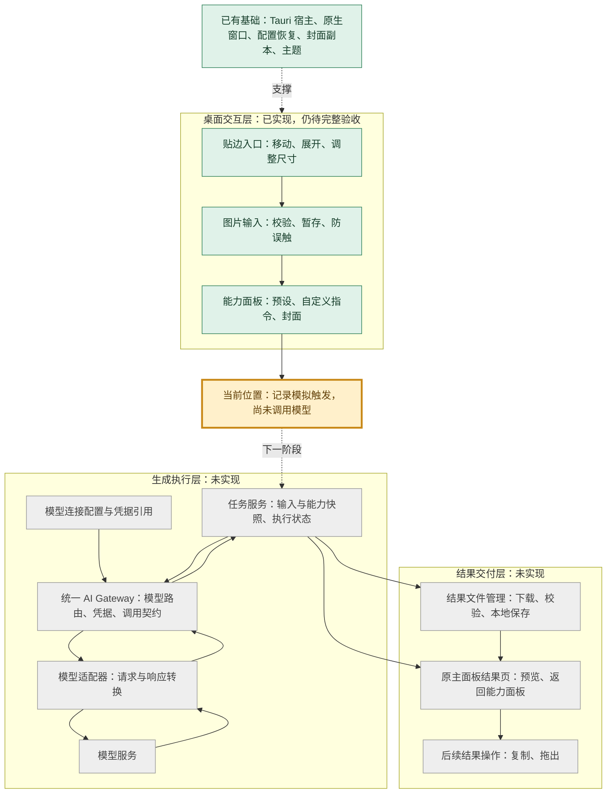

> 历史快照，已被上级目录同名文档替代。不得按此启动开发。

# QuickGen 整体架构与当前定位

更新：2026-11-12。本文记录已讨论的整体方向和最小实现边界；未来模块不是当前已经存在的代码。执行状态分别以 [W 阶段台账](windows-desktop-plan.md) 和 [G 阶段计划](generation-plan.md) 为准。

## 产品骨架

单屏迁移实施修订：原quickgen-desktop产品入口加载board.rs与board.html，继续使用原storage.rs和com.quickgen.desktop目录；画板与能力面板同一WebView，添加/预设为附属窗口。收起时原生区域裁切，穿透时依据宿主光标命中切换ignore_cursor_events。临时独立画板产品目标已撤销，双窗口probe仅保留技术验证用途。详见B阶段台账。

2026-11-12 已授权[画板迁移B阶段](board-migration-plan.md)。下图保留旧实现基线。新交互采用独立画板窗与能力窗，Asset资源、BoardScene布局、Task任务分离；生成仍走统一AI Gateway，结果回到原图旁，不再以独立结果页为唯一呈现。B阶段使用模拟执行器，不同时启动G阶段模型接入。

已实现不等于最终验收全部通过。图中复制、拖出属于产品后续方向，不是第一条真实生成流程的必做范围。

## 当前代码与后续承接

| 边界 | 当前实现 | 下一阶段承接 |
| --- | --- | --- |
| 主面板 | `desktop/ui/app.js`、`index.html`、`style.css` | 发起任务、订阅状态、展示结果；保留现有输入及窗口交互 |
| 能力管理 | `desktop/ui/manager.js`、`manager.css` | 继续管理名称、指令、封面，不嵌入厂商调用代码 |
| 宿主 | `desktop/src-tauri/src/main.rs`、`geometry.rs` | 提供任务命令及事件；保留原生窗口、拖放通道 |
| 本地配置 | `desktop/src-tauri/src/storage.rs` | 保留布局、能力和主题；连接配置与密钥分开存储 |
| 当前触发出口 | `app.js` 的 `trigger()` 调用 `record_trigger` | 新增真实任务入口，不能仅把模拟日志函数改名为生成成功 |
| 主题 | `theme.js`、`theme.css` | 新增状态页和设置控件同样使用共享主题与圆角 |

## 核心决策：缩小范围，保留模块边界

第一版只实现一张图片、一个已选服务商/模型、同时一个任务、一个结果。它是完整架构中的一条纵向流程，不另造一套需要丢弃的临时代码。

| 模块 | 应负责 | 不应负责 |
| --- | --- | --- |
| 能力卡片 | 稳定 ID、名称、处理指令、封面 | 持有密钥；硬编码厂商 URL 和请求格式 |
| 桌面界面 | 收集操作、发送任务请求、展示宿主状态 | 直接请求模型；用组件显示状态代替真实任务状态 |
| 任务服务 | 固定输入/能力快照、分配任务 ID、限制并发、管理生命周期 | 操纵窗口几何；把具体厂商 JSON 散布给 UI |
| AI Gateway | 统一生成入口、模型路由与能力校验、凭据解析、统一结果/错误契约、调用级限制及脱敏观测 | 管理界面状态或本地结果文件；绕过任务服务另建队列 |
| 模型适配器 | 转换图片/指令与厂商请求，将厂商响应和错误映射至Gateway契约 | 保存界面配置；决定“已保存”文案 |
| 结果文件管理 | 取得图片字节、校验、写入应用管理的结果位置 | 把临时远程 URL 当作持久文件；保存失败后重新付费生成 |
| 凭据存储 | 宿主访问系统安全存储，返回是否已配置 | 将密钥写入普通配置、前端 localStorage、日志或事件 |

这些是逻辑边界，不要求微服务、插件框架或多个进程。初期可在现有 Rust 宿主内按模块实现，仅抽象真实用到的模型接口，不提前建通用工作流引擎。

## 统一 AI Gateway

所有模型调用经过同一个逻辑入口：`桌面界面 → 任务服务 → AI Gateway → 模型适配器 → 服务商`。第一版即保留该边界，不能因为只有一个模型就让任务服务直接绑定厂商协议。

**部署选择：先实现 Rust 宿主内的模块，不新增独立HTTP服务。** “统一网关”指调用契约与入口统一，不要求立刻部署后端。如果未来需要多客户端共享密钥、集中额度或团队权限，可将该边界移至服务端；这属于后续独立设计，不承诺无需任何改动即可迁移。

### 第一版职责

- 以连接/模型引用选择适配器；维护所选模型的实际能力和限制，先验证图生图能力再发请求。首版只有一个路由，不做自动选模或故障转移。
- 接受统一的图片生成请求：任务/请求ID、模型引用、图片引用、指令和已明确的输出参数。厂商的multipart、JSON、轮询URL等细节只存在于适配器中。
- 根据配置引用从安全存储读取凭据，仅在宿主调用链使用，不返回前端，也不广播到任务事件。
- 输出统一的生成结果或错误，同时保留必要的服务商请求ID、未知受理状态和能力信息。适配器负责厂商映射，Gateway负责对外契约，任务服务负责产品任务生命周期。
- 统一请求超时/大小限制、脱敏日志和调用结果观测；只有服务商实际提供时才记录用量或费用，不编造统计。
- 提供受能力约束的状态查询/取消入口（仅接口支持时实现）；不把不支持伪装成成功。任务服务的重试决定必须通过Gateway执行，不允许多层各自自动重试。

### 与相邻模块的边界

| 模块 | 所拥有的状态与策略 |
| --- | --- |
| 任务服务 | 输入/能力快照、并发1、提交去重、用户重试、任务版本、UI可见生命周期 |
| AI Gateway | 模型引用与适配器解析、能力校验、凭据获取、调用约束、统一模型结果/错误 |
| 适配器 | 厂商协议、认证头构造、同步/异步响应转换、远端请求查询细节 |
| 结果文件管理 | 取得并校验结果图片、原子落盘、保存重试；需要认证的远端取图由Gateway/适配器处理，不泄漏密钥 |

统一接口不等于强制所有厂商使用某一种兼容API，也不把文本、图片、语音硬塞进万能函数。第一版只定义实际需要的图像生成契约；未来增加其他能力时增加明确类型的入口。

### 验证要求

用一个真实适配器加一个测试替身验证路由可替换：不修改能力卡片和任务服务即可替换实现。覆盖能力不匹配时请求次数为零、凭据不出宿主、厂商错误归一化且保留未知受理语义、保存重试不重复调用网关。真实服务证据仍按G阶段要求取得，测试替身不计为第二家服务商已支持。

## 建议数据契约（G0 确认后实现）

- `AbilitySnapshot`：能力 ID、名称和指令的任务时刻副本。提交后编辑卡片不改变进行中的任务。
- `InputAsset`：已校验的文件类型、大小及宿主管理的输入引用。受理任务前确认文件仍可读；按实际需要复制至临时工作目录，避免源文件移动影响执行。
- `ConnectionProfile`：服务商标识、接口地址、模型标识、凭据引用；不含可返回前端的明文密钥。
- `GenerationJob`：任务 ID、输入与能力快照、连接引用、状态、时间、标准化错误及结果引用。前端通过任务 ID 关联事件，迟到事件不得覆盖另一任务。
- `ResultAsset`：结果 ID、实际图片格式、尺寸、文件状态、本地位置。只有本地写入成功才有“已保存”语义。

具体字段名及 Rust 类型在实现时确定；当前仓库不存在这些生产模块。

## 生命周期与失败边界

建议第一版流程：`受理 → 请求中 → 结果写入中 → 完成`。校验失败不创建已受理任务；网络、服务端或输出校验失败返回可理解错误。磁盘写入失败独立保留为“生成已完成、保存失败”，不得提示“已保存”。

- 任务由宿主持有，面板收起或切换视图不应意外启动、取消或重复提交。
- 接受新任务前固定输入与能力快照；受理失败保留当前暂存图，已受理任务不依赖前端暂存缩略图继续存在。
- 首版并发上限为 1；忙时拒绝重复生成，不暗中排队。用户选择另一张图时不得更换进行中任务的输入。
- 网络超时不等于远端没有受理；不自动重发可能重复计费的请求。是否支持查询、取消或幂等由所选服务商能力决定。
- 重试生成与重试本地保存是不同动作。保存失败优先复用已取得的结果，不再次请求模型。
- 原子写入及明确的工作文件归属继续沿用；不删除用户原图，不用用户生产配置做故障注入。
- 重启恢复进行中任务、退出时如何处理任务和临时文件保留期限，在 G0 明确；首版不默认承诺持久队列或任务历史。

## 后续扩展与约束

第二个模型通过在统一 AI Gateway 注册适配器和模型能力接入；队列在任务服务扩展；历史围绕任务/结果引用扩展；复制、拖出及 DCC 使用本地结果文件。以上都不要求推倒桌面面板或能力结构。

暂不引入数据库、账号、云同步、批量任务、插件系统或通用 DAG。未来需要时再依据实际数据量和产品需求选择。禁止为了快速演示在前端持有密钥、把能力卡片绑定厂商协议、把假图或模拟事件标为生成结果。
