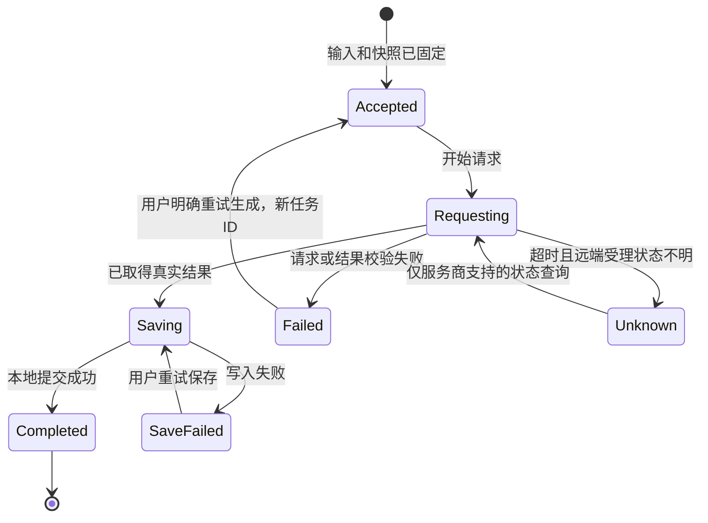

> 历史快照，已被上级目录同名文档替代。不得按此启动开发。

# QuickGen 下一阶段开发执行计划：最小真实生成闭环

2026-11-12 接续修订：先执行[画板迁移B阶段](board-migration-plan.md)。统一AI Gateway与任务服务边界保留；旧单图暂存触发和结果页描述须在G阶段启动前按新画板合同更新，不直接照旧实现。

更新：2026-11-12。状态：**仅规划，G0–G5 均未开始**。本次用户要求编写下一阶段开发执行计划，不是立即实现、配置密钥或调用付费模型的授权；旧自动执行目标不恢复。

架构遵循 [整体架构](architecture.md)，界面遵循 [交互规格](interaction-spec.md)。本文件仅维护 G 阶段任务，W 阶段状态仍由 [桌面计划](windows-desktop-plan.md) 维护，不建立第二份 W 台账。

## 阶段目标与范围

打通一条真实路径：**一张本地图片 → 选择一张能力卡 → 一个模型处理 → 原主面板显示真实结果 → 本地保存成功**。

第一版支持一张输入、一个已选模型、同时一个任务和一个结果；必须包括进行中状态、明确失败反馈以及区分生成重试与保存重试。现有贴边、拖入保护、暂存、自定义能力、配置恢复、深浅主题等行为继续保留。

不包含多模型切换、批量处理、队列、任务历史、账号/云同步、数据库、自动更新及跨平台。结果复制、拖出与 DCC 回传作为后续阶段，保留接口方向但不列入本次最小闭环通过门槛。

## G0 开始前需要明确

| 决策 | 目前状态 |
| --- | --- |
| 服务商、接口文档、具体模型及图生图能力 | 未提供；不能假定兼容某厂商协议 |
| 接口地址、认证方法和测试用凭据 | 未配置；密钥通过本机安全入口录入，不写进文档 |
| 真实测试调用的费用/次数边界 | 未确定；本次无任何付费调用 |
| 输出尺寸/格式及服务端同步或异步处理方式 | 随接口能力确定，首版只选择一组明确参数 |
| 结果保存位置、重名处理 | 建议应用管理的结果目录加唯一任务 ID；G0 确认 |
| 任务中关闭/退出、超时、重试、临时文件清理 | 按架构失败边界确定首版行为，不默认承诺取消远端任务 |
| 与 W 阶段的关系 | W2–W4 verifying、W5 doing；保留缺项。若先启动 G 开发，应明确验收先后安排，不静默绕过 W 完成门槛 |

## 切片台账

以下是建议执行顺序，不表示已经实现或测试。

| ID | 可观察行为 | 依赖与实现边界 | 必须保留的约束 | 通过证据 | 状态 |
| --- | --- | --- | --- | --- | --- |
| G0 | 明确一个可执行的图生图接口和第一版行为 | 提供接口信息、确定阶段授权；更新本计划 | 不伪造接口能力或费用；不存放密钥原文 | 选定服务/模型、输入输出、费用与错误行为；明确 W 缺项安排 | not_started |
| G1 | 在应用中配置连接，重启后仍可使用 | G0；宿主连接配置/安全凭据入口、统一样式的附属设置界面 | UI 不接收已保存明文密钥；普通配置无秘密 | 配置校验、重启可读、更新失败不丢原配置；真实连接检查若会计费须纳入授权 | not_started |
| G2 | 图片与能力被受理为唯一任务并返回真实模型结果 | G1；现有 trigger 出口、宿主任务服务、统一AI Gateway及首个适配器 | 固定快照、并发 1、无图不提交、不自动重复计费；模拟路径明确区分 | 针对性契约测试加一次授权的真实图片请求，任务 ID 对应真实返回 | not_started |
| G3 | 真正保存结果，失败时能单独重试保存 | G2；结果文件管理 | 校验返回图片；不能把 URL/临时文件称为已保存，不覆盖用户源文件 | 成功文件实际可读；写入失败保留可恢复结果，保存重试不再请求模型 | not_started |
| G4 | 主面板展示进行中、失败、完成及结果返回 | G2/G3；app.js/界面状态及任务事件 | 不新开独立结果面板；不硬切回固定演示图；无新增保存/复制/拖出按钮 | 真实状态与结果一致，收起重开不重复提交，返回能力面板正确，深浅主题一致 | not_started |
| G5 | 同一构建走通两种输入方式及失败恢复 | G1–G4；候选交付与真实桌面回归 | 不撤销既有通过证据；新行为取得匹配范围的证据 | 一图暂存后点卡、直接落卡均生成正确结果且各提交一次；本地文件可打开；关键失败可恢复 | not_started |

G2 的假服务测试只用于请求转换、状态与错误分支，不能代替真实模型证据。G2/G3 可以先经宿主验证结果，G4 才是用户可操作的完整界面；不连续扩展通用抽象而推迟可运行闭环。

## 执行基线与阶段安排

模型统一调用入口为AI Gateway，职责和边界以[整体架构](architecture.md)为准。它从第一版纳入G2，不延期到多模型阶段；首版仅一个真实路由，不扩展独立部署、团队权限或自动故障转移。

- 基线候选为 `desktop/dist/QuickGen-Windows-candidate-5717b187fe3e/QuickGen.exe`，完整身份见 W 台账；实施前重新核对源码和运行实例，不把历史 PID 当作当前状态。
- 现有前端为原生 HTML/CSS/JavaScript，宿主为 Tauri 2/Rust。沿用现有工程，不迁移框架；HTTP、图片解码、安全凭据所需依赖在 G0 根据接口选择，核实官方文档后固定版本并更新锁文件。
- W 阶段已通过的用户确认继续有效。建议将尚缺的完整桌面回归并入 G5 的同候选验证，保留 W 验收条目，不用 G 进展补写 W 完成；此安排在开始实施时明确采用。
- 默认顺序为 G0 → G1 → G2 → G3 → G4 → G5。G2 先形成可从实际面板发起的窄路径，再完善 G4 结果交互；不先做一整套无人使用的通用任务框架。
- 整个阶段不设没有依据的工期承诺。每片完成后记录实际工作量与剩余依赖；服务商、接口限制和实测结果变化时更新计划，不用继续堆任务掩盖阻塞。

## 各切片执行步骤

### G0：锁定接口、行为和验证基线

1. 核对现有触发、配置、窗口和主题代码，记录需要保持的输入/退出语义。
2. 取得所选模型的官方接口文档，确认它确实支持图片输入和图片输出；记录认证、图片传输、响应形式、大小限制、同步/轮询、超时、取消/查询及幂等支持。缺失能力如实标注，不假设存在。
3. 明确真实调用允许使用的测试图片、费用/次数上限；没有凭据或额度不开展真实请求，允许先做不依赖它们的实现和本地契约测试。
4. 确定连接设置的入口及紧凑布局，不继续挤压120px标题行；设置作为贴着主面板的附属面板，沿用6px圆角、12px间距和主题。模型配置不放到能力卡片里。
5. 对下表建议行为作最终取舍并更新本文件，然后才进入依赖这些决策的代码实现。

| 项目 | 第一版建议默认值 | 需要确认或验证的部分 |
| --- | --- | --- |
| 模型数量/并发 | 一个配置、同时一个任务；无等待队列 | 所选模型的请求/查询机制 |
| 结果路径 | 应用数据目录下 `results/<job-id>.<ext>`，名称由宿主生成 | 用户是否需要指定其他默认目录 |
| 运行中收起面板 | 继续执行，重新展开读取同一任务状态 | 与当前收起/拖图交互不冲突 |
| 运行中 Alt+F4 | 显示沿用现有视觉规范的退出确认；说明本地退出不保证取消远端 | 首版是否采用等待完成再退出；不得静默取消或重复请求 |
| 重启 | 不自动重新提交生成；不承诺恢复远端进行中任务 | 异常退出后的最小中断记录与残留工作文件处理 |
| 输入与结果暂存 | 任务受理前复制输入到宿主管理的工作目录；结果落盘失败保留可重试副本 | 容量限制、保留期限、清理条件在实现前明确，不能无限增长 |
| 首版结果数量 | 一个真实结果；请求端指定单张（若接口支持） | 返回多张时的处理规则按接口确定，不悄悄增加产品范围 |

G0 交付物：本文件中的接口决策记录和一组无密钥的请求/响应契约样例。不得将不存在的接口样例写成已经成功的真实调用。

### G1：连接设置与安全凭据

建议代码边界：新增宿主 `connection.rs`、`credentials.rs`，复用 `storage.rs` 的配置事务；前端新增设置视图或扩展现有附属窗口路由。名称为建议，实际依赖可调整并记录。

- 连接配置保存服务商、地址、模型和凭据引用；密钥由宿主使用 Windows 安全存储管理，不落普通JSON。前端只在用户输入时短暂持有，提交后清空，不提供读取已存明文接口。
- 旧配置缺少连接字段时正常启动，不重置用户卡片、主题及布局。
- 更新凭据和连接配置时使用先准备、再提交、失败回退的顺序；不能因一半写入失败损坏原连接。日志和错误必须脱敏。
- 区分“配置已保存”与“连接已验证”。服务商没有免费探测接口时，不伪造连接成功，也不自动发起生成来测试。
- 校验URL方案与模型必填项。输出下载若涉及其他域名，不转发认证头；重定向和可接受输出地址按官方协议处理。

验收：安全存储往返、旧配置兼容、更新失败保留原值；浏览器/真实设置界面验证输入与错误样式，已有面板不会被错误关闭；重启后读取配置但不能读出已存密钥。仅完成前端表单不能标G1通过。

### G2：单任务服务、统一 AI Gateway 与第一个真实适配器

建议代码边界：新增 `jobs.rs`、`ai_gateway/mod.rs`（含请求/结果/错误契约）、`providers/mod.rs` 和一个具体适配器；在 `main.rs` 注册命令，`app.js` 的 `trigger()` 改接任务入口。模拟入口显式保留为开发用途，不能在真实模式失败后自动回退到假成功。

建议命令职责（不是当前已实现API）：

| 命令/事件 | 输入/输出与责任 |
| --- | --- |
| `start_generation` | 输入客户端提交ID、图片引用、能力ID；宿主校验并固定能力/输入快照，返回任务ID与当前状态 |
| `get_generation` | 按任务ID返回无秘密的状态快照，供窗口重开或事件丢失后恢复显示 |
| `generation-changed` | 携带任务ID、单调递增版本、阶段及安全的错误/结果摘要；不得携带密钥和原始响应头 |
| `retry_result_save` | 指定现有任务ID，只重试落盘，不请求模型 |

执行步骤：

1. 在宿主原子受理任务并限制并发；复制/校验输入、固定能力指令。用提交ID防止同一次操作重复受理；已确认任务不再依赖缩略图状态。
2. 先连接本地假服务验证请求契约、重复提交、忙时拒绝、错误分类和迟到事件；必须贯通实际生产任务服务，不能另写一套只供测试的执行逻辑。
3. 先实现统一 AI Gateway 入口，再注册一个适配器：任务服务只依赖Gateway契约，Gateway解析模型/能力、读取凭据并路由；适配器转换厂商请求及响应。首版均在现有Rust宿主内，不新增独立网关服务。仅有真实字节/结果引用时才能进入保存阶段；服务器接受请求不等于生成完成。
4. 在现有面板增加最小进行中/错误状态，通过两种现有拖图路径调用同一任务入口；未受理失败时保留暂存图。
5. 在已经确认的调用边界内用测试图片进行一次真实请求，记录脱敏任务ID、实际结果和构建身份。没有凭据时标记真实验证待完成，不继续循环假测试。

验收：使用真实适配器与测试替身证明任务服务和能力卡片无需因适配器替换而修改；不支持的模型能力在出网前拒绝、凭据不暴露、错误归一化但保留受理未知语义。

同一次点击/拖放只生成一个任务，忙时不暗中排队；能力变化不会修改进行中请求；断网/超时不自动重发；真实模型输出与任务对应。增加明确的超时/输出大小限制，具体数值来自G0决策。

### G3：真实结果文件与保存恢复

建议代码边界：新增 `results.rs`，由任务服务调用，不让UI自行下载或拼接路径。

- 按Gateway返回的统一结果取得图片数据，需认证的远端取图由Gateway/适配器完成，验证实际格式、解码和限制；扩展名不作为内容有效性的唯一依据。
- 先写临时文件并确保写入成功，再原子提交到任务唯一目标；只处理应用创建的工作目录，避免覆盖或删除用户原图。
- 将生成失败与保存失败分开。保存失败保留已取得的可恢复结果，提供对应状态及重试保存命令；失败后不触发第二次模型请求。
- 写入成功返回本地结果引用、格式与尺寸；通过受限的宿主读取/资源路径供UI预览，不为便利放开任意文件访问。
- 根据G0明确的保留策略清理应用工作文件，未保存结果与已保存结果采用不同规则。

验收：用真实临时目录验证成功、重复保存、损坏输出、受控写入失败及恢复；记录适配器调用次数不因保存重试增加；真实输出文件可被独立打开。

### G4：原面板内完成状态与结果体验

建议代码边界：`app.js` 及按需要拆出的任务/结果视图文件，复用共享主题、图标、圆角，不改动刘海形变与原生拖入通道。

- 状态显示依据宿主任务及版本号，不由定时器假装成功；无真实进度时仅显示处理状态。
- 完成后在同一主面板展示真实结果；保存成功才显示“已保存”。右上角返回能力页与主面板收起、附属窗口关闭保持不同语义。
- 生成失败提供生成重试；保存失败提供保存重试，两者明确区分。操作采用统一Lucide图标与无障碍名称，不增加永久说明、悬停提示或普通保存/复制/拖出按钮。
- 输入新图片时保留已受理任务快照；是否切回能力页按G0确定的交互执行，不让迟到结果覆盖用户正在查看的另一个任务。
- 收起/重开通过快照恢复正在执行的任务；订阅与首次读取采用一致的版本处理，避免先后响应造成倒退。异常退出不自动重发生成。

验收：正常、进行中、生成失败、保存失败、已保存五种界面均核对；覆盖浅色/深色、120px单列、正常尺寸及附属窗口共存。实际结果不得被CSS拉伸，内容可滚动但不露滚动条。浏览器检查通过不冒充桌面动效通过。

### G5：同候选收尾与交付

1. 先完成受影响自动检查与构建，再记录候选哈希和真实运行路径；确认正在操作该版本。
2. 使用暂存后点击、成熟面板直接落卡两条路径各完成一次真实生成和保存；这些调用须包含在已确认的测试额度内。
3. 对新增主题/设置/结果返回做实际桌面回归；已有未改变路径的用户确认不要求全部重复。
4. 断网、鉴权、无效输出和写盘失败优先用隔离测试验证；只有必须依赖真实桌面的部分才追加真实操作。不得修改用户生产凭据或配置来制造失败。
5. 对照W/G验收矩阵逐项核对。桌面工具仍故障时保存具体缺项与恢复条件，不重复失败工具，不把记录整理算作产品进度。
6. 交付可运行候选、更新运行说明、记录限制；缺任一真实模型或最终保存证据都不标最小闭环完成。

## 状态和错误处理约定



`Unknown`不是可以安全重发的失败状态。服务商支持查询时查询原请求，不能将查询画成重新创建请求；无查询能力则说明结果未知，让用户明确决定后续操作。具体错误结构至少区分输入/配置、忙碌、鉴权、网络、服务端、无效输出、保存失败；错误文本必须可理解且不包含认证信息。

## 验证组织与实施规则

| 范围 | 自动验证 | 不能被其替代的证据 |
| --- | --- | --- |
| 配置/凭据 | 安全存储、迁移、失败回退、敏感值不泄漏 | 真实设置界面、系统凭据可用及重启行为 |
| 任务/Gateway/适配器 | 路由与能力校验、请求映射、并发、快照、重复提交、超时及迟到响应 | 一次授权真实模型响应 |
| 结果文件 | 校验、原子落盘、失败恢复、保存重试不再生成 | 实际生成文件可读、面板显示对应图片 |
| 界面 | 事件顺序、状态恢复、失败操作、紧凑布局 | 原生窗口、系统拖入、动画、同候选完整流程 |

只运行与切片相关及受影响的检查；完成阶段交付时再跑必要完整回归。新测试必须针对业务不变量，不靠复制实现得到绿色。现有命令见下文，新增测试命令落地后再加入README。

每片记录：任务ID、变更范围、可观察结果、验证命令/退出码、真实证据、候选身份、剩余项与下一步。默认单个主任务持续推进，不自行启用子Agent；只有用户明确授权时才委派。

## 开始实施时可使用的执行指令

以下指令供用户确认进入开发后使用，当前写入不等于执行：

```text
使用 $agent-dev-loop，按 docs/quickgen/generation-plan.md 执行 QuickGen 最小真实生成闭环。
先读取 docs/quickgen/README.md、architecture.md、interaction-spec.md、generation-plan.md
以及 windows-desktop-plan.md 的当前检查点，核对实际源码与运行候选。
从 G0 开始确认接口和真实调用边界；缺必要外部信息只提出集中问题，继续不依赖它的工作。
按 G1–G5 完成一个可验证切片后更新本台账并推进下一片，不停留在计划或通用抽象。
保留现有桌面交互和W阶段未完成验收，不调用未经授权的模型、不伪造生成或保存成功。
真实费用与测试图片须符合G0记录；密钥仅在本机安全入口录入。
同一失败路径没有新增信息时停止重复尝试，保存恢复条件。
以真实桌面两条输入路径均获得对应模型结果并成功保存为完成门槛，
同时满足G5及其关联验收；未取得的证据保留待验收，不自动创建或恢复goal。
```

## 最终验收清单

1. 从已确认构建的真实桌面入口拖入有效图片，保留既有 1 秒保护和静止落点暂存规则。
2. 点击能力，宿主建立任务快照并仅提交一次真实模型请求；卡片名称、处理指令与实际请求对应。
3. 界面显示真实任务状态；没有可用进度数值时不编造百分比。
4. 模型返回的真实图片在原主面板显示，实际文件成功写入后才显示“已保存”。返回能力页、收起及再展开的语义明确。
5. 认证错误、超时、服务端错误、无效输出、磁盘写入失败分别有可理解反馈；失败不误删输入或已有结果，不无限重试。
6. 保存重试不重新生成；生成重试由用户明确发起，并按服务商能力控制重复受理风险。
7. 配置、主题和用户能力继续恢复；密钥不进入前端持久存储、配置明文、截图或日志。示例与故障注入使用独立测试数据。
8. 证据关联同一候选、任务 ID 和实际结果文件；日志只保留必要诊断信息。浏览器预览、自动契约检查和真实桌面/模型结果分别标注。

## 验证与接续规则

现有工程命令从 `desktop/` 执行：`.\scripts\desktop.cmd test`、`.\scripts\desktop.cmd build`，现有前端检查见 [运行说明](../../desktop/README.md)。新增任务/适配器测试随生产行为实现，不虚构当前可执行的未来命令。

每个切片记录具体改动、测试范围、构建身份、实际证据、限制及下一步。仅当 G5 验收完成才宣称最小真实生成闭环完成；不得将“已有类型/适配器文件”或“模拟请求通过”视作完成。没有外部变化时不重复工具故障尝试，也不为维持循环追加无关功能。

下一次接续先读取本文件 G0 的未决事项，核对当前代码与 W 阶段记录；确认实施范围和服务商后再启动 G1。不自动创建目标或后台持续任务。
