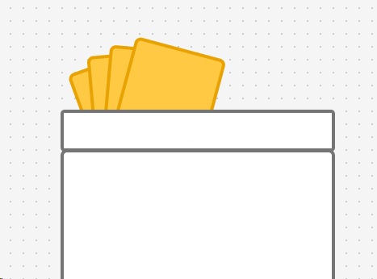

# QuickGen 灵感与小场景

创建：2026-11-12。状态核对：2026-11-13。

前两条灵感已进入桌面版：IDEA-001已实现；IDEA-002的桌面交互已实现，模型生成仍为模拟。以[单屏交互收口记录](desktop-baseline.md)为当前交付依据，以下保留原始想法，不把已实现内容继续当作待开发需求；新增留存点子单独标注状态。

单独保存产品讨论中的零散想法和小 case，方便以后继续聊或挑选实现。这里不是需求规格、开发排期或执行授权；记录下来不表示已经决定要做。

## 记录方式

- 每条保留日期、稳定编号和用户原意，尽量简短。
- 有具体场景时，记清“什么时候用、拿什么作为输入、希望得到什么结果、能省掉什么麻烦”。尚未说清的内容留空，不替用户编造。
- 助手补充的设想或待确认问题单独标注，不混入用户原话。
- 相近想法可以关联，但保留各自有价值的细节；暂不判断优先级、不预估工期、不展开技术方案。
- 后续用户明确选中某条再讨论方案或转入计划；在原条目留下对应文档链接，避免丢失来由。

## 灵感记录

### IDEA-001 · 常驻开关与失焦收起，重新打开保留现场

日期：2026-11-12｜状态：已实现，已纳入单屏桌面交互基线

用户原话：
> 关闭按钮改为常驻按钮，默认不常驻，焦点不在面板上就自动关闭面板，但是再次点开，还是关闭前看到的样子。

交互意图：
- 主面板当前的关闭按钮改为“常驻”开关，初始默认不常驻。
- 不常驻时，焦点离开面板后自动关闭面板。
- 开启常驻后，失去焦点仍保持面板打开。
- 再次打开时保留关闭前看到的界面，不重新回到初始页面或重置现场。

当前实现（2026-11-13）：
- 主面板使用常驻图钉，非固定时离开窗口组收起；主面板与添加/预设窗口按同一焦点组处理。
- 收起回刘海而非退出应用；附属窗口X只关闭自身，程序退出由托盘菜单或Alt+F4承担。
- 收起再开保留画板现场；图片、相机、选择及常驻状态已有WebView本地恢复，布局、能力和主题沿用原配置存储。
- 未提交表单草稿的跨重启恢复、未来真实任务恢复不属于本条已完成承诺。

关联：[交互规格](interaction-spec.md)、[单屏交互收口记录](desktop-baseline.md)。

### IDEA-002 · 顶部图片堆叠与全屏透明画板

日期：2026-11-12｜状态：桌面交互已实现并收口；真实模型生成未接入

用户原话：
> 暂存区体验优化，我希望改成放到顶部堆叠的感觉，类似参考图效果，悬浮会有动效，点击会打开一个新面板，这个新面板是全屏且透明的，与其说是面板不如说是画板，图片首次会整齐排列在主面板旁边，滚轮滚动可以放大缩小画板查看图片，拖动图片到预设上面可执行生成。去除原来的放入暂存区然后点击预设就可生成的体验。

实现进展：从[可交互原型](../../design/board-prototype.html)迁入原QuickGen桌面入口，包含堆叠、画板、大纲、框选/组拖动、逐张模拟任务和结果再处理。当前画板与能力面板共用主WebView，添加/预设为附属窗口；全屏画板是交互体验，不表示必须另建一个原生窗口。

参考图（已从临时附件复制到项目，避免后续丢失）：

明确的体验意图：
- 将当前暂存缩略图入口改为位于顶部的图片堆叠，参考图中多张卡片错位、向上展开的感觉。
- 鼠标悬浮在堆叠入口上有动效；现已实现按鼠标位置提起对应图片，可直接拖入能力。
- 点击堆叠入口，打开独立的全屏透明画板，而不是常规有实底的小面板。
- 图片首次进入画板时整齐排列在主面板旁边；不要把“首次排列”扩大理解为每次打开都重置布局。
- 滚轮用于缩放整个画板，以便查看图片。
- 从画板拖动某张图片到预设上，发起该图片的生成处理。
- 画板打开后，主面板旁增加与主面板等高的缩略图大纲，日期倒序、最新在上；画板选中图片时，大纲同步高亮并将对应项滚至垂直中央。画板和大纲中的图片均可拖至预设。本原型将日期暂解释为加入画板时间，已实现并验证该交互。
- **移除“放入暂存区后，再点击预设即可生成”的旧交互。** 这是一条明确的替代意图，不是同时保留的第二种选择。

流程：顶部堆叠入口 → 点击展开透明画板 → 查看/缩放 → 将图片拖到预设 → 生成。

参考图使用范围：记录堆叠的位置与层叠形式；黄色、背景点阵及外框样式不自动成为产品视觉要求。

当前已落地（2026-11-13）：
- 顶部显示0–4张最近图片；大纲按加入时间倒序，同步选中项并居中，边缘渐隐。
- 支持多图导入、缩放/平移、自由摆放、框选和整组拖动；画板现场跨重启恢复。尚未据此承诺无限图片规模。
- 多图拖到能力逐张模拟执行，每张独立状态；原图保留，结果在原图旁，可再次拖入能力。模拟结果复用输入，不是真实模型产物。
- Alt＋·为系统级模式快捷键；穿透时未常驻面板收起。鼠标经过图片变淡，宿主仅在命中集合变化时通知前端；用户已确认桌面流畅且变淡正常。
- 支持资源管理器拖入；展开完成后1秒保护期内只导入，之后可直接落到能力。自定义卡片和库中预设共用触发路径，单击卡片不消费暂存图。
- 图片移除、布局恢复、贴边与顶部堆叠避让已纳入桌面版；未实现的去重策略、统一清空策略不能按原待聊清单自动视为已完成。

仍待后续：真实AI Gateway和模型执行、Rust资源库/任务持久化，以及多屏/大量图片/长时运行专项。它们不改变本条交互创意已经落地的状态。旧G计划中的“暂存后点击”和“主面板结果页”已被画板合同取代，后续实施前必须更新，不能重新引入。

关联：本页 IDEA-001、[现有交互规格](interaction-spec.md)、[生成阶段计划](generation-plan.md)。

### IDEA-003 · 网页图片随手拖入与可选浏览器助手

日期：2026-11-13｜状态：留存，未实现、未排期；不改变当前可靠底座开发范围

用户原话：
> 又有个想法，网页上的图能直接拖拽到quickgen吗

用户进一步提出：担心网站的防爬机制影响拖图，询问是否需要类似浏览器图片解析插件的功能。这是待验证的问题，不记录为“大部分网站不支持拖图”的事实。

场景与价值：浏览网页时，把眼前选中的图片直接放进QuickGen，减少先下载、找文件、再导入的步骤；收纳后沿用画板查看和拖给能力处理。

助手补充的实现方向（尚未选定方案）：
- 基础接收：识别浏览器拖来的文件、图片内容或图片地址，取得真实内容后校验并归档为统一资源；复制图片后粘贴可作补充入口。
- 可选浏览器助手：基础拖放不能覆盖时，提供“发送到QuickGen”；必要时识别页面中的原图。整页搜图、批量解析和站点专项适配是更远的扩展，不默认纳入第一版。
- 两种入口共用Rust资源服务，后面的画板与任务不另建一套。拖到收纳区只导入；若支持直接拖到能力，导入成功后沿用既有防误触与执行规则。
- 区分拖放格式未接收、图片地址获取失败和原图定位三类问题，不能一概归因于防爬。登录、过期地址及页面环境可能影响获取；插件也不承诺任意站点均可提取。

待聊与验证：选取用户实际常用网站及浏览器，分别测直接拖入、复制粘贴、缩略图/原图差异和登录场景，再决定是否需要浏览器助手及站点适配。

关联：[真实能力与便捷输入输出计划](generation-plan.md)。可在G3输入输出阶段讨论纳入，但目前G3正式验收只包括已写入的剪贴板输入、复制和拖出，网页拖图尚未加入。

<!-- 新条目采用 IDEA-001、IDEA-002 等连续编号；字段按实际信息填写，不必凑齐。
### IDEA-001 · 简短名称
日期：YYYY-MM-DD｜状态：留存
原意：用户提出的想法，引用时保留准确原话。
场景：什么时候用，输入是什么，希望得到什么。
价值：想省掉的步骤或解决的麻烦。
待聊：尚未确定的问题；助手补充必须标明。
关联：相关想法、后续方案或计划（如有）。
-->

## 历史原型记录（以下为当时状态，不代表当前缺项）

2026-11-12 原型补充确认：多选图片拖到预设按逐张生成处理，每张独立状态与重试；结果回到原图附近并进入最新大纲和顶部堆叠。已在浏览器原型实现模拟队列，尚未接入桌面宿主或 AI Gateway。

2026-11-12 桌面浮层增量：已在独立原型实现操作/穿透切换，Alt＋·（数字1左侧的 Backquote 键）作为页面内切换快捷键；穿透保留图片显示，未常驻面板收起，常驻保持。模拟桌面增加可打开的文件夹、可输入的便签和可切换的场景预览，用于直接体验穿透交互。此验证不等同于 Windows 系统级穿透或全局快捷键验收。

用户补充：穿透模式下鼠标放到图片上时，图片半透明以露出桌面。已在原型实现，暂用30%不透明度与160ms淡入淡出，移开恢复，鼠标点击继续穿透。
