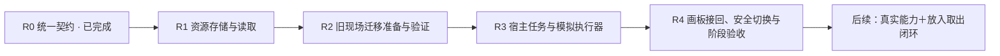

# QuickGen 可靠底座版：完整开发执行计划

更新：2026-11-13。**本文是可靠底座阶段的唯一执行计划、状态台账和接续入口。原R0—R4收口历史保留；本次两项审查返修及验收已完成，最新交付见文末返修收口检查点。** 以下保留计划原约定及实施历史；当前仅模拟执行，后续真实能力阶段尚未启动。

## 1. 全貌与交付目标

产品路线：桌面交互基础（单屏已收口）→ **可靠底座版（当前）** → 真实处理与便捷输入输出 → Harness快捷添加能力 → 日常发布完善。

可靠底座版完成后，用户保持现在的操作方式：把图片放入盒子、在画板查看、拖到预设逐张处理、在原图旁得到明确标为模拟的结果、继续复用。区别在于图片、场景和任务由Rust可靠管理：关闭界面不打断任务，重启不丢已保存内容，失败不会误覆盖原图或重复执行。

**本阶段仍是模拟执行，不承诺真实AI结果。** 完成标准是生产桌面路径实际接管，而不是只新增类型、数据库文件或独立演示。



R1可在隔离目录独立验证；R2先生成并验证迁移目标，**最终生产读取切换延至R4，待资源、场景和任务消费者全部就绪**。这细化了旧计划“R2改用资源ID”的时机，避免半迁移后前端仍运行旧任务队列。

## 2. 权威依据与已知现场

- [整体架构](architecture.md)：产品定位、模块边界和Harness引用执行方向。
- [统一契约v1](contracts/README.md)：Rust类型、输入输出/版本/状态规则、SQLite＋blob选型。
- [交互规格](interaction-spec.md)、[桌面基线](desktop-baseline.md)：已确认行为和交付身份；历史证据保留。
- [后续真实能力计划](generation-plan.md)：本阶段之后的模型/Harness接入与粘贴、复制、拖出，不混入本阶段完成率。

计划制定时的源码基线如下；实施后的当前状态以第5节台账和末尾最新检查点为准，不将此历史表当作仍未实现的任务：

| 部位 | 当前实现 | 本阶段目标 |
| --- | --- | --- |
| `desktop/src-tauri/src/main.rs → board.rs` | 唯一桌面入口，窗口/托盘/快捷键/原生穿透；read_image读取并返回base64 | 保留窗口链路，增加受控资源/场景/任务命令入口 |
| `desktop/ui/board.js` | 图片data URI、画板和前端模拟队列；IndexedDB保存现场 | 只做操作与呈现，持久引用和任务权威交给Rust |
| IndexedDB | quickgen-board-single-v1 / scene / current，含items、jobs、相机与选择等 | 迁移源和只读回退快照；切换后不再持续写入 |
| `desktop/src-tauri/src/storage.rs` | config.json、布局、主题、用户能力、封面副本 | 保留兼容性；从旧能力投影出稳定的模拟Capability/Preset引用 |
| `desktop/src-tauri/src/lib.rs`、`contracts.rs` | R0纯类型与校验，未接入桌面命令 | 作为服务公共领域模型，补实际运行所需校验 |

R0证据：9项新增契约测试＋原有24项主程序/4项探针测试通过。没有SQLite运行时、生产资源服务、真实任务队列或Harness连接。有效交付包身份以桌面基线为准，测试编译产物不自动成为验收候选。当前工作目录不是Git仓库，不能宣称已有提交或用git差异代替文件核对；执行前记录受影响源码哈希并备份必要文件。

## 3. 范围与不变条件

本阶段包括：受管图片导入/读取、SQLite元信息、场景持久化、旧现场迁移、Rust串行任务队列、模拟执行器、输出归档、恢复、与现有画板整合、失败提示和最小诊断证据。

本阶段不包括：真实模型/付费调用、AI Gateway运行时、真实Harness桥接或配对UI、所有非图片类型的产品支持、插件市场、工作流编辑器、云同步、多屏产品化、安装自动更新、原生渲染框架重写。Harness非图片契约继续用内存/模拟案例保护，未选具体Harness不阻塞本阶段。

必须保持：

- 原应用ID、数据目录、托盘入口；不新做第二个产品或改变已确认窗口结构。
- 收纳不执行；点击卡片不消费图片；外部拖放展开完成后1秒保护按松手时刻冻结；内部有意拖放不重复等待。
- 多图逐张任务、原图保留、结果在原图旁、结果可再次使用；模拟必须明确标识。
- 堆叠0—4张、缩略图大纲、框选/组拖、自由贴边/缩放尺寸/卡片高度、主题和附属面板行为。
- Alt＋·、透明区域穿透、按命中集合变化通知悬浮；不得恢复每次鼠标移动读取DOM/发送事件的旧性能路径。
- 不对用户原文件改名、覆盖或删除；不通过清空旧库解决迁移失败。

## 4. 模块边界与数据流

以下新增文件名为建议实现边界，可随实际依赖调整并记理由，不是冻结白名单。

| 模块 | 建议位置 | 责任 | 不承担 |
| --- | --- | --- | --- |
| 领域契约 | `src-tauri/src/contracts.rs` | 版本、对象、输入输出、错误、状态校验 | IO、窗口、网络 |
| 元信息存储 | 新增`src-tauri/src/store/` | SQLite连接、版本迁移、事务、查询、唯一约束 | 解码、长任务、窗口交互 |
| 资源服务 | 新增`src-tauri/src/resources/` | 导入、解码、blob、受限读取、引用与恢复 | 用户原文件清理、任务调度 |
| 场景与迁移 | 新增`src-tauri/src/scenes.rs`、`migration.rs` | revision保存、旧ID映射、迁移验证/切换 | 模型调用 |
| 任务服务 | 新增`src-tauri/src/tasks/` | 受理、去重、串行调度、attempt、事件、恢复 | 厂商协议、前端动画 |
| 执行器 | 新增`src-tauri/src/executors/` | 统一执行接口及mock实现 | 另建队列、直接改场景 |
| 桌面桥接 | `src-tauri/src/board.rs`及新command模块 | IPC校验、服务生命周期、受限资源访问 | 把领域规则复制到命令函数 |
| 前端适配 | `desktop/ui/board.js`及必要拆分模块 | 资源ID、任务快照与事件、现场呈现 | 权威队列、data URI持久正文 |

主数据流：原生拖入→资源服务校验/归档→资源ID→场景保存；有意投放→任务受理事务→mock执行器→待归档输出→资源归档→任务完成→场景邻近原图放置结果。

图片解码、复制、数据库访问不得放在原生鼠标命中循环或阻塞UI线程；使用有上限的工作队列，首期执行并发1。IPC传引用和必要元信息，不在每次状态事件复制整张图或整个场景。

## 5. 开发台账与依赖

状态值：not_started / doing / verifying / done / blocked。只有下表维护任务状态；后面的证据记录描述事实，不再建立平行TODO清单。R0已完成；细分切片以实际可验证行为划分。

| ID | 交付及可观察行为 | 前置 | 主要入口 | 通过标准 | 状态 |
| --- | --- | --- | --- | --- | --- |
| R0 | 统一契约、图片/非图片案例、存储和迁移决策 | 已有桌面基线 | contracts及契约文档 | 已有9项契约测试通过；运行时未实现边界明确 | done |
| R1.1 | 建库、schema版本及可重入升级，失败不破坏旧库 | R0 | store | 空目录初始化/重复打开/旧版升级/未知高版本拒绝；失败事务回滚，损坏原件保留 | done |
| R1.2 | PNG/JPG/WebP实际解码后导入成稳定资源 | R1.1 | resources | 有效内容归档；源文件移走仍可读；假后缀/损坏/超限拒绝；批次逐项返回结果 | done |
| R1.3 | 限定资源读取、引用保留与中断恢复 | R1.2 | resources/store | 不能越权读任意文件；孤立文件与缺失blob识别；活动引用阻止回收；故障注入可恢复 | done |
| R2.1 | 旧现场导出和迁移清单，未切换生产读取 | R1.3 | board.js/migration | 固定快照覆盖图片、模拟任务、布局关联；旧ID映射稳定；重复执行不增副本 | done |
| R2.2 | 迁移中断续传、完整性核对和回退演练 | R2.1 | migration/scenes | 故障后继续；数量/内容/位置/任务关联核对；旧数据保留；形成verified候选不自动激活 | done |
| R3.1 | 持久受理、能力快照、提交去重和批次 | R1.3 | tasks/store/config适配 | 相同提交不重复，ID内容冲突报错；多图独立任务；卡片修改不改变已受理任务 | done |
| R3.2 | 串行mock执行和实际输出归档 | R3.1 | executors/tasks/resources | 输出可解码可读、有来源关系且标为模拟；单项失败不阻塞其他项；保存失败不重跑执行器 | done |
| R3.3 | 重启/取消/重试、事件版本和场景保存一致性 | R3.2、R2.2 | tasks/scenes | 迟到事件不覆盖新状态；收起/重载不停止；未知结果不自动重发；冲突场景不静默覆盖 | done |
| R4.1 | 前端通过资源/任务接口运行，隔离现场验证 | R2.2、R3.3 | board.js/board.rs | 移除前端权威队列；结果只放置一次；内部拖放/外部保护期保持；模拟可连续处理 | done |
| R4.2 | 安全迁移切换、完整流程与性能回归 | R4.1 | migration/桌面候选 | 生产切换前备份和演练完成；异常不清库；同候选完整验收，用户已有证据按影响复用 | done |
| R4.3 | 可靠底座交付包与阶段收口 | R4.2 | 构建/打包/文档 | 源码证据、exe/zip哈希对应；恢复说明完整；所有必做门槛通过后结项 | done |

R3.1可在R1完成后独立编写，但默认按上表顺序推进，避免并行切换状态来源。R2验证允许使用迁移历史任务模型；待R3就绪后必须再检查任务恢复兼容，不能只凭R2单测激活。

## 6. R1实现约定：资源、数据库与文件

### 6.1 元信息结构

使用SQLite保存逻辑实体：schema_migrations、resources/blobs、scene及scene_items、task/attempt/input/output、能力快照、submission唯一键、migration_runs/id_maps。具体表名/SQL由实现确定；数据库层必须落实外键、唯一键、事务和schema版本，不能只有Rust内存校验。

当前config.json继续权威管理用户卡片、布局和主题；将卡片投影为内部mock能力和预设，保留旧ID。参数/指令变化创建新快照revision，既有任务固定旧版本。不要同时引入第二套可编辑卡片目录。真实Harness注册目录写入后续接入，当前只保留契约。

首期单写入者、短事务、外键、持久同步及rollback journal，禁止在事务内等待网络、解码或UI。首次实现前核对SQLite Rust绑定、图片解码库与锁文件，选择支持Windows打包的版本并记录理由；本计划不虚构已安装依赖。依赖下载问题先处理环境，不更换成无解码校验的弱实现。

### 6.2 图片导入

保持单文件20MB限制，识别实际PNG/JPEG/WebP内容并完整解码，核对MIME/扩展名兼容；记录尺寸、字节数、内容摘要和来源。除压缩大小外，必须设置像素数及解码内存上限，并在实现时记录精确阈值与边界测试，防止小文件解码占用巨大内存。处理导入时文件变化/不可读，不依赖首次metadata检查后就无限读取。

同内容再次导入可以生成独立资源实例；blob去重是可选优化，不作为首期必做。迁移幂等必须依赖旧ID映射，不能依赖图片摘要把多个场景实例错误合并。输入和模拟输出不得因内容相同丢失来源关系。

先写受管目录内临时文件并同步，移动到不可变唯一blob，再事务提交可用资源。文件系统与SQLite不是一个事务，允许中断留下孤立文件，但不能承诺仅靠数据库事务解决跨文件一致性。恢复只扫描受管目录，活动导入不被误回收。

### 6.3 读取与回收

前端只按已授权资源ID读取，不能传任意文件路径。采用受限协议/宿主读取适配，具体方案需检查当前Tauri权限配置；任意URL、路径穿越、符号链接/重解析点越界须拒绝。缩略图缓存按需建立，不能每帧base64整图。

移除画板元素只是解除场景引用；任务输入/输出、封面等引用未释放时不得删除blob。首期不自动删除已导入用户资源或任务历史。服务需具备受限回收判定及测试，不为它新增复杂资源管理UI。源文件永不归应用清理。

## 7. R2迁移和回退协议

迁移状态按created→copying→verified→active记录，失败保留最后进度和错误；不把verified当active。每次记录源版本/摘要、迁移ID、每项旧ID映射、校验结果。数据库层migration映射必须有唯一约束。

迁移源包含items图片和显示信息、jobs输入/输出及abilitySnapshot、scale/tx/ty、placed、选择、pinned、画板开关/穿透状态；config布局、主题、卡片、封面保留。每个旧字段要列出保留/转换/废弃理由，不因新类型暂时没有字段而丢弃。例如Resource缺少显示名称/导入时间、Placement缺少显示尺寸等，应先增补兼容元信息并扩展测试，不能用新默认值覆盖旧现场。

旧queued/running模拟任务转历史interrupted，不自动补跑；已完成模拟任务保留模拟标识和来源，旧失败/取消状态不得洗成成功。任务引用缺失、图片损坏时阻止整体切换，给出具体项；若允许用户跳过，必须明确选择并保留原记录，本计划不默认跳过。

最终切换流程：冻结旧前端写入并排空保存→取得最终快照→核对/补迁相较演练快照的变化→验证完整性→原子提交active标记→重建前端从Rust读取。迁移期间暂停新的图片和任务写入，提供短暂迁移状态，不抢焦点或抹掉画板；失败恢复旧写入路径。不能让“已过时的演练快照”直接覆盖用户最近操作。

激活后Rust唯一权威，旧IndexedDB只读保留。重启按持久标记选择路径，不能由临时前端开关决定。重复启动/多窗口不能同时迁移，须宿主锁定并识别已有迁移。

回退分两种：

- 激活前：撤销迁移准备可恢复旧读取，旧库未改；中间文件保留可重试或受控清理。
- 激活后：旧程序只看见切换时快照，无法理解新增Rust内容。回退前导出/保留数据库与受管文件及新增资源清单；不能宣布完全无损回退，也不能删除新库来强行启动旧版。

先在独立目录演练；操作真实现场前自动完成备份、核对与可恢复性检查。测试不得借用生产目录做损坏、断电模拟或删除。不能可靠隔离候选数据路径时，先实现测试目录注入，再做演练。

## 8. R3任务、执行器与恢复

受理事务校验协议/角色/数量/参数/资源存在与状态，冻结Capability/Preset有效参数和输入；submission_id相同请求复用任务，不同请求返回冲突。首期并发1、逐张任务，同批共享batch_id；成功项不会随批次重试重跑。

Rust服务拥有worker生命周期，前端销毁/收起不停止；程序退出时保留durable状态，重启按恢复规则处理。mock执行器仅在应用内部注册，不开放导入任意脚本。用确定性、可解码的图片输出验证归档链路，结果保持“模拟”标识；不能只返回输入ID冒充新的执行产物。

错误分受理、执行、归档三阶段。执行器完成后先保存可恢复输出描述，再归档；只有输出资源与任务结果记录持久完成才succeeded。归档失败重试不重新执行mock，测试用执行计数证明。远端机制虽然尚未接入，但未知状态不自动重发的约束必须保留。

每条任务保留attempt记录，终态不回跳；显式重试创建新attempt，沿用冻结输入。queued可取消；running仅执行器确认取消后终态cancelled；不支持取消如实反馈。finalizing优先完成/恢复归档，不能借取消丢掉已取得输出。

重启：queued恢复排队；运行中/等待确认的未知执行结果interrupted；finalizing有持久输出则仅恢复归档，无持久输出则中断并解释。历史旧模拟任务按迁移规则处理，不能与新队列恢复混淆。

事件提供task_id/attempt/event_version，先获取快照再订阅或使用游标补偿，消除快照与监听之间漏事件窗口。重连先校准快照；迟到旧attempt不覆盖。前端结果放置以task/attempt/output身份去重，并持久记录放置关系；崩溃恢复不会多插一张或少插已完成结果。

场景采用revision或等价乐观并发控制，拒绝过时整场景覆盖。用户移动与任务结果插入并发时合并操作或重新获取，不把用户位置重置。高频拖动可前端暂存节流提交，收起/退出前刷新；保存失败明确告知，不假称已保存。

## 9. R4整合和交付

先隔离目录打开真实桌面候选：资源读取、拖入、模拟任务、结果再利用、重载恢复通过后再准备真实现场切换。保留单屏已验收布局，不借底座迁移重做UI或新增无关提示。

前端旧队列和定时模拟执行必须从生产路径移除，旧IndexedDB写入在active后停止；迁移读取代码可保留作为版本化兼容入口。诊断功能保持feature隔离，日常版不启用实验计时与固定穿透。

完整演练：旧版样例现场→迁移→两张有效图及一张损坏图导入→有效图逐张投放→一项模拟失败、另一项完成→仅重试失败项→结果再次投放→移动/选择→关闭/重开→退出/重启。核对原图、结果、来源、位置、任务状态和卡片全部一致。

最后构建并打包一个候选，保留上一交付包。记录源码指纹、默认feature、依赖锁、exe和zip哈希、数据schema版本及已验收/未验收项，交付包与实际运行必须一致。不得把cargo test生成的可执行文件直接称为用户验收版本。

## 10. 自动验证与验收矩阵

已有命令（从项目根目录执行，按受影响范围选用）：

```powershell
.\desktop\scripts\desktop.cmd test -- --offline
node --check desktop/ui/board.js
node desktop/scripts/test-board-panel.cjs
node desktop/scripts/test-board-motion.cjs
.\desktop\scripts\desktop.cmd build
.\desktop\scripts\package-candidate.ps1 -ExpectedSHA256 <已验收exe的SHA256> -SourceManifest <冻结源码清单>
```

新资源/迁移/队列测试应接入已有cargo test入口，前端桥接测试按项目Node风格补充；不要在实现前声称未来测试命令已经存在。依赖首次接入可能需下载，离线失败不等于产品失败，记录实际原因。构建/打包只在候选验证阶段执行，不在每个文档改动后重复。

| 验收组 | 必测场景 | 证据与通过要求 |
| --- | --- | --- |
| 数据库 | 初始化、版本升级、重复打开、SQL失败/事务中断、高版本/损坏 | 自动测试；失败保留原件，无部分生效schema |
| 导入 | PNG/JPG/WebP、损坏/假类型、20MB边界、像素/内存边界、源文件变化、批次部分失败 | 真实解码与落盘测试；失败不产生可用记录、不清空旧资源 |
| 跨文件恢复 | 临时写入后、blob落地后、DB提交前后注入中断 | 重开检查：资源可读或明确失败；孤立文件可回收；无误删已引用内容 |
| 受限读取 | 未知ID、路径/URL伪装、重解析点越界、缺失blob | 自动拒绝；不泄露任意本机内容；错误定位到资源 |
| 迁移 | 空库、典型旧现场、重复/中断、损坏项、最终快照变化、重启切换 | 独立目录演练；映射唯一、内容/坐标/关联一致、active前不改生产权威 |
| 受理与排队 | 重复提交、同ID不同参数、同批部分失败、排队时修改/删除卡片 | 自动测试；只执行预期次数，快照固定，执行并发1 |
| 生命周期 | 收起、WebView重载、退出/重启、取消竞态、显式重试 | 服务与桌面结合验证；无丢失终态、无自动重复执行 |
| 结果一致性 | 归档失败、重复事件、旧attempt、快照订阅空窗、重复放置 | 故障测试；归档重试执行计数不增加，结果只放置一次 |
| 场景 | 移动与结果到达并发、保存冲突/失败、选择与缩放恢复 | 自动及真实桌面；不静默覆盖较新现场 |
| 桌面回归 | 拖放保护期、组拖、面板管理、托盘、穿透/快捷键/悬浮变淡 | 现有单测＋受影响原生操作；浏览器DOM不替代原生拖放 |
| 性能 | 同机旧基线/新候选、空闲穿透、处理期间操作后方软件 | 相同场景对照，记录采样与体验；不得重现已解决的明显桌面延迟 |

本阶段容量验收样本：100张受控尺寸图片、50个逐张模拟任务、30分钟运行及20次画板开关，用独立数据目录。它是本阶段测试规模，不是无限资源或长期稳定承诺。记录实际尺寸/字节总量、耗时、CPU与内存；检查是否有持续增长、主线程长阻塞、无变化时事件洪泛。性能差异需同环境复测并定位，不能用关闭既有交互功能换取通过；多屏/混合DPI和更大规模仍后置。

自动化能完成的构建、数据核对、故障注入、任务计数和恢复由开发代理完成。只有无法可靠自动观察的原生体验，才集中请用户验收一次相关变化，不要求重测所有旧项目。工具受限不应阻塞纯服务开发，也不能把未测界面写成已通过。

## 11. 风险、阻断与决策规则

| 风险 | 应对与停止边界 |
| --- | --- |
| 现有R0类型不够保留旧现场 | 先增补元信息/兼容转换与测试；不为保住类型表面稳定而丢字段 |
| DB与blob非同一事务 | staged导入、唯一blob、事务记录与恢复扫描；实际故障注入证明 |
| 迁移失败但旧前端继续写 | 迁移锁、最终冻结快照、明确单一权威；失败前不active |
| 旧卡片与新能力双重权威 | config暂为编辑源，投影/快照只读；不增加第二编辑入口 |
| 同时运行旧/新实例 | 单实例或数据写入锁；无法确认安全时不执行切换 |
| 临时输出失效 | 明确不可恢复，不偷偷重新生成；保留失败和输入 |
| WebView资源读取方案有权限/性能问题 | 在R1.3验证适配；保留稳定Resource协议，换读取机制不重写领域层 |
| 接口或依赖未知 | 查实际代码/官方资料再定版本；不杜撰命令或兼容能力 |

必要的范围内文件调整、依赖与自动测试可自主推进；跨入真实模型/Harness调用、用户数据不可逆删除、新产品范围时另行明确。真实现场迁移必须先满足备份/验证门槛；没有就绪条件就继续隔离验证，不冒险切换。

## 12. 持续执行、证据与接续

获得整阶段开发授权后，循环推进一个依赖就绪切片：恢复现场→明确预期行为→实现→针对性自动验证→必要回归→复核→更新本表与证据→继续下一个。普通可逆步骤不逐项请示，也不以每完成一张表格行作为整阶段结束。

每片追加精简记录：日期/ID、改动路径、实际命令与退出码、关键结果、源码/候选身份、未通过项、下一具体动作。doing/verifying未闭合先恢复它，不重新从R0开始。失败保存原始原因；同一路径两次无新信息改诊断方向，不删测试或放宽约束换绿灯。

阶段状态仅在全部必做验收通过后done；尚缺原生证据标verifying。外部阻塞记录所缺条件并转做独立就绪工作；无工作可做才交付阻断说明。上下文或回合结束前更新当前检查点，不能把停止写成完成。

向用户汇报始终包含：**整体目标“可靠底座版”、当前阶段、已完成/剩余、验证结果、下一交付**。不要只报孤立R编号，不以未估算的百分比或工期承诺代替状态。

## 13. 整阶段完成门槛

以下全部满足才交付“可靠底座版完成”：

1. 正式桌面路径资源/场景由Rust持久化，前端不再持久保存图片正文或独立调度模拟任务。
2. 已有现场经过可恢复迁移，旧图片、卡片、主题、布局、相机和任务关联保留；旧备份与激活后回退限制可检查。
3. 多图逐张模拟任务、结果归档/再利用、取消/重试、保存失败/重启恢复通过，无误触或重复执行。
4. 数据库/文件中断、迟到事件、并发场景保存、受限读取测试通过；生产数据没有作为故障夹具。
5. 同候选单屏流程与相关交互/性能回归通过，模拟身份清楚，真实能力未接入的边界清楚。
6. 已有自动测试与新增测试通过，构建/交付包身份明确，文档和唯一状态台账同步。

## 14. 可直接使用的执行指令

下面是未来启动整阶段的指令，本轮编写它不等于立即启动：

> 使用 agent-dev-loop，按 docs/quickgen/resource-task-plan.md 完成整个“可靠底座版”。先读取文档入口、架构、统一契约、桌面基线和本计划当前检查点，核对实际源码与运行现场。从第一个未完成切片推进，复用R0成果，不重做已验收交互。每个切片实现、验证、复核、记录后继续下一依赖就绪项，不逐项询问是否继续。保持现有数据与交互；故障测试仅用隔离目录，真实迁移先备份和验证。当前阶段只接模拟执行器，不调用付费模型或真实Harness。以本计划整阶段完成门槛交付，未验收如实记录。每次汇报整体位置，结束回合前保存可接续检查点。

## 当前检查点：R0完成（2026-11-13）

- 交付：[契约说明与存储决策](contracts/README.md)、图片/Harness两份JSON示例、Rust library中的contracts模块及9项集成测试。当前桌面main/board入口没有接入该模块，生产行为与数据格式不变。
- 验证：项目根目录运行 `desktop/scripts/desktop.cmd test -- --offline`，退出码0；原有24＋4项及新增9项全部通过。验证包括错误输入、重复注册/版本冲突、离线、归档门槛、迟到事件与场景引用；不能视为真实Harness或磁盘事务验证。
- 首轮环境发现cargo不在默认PATH，改用已有desktop.cmd；rustfmt未安装，本轮未执行格式工具。测试首次因两处serde_json测试赋值缺少Value转换编译失败，修正后全套通过。原有6条未使用代码警告保留，没有通过屏蔽警告修改业务代码。
- 没有启动应用或替换dist交付包；cargo测试生成了本地编译产物，不将其宣称为新的桌面验收候选。
- 下一条：R1，SQLite元信息与受管图片导入，独立测试目录验证内容损坏、写入中断、孤立文件恢复和源文件移走后可读。R2才切换已有现场读取；具体Harness接入仍后置。

## 计划完善记录（2026-11-13）

本轮扩展为整阶段执行计划；保留R0事实，R1—R4均未开始。下一开发入口R1.1；当前未修改产品代码、运行构建或迁移数据。R2激活时机明确延至R4，R2先完成准备与验证，以避免新旧任务来源并存。


## 当前检查点：R1.1实现待编译验证（2026-11-13）

- 已读取入口、架构、契约、桌面基线、交互规格和本计划。无AGENTS.md命中；git确认不是仓库；进程查询未发现QuickGen/Adrazzo。生产入口仍是board.rs，前端IndexedDB和模拟定时器与R0记录一致。
- 改前文件备份及SHA256：desktop/evidence/reliable-base/r1/。新增store.rs/store_v1.sql，接入lib模块，固定rusqlite=0.42.0 bundled（官方https://docs.rs/crate/rusqlite/0.42.0：随包编译SQLite，避免Windows依赖系统安装）。schema v1仅建立资源基础表，后续实体随切片版本升级。
- 配置外键、FULL同步、DELETE journal，IMMEDIATE事务升级；未知版本/损坏文件先拒绝。新增4个隔离临时目录测试，覆盖初始化/重开/外键、旧库保留、升级SQL冲突回滚、高版本与损坏原件字节保留。尚未宣称通过。
- 首次desktop.cmd test -- --lib退出1：默认离线缺rusqlite。设置CARGO_NET_OFFLINE=false后沙箱TLS SEC_E_NO_CREDENTIALS失败（退出1）；已获工具自动批准在沙箱外下载，同命令正在编译。活动exec session_id=36168，下一步先write_stdin恢复，勿重复启动。
- Cargo.lock已新增SQLite依赖；未运行生产应用、未修改用户现场、未打包。当前只做R1.1，R1.2—R4未开始。下一步检查编译及4项测试结果，补必要事务中断测试/全套回归和源码指纹，再接R1.2实际图片解码导入。

## 接续检查点更新（2026-11-13，R1.1复核/R1.2解码准备）

- 上轮36168已结束退出0，4项数据库测试通过。本轮新增强制退出子进程（exit 73、不drop事务、2MiB写入触发journal）的恢复测试：重开保留已提交数据，未提交DDL/内容消失。5项数据库测试通过。
- 全套offline回归70933退出1：原有storage::tests::truncated_json_is_preserved_byte_for_byte_and_next_save_recovers在storage.rs:101得到os error 5。该失败未改源码，直接同测试exe定向复验退出0；尚不能判定根因，保留记录，未用放宽断言处理。
- R1.2预备实现resources.rs：固定image=0.25.8仅PNG/JPEG/WebP、sha2=0.10.9；内容匹配扩展名，实际完整解码，受限读取20MiB+1，前后metadata检查，32,000,000像素/单边16,384/解码输出256MiB。image官方Limits说明max_alloc为尽力限制，后续须审查解码器内存支持与边界，不能宣称进程绝对内存上限。未实现受管blob归档/批次/稳定资源ID，R1.2不算完成。
- 下载/测试88888退出0，7项lib测试通过（5数据库＋2图片测试，含三种格式实际编码解码、损坏正文/超限拒绝）。没有生产迁移/启动/打包。
- 已再启动全套offline回归，下一动作先恢复最新测试session（工具输出记录），核对旧配置失败是否复现；随后闭合R1.1并继续R1.2归档/边界测试。R1.1仍verifying，R1.2尚未交付；整个可靠底座R2—R4仍未开始。
- 当前活动全套测试句柄：session_id=20299；恢复使用write_stdin，勿因回合结束重启。


## 当前检查点：R1.1完成，R1.2归档闭环已实现待完整复核（2026-11-13）

- 20299全套测试已终止退出0：7 lib＋24主程序＋4探针＋9契约全部通过，旧配置os error 5未复现。保留历史失败，根因未确定；未改配置实现或放宽测试。R1.1标done，R1.2 doing。
- resources.rs新增ResourceService：实际解码、临时文件sync、hard_link不覆盖发布至唯一blob、事务写blob/Resource，保留R0 Resource类型，StoredImage额外保存显示名/时间/SHA256。相同内容保留独立资源实例；按ID读取核对长度/摘要；批次逐项结果。当前尚未接桌面生产入口。
- 首次编译失败u64不支持ToSql，20MiB有界长度转i64后修复；最新desktop.cmd test -- --offline --lib退出0，10项通过。新增源文件移走/服务重开/批次部分失败、SQL归档失败无可用记录但孤立blob保留、20MiB精确边界、像素/解码字节阈值及实际超宽PNG拒绝。
- 读取路径与目录canonicalize检查只是初步约束，R1.3必须补重解析点/竞态安全检查、引用保留及恢复扫描。hard_link发布不同于计划rename，理由是不覆盖已有唯一blob；跨文件中断恢复尚待故障测试，不宣称已验证断电持久性。
- R1.2尚缺确定性源文件变化测试和解码器内存限制支持复核；源码中image max_alloc为尽力限制，不能当作进程硬上限。下一步先补这些，再闭合R1.2进入R1.3。R2—R4未开始。无活动编译句柄，无生产数据变更、运行应用或新交付包。

## 当前检查点更新：R1.2复核与R1.3基础准备（2026-11-13）

- 本轮是实质进展：新增确定性导入期间append变更测试，确认在归档前拒绝；新增资源retain/release/retire及recover报告。场景和任务同时引用时分别释放不会误退役；退役不删除blob。扫描只报告staging、孤立blob及不可读资源，不自动删除，保持故障证据。
- Windows读取加固：持有root/blobs/staging目录句柄且不共享删除，阻止运行中目录改名替换；用OPEN_REPARSE_POINT打开blob并检查reparse属性，读取句柄不共享写入/删除。尚需实际junction/symlink测试及数据库文件路径保护，不能视为R1.3通过。
- 两次desktop.cmd test -- --offline --lib均退出0，最新12项通过。源码未接生产桌面，无迁移、付费模型或Harness调用，无活动测试句柄。
- 解码内存审查：已读锁定image-0.25.8源码。PNG传递limits到解码器；JPEG set_limits只保存并检查尺寸；WebP包装未覆盖set_limits，底层memory_limit仅见元数据chunk读取使用。现有尺寸/像素/输出buffer限制有效，但不足以证明所有内部解码内存上限。R1.2继续doing，下一步实现可验证的解码内存预算方案（必要时隔离受限解码进程），不得把max_alloc当硬保证。R1.3代码仅为准备，尚缺跨文件各断点故障注入、单写入者锁、受限回收判定及桌面读取适配验证。
- 下一顺序：先闭合R1.2内存约束，再R1.3；R2—R4仍未开始。当前全阶段未完成，唯一状态表保持R1.1 done、R1.2 doing。

## 当前检查点更新：R1资源崩溃恢复证据补齐中（2026-11-13）

- 上轮属于实现/验证进展，无在途进程。本轮新增writer.lock系统锁（Windows不共享打开＋File::try_lock），同目录第二服务拒绝，关闭后可重开；异常退出由OS释放，不靠删除锁文件猜测PID。
- 新增数据库文件句柄保护，拒绝重解析点，禁止活跃时数据库改名替换；目录保护测试实测blobs目录和metadata.sqlite在服务存活时rename失败，释放后可正常改名。
- 归档新增仅cfg(test)有效的进程退出检查点：staged/published/before_commit/committed。4个子进程均在对应位置exit74，重开时原有资源完整，提交前没有新可用记录，提交后新增记录可读，临时/孤立文件数量符合预期。故障全部在独立temp目录；未清理或改动生产数据。
- desktop.cmd test -- --offline --lib最新退出0，15项通过，包含上述4次崩溃实验。没有活动测试句柄。生产命令未接入，未构建交付候选。
- 仍缺：R1.2解码内部内存预算硬约束；R1.3重解析点实际夹具、SQLite journal路径约束/恢复复核、受限回收判定和桌面读取适配。当前不提前标done；R1.1 done/R1.2 doing，R2—R4未开始。
- 下一具体动作：实现并验证隔离解码内存限制，优先采用现有exe内部helper模式＋Windows Job内存限制，处理超限/异常退出为导入失败；不限制整个桌面宿主进程。需确保默认打包能启动helper并且测试不是仅验证一个未接入的工具。再闭合R1.2并完成R1.3剩余约束。

## 在途检查点：R1.2隔离解码实现（2026-11-13）

- 新增decode_worker.rs，同exe --quickgen-decode内部模式在main启动桌面前分流。ResourceService的validate_image改为调用子进程，主进程保留压缩字节，子进程仅返回尺寸/MIME；decode_local只在helper内做实际解码。
- helper消费stdin图片前创建并加入Windows Job：512MiB进程commit内存上限、30秒用户CPU时间限制，父进程45秒完成超时。现有单文件20MiB、输出256MiB、32M像素限制继续有效。Windows Job失败则导入失败，不退回无界宿主解码。官方依据：https://learn.microsoft.com/en-us/windows/win32/api/winnt/ns-winnt-jobobject_extended_limit_information 。新增Windows Security/JobObjects/Threading features，无新外部服务。
- main.rs改前备份在desktop/evidence/reliable-base/r1/main-before-helper.rs。未替换dist或启动UI。测试通过同一helper实现、测试exe专用入口运行；新增子进程try_reserve_exact(1GiB)应被512MiB预算拒绝的验证。
- 当前首次编译正在运行session_id=46841，下一步先收取结果（编译开始后新增内存预算测试，需要确认该测试是否纳入本次构建；未纳入则再运行）。后续必须验证正式main helper管道及超限/异常回收，不以测试exe代替交付包验证。
- 仍有待复核：父进程stdin写入阶段的超时覆盖、helper作业句柄生命周期，以及R1.3重解析点/journal保护与读取适配。R1.2仍doing，整阶段未完成。
- 46841已完成退出0，17项lib测试通过，包含OS拒绝1GiB分配的子进程测试、三格式隔离解码和四处归档崩溃恢复。无活动句柄。下一步修复/验证写入阶段超时与helper句柄回收，再测试正式exe helper入口。


## 当前检查点：R1.2完成，R1.3进行中（2026-11-13）

- decode_worker输入改为作用域写入线程，父进程从写入前开始计时；超时kill＋wait并join写入线程。新增子进程不读stdin的反例，100ms超时能终止并在3秒内返回。Job改为RAII句柄，helper结束自动关闭。
- desktop.cmd test -- --offline退出0：18 lib＋24主程序＋4探针＋9契约通过。另新增tests/decode_worker.rs，经CARGO_BIN_EXE启动正式main构建产物（非单测入口），通过重定向stdin/stdout完成PNG/JPEG/WebP尺寸验证及损坏拒绝；desktop.cmd test -- --offline --test decode_worker退出0。未打开桌面UI、未替换dist，不把测试生成exe称为交付候选。
- R1.2门槛已满足，标done：有界读取、实际完整解码、稳定资源归档、源文件移走后读取、类型/损坏/尺寸/20MiB边界、批次部分失败、源变化拒绝，以及Windows Job硬内存预算。R1.3标doing，复用已实现恢复扫描/引用/四处归档退出测试。
- R1.3新增SQLite预存journal/wal/shm重解析点/非文件拒绝，新增实际junction将blobs指向隔离外部目录的拒绝测试。侧文件检查非防御同权限恶意进程持续篡改的完整沙箱；宿主IPC只接受资源ID，数据库/目录不开放前端路径写入。
- 下一步完成R1.3资源ID受控桌面读取适配、孤立/退役回收判定与其余重解析夹具，再推进R2迁移导出。R2—R4未开始；无生产现场迁移。
- junction定向测试退出0：真实Windows目录联接被拒绝，外部keep内容不变，未创建外部数据库。当前无在途测试。

## 当前检查点：R1.3宿主读取接口已接入（2026-11-13）

- 新增resource_commands.rs并接main/board的manage与invoke_handler。resource_read仅main窗口、仅受校验r-ID，拒绝路径/URL；资源ID查询后检查blob内容。按需创建容量16的sync_channel，独立资源线程串行读取/编码，IPC异步等待，不在鼠标命中或UI线程进行文件/SQLite工作。数据目录由app_data_dir/resource-store决定，前端无路径参数。
- 检查tauri.conf CSP允许data:图片；capabilities/main.json包含main/manager事件权限，命令内部额外强制main。返回data URI只在明确读取时生成，非事件/帧循环。当前前端没有调用新命令，因此未创建生产资源目录，旧IndexedDB仍权威。
- 新增can_collect判定：必须显式retired且无引用；未知/活动/仍有任务引用资源不能回收。测试验证场景释放但任务保留仍阻止，全部释放再退役才可回收；不执行自动删除。
- desktop.cmd test -- --offline --bin quickgen-desktop退出0（25项）；desktop.cmd test -- --offline --lib退出0（19项）。源码及命令编译通过，但真实WebView显示读取尚未验证，R1.3仍doing。
- 下一步：提供隔离目录注入及读取适配的真实桌面验证路径（不能借用生产目录故障测试），核对缺失/伪造资源和重解析拒绝；闭合R1.3后R2.1导出IndexedDB最终源字段快照及迁移清单。已重读board.js initStorage/saveScene完整字段作为迁移依据。R2—R4未开始，无在途测试/新打包。

## 当前检查点：R1.3隔离桌面路径完成，真实读取验证待执行（2026-11-13）

- 新增runtime_paths.rs：明确--isolated-data绝对目录参数；首次仅接受空目录，写quickgen-isolated-v1标记，重开核对标记内容。非空无标记目录拒绝，未传参数完全沿用app_data_dir和默认WebView路径，不迁移或重置生产IndexedDB。
- storage配置/封面、resource_commands资源库统一使用该目录；board主窗口及manager附属窗口仅在隔离模式设置data_directory(root/webview)。解码helper分流早于路径初始化，子进程不创建或修改数据目录。
- storage.rs改前备份desktop/evidence/reliable-base/r1/storage-before-isolation.rs。确认当前依赖Tauri WebviewWindowBuilder::data_directory API后实现。未启动任何桌面进程或替换dist。
- desktop.cmd test -- --offline --bin quickgen-desktop退出0（26项）；补目录拒绝/重复打开测试后定向runtime_paths测试退出0（2项，当前主程序共27项）。删除本轮引入的未使用Manager import，未屏蔽原有警告。
- 下一具体动作：使用隔离目录、默认同源码候选或受feature保护的resource smoke页面，导入受控图片后从真实WebView调用resource_read并Image.decode、核对未知ID/路径拒绝。普通页面不加入开发入口；需要记录原生候选与隔离路径、完成后退出。R1.3仍doing；随后推进R2.1固定快照导出和迁移映射。R2—R4未开始，无在途进程。

## 在途检查点：R1.3真实WebView验证候选构建（2026-11-13）

- 新增仅desktop-diagnostics编译的resource_smoke.rs：必须--isolated-data，先归档受控7x5 PNG，随后使用真实Tauri WebView/IPC resource_read及浏览器Image.decode。成功读取＋未知ID/路径/URL拒绝结果写隔离目录resource-smoke-result.json并退出。main只在诊断feature且--resource-smoke时分流，普通board不加载测试页面。
- 新增ui/resource-smoke.html/js及scripts/test-resource-webview.ps1。脚本创建全新独立目录，以Hidden运行准确候选，45秒超时终止自己创建的进程，保留证据，汇总exe SHA256、路径、退出码和WebView结果到evidence/reliable-base/r1/resource-webview-latest.json。未使用生产路径。JS语法检查退出0；查询未见已有quickgen-desktop进程。
- 当前构建命令：CARGO_TARGET_DIR=desktop/src-tauri/target/diagnostics，desktop.cmd build -- --features desktop-diagnostics。活动session_id=85261，正在首次完整编译该隔离target的依赖，尚无成功结论。下一步先write_stdin恢复，不重跑；构建通过后运行desktop/scripts/test-resource-webview.ps1，读取真实结果。未运行测试候选、未创建生产资源库、未打包dist。
- R1.3仍doing；缺WebView证据才不能标done。构建期间没有提前启动R2迁移；后续按计划依赖接R2.1。


## 当前检查点：R1完成，R2.1迁移清单实现中（2026-11-13）

- 85261诊断构建退出0。候选SHA256 F5040FE98BB68A2AD1C3E3A873C022B74B9F4969BFE1DB6C7FB9FE0A702673E6。首次两次沙箱运行exit101，无WebView结果；第二次补stderr日志定位WebView2初始化HRESULT 0x8000FFFF，保留webview-842a…和webview-211…隔离目录与日志。
- 工具批准沙箱外运行同候选后test-resource-webview.ps1退出0，真实WebView Image.decode读出7x5 PNG，未知ID/路径/URL拒绝，程序退出0。证据desktop/evidence/reliable-base/r1/resource-webview-latest.json，隔离root=webview-95b88e336b9e40498b1c2b3160d2aa5a。未接生产画板、未替换dist。R1.3标done，R1全部切片闭合；不把该诊断窗口视为R4完整交互验收。
- 新增migration.rs MigrationInventory::prepare，保留完整源Value及逐图片display字段，稳定源SHA256和item/job-input逻辑键；分别保留已移除画板但任务仍引用的输入。queued/running在历史投影变interrupted且明确simulated，不改源快照。重复ID/悬空选择/非法版本、图源和状态拒绝。实际图片解码/导入及迁移映射持久化尚未接入。
- desktop.cmd test -- --offline --lib migration退出0，3项通过：字段完整保留/摘要幂等、历史任务转换但源不变、重复和悬空引用拒绝。R2.1 doing，尚缺前端固定快照导出、落盘备份、SQLite migration_runs/id_maps及幂等导入；R2.2—R4未开始。
- 下一动作：增加schema v2迁移表并实现created/copying清单/稳定旧ID映射，确保导入与映射在同一DB事务或可恢复挂接；前端从实际IndexedDB导出全字段快照并排空写入。此阶段仅准备，不active。当前无在途作业。

## 当前检查点：R2.1持久清单与映射实现（2026-11-13）

- schema v2新增migration_runs（源摘要唯一、完整snapshot/inventory、状态/last_error）和migration_id_maps（run＋旧键唯一、资源外键）。Store逐版本事务升级；新增真实v1库升级保留资源记录测试。没有升级生产库，旧诊断证据仍对应v1历史候选。
- ResourceService.prepare_migration固定完整源快照，重复准备复用同run；copy_migration逐图完整解码归档，按映射复用已完成资源、核对源内容摘要。映射、资源、blob记录及迁移保留引用在同一数据库事务提交，文件发布先行，失败允许孤立文件但不产生已用记录。
- 故障测试向migration_id_maps插入注入SQL失败，资源计数保持0；撤掉故障后导入，关闭/重开重复导入保持相同资源ID、计数1；state仍copying，不verified/active。源快照和旧显示字段保留在清单，任务历史的来源关系还需后续投影。
- desktop.cmd test -- --offline --lib最新退出0，24项通过。当前无在途构建/进程；未接生产迁移命令、未修改IndexedDB。
- R2.1仍doing：下一步抽取前端固定快照导出（完整内存场景＋排空IDB写入）、宿主独立备份和读取复核，并接入准备命令；再R2.2中断续传/完整性验证候选。R2.2—R4未开始。schema变化后后续桌面候选须重新验证，不能沿用旧exe哈希声称当前二进制已验收。

## 当前检查点：R2.1快照导出与备份接入（2026-11-13）

- board.js从原saveScene同一字段表达式抽出snapshotScene并structuredClone，旧保存继续使用；新增exportLegacyScene先固定内存快照，再等待同scene store的readwrite事务完成，排在此前写入之后。新增legacy-snapshot.js处理完成/失败/abort，未增加UI入口或自动执行迁移。board.js改前备份在r1/board-before-snapshot.js。
- prepare_migration现在先将完整原快照写入migration-backups/摘要.json：临时文件同步、不覆盖发布、回读逐字节和JSON校验；重复准备校验原件，不覆盖差异。资源工作队列扩展Prepare操作，main-only migration_prepare命令已注册；返回migrationId，不虚构重复运行的状态。
- 已运行：node --check board.js、test-legacy-snapshot.cjs（冻结副本/等待commit/abort）、test-board-panel.cjs、test-board-motion.cjs均退出0；Rust migration 4项、主程序27项均通过。最后仅去掉响应中固定created状态字段，未再次运行整套。
- 未验收：exportLegacyScene尚未调用migration_prepare串成实际端到端准备动作；缺真实IDB快照导出验证、config/封面备份、备份损坏/写失败用例和字段映射说明。R2.1继续doing，禁止将当前准备备份等同生产迁移备份门槛已满足。
- 下一步串联受控prepareLegacyMigration函数（导出后调用宿主）、补备份完整性故障测试及config关联快照，再真实隔离WebView验证R2.1；之后R2.2生成verified候选。R2.2—R4未开始，无在途进程，未迁移生产现场。

## 在途检查点：R2.1端到端准备与配置备份（2026-11-13）

- storage新增migration_backup，在配置锁下读取配置原文并验证layout/abilities，引用封面读取成base64备份；封面canonical父路径必须仍为covers，缺失/越界拒绝，不沿用hydrate的静默空封面。宿主Prepare将configBackup加入源快照，再写独立备份/数据库，因此配置变化也影响迁移摘要。
- board.js新增prepareLegacyMigration串联exportLegacyScene→migration_prepare（尚无自动/UI触发）；legacy-snapshot.prepare供真实WebView验证相同persist→IPC路径。resource-smoke扩展真实IndexedDB固定快照写读核对＋两次IPC准备ID一致；保留R1图片读取检查。
- 新增备份损坏/路径写入失败测试：已存在损坏备份必须保留并报错，写入受阻不覆盖已有文件。JS语法及snapshot测试已通过。
- 当前在途：诊断候选增量构建session_id=36395；默认target迁移定向测试session_id=35449。先恢复句柄，不重复启动。诊断构建完成后以require_escalated运行test-resource-webview.ps1（此前已确认沙箱WebView2初始化失败），读新结果及备份configBackup；不把旧候选证据当新schema验收。
- R2.1仍doing；还需字段映射/输出来源核对、真实旧任务样本及最终备份验证记录，之后R2.2。未改生产数据，未active，未打包dist。
- 更新：36395构建、35449五项迁移测试均退出0；新候选SHA256 F0410C22FD8A85ECDF7A1358C2189140ED54A2AE7DFA85E77AB09F50E0391DE3，真实WebView测试退出0，新增IndexedDB逐字段快照读取相同、两次准备ID一致。隔离root webview-fd082612449d427ca44b4797d6e513b1；独立备份检查1份、1图片、config version1及2张默认卡片。当前无在途作业。


## 迁移字段映射（R2，2026-11-13）

- 原始snapshot完整备份保留所有字段，包括未知扩展；新候选items保留id/name/local/result/addedAt/order/x/y和其他显示字段，仅src转换resourceId。旧版显示尺寸由CSS固定，没有丢弃一个已存尺寸字段；未来若出现额外尺寸字段会原样保留。
- jobs保留id/input显示信息/preset/abilitySnapshot/fail/attempt/x/y；input.src转换资源引用，queued/running转历史interrupted，其余状态保留，加simulated=true。结果按既有finishJob生成的result-{jobId}识别，outputResourceIds和Resource.provenance关联legacy任务及任务输入资源；用户已移除结果时保留空可见输出，不重新造图。
- scale/tx/ty/placed/nextId/jobId/pinned/selected/selection/open/passthrough/light全部原值进入候选；configBackup包含配置原文（布局/主题/能力）和引用封面base64，生产config仍是编辑权威，不在R2用备份覆盖现场。独立备份永久保留src正文，新候选不保存items/jobs图片正文。

## 当前检查点：R2.1完成，R2.2验证候选进行中（2026-11-13）

- R2.1已具备固定源快照、真实IDB导出/IPC准备证据、独立备份回读、稳定映射/重复导入不增副本及旧任务样本核对，标done。R2.2 doing。
- schema v3新增migration_candidates。verify_migration核对源摘要、独立备份、每张资源字节、映射数量，投影资源化场景与历史任务；输出来源更新、候选保存、verified标记同事务完成；拒绝active阶段调用。没有生产激活接口。
- desktop.cmd test -- --offline --lib退出0（26项）。新增含成功任务/模拟结果/失败任务样本：坐标选择保留、失败不洗白、src转resourceId、来源正确、源快照不变、重开verify结果一致；缺映射时拒绝。
- 剩余R2.2：进程退出后迁移续传专测、损坏/缺失阻止候选、已verified后损坏应降级并记错误、最终源变化差异验证、激活前回退演练；后续R3还需校验旧历史任务兼容。下一步先补候选失效与续传故障测试，不将单次verify成功视为整片完成。
- 当前无在途作业；源码schema3未构建新的WebView候选，历史F041…只证明此前schema2的准备链路。未改生产现场、未active、未替换dist。R3—R4未开始。

## 在途检查点：R2.2恢复与候选失效测试通过（2026-11-13）

- verify/copy失败会事务删除未激活候选、降级copying并保存last_error，防止已verified资源损坏后继续保有有效候选。active运行不允许复制/验证/准备回退。
- rollback_prepared_migration回读并核对备份，返回精确源snapshot，撤销候选但不删资源/旧备份；生产激活后回退尚未实现，不能用它代替。
- desktop.cmd test -- --offline --lib migration退出0（8项）：首项提交后子进程exit74，重开复制第二项，第一项ID不变、资源计数2；已verified blob损坏使候选失效并记录integrity错误；恢复文件后可重验；回退保留源；源坐标变化创建不同run并保留旧快照。
- 已增加main-only migration_verify命令：同一资源worker内copy→verify，最多得到verified，不active。隔离resource-smoke新增真实IPC复制/核对、迁移资源Image.decode、重复验证ID不变。JS语法通过。
- 当前诊断候选构建session_id=4973运行中，先恢复句柄；成功后require_escalated执行test-resource-webview.ps1并检查新证据。R2.2仍doing，缺这轮真实IPC证据及空场景/损坏项补验。完成后接R3.1持久任务受理与卡片快照，不提前生产切换。当前生产数据未改，无新dist包。


## 当前检查点：R2完成准备验证，R3.1受理实现中（2026-11-13）

- 4973构建退出0；隔离WebView复制/verify/资源读取/重复ID验证退出0。候选SHA256 3CA8BAD6E18F2C1FC4038B4CDCC558DDA95D89AA3426A5F7EF43404E39CC9110，root webview-e8e05a4987704ec4bc379bcf4e829802。补空场景可verified、损坏源无法复制/无候选；9项迁移测试通过。R2.2标done，仅准备和验证；最终冻结源/激活/任务恢复兼容仍按计划R3/R4验收。
- 新schema4 tasks/attempts表、submission唯一键。tasks.rs复用R0 TaskRequest/Capability/Task校验，仅internal-mock；卡片从config按preset投影，名称/指令散列revision，任务内冻结有效prompt/模拟失败参数、能力及卡片快照。事务同时写任务、首attempt、资源保留引用。相同submission内容返回原任务，不同内容冲突；批次逐项受理。
- 全lib回归29项通过；随后新增admission测试定向退出0：关闭重开后去重复用，卡片删除不改变已受理任务，同ID参数冲突，批次一项缺资源不影响其他项，任务引用阻止退役。当前共30 lib测试（新增后未全套重跑）。
- R3.1 doing：尚缺受理SQL失败回滚/参数拒绝、宿主config读取适配及IPC受理/快照读取；R3.2执行器和worker尚未实现。下一步补这些后接串行mock归档闭环。无在途进程、生产数据未迁移、dist未替换。schema4不是此前诊断候选schema3，不混用二进制验收。

## 在途检查点：R3.1宿主受理与失败回滚（2026-11-13）

- 增加task_snapshot服务及main-only task_submit/task_snapshot命令。task_submit限制1—100项，同资源线程从storage.load_config读取当前卡片，前端只提交预设/资源/提交ID/批次/模拟故障参数；返回逐项Result，快照来自持久tasks。
- 扩展任务测试：attempt INSERT注入失败后任务/引用计数不变；撤掉故障可重试；空指令参数被R0规则拒绝。desktop.cmd test -- --offline --lib tasks退出0。
- 隔离resource-smoke增加真实IPC受理、重复ID复用、同ID不同参数冲突、queued任务快照读取；JS语法检查通过。当前任务尚不执行，此queued断言在接worker后需按最终行为更新，不能误当生命周期验证。
- 当前诊断构建session_id=72395，先恢复结果，成功后require_escalated运行test-resource-webview.ps1。未取得新WebView证据，R3.1仍doing；通过后接R3.2持久pending输出＋模拟执行＋归档，必须保证归档重试不再次执行。
- 当前生产旧前端队列仍未切换，未迁移真实现场，无付费/真实Harness调用，dist未替换。


## 当前检查点：R3.1验收通过，R3.2持久模拟输出实现中（2026-11-13）

- 按用户指定从已构建候选接续，未重做R0—R2。R3.1隔离WebView验收退出0：受理、重复复用、冲突拒绝、queued持久快照通过。候选SHA256 C9C74DE7F5C035F2EB181922E4EE58697BAC6AAF3830A7E3337EE6EF16B014AB，root webview-61309a41ea36475190bc4d6bb6f142fd，完整结果resource-webview-latest.json。R3.1标done。
- R3.2新增schema5：pending_task_outputs持久图片字节、attempt execution_count、task_failures执行错误。execute_next_mock一次选一条queued，先提交running及执行计数，再生成有界确定性64x64棋盘PNG；暂存字节与finalizing同事务，模拟失败记execution阶段并failed。finalizing重启后不会被再次选择执行。
- 默认任务定向测试退出0，扩展覆盖3项输出暂存/1项模拟失败、实际PNG解码64x64、服务重开后无queued重执行、执行计数合计4。首次测试24511也已结束退出0。当前无在途作业。
- 重要未完成：输出尚未导入资源或标succeeded，尚未接自动worker循环；下一步把pending输出归档、输出引用/任务成功在同一事务完成，故障验证归档重试execution_count不增加；然后启动宿主串行调度并验证失败项不阻塞后续。R3.2仍doing，R3.3/R4未开始。
- 真实画板仍旧队列；没有生产迁移、付费模型/Harness调用或dist替换。当前源码schema5，验收候选C9C…仍schema4，后续必须重建核对。

## 在途检查点：R3.2归档事务与宿主调度（2026-11-13）

- pending输出经真实解码后归档；resource/blob元数据、task输出、task_output引用、succeeded状态、pending删除同一SQLite事务。标明“模拟结果”和任务/输入来源。finalize重复调用复用已成功结果。
- SQL故障注入在task_output引用写入处失败，资源记录回滚、pending保留；关闭重开再归档成功，执行计数仍4，重复归档不增加资源。调度跳过已记录归档错误，继续其他项。默认30项lib回归通过；补充调度故障断言后tasks定向再次通过（48319退出0）。
- ResourceHost串行线程每步处理命令并推进一次mock；前端断开不停止宿主线程。调度存储错误停止并记录stderr，生命周期恢复/可见错误将在R3.3处理。真实画板尚未接新队列。
- 新WebView smoke核对3任务成功/失败/成功、输出64x64解码与模拟名称/来源；移除旧queued固定断言。第一次构建24103退出0，但构建期间有调度错误处理补丁，未用该旧候选作验收。已重新构建52913，尚在途，下一动作恢复句柄再运行隔离WebView脚本。
- R3.2状态纠正为doing（此前表格done与末尾检查点不一致）；待当前候选IPC闭环通过才完成。R3.3/R4未开始。未迁移生产、未替换dist、未调用付费模型或Harness。

## 当前检查点：R3.2完成，R3.3恢复实现中（2026-11-13）

- 52913诊断构建退出0，test-resource-webview.ps1沙箱外隔离运行退出0。候选SHA256 EEF66C4131EF05A4F25C35C2741CA6F99D9A0A416577A0D413AD00DA4F961163；root webview-b9830baff4404fa69d1a79396e671edd；resource-webview-latest.json保存完整证据。三任务成功/失败/成功、两输出Image.decode 64x64、模拟名称与任务来源均通过。R3.2标done。
- R3.3开始：新增recover_mock_tasks，宿主首次打开服务后、执行前恢复；running/waiting_user转interrupted并记录原因，不自动重发；finalizing缺pending转interrupted，存在pending清理上次归档错误允许一次恢复。queued保持排队，终态不变。此新增尚待测试，不属于上面EEF候选证据。
- 后续先覆盖恢复状态/执行计数/重复恢复，再实现取消和显式新attempt重试、版本快照/事件、场景revision与结果放置幂等；最后R4接画板。无在途作业，生产未改、dist未替换。
- 恢复定向验证已通过：desktop.cmd test -- --offline --lib tasks退出0，2项通过。隔离库构造running/waiting_user/finalizing缺输出状态，重开均interrupted且版本增加；重复恢复不重复变更。已暂存输出只归档，执行计数保持4；queued后续执行一次后合计5，成功任务不再调度。当前无在途作业。下一具体动作：增加带expected attempt/event_version的取消/显式重试服务与IPC，旧终态attempt保持不变；归档重试单独走finalize，不创建执行attempt。

## 在途检查点：R3.3版本控制、事件游标与场景事务（2026-11-13）

- task_control增加Cancel/Retry/RetryArchive，要求task_id＋attempt＋event_version匹配。queued可取消；运行/归档中取消拒绝，不假称执行器确认。失败/中断/取消显式重试创建新attempt且保持冻结输入/参数，旧attempt终态保留；成功项拒绝执行重试。归档重试沿用同attempt。main-only IPC已注册。
- schema6新增scenes、result_placements、task_events。任务INSERT/UPDATE触发器与原写事务一起持久事件；task_feed(None)返回同线程一致快照/游标，task_feed(after)每页最多1000按游标补读，包含历史attempt。无事件时返回空，前端消费者尚未接入。
- scenes.rs保留完整资源化场景JSON，通过R0 BoardScene验证坐标/选择/资源元信息，不在每次拖动保存读取所有图片正文。revision条件更新拒绝过时覆盖；场景资源引用同步事务维护。结果放置验证成功task/attempt/output并事务记录receipt，重复通知不重复插图，用户删除后不复活；初始化仅内部API，生产激活尚未接入。
- 测试：取消/新attempt/迟到版本/SQL失败回滚、旧终态保持、游标补读/重开/失败无事件均覆盖；场景移动与结果冲突、receipt写入失败回滚、重复放置/删除后重开、缺失资源拒绝已通过。最新lib32项退出0。此前全套50651退出0（32lib＋27main＋4probe＋9contracts＋1decoder），但其构建早于事件游标补丁，不当作最新IPC编译证据。
- 一次事件编译失败原因rusqlite不支持u64 FromSql，已改i64读取再检查转换，最新lib回归通过。入口README/architecture过时进度已对齐，桌面历史基线未倒改。
- 当前新诊断构建session_id=55855在途；先恢复句柄，再require_escalated执行test-resource-webview.ps1。smoke已增加显式重试、旧版本拒绝、游标补读，JS语法通过。R3.3仍doing，尚缺scene IPC/前端版本消费者、重载/退出重启桌面证据、调度失败可见状态及完整保存/放置接入。R4未开始，生产未改，dist未替换。
- 更新：55855构建退出0，隔离WebView脚本退出0；候选SHA256 29665DF5ECC171C387BF9F4A221C5D770B2332D51462F493D23A84886C03DCD1，root webview-c870a92fb72a495bb03b4f0faa9776b8。真实IPC重试新attempt、迟到命令拒绝、事件游标补读通过，既有资源/迁移/归档链路回归通过。当前无在途作业；下一动作接scene IPC和前端事件版本消费者，随后重载/进程重启隔离验证。R3.3未完成。

## 在途检查点：R3.3场景IPC与前端状态消费者（2026-11-13）

- scene_snapshot/scene_save/scene_place_output main-only命令进入同一资源线程；OutputPlacement拒绝未知字段。worker空闲时阻塞等待请求，避免每25ms扫描任务；调度存储错误通过task_feed.scheduler_error返回而非仅stderr，初始化失败同样不空转。
- durable-client.js新增TaskMirror：游标同步串行、旧attempt/版本拒绝、reset后迟到响应丢弃；SceneClient串行提交操作，保存冲突拉取最新场景后重放操作，保存失败保留已知持久状态并向调用者抛错。生产board尚未加载此模块，R4再接已有交互。
- node test-durable-client.cjs退出0：迟到事件/重置、任务同步去重、场景移动与并发结果合并、写失败后可继续。resource-smoke JS语法通过。
- 诊断fixture初始化独立空场景；smoke新增真实scene IPC放置/移动/过时保存拒绝，然后location.reload并重新获取任务快照与场景，核对宿主任务完成和重复放置幂等。当前诊断构建session_id=9227在途，先恢复；成功后运行test-resource-webview.ps1。尚未取得新增WebView证据，勿沿用29665…当本次验收。
- R3.3仍doing；后续真实进程退出/重启验证和场景退出刷新边界未验收，R4画板接回/激活/桌面与性能验收尚未开始。无生产数据修改、dist替换或付费模型/Harness调用。
- 更新：9227构建和新隔离WebView运行均退出0；候选SHA256 D6A17729A53A90CCAE049C81D40C0591CC001338725988B12B5B73953C47ED80，root webview-356e3d37dc2a49d99959a2a0e8b8963e。新增scene IPC/冲突保护/实际location.reload后任务完成及重复放置唯一均通过。
- 继续补真实进程重启：诊断fixture持久seed ID、重启复用同目录和场景；首进程在10项新队列仍有queued时退出，第二进程验证旧完成attempt完全不变、队列继续、场景一致、输出可解码。若退出瞬间唯一执行中任务结果未知，允许且要求维持interrupted而不自动重发（至多1项）；不把它当成功。脚本保存两个阶段独立结果和日志。
- 当前构建session_id=25100在途，下一动作恢复句柄，再运行更新后的test-resource-webview.ps1（一次脚本启动两次同候选）。当前尚无进程重启通过证据。未接生产画板，R3.3保持doing。

## 当前检查点：R3服务闭环完成，进入R4.1画板接回（2026-11-13）

- 25100构建退出0；双进程test-resource-webview.ps1退出0，两阶段各exit0。候选SHA256 712DDF6D76F0E29CF9D005F446CB2377DFAE6D0E6E849FF0336F2913E592C86C；root webview-cb307814301642fbbda9590a61250a2c。真实WebView重载与实际进程退出/重启均通过，旧完成attempt逐字段不变、排队恢复、场景一致、结果可解码。完整两阶段证据resource-webview-latest.json。
- R3.3按服务闭环标done：版本命令/持久游标/恢复/场景revision/结果receipt均已有服务及真实IPC证据。生产画板未加载新消费者，不将诊断页面视为R4完整交互验收；原画板收起/退出前最终保存、拖动与结果到达并发必须在R4接入时验证。
- R4.1 doing。下一步：补受管导入IPC及已验证迁移候选→场景＋active标记同事务激活（先隔离模式）；board加载durable-client，保持现有DOM/手势/保护期，只替换数据和任务权威。生产切换不得早于隔离完整流程；故障测试继续只用独立目录。当前无在途作业，生产数据未改、dist未替换。
- R4.1已开始新增resource_import IPC：仅main、28MiB传输上限、PNG/JPEG/WebP data URI白名单、解码后20MiB限制，再走既有真实图片验证/归档；名称仅展示不拼路径。该新增尚未编译/IPC验证，不属于712D…候选证据。下一步补导入拒绝用例与迁移激活原子事务，再接实际board。

## 在途检查点：R4.1隔离画板数据路径接入（2026-11-13）

- activate_migration重验备份/所有资源字节后，把scene＋引用＋active同事务提交；active_scene作为启动权威。SQL注入active写失败使scene与引用回滚，重开/重复激活不覆盖后续移动；10项migration定向通过。候选不再携带configBackup封面正文，每份原始备份仍完整保留，实时config仍独立权威。
- 新storage_status/migration_activate命令；激活明确限制isolated路径，生产门槛未过不会自动切换。resource_import新增传输白名单/边界测试，仍委托R1完整解码与归档。
- board加载durable-client：隔离启动固定IDB源快照并等待持久化→宿主备份/复制/验证/原子激活；后续启动读active场景，不再读写IDB。默认生产尚未激活时继续原路径。导入走Rust资源；渲染src仅缓存不写场景。新任务先持久意图再submission去重受理，Rust执行/事件校准/输出receipt放置；取消和重试走版本化宿主命令。
- sceneDelta按item/job ID和变更字段合并，保留并发新增结果；保存串行、失败明确显示。异步放置返回后再检查gesture，避免换掉指针捕获节点；本地receipt缓存防空闲重复保存。原DOM、手势、原生保护期逻辑未重做。JS语法、durable-client、panel、motion测试均退出0。
- 模拟故障开关明确只使attempt1失败，显式重试用同冻结参数正常执行，符合原画板重试行为；smoke更新为第二attempt成功。新增结果保留旧名称格式、addedAt/order，宿主分配nextId。此后续源码未全部验证。
- 当前默认全套测试session_id=96457在途，其启动后新增结果显示元信息补丁，结束后需补scenes定向。尚未构建新诊断候选，也未验证实际board运行，不能把此前712D…当本次证据。下一步恢复测试、补变更验证，再实现/运行实际board隔离流程（含旧场景激活、导入、失败重试、结果再投放、重载）。R4.1保持doing，生产未改、dist未替换。
- 更新：96457全套退出0（33lib、28main、4probe、9contracts、1decoder）；结果元信息补丁后scenes定向和board.js语法再验退出0。复核补正结果同步仅添加当前task/attempt/output对应行，避免把等待IPC期间用户删除的其他图片重新加入；结果到达同步nextId。当前无在途作业。实际board隔离运行仍未验收，为下一接续入口。

## 在途检查点：R4.1实际画板隔离验收候选（2026-11-13）

- 新board-smoke.js仅在desktop-diagnostics＋reliable-base模式且isolated路径加载。启动前写受控旧IDB样本，再走真实board初始化/迁移；使用原importFiles、simulate入口和实际重试按钮，验证损坏导入隔离、失败重试、结果再投放、键盘移动、选择、收起/展开和location.reload恢复。不将此自动流程冒充原生OS拖放或完整桌面体验验收。
- 新test-reliable-board.ps1创建独立root，Hidden启动准确诊断候选，60秒超时仅终止所创建进程，保存stderr/stdout/result和exe SHA。board_smoke_finish只允许诊断模式＋隔离root，日常模式拒绝。
- sceneDelta补字段级合并测试：改名称保留并发位置、显式删除只删指定项、保留并发输出；Node通过。board/board-smoke语法通过。当前无已运行quickgen-desktop实例（查询无结果）。
- 当前诊断构建session_id=52632在途，下一步先恢复，再require_escalated运行test-reliable-board.ps1读取实际结果；失败保留root与日志并按具体错误修复。R4.1仍doing，生产未改、dist未替换。
- 更新：52632构建退出0，实际board隔离脚本退出0。候选SHA256 78AFC8AA54FDA58ECEA94B43D1AE5AFBE7778A4CEF0140122CBEFBFC91061411，root board-2ff39041e5934ba18cb35fdfd6868e8d；真实画板迁移保留旧IDB、部分导入、失败重试、结果再投放、选择/坐标/任务及重载图片解码均通过。
- 继续补退出边界：State.quit_requested＋flush-and-quit→主页面等待pendingBoardWork、任务UI同步、最终场景保存→main-only board_quit_saved确认后退出。托盘退出和主窗口CloseRequested都走同一入口；保存失败留在页面并提示，不直接退出。导入/投放/重试promise受追踪；页面退出时不把150ms节流当作已保存。
- board诊断第二阶段在键盘移动后立即通过相同request_quit路径退出（尚未触发延迟保存），脚本再启动同目录候选，验证最后位置和原任务。当前构建session_id=54197在途，先恢复，再require_escalated执行test-reliable-board.ps1（两进程）。新增退出逻辑尚未取得运行通过证据。R4.1仍doing，生产未改、dist未替换。
- 更新：54197构建与双进程画板脚本退出0；候选SHA256 5E24B6419A033F8F438018F802E763E3CA84CDAA89D396ADFD5B49B26C743230，root board-2bc31248744e47e5af9352f9e957cc48。实际退出握手在延迟保存前冲刷键盘移动，第二进程验证最终坐标、任务和图片均保持；两阶段独立证据在r4/board-latest.json和phase结果。
- 验证后复核优化：sceneDelta暴露changed，未变化快照不写SQLite；空闲worker只有Submit/Control唤醒任务推进，事件/资源/场景读取不扫描全队列。durable-client、board语法、panel/motion回归退出0；这两处优化尚未重新构建，不能归入5E24…证据。
- 当前无在途作业。R4.1功能自动流程已通，仍缺相关原生拖放/保护期与真实桌面体验复核；继续R4范围内容量/性能（100图、50任务、30分钟、20次开关）及安全切换准备，不能提前完成整阶段。下一具体动作：构建含空闲优化的新候选，并运行原生画板/容量验证；生产activation限制仍保留，dist未替换。

## 在途检查点：R4容量与长时验收准备（2026-11-13）

- 新board-capacity.js在diagnostic reliable-capacity＋isolated模式下生成100张512x512受控PNG旧现场，记录实际编码字节数；经真实board迁移，投放50任务，核对150项，30分钟内完成20次收起/展开并保持穿透，采集250ms事件循环延迟并每10秒写进度。仅诊断入口加载，日常不启用。
- test-reliable-capacity.ps1创建独立root并启动准确候选，记录PID/开始时间/exe SHA；每5秒采集宿主及WebView后代进程CPU累计秒、private/working-set字节，每分钟输出存活进度；32分钟上限，保留全部样本/日志。CPU/内存是否合格须分析曲线并与同机旧基线比较，脚本仅核对状态完整，不自动宣布性能达标。
- 当前构建session_id=75369在途，先恢复，成功后require_escalated运行test-reliable-capacity.ps1；长时作业须保留工具session和PID，不因等待超时重启。R4.1仍doing；原生拖放和完整性能门槛未通过，生产未激活、dist未替换。
- 长时作业已实际启动：75369构建退出0；候选SHA256 91CA48C3EE9C70DE00FB8B8730C32DFF632887AF857CCBC173506FA5D77345FE，capacity脚本活动session_id=19059，PID=19148，StartTime=2026-11-13 17:54:13，root=desktop/evidence/reliable-base/r4/capacity-c7b18ba6f0be431a96c405ed80fcd64c，身份/样本路径在capacity-latest.json。不要重启，先检查同PID路径及progress/samples；write_stdin最近已返回存活输出至377s。
- 已观察初始功能通过：100张512x512，编码总字节820697；50任务处理15864.9ms，共150items/50jobs。progress在443324ms时15次开关、1773个250ms延迟样本、max15.6ms、超过100ms为0。长时尚未完成；进程树private内存有GC/图形波动，必须看完整曲线，不能据局部值宣布无增长或性能通过。CPU采样是各进程累计CPU秒，后续按同PID相邻差值计算。
- CUA inventory确认此隔离QuickGen窗口38537150；getApp等待应用授权300秒超时，未执行输入操作，原生交互仍未验收。容量脚本独立继续运行。后续原生测试需恢复可用的应用控制或集中用户验收，当前仍有独立开发/验收工作，不标blocked。
- 源码复核补了storageReady门禁：恢复失败时拒绝新导入/任务，避免第二实例锁失败后产生无法保存的临时操作。board.js语法通过；此补丁在长时候选构建之后，不属于91CA…证据，最终候选须重验。当前勿覆盖运行中的诊断exe。下一步持续核对容量进程并分析完整采样，同时完成迁移/发布说明和原生验收准备；生产未改、dist未替换。

## 当前检查点：R4恢复导出与真实现场备份准备（2026-11-13）

- 新recovery_export.rs：单资源worker中VACUUM INTO一致SQLite快照并integrity_check；复制所有登记blob逐一摘要回读，复制/核对原始migration-backups，导出资源/任务/场景/config与covers inventory；最后才写manifest。失败保留不完整目录但无完成清单，不改源库。导出目录持有防替换句柄。read_stored内部读取支持退役资源，正常read仍只允许available。
- 恢复导出定向测试通过：副本可作为ResourceService重开，active场景、任务、资源及原始备份保持；损坏源blob导出失败且不增加完整manifest。首次扩展测试因fixture缺placed字段失败，补全真实v1字段后通过，不放宽业务校验。
- 新main-only recovery_export IPC与托盘“保存恢复副本”；前端先保存，再导出，成功后board_recovery_open仅打开受管exports下有manifest的直属目录。UI入口尚未原生验收，相关源码未构建诊断候选，运行中的91CA…不包含这些改动。docs/quickgen/recovery.md写清激活前后权威、完整副本与不支持无损逆迁移；README同步R4状态。
- 全套65053编译成功、34lib通过；main有27通过/1失败，失败为native_hotkey_conflict_and_release：活动容量进程19148占Alt＋·。未停止容量作业/未删测；容量结束后再全套测试。后续probe/contracts/decoder因该中断未运行，不能称全套绿。
- 真实现场只读备份已完成：production-before-migration-6893cdd836404c9fbf6c92ffb359f695，381文件、115626011字节；源为Roaming配置/封面和Local EBWebView/logs。先检查无生产QuickGen/WebView占用，逐文件源前/副本/源后哈希相同；后独立重读manifest再次校验全部源与副本，verification.json为完整证据。生产内容未改。脚本初次沙箱CIM拒绝访问，升级只读检查获准后完成；汇总hashtable字节计数为空已改PSCustomObject并独立补证。
- 新test-production-rehearsal.ps1与board-rehearsal.js准备好：仅复制上述已验证备份到新isolated root，旧WebView放到webview/EBWebView；运行真实board迁移，比较原字段/历史状态并导出恢复副本。PowerShell语法、JS语法与durable-client回归通过；尚未构建/运行，勿声称真实现场演练通过。生产真正切换前还要重新核对源没有变化。
- 长时作业仍是session19059/PID19148/同StartTime、同91CA候选；最新采样已约25分钟，100图/50任务/150items、20次开关保持，尚待30分钟结束。summarize-capacity.ps1输出5分钟CPU/内存窗口，修正Math.Max整型重载将小数CPU增量截为0的问题，原始累计CPU采样有效无需重跑。约10—25分钟CPU为单逻辑核0.9—1.5%，private内存均值435—452MiB波动；完整趋势和同机旧基线仍待评估，不提前判性能通过。
- 下一动作：继续核对容量进程/最终退出及样本；结束后重跑含热键全套，再构建新诊断候选运行生产副本演练/恢复导出IPC。原生控制先前授权超时，真实拖放/桌面体验未验收；最终默认构建、旧队列退出生产路径、生产激活与打包仍未完成。生产未改、dist未替换。
- 长时作业最终完成：19059退出0，capacity-latest.status=exited/exitCode0，实际运行1800089.6ms；100张512x512原图＋50输出、50任务attempt1、20次开关通过，7200延迟样本最大15.8ms、超过100ms为0。采样345条；末5分钟进程树private均值447.8MiB、范围446.2—449.6MiB，单逻辑核CPU均值0.85%；中间存在图形/GC峰值685.5MiB，不隐去峰值。capacity-summary.json保存完整窗口及限制。此结果证明91CA…候选样本30分钟状态保持，不替代同机旧基线和原生体验。
- 已关闭容量进程且回收工具句柄。重新启动默认全套测试session79360（修复环境占用后复核热键），新诊断构建session79619（包含恢复导出和真实现场副本演练）。两者在途，先恢复结果；不要提前运行新候选或覆盖旧证据。
- 79360全套退出0：34lib＋28main＋4probe＋9contracts＋1decoder，先前热键占用失败在容量进程退出后消失，未改断言。79619诊断构建仍待完成，先恢复再运行副本演练。

## 当前检查点：R4真实现场副本兼容性修复（2026-11-13）

- 6A24A1A8125C4073016D78D69147DE3B4C736CBA8CB0B4EFDAB323476344A785候选的首次真实备份副本演练失败，root rehearsal-a46ade5f8bda4be19133a62340af371f：旧数据部分JPEG正文标成PNG。原始备份、生产文件未改。迁移专用分支按实际内容识别PNG/JPEG/WebP后仍完整解码，保留原快照与原始图片字节；正常新导入仍严格核对类型。新增误标JPEG测试覆盖字节/回退备份不变及规范化MIME。
- 中断恢复时36048句柄已回收，诊断构建句柄丢失；核对无cargo/rustc进程，产物18:30:14晚于源码，SHA EAB1F535637902E7FA7BFAA0077694996A02B36F8FC05354D6E5B899A8190301。重新取得迁移定向11项退出0证据。该候选实际副本演练86300退出1，root rehearsal-0a537563253e47a08d0d5bd2f9383822，图片已全部迁移，但严格比较scale失败。
- 进一步确认JSON浮点解析缺陷：新增scene_json_preserves_exact_camera_numbers测试在1.3720290902350643往返后变为下一相邻double，测试失败退出1；不是布局变更，未放宽相等断言。Cargo启用现有serde_json的float_roundtrip特性，不增新版本；正在验证。恢复失败提示现在保留具体错误原因供诊断。
- 当前在途：迁移测试session7351，诊断构建session39681。先恢复两个句柄，不重复启动；成功后用同一已验证备份运行test-production-rehearsal.ps1的新隔离副本。生产迁移尚未执行，dist未替换。R4.1仍doing；原生交互、同机旧性能对比、最终同候选验证、生产切换及交付门槛仍待完成。
- 更新：7351迁移12项退出0；39681诊断构建退出0；69758默认全套退出0（36lib＋28main＋4probe＋9contracts＋1decoder）。精确浮点往返修复得到失败→通过证据。
- C89B3138D9F84C82556EFE1BDEBEF1C318AD0630848D23AA39202BBA752BB934候选：真实备份副本演练74662退出0，root rehearsal-6d6c324c7f6946bfafedfddb312482e2，12items/5历史jobs全部保留，旧item字段/相机/选择精确相同，实际图片decode与恢复导出IPC通过。相同候选test-reliable-board.ps1双进程退出0，root board-dd4ba287e5264470831ab41828a79317，导入部分失败、模拟失败重试/结果再投放、重载与退出前最终保存/重启恢复通过。完整证据分别在rehearsal-latest.json、board-latest.json。
- 当前无在途构建或测试；下一依赖就绪动作是原生交互与旧基线性能对照准备，随后最终生产路径/安全切换。此前CUA授权超时未算原生通过；本轮自动流程不替代真实拖放和后方软件体验。生产数据与dist仍未改，整阶段未验收。
- 恢复副本独立复核完成：20个文件全部SHA匹配，17条资源、12items、5历史jobs，SQLite integrity_check与foreign_key_check通过；证据rehearsal-6d6c324c7f6946bfafedfddb312482e2/recovery-independent-verification.json。首次Python只读URI包含Windows长路径前缀导致unable to open，规范化为file URI后通过，无数据改写。
- 本轮原生复核：同C89B候选用已验收合成board隔离目录、无diagnostic模式启动PID50144（身份native-session.json）。CUA这次成功绑定窗口45614648并Raise，AX确认6张图片、原能力面板与3张模拟完成记录；截图先后FrameArrived/window capture超时，按钮click返回coordinate input geometry is unavailable，未实际拖放。尝试原生Alt+F4后AX返回window is not a usable app window；随后Get-Process确认50144已退出，不把此作为完整交互/保存验收。不要继续使用历史窗口ID或PID。
- 本轮无在途作业。下一接续：保留C89B候选，解决可捕获窗口的原生验证或集中用户体验验收，并准备同机旧基线性能对照；不要重复图片/浮点修复与已经通过的副本演练。R4.1保持doing，R4.2生产切换与R4.3交付未完成。恢复导出说明已存在；打包脚本旧说明仍待最终路径确定后更新。真实生产未激活，已有备份和旧dist保持原样。

## 在途检查点：R4同机旧画板实现性能对照（2026-11-13）

- 上轮为实质进展（迁移兼容修复、实际副本/恢复/退出重启均通过），非空转；本轮核对无在途QuickGen/cargo/rustc后接续。旧发行exe无隔离能力，未启动其访问生产。对照用R1留存board-before-snapshot.js（SHA52EAAFD0…，与最初基线哈希相同），共用当前原生宿主以提供隔离及同一窗口层；明确不是旧发行二进制验证，原生体验仍缺。
- 新prepare-performance-reference.py在evidence内生成独立legacy/durable两套UI，不改产品UI；旧版本只接同样的诊断seed/run并恢复正常IDB保存，保留旧队列/交互。样本100张512x512（与容量样本相同），50任务完成后3分钟空闲穿透；相同250ms事件循环延迟及每2秒进程树采样。旧队列含1800ms模拟延迟，新输出实际生成不同，不能将总完成时长称真实模型速度。
- 当前根comparison-bde52258b3f8439e809e3930ad3beb38，manifest记录产品源码指纹。原C89B有效候选另存product-candidate.exe并复核原SHA。对照构建会暂时改变target/diagnostics产物，后续不要把该默认路径当C89B；测试必须显式使用comparison各variant目录的exe，最终恢复产品构建后才能作为新候选。
- 首轮legacy/durable构建92247/58031退出0，但legacy启动exit101（InvalidUrl RelativeUrlWithCannotBeABaseBase）：生成frontendDist使用Windows绝对路径被Tauri识别为URL。失败identity/log保持legacy-run-33a2a3ed5ea1489c9da556c7d4aa15e8；已改为相对src-tauri的路径。当前legacy重建session26922在途，成功后保留旧失败exe再拷贝新legacy，顺序重建durable；避免编译与性能采样重叠。
- 新test-performance-reference.ps1和summarize-performance-reference.py只操作新隔离root，保存每次候选/PID/样本/退出；失败不覆盖，摘要单列失败。生产未改、未切换、dist未改。
- 源码复核另发现待处理入口：board.rs read_image仍同步fs::read且仅读取前检查大小；R1受限读取虽已存在，真实原生拖入此前仍经过此旧桥。完成当前对照后应接有界读取及异步宿主路径，验证源变化/过大拒绝，不能只凭资源服务单测宣称实际导入链路全部完成。
- 路径修复后26922/77850两套构建均退出0。旧无效URL二进制分别保留为variant/invalid-url-build.exe。旧画板有效对照SHA0BDDF48CC1FC6A0002A0FE5951CB1BFBA460B8557A4BE2EB57732DE5B05E2AF0；当前运行session51246、PID24620、StartTime2026-11-13T18:47:09.0869034+08:00，root legacy-run-2fadf0a279eb49eaab866174ae804fc8。已核对进程存活/identity/样本，不重复启动。等待本次退出后再运行durable对照；采样期间无编译。默认target/diagnostics当前是durable对照版，不是产品候选，C89B仍保存在comparison/product-candidate.exe。
- 51246旧画板对照退出0：50任务处理91094.8ms（含原1800ms/项等待），总271311.3ms、150items/50jobs；处理期max lag21.3ms、空闲期15.2ms，均无>100ms样本。开始顺序durable对照session56018/PID37084，未启动其他编译或测试；先恢复此句柄，结束后运行summarize-performance-reference.py生成双方摘要。
- 56018新持久化对照退出0，候选06E732F5FCCFE2BC8F40BCC81F115766A4F2AEA76BE7306363D0F150705C9A76，root durable-run-3c3099da34944616bf8f0f739f8d024c。处理15807ms，总196001.1ms，150items/50jobs；处理/空闲max lag13.2/15.5ms，无>100ms。summary.json包含两边完整结果及原exit101失败。
- 3分钟空闲对照：旧CPU单核等价2.834%、private均值418.05MiB/峰433.38；新3.576%、462.46MiB/峰554.32。末分钟CPU宿主/WebView为旧0.999/1.808%、新1.212/2.019%，末采样private旧424.83/new462.42MiB。新路径有可见额外开销，不能说零回归；短采样/先旧后新/不同输出内容/短解码子进程遗漏等限制已写明，不作为整阶段性能或原生体验门槛通过。原30分钟容量证据继续保留。
- 当前两对照已退出，无在途作业；不重跑相同对照。下一主切片为修复真实原生拖入桥的同步无界读取，沿用资源worker队列及R1读取/解码边界，再做真实IPC验证；之后恢复产品诊断构建（当前target/diagnostics仍为对照UI）。R4整阶段仍未完成。

## 在途检查点：R4原生导入桥接入有界资源worker（2026-11-13）

- 原board.rs同步read_image已移除，命令名/前端协议保持；resource_commands.rs中main-only异步read_image进入现有容量16的单worker队列，复用resources::read_image的MAX_BYTES+1有界读取、源文件前后metadata核对和完整PNG/JPEG/WebP受限解码。仅返回读取结果，不归档/不创建任务；现有原生松手时冻结card保护逻辑不改。
- resource_smoke诊断夹具新增隔离PNG、PNG正文假JPG后缀、损坏PNG和MAX_BYTES+1稀疏文件；真实read_image IPC需验证有效图片decode7x5、其余拒绝。这是IPC桥验证，不冒充OS拖放。JS语法通过。
- 当前默认全套测试session34352、恢复产品UI的诊断构建在途（下一记录补句柄）。对照测试已全部结束，不与编译重叠。真实生产/旧备份/dist未改，原生交互和最终生产切换仍未验收。
- 34352默认全套退出0（36lib＋28main＋4probe＋9contracts＋1decoder）；13495恢复产品UI诊断构建退出0，新候选FE41F28B25F24BD7769A592444A93CC7DA75D9B02EBB710809EF61BDC6B1AEAD。target/diagnostics现已恢复产品UI，不再是对照夹具。
- test-resource-webview.ps1双进程退出0，root r1/webview-841a02606ff64cf9a3d8710eb6d5f74c。新增read_image真实IPC有效PNG7x5通过，假后缀/损坏/超限拒绝；已有资源、迁移、任务重试、游标、场景、WebView重载、进程重启均回归通过。服务的source_changed测试仍通过。没有将IPC验证当作原生OS拖放验收。
- 同FE41候选test-reliable-board.ps1双进程退出0，root r4/board-5303abb5cc9c4deaa2fe7670554ec5de；真实画板导入/失败重试/再投放、现场重载及退出最终保存恢复通过。两项latest证据已更新。
- 当前无在途作业。本轮完成对照证据与有界异步原生读取桥；整体R4.1仍doing，生产激活限制保留，旧前端fallback尚未从最终生产路径移除，未替换dist。下一接续：以FE41准备一个可复用的隔离原生验收现场和简短集中验收清单；CUA此前窗口捕获两次超时不能反复盲试，需要用户原生体验或可用捕获条件。原生通过后再推进默认生产切换/备份复核/最终同候选门槛与发布，不能提前结项。

## 当前检查点：R4集中原生验收现场已就绪（2026-11-13）

- 上轮为实质进展（旧/新性能对照完成、有界异步原生读取桥实际IPC通过）。本轮先核对无旧作业、FE41候选SHA和最新board证据，未重复已通过流程。
- 已固定FE41候选到native-fe41-e26e9aace3924a548e3a0a0feac78342/QuickGen.exe，独立data从合成board-5303…资源库复制并做SQLite完整性核对，6张测试图/模拟历史；512x512 sample.png来自已验收容量夹具。start.ps1校验exe SHA及隔离标记，明确传--isolated-data，不应直接双击exe。manifest/native-review-latest.json记录身份。
- 已启动该原生验收现场：PID47300，StartTime2026-11-13T19:01:25.121688+08:00，独立QuickGen.exe，19:03后再次核对存活。用户正在获得的候选不能因下一构建被覆盖；不要自动结束其进程或重复启动。docs/quickgen/native-acceptance.md给出四组相关操作（外部保护期、组拖/结果、穿透后方软件、恢复副本/退出重启）。已通过异步输入工具集中请求一次反馈；尚未收到，不当作通过。当前限制来自CUA透明窗口捕获连续超时/点击无坐标及计划第10节真实原生证据要求，并非要求逐项确认继续开发。
- 独立就绪工作：修复backup-before-migration.ps1缺少verification.json输出的问题。现在复制完成后再检查生产进程关闭、重新枚举文件、复核完整源与副本哈希，最后写完成验证记录；失败副本没有verification.json。语法与实际只读备份流程退出0。
- 新备份production-before-migration-b68fafad9ce1498d9ed0b62bdd944c64，381文件/115626011字节，verification verifiedUtc2026-11-13T11:03:17.1552313Z。与旧6893…备份逐路径摘要清单完全相同，生产未发生内容变化，两个备份均保留。没有新生产迁移或重复副本演练。
- README/architecture过时的R3恢复进行中表述已同步；计划旧源码表明确为制定时基线，避免重复已验收工作。当前R4.1仍doing，R4.2/R4.3未完成；原生反馈仍缺。下一动作：保留现有验收窗口等待具体反馈，处理反馈问题；通过后才能启用最终生产路径（移除旧前端队列）、重新核对备份、迁移/同候选验收及打包。原生验收不通过或缺反馈时，不将生产切换作为绕过门槛的下一动作。
- 继续完成独立源码切片：board.js删除pumpJobs/finishJob及旧取消/重试队列分支，导入必须取得Rust resourceId，保存和退出只走Rust场景；移除旧IDB saveScene/exportLegacyScene/prepareLegacyMigration写入入口。启动只有经允许的迁移可读取旧IDB，读取后关闭连接，不再重新写入旧快照；未激活且迁移不允许时明确拒绝恢复/导入/任务，不回退到第二权威。原文件保留r4/board-before-rust-only.js。
- 上述源码变更的node语法、durable-client、motion/drop-gate、panel回归退出0，尚未构建或取得实际WebView证据，不能标done。FE41固定验收程序不包含这次删除备用路径的变更；其已激活主路径与新源码目标一致。为避免编译负载影响用户后方软件体验，目前不启动重编译或第二QuickGen。最新核对PID47300仍存活，固定候选未覆盖。
- 下一具体动作补充：收到原生反馈并确认验收进程正常退出后，构建Rust唯一前端路径，跑实际board双进程与真实现场副本演练（核对只读旧IDB仍保留）；失败修复后才能标该源码切片完成。生产activation门禁仍关闭、默认开发候选尚不可发布，正式旧交付包和生产数据保持不变。尚缺反馈，不以等待时间当验收。

## 当前检查点：R4 Rust唯一前端路径已构建，等待原生反馈（2026-11-13）

- 上轮为实质进展：集中验收现场、备份脚本完整流程修复和旧队列移除；本轮核对PID47300仍为同StartTime的FE41固定候选，无旧cargo/rustc作业，未重复启动或关闭验收窗口。
- 为继续独立工作，已告知编译期间不据此判断原生延迟，随后10663诊断构建退出0。固定native-fe41…/QuickGen.exe未覆盖；当前target/diagnostics另为Rust唯一前端新候选，下一记录补SHA。当前没有在途编译。
- 新test-storage-authority.cjs直接执行board.js的initStorage实现，验证迁移门禁关闭不打开IDB/不提交、active绕过旧库、允许迁移只开readonly事务并关闭连接、迁移失败保留源/不置storageReady、未知资源版本拒绝。退出0。该测试不是实际WebView或原生替代证据。
- 异步原生反馈请求仍未答复；不可把FE41窗口存活或等待时间当测试通过。为不覆盖用户操作现场，不运行第二个可见board进程或抢热键。下一动作仍为收到具体反馈并确认其正常退出后，运行新候选test-reliable-board.ps1双进程及test-production-rehearsal.ps1真实备份副本，核对旧IDB只读保留；随后再推进生产门禁/最终发布。
- 整体R4.1仍doing，生产切换/最终同候选验收/打包未完成；原生捕获限制自前几轮持续存在，当前集中验收请求已具体化。若反馈持续缺失且没有其他就绪项，按goal阻塞审计停止自动续跑，保留现场与接续入口，不擅自跳过验收。
- 新候选SHA256：7BCCA29E8128A918C1BCEF2803839B9FD63DC57E4927AEFB3A613591B35DD82C。待验证Rust唯一前端，不应替换正在原生验收的FE41。
- 阻塞审计：同一条件（透明窗口捕获不可用，缺受影响原生交互/后方软件体验证据）已连续至少3个goal回合存在。此前继续完成了性能对照、读取桥、备份、去除旧队列及构建/门禁测试；当前这些独立工作已完成到可验证边界。后续真实board验证需避开用户正在操作的FE41现场，生产切换必须满足计划第10/13节原生门槛。现仅缺已发出的集中反馈及正常结束该测试进程，不能以再跑旧测试制造进展。将goal标blocked以停止无结果自动续跑；不是用户要求暂停，也不是完成。收到反馈后从本检查点恢复，原文件/候选/备份全部保留。


## 当前检查点：原生验收通过，R4.1完成／R4.2开始（2026-11-13）

- 用户明确回复原生验收“1–4 通过”，对应FE41固定隔离现场：外部保护期、组拖/模拟结果再利用、穿透后方软件体验、托盘恢复与退出重启。再次核对无QuickGen/cargo/rustc进程，验收窗口已退出。反馈记录到native-review-latest.json、native-fe41…/acceptance.json及原生清单，不要求重做旧交互。
- Rust唯一前端7BCCA…实际board双进程退出0（board-7335b4e0e0da4b449834f4a8f390d7e9）；真实备份副本演练21405退出0（rehearsal-7510888bb5e14d9594b340f32136fc1b）：12items/5历史jobs、原字段/坐标/缩放/选择精确保留，图片decode和恢复导出通过；旧IDB源保持。此次删除的是未激活备用路径，原生已激活交互按影响复用FE41用户验收。
- R4.1标done，R4.2 doing。原生阻塞已解除，继续原目标，不重建或缩小目标。已启用主窗口正式migration_activate；原有备份、全图片核对及scene/refs/active原子事务不变。该启用尚待最终构建验证，未启动生产，不能称实际切换已完成。
- 正式迁移开放时已把storage_status.isolated独立于activationAllowed；三个诊断seed入口仅在isolated为true时启用，新增门禁检查通过，避免启用生产迁移时使诊断夹具可进入生产。
- 最终源码默认全套24849退出0（36lib＋28main＋4probe＋9contracts＋1decoder），Node durable-client/storage-authority/motion/panel通过。诊断构建35680退出0，候选543D1EE34663EA3C804046002491A8D3D48BB5B03A8A9A8F96121712B4F1B452；同候选board双进程、资源IPC双进程37158和生产副本演练48258均退出0。证据分别board-5c71301634944201b53019b667140d0f、r1/webview-21093724cee643639eff0f0020c02106、rehearsal-238d6a2b353646efb0f739e59979baa0。
- 默认日常构建66498退出0，source-hashes.json冻结当前Rust/UI/Cargo来源。默认与诊断feature构建分别记录身份，不混称同一exe。新最终容量测试已启动，下一记录补句柄/PID；采样期间不再编译。此前91CA长时identity保留final/previous-capacity-91ca.json，旧证据不覆盖。
- 最终日常exe SHA256 19C09C793C9CBE9B72D2EBE29B4C27B2E80E5FC75E371BAC9505CAB082A682F8；诊断543D…来自同一final/source-hashes.json。容量活动session88616、PID42972，startedUtc2026-11-13T11:14:58.0948652Z，root capacity-eed9b4c55f3a4a689f678526a5865526。不要覆盖exe/重启作业，恢复句柄并核对progress/samples，完成后再作生产切换。
- 新verify-migrated-profile.py只读比较待验收profile与已接受rehearsal：SQLite完整性/外键、唯一active、源备份摘要及字节、完整legacy映射、每张原图正文、规范化资源ID后的全部场景字段（仅顶层revision可变）、配置与封面。两个成功真实副本间验证退出0，final/verifier-rehearsal.json保存证据；隔离合成副本verification-fault-a12cedbb2ca748229e07da008c7b87e1只改一个坐标，验证器正确失败且不生成成功报告。生产数据未作为故障夹具。

## 在途检查点：R4.2最终容量持续运行，发布核对准备完成（2026-11-13）

- 本轮首先恢复session88616并核对PID42972/StartTime19:14:58/诊断路径，确认同一作业持续运行。最新progress约472386ms，150items/50jobs、16次开关，1889个延迟样本max19.8ms、>100ms为0。未结束，不把ok:false（尚在运行）当失败，也不重启。
- 暂态capacity-summary.json明确status=running：首5分钟CPU单核等价均值5.184%、private均值412.12MiB/范围333.20—534.73；含启动/处理，不作最终性能判定。待完整30分钟后重新生成总结和最终结果。
- 打包脚本现在要求ExpectedSHA256与SourceManifest，打包前核对候选和全部冻结源码，包内带构建信息与恢复说明，仍核对zip内exe哈希。当前60项产品源码指纹不变，未实际打包或替换dist；入口文档已同步新参数和Rust候选状态。
- 复核旧run-latency-experiment.ps1可能在无隔离参数下访问真实现场，已改为必须绝对IsolatedData，启动传--isolated-data，并拒绝结束已有QuickGen。脚本语法通过，不在生产运行；此脚本修改不进入已冻结的产品二进制，不影响容量候选身份。
- 后续依次：容量正常退出并分析完整曲线→再次核对生产进程关闭及最新备份哈希/文件清单→默认19C09…正式启动迁移→verify-migrated-profile.py对照rehearsal-238d…核对数据→正常退出/重启验证active权威→更新恢复/发布文档并打包核对→整阶段逐门槛审计。此时生产尚未切换。
- 10分钟接续更新：同PID42972/同StartTime仍存活，progress605062.2ms，20次开关全部完成，150items/50jobs，2420延迟样本max19.8ms、>100ms为0。仍是session88616，后续还需跑满1800000ms；下一轮先恢复该句柄，不能重跑容量或提前生产迁移。此轮属于明确存活作业的verified wait及发布脚本收敛，目标保持active。

## 在途检查点：R4.2容量20分钟及峰值归因（2026-11-13）

- 本轮全程恢复同session88616/PID42972/StartTime19:14:58；未重启。最新progress1224337.6ms、150items/50jobs、20开关、4897延迟样本max32.7ms、>100ms为0。作业仍live，尚待跑满30分钟和最终SQL核对，不提前通过。
- 完整保留第10—15分钟峰值：单核等价CPU19.345%、进程树private峰855.23MiB。只读CIM角色/创建时间确认全部7进程均从启动存活：Rust宿主该窗口CPU3.6875秒/private峰52.93MiB；browser32.77秒；GPU进程10.73秒/private峰547.07MiB；renderer10.84秒/private峰142.03MiB。capacity-spike-analysis.json保存从原始样本导出的角色归因；这不是GPU显存测量，也未宣称已确定内部原因。
- 第15—20分钟回落稳定：CPU0.831%、private均585.18MiB、范围581.34—586.58；20分钟后当前片段约586MiB，未延续峰值增长。仍待尾段确认，不能把中段峰值隐藏成零增长/无开销。
- 此轮为verified wait及新增峰值定位证据。没有改产品源码/构建、没有启动生产或替换dist。后续先继续同句柄至最终退出，再分析完整30分钟；通过后执行既定备份复核→默认19C09…真实迁移/只读核对→正常退出重启→发布及阶段审计。

## 在途检查点：R4.2最终尾段／真实切换预检就绪（2026-11-13）

- 继续同一容量作业session88616/PID42972；最近工具输出1331秒仍存活。当前未启动生产，未改变冻结产品源码。
- 新start-verified-cutover.ps1将后续动作具体化：校验日常候选SHA；要求最终容量exited/exit0/ok/≥1800000ms/20开关/100原图/50任务/150items及诊断exe身份；核对备份verification、来源必须当前用户生产根、完整文件数量与源/副本每项哈希；核对全部冻结源码，前后确认无QuickGen/生产WebView占用。启动后记录PID/开始时间/候选/备份到final/production-session.json；已有session时拒绝盲目重复启动。
- 脚本语法通过；容量仍running时实际调用预检，预期拒绝“Final capacity gate has not passed”，未进入CIM/生产启动，拒绝路径通过。最终容量通过后使用该脚本启动默认19C09…，不省略数据核对。此脚本只改开发工具，不需重建已冻结候选。


## 最终检查点：可靠底座 R0—R4 完成（2026-11-13）

- agent-dev-loop 接续原任务至整阶段门槛。R0—R4全部done；未重做已验收交互，没有真实模型、付费调用或真实Harness，没有提交记录（工作目录不是Git仓库）。后续真实能力阶段未启动。
- 容量原session88616正常退出0，最终543D候选运行1800253ms，100张512×512原图共820697字节、50任务处理16046.5ms、150items、20开关，无重复任务/结果。7201延迟样本最大32.7ms，>100ms为0。344进程采样保留到1807秒。
- 性能完整曲线见capacity-eed9…/capacity-summary.json及capacity-spike-analysis.json：10—15分钟private峰855.23MiB，主要来自WebView GPU进程private（不是显存），内部原因未确定；后15分钟稳定约585—586MiB，最后完整5分钟CPU单核等价0.855%、private均586.41MiB，未持续上升。旧/新3分钟对照有额外开销，限制已保留，不宣称零回归或无限容量。悬浮仅命中集合变化通知、feed空游标无事件和单飞轮询的实现/已有测试复核，无恢复逐鼠标事件路径。
- 真实切换前start-verified-cutover再次逐项核对381文件源及b68备份哈希、无QuickGen占用、最终容量门槛、60项冻结产品源码与默认exe身份。默认19C09…于19:45:39启动PID62564；真实迁移后17resources/mappings、12items、5历史jobs、0新durable tasks，sourceDigest为7dfc2d91563b44b5aff92a71fd12c84d4d6fc41f807ccd3f6221f1a449019c68。
- 只读verify-migrated-profile核对SQLite完整性/外键、唯一active、备份精确字节、每张原图、全部场景字段（仅允许顶层revision递增）、配置和封面，与rehearsal-238d…一致。第一次正常Alt+F4退出后再次通过；19:46:39重启PID57200，CUA原生AX再次显示12张图片、逐张模拟5张完成及原能力列表；正常退出后最后核对仍通过。两个PID均退出，未强杀，保持原先退出状态。
- 真实备份b68…和6893…及迁移源保留在本地；未作为故障夹具，未放入发布包。生产已active，旧exe只能显示切换时旧快照；没有逆向迁移器，回退必须保留新库。恢复说明已同步。

### 第10节验证矩阵收口

| 验收组 | 最终证据与边界 |
| --- | --- |
| 数据库、导入、跨文件恢复、受限读取 | 默认全套session24849退出0：36lib、28main、4probe、9contracts、1decoder；覆盖真实解码、故障断点、版本/损坏、重解析点、内存约束。最终resource-webview-210937…双进程exit0另覆盖实际IPC。 |
| 迁移 | rehearsal-238d…真实备份副本exit0；final/production-verification、after-exit、after-restart、final-exited四份JSON全部ok。原始失败及修复记录保留，故障只用隔离目录。 |
| 受理、生命周期、结果一致性、场景 | 同冻结源码服务全套、Node durable-client/storage-authority通过；board-5c713…双进程实际WebView通过导入/失败重试/结果复用/重载/退出最终保存；资源WebView覆盖恢复和归档。 |
| 桌面回归 | 用户明确“1–4通过”，native-review-latest及acceptance.json；FE41原生交互未改，按影响复用。最终默认程序另验证真实迁移后的原生页面与正常退出重启。透明窗口截图工具受限未伪造截图。 |
| 性能 | comparison-bde…旧/新同机对照与完整限制；最终capacity-eed9…30分钟完整曲线；用户确认穿透后方软件流畅。更大规模、多屏/混合DPI不在本阶段范围。 |

### 第13节六项门槛复核

1. 正式Rust资源/场景/任务权威通过：旧前端队列及IDB正文保存入口已移除，active后不读旧库；storage-authority测试与真实默认启动验证。
2. 可恢复迁移通过：完整源备份及副本演练先于生产启动，四次只读比较及正常重启一致；恢复与激活后回退限制已交付。
3. 模拟多图/归档/复用/取消重试/失败恢复通过：服务测试＋最终实际WebView＋用户原生验收，执行计数及放置收据保护重复。
4. 故障/迟到/并发/读取边界通过：默认全套和隔离进程证据；生产仅正常迁移及只读核对，未注入故障。
5. 单屏与性能通过：同冻结产品源码分别构建默认19C09…和诊断543D…，不混称同一exe；原生FE41交互证据按影响复用。有限样本峰值、开销及未知内部原因如实记录。
6. 构建与交付通过：60项源码指纹末次核对不变；默认测试与最终构建通过；zip内exe及sourceManifest对应，5个白名单文件，不含用户资料。文档入口、架构、桌面基线、恢复说明及宿主README已同步。

交付包：desktop/dist/QuickGen-Windows-candidate-19c09c793c9c.zip。
exe SHA256：19C09C793C9CBE9B72D2EBE29B4C27B2E80E5FC75E371BAC9505CAB082A682F8。
zip SHA256：5D798477CBDEC12230430AF0B43E60406B3E7A74DCA0F5B6A02FD0E623C7FF46。
身份/核对记录：desktop/evidence/reliable-base/r4/final/package.json、package-verification.json、source-hashes.json、production-session.json、production-restart.json及四份production核对报告。

当前无在途测试/构建或QuickGen实例。可靠底座无未验收必做项；后续仅在新的授权范围内推进真实能力/输入输出完善，多屏、混合DPI与更大容量仍未验收，不纳入本次完成声明。


## 审查返修（2026-11-13）

| ID | 范围 | 状态 |
| --- | --- | --- |
| RV1 | 归档失败持久状态/事件/重试保存与重启恢复 | done |
| RV2 | 隐藏任务语义、宿主驱动结果恢复、删除收据去重 | done |
| RV3 | 隔离端到端、必要回归、新候选与包身份核对 | done |

- 已核对60项产品源码与19C09原交付清单完全一致，原zip哈希5D7984…一致；备份受影响源码至desktop/evidence/reliable-base/review。原交付包不覆盖。
- 当前先建立反例：archive错误仅存task_failures而无task事件，前端finalizing只显示保存中；结果同步遍历本地jobs，移除后不触发宿主成功结果放置。生产数据不作任何本轮操作，故障仅隔离目录。

- 两个修复前反例已保存：before-host-recovery.log断言放置0≠1；before-archive.log任务快照failure.stage为空而非archive，Rust定向退出1。前者执行实际board.js函数，后者实际隔离SQLite归档故障。
- 已实现Task可选failure兼容字段、错误与版本事件原子提交、重启保留/补发旧错误、归档成功清错；host任务遍历恢复结果、隐藏标记与显示入口。首次编译发现Result错误类型推断失败，日志保留，已明确Result<Task,String>。当前全套41473与诊断23946在途，尚未完成端到端，不标返修通过。

- 41473默认全套退出0（36lib＋28main＋4probe＋9contracts＋1decoder）。Node实际host-only恢复、durable-client新增迟到错误/成功清错、storage-authority含新增诊断门禁、motion/panel均通过。
- 诊断最终候选982256B627B11624CB37B609EDBE6D2EAEE100D9701AA5EE14D9C7A9A713625A。首次E2E读到任务对象已更新但渲染未完成，失败记录review-b8f…保留；改为等待真实DOM错误/按钮且sync结束，未放宽通过要求。新三进程review-44d02…全部退出0，覆盖失败事件、失败重试版本递增、隐藏与重载、重启保留错误、UI重试成功、缺本地jobs的宿主结果恢复、删除结果后重载/重启不复活、原图保留。执行总数始终2、attempt均1、放置收据2，成功failure清除。
- 同982256候选旧board双进程与resource-webview双进程回归退出0，身份复制到review目录。冻结61项产品源码到review/source-hashes.json；原交付zip不覆盖。
- 原生隔离外观现场native-controls-df618907c2184243af37968a14382ec5（失败合成夹具复制件），PID63640，StartTime21:16:45，未操作生产。CUA AX确认两张卡片均有错误文字、重试保存、隐藏及明确隐藏语义。透明窗口截图再次超时；浏览器file预览被URL策略拒绝，未绕过。已集中询问新增控件外观反馈，尚未收到，RV3不提前完成。保留该窗口；下一步默认构建/打包身份核对并接收外观反馈。

- 外观复核发现动态卡片高度可能超过原160px间距，已将操作放入同一行、错误区最多28px滚动、任务卡固定144px；新增实际WebView检查每个按钮都在卡片边界内且卡片高度不超144px。原生隔离窗口PID63640已退出（CUA窗口不可用且Get-Process无实例），没有强杀。当前诊断重建16893；此前982256和默认089E仅为中间候选，不作为最终返修交付。外观集中请求仍待答复。


## 当前返修检查点：功能与新包通过，外观反馈待确认（2026-11-13）

- RV1/RV2 done，RV3 verifying；原R0—R4收口历史不倒改，但不声明返修阶段全部完成。
- 最终诊断6E38B9790701ED54E88DBD93735F307E2B5D6CB3542988507139E5137C76E321，review-8b8d99edb3b248ab9208bb26d538546e三进程exit0。含实际DOM失败/按钮、按钮边界和144px高度检查；终态SQLite只读核对integrity=ok，execution_count总2、placement receipts2、task_failures0，画板原图+未删除结果共2张。没有重复执行、重复结果或已删结果复活。
- 默认最终构建32690退出0，exe 9B2A33B08A6ACD9C70B5C8070E69BB3704032CB0BFD45111D3CB574150914D79。默认与诊断来自同一61项冻结源码；default-identity.json与source-hashes.json分别记录。Rust全套沿用41473（服务/桥代码未再改变）；最终CSS/卡片布局有同候选实际E2E和Node回归。旧board/resource双进程在982256中间候选通过，之后仅卡片布局和诊断断言改动，按影响复用，不冒称这两项也跑在最终exe上。
- 新独立候选包desktop/dist/QuickGen-Windows-candidate-9b2a33b08a6a.zip，SHA256=71BBF33B95C455A481E8CCC723AE9EFD12297E95DF411F697332A40DCC3A7664。包内exe和源码清单核对，严格5个白名单文件，不含任何用户资料。旧19C09包摘要仍5D7984…未改。package.json与package-verification.json保存核对结果。
- 修改说明：Task.failure可选兼容字段；归档失败与任务版本事件事务提交，重启保留错误并兼容旧task_failures；retry_archive只归档并清错。scene.jobs是显示缓存，hidden不取消，排队任务才可取消，结果恢复遍历宿主任务，result_placements保留明确删除收据。恢复说明、契约说明与包内使用说明已更新。
- 尚待一次新增控件外观反馈（此前异步请求未答复）。原生工具AX已确认错误/按钮，透明窗口截图超时；不把AX当截图。更新后的隔离窗口PID17516/StartTime21:21:27、native-controls-df618…，只含合成图片，可检查新增控件。保留窗口，不抢占用户体验或重复开实例。若回复通过，核对同候选后正常退出并完成RV3/文档收口；若有问题，保存反馈、修复并重验受影响路径。不要重做R0—R4或真实迁移。本轮生产数据未被打开或修改。
- 当前无在途编译/自动测试；仅隔离外观验收进程。新包是返修候选，外观确认前不替换为“全部收口”声明。后续接续入口为本节。


## 返修收口检查点：RV1—RV3全部完成（2026-11-13）

- 用户明确反馈“新增控件外观通过”，对应最后更新的6E38B9…隔离候选。review/native-acceptance.json记录原文、范围及默认/诊断/zip身份；这是用户实际外观反馈，不冒称工具截图通过。
- 最终复核61项产品源码与冻结清单一致，诊断exe及包内默认exe、整个zip摘要一致。未重建或改动已验收程序，保留原19C09交付包及所有反例/失败日志。新交付仍为9b2a33b08a6a.zip（zip SHA256 71BBF33B95C455A481E8CCC723AE9EFD12297E95DF411F697332A40DCC3A7664）。
- 正常Alt+F4关闭隔离验收窗口，未强杀；退出状态另记录到native-acceptance.json。无在途编译或测试，本轮未打开/修改生产数据。新包可用于日常运行，但不宣称本轮再次运行了生产现场。
- RV1/RV2/RV3全部done：归档失败事件/重启/显式只归档重试、宿主任务驱动结果恢复、隐藏/取消/删除语义及防复活已通过，新增控件外观通过。详细自动验收及复用范围见上节，不重复历史手测。
- 当前返修无待验收项。仍仅模拟执行；真实模型/Harness、多屏/混合DPI、更大容量及逆向迁移器不在本次范围。恢复与回退约束继续有效。
